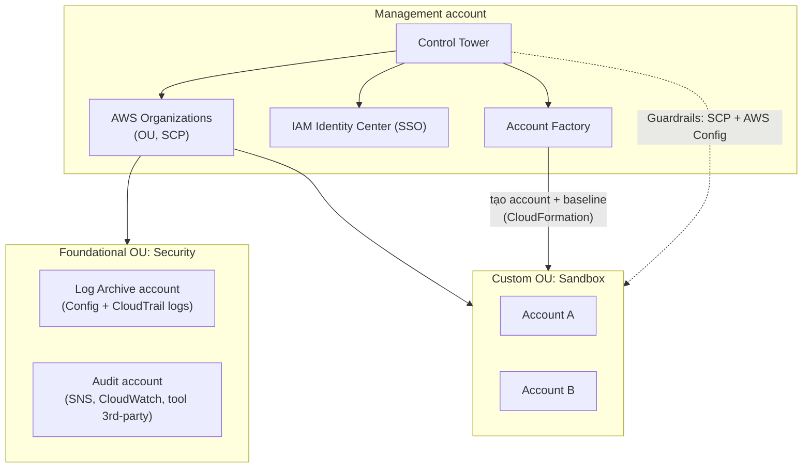

# AWS Control Tower

> **TL;DR:** Control Tower giúp dựng nhanh một môi trường **multi-account** chuẩn, có quản trị. Nó không thay [[AWS Organizations]] mà **điều phối** Organizations, IAM Identity Center, CloudFormation, AWS Config, CloudTrail, CloudWatch, SNS... để cung cấp **Landing Zone**, **Guardrails**, **Account Factory** và **Dashboard**. Có thể coi nó là "Organizations với superpowers".

## 🖼️ Sơ đồ
![[AWS Control Tower.excalidraw]]
*Mở bằng plugin Excalidraw để chỉnh sửa · ảnh tĩnh: [[AWS Control Tower.svg]]*

![[AWS Control Tower - guardrails.excalidraw]]
*Mở bằng plugin Excalidraw để chỉnh sửa · ảnh tĩnh: [[AWS Control Tower - guardrails.svg]]*

## Khái niệm cốt lõi
Bốn thành phần chính:
1. **Landing Zone** – phần môi trường multi-account (phần người dùng tương tác nhiều nhất). Cung cấp SSO + ID federation (qua **IAM Identity Center**, tên cũ AWS SSO) và logging/audit tập trung (CloudWatch, [[CloudTrail]], [[AWS Config]], [[SNS]]).
2. **Guardrails** – quy tắc governance áp lên mọi account trong landing zone, để **phát hiện** hoặc **bắt buộc** chuẩn mực.
3. **Account Factory** – tự động hóa và chuẩn hóa việc tạo account.
4. **Dashboard** – một trang tổng quan cho toàn bộ tổ chức.

## Cách hoạt động / Kiến trúc
- Control Tower được bật từ một account → account đó trở thành **management account** của landing zone. Trong đó có: Control Tower (điều phối), AWS Organizations (OU + [[Service Control Policies|SCP]]), IAM Identity Center (SSO).
- Khi setup, mặc định tạo **2 OU**:
  - **Foundational OU** – tên mặc định **Security**, chứa 2 account:
    - **Log Archive**: lưu log tập trung của mọi account đã enroll (AWS Config, CloudTrail...). Tách biệt, phải cấp quyền tường minh, là kho log **read-only** an toàn.
    - **Audit**: cho người cần thông tin audit; nơi đặt công cụ audit bên thứ ba; dùng SNS thông báo thay đổi về governance/security policy và CloudWatch theo dõi metric toàn landing zone.
  - **Custom OU** – tên mặc định **Sandbox**: thường cho môi trường test, ít ràng buộc bảo mật hơn.
- **Account Factory** tạo account (tự động hoàn toàn) trong các OU custom, áp **cấu hình baseline** (cookie-cutter) cho account và network.
- Bên dưới, Control Tower dùng **CloudFormation** để tự động hóa (sẽ thấy các stack do nó tạo) và dùng **AWS Config + SCP** để thực thi guardrails.

### Landing Zone
- Mục tiêu: ai cũng dựng được môi trường multi-account **well-architected**.
- **Home region**: region triển khai ban đầu (ví dụ `us-east-1`), luôn dùng được; các region khác có thể cho phép/chặn tường minh.
- Ngoài Security và Sandbox, có thể tạo thêm OU/account (kể cả OU lồng nhau) cho cấu trúc thực tế.
- SSO qua IAM Identity Center, hỗ trợ **ID federation** (dùng identity store sẵn có của công ty).
- Giám sát/thông báo bằng CloudWatch + SNS; người dùng cuối có thể tự cấp account mới qua **Service Catalog**.

### Guardrails
- **Theo mức độ áp dụng:** *Mandatory* (luôn bật), *Strongly recommended* (AWS khuyến nghị mạnh), *Elective* (tùy chọn, cho yêu cầu đặc thù).
- **Theo cách hoạt động:**

| | Preventative | Detective |
|---|---|---|
| Làm gì | **Ngăn** hành động xảy ra | **Phát hiện** cấu hình lệch chuẩn (compliance check) |
| Cơ chế | **SCP** (AWS Organizations) | **AWS Config rules** |
| Trạng thái | *Enforced* / *Not enabled* | *Clear* / *In violation* / *Not enabled* |
| Ví dụ | Cấm dùng một số region; cấm sửa bucket policy | Kiểm tra CloudTrail có bật không; EC2 nào có public IPv4 |

> Khóa học gọi là *guardrails*; hiện nay AWS đổi tên thành **controls** và có thêm loại **proactive** (dùng CloudFormation Hooks kiểm tra tài nguyên *trước khi* tạo). Về bản chất preventative/detective vẫn như trên.

### Account Factory
- **Automated account provisioning** — do cloud admin hoặc **end user** (có quyền phù hợp) thực hiện, qua Control Tower console hoặc Service Catalog.
- **Guardrails tự động áp** lên account mới.
- Quyền **admin account** cấp cho một **named user** (qua IAM Identity Center) → self-service nhưng trong giới hạn kiểm soát chặt.
- **Cấu hình chuẩn cho account và network**, ví dụ dải IP VPC được cấp tự động để **tránh chồng lấn địa chỉ** — rất quan trọng khi tạo account ở quy mô lớn (xem [[VPC Sizing and Structure]]).
- Account có thể **đóng** hoặc **tái sử dụng (repurpose)**; dài hạn hoặc ngắn hạn.
- Tích hợp vào **SDLC** của doanh nghiệp qua API (ví dụ tự tạo account cho một giai đoạn phát triển, demo khách hàng, kiểm thử).

## Bảng so sánh / số liệu

| | [[AWS Organizations]] | AWS Control Tower |
|---|---|---|
| Vai trò | Cấu trúc multi-account: OU, SCP, consolidated billing | Điều phối nhiều dịch vụ (gồm Organizations) để dựng landing zone chuẩn |
| Tạo account | Tạo thủ công/API, không có baseline | Account Factory: tự động, baseline account + network, guardrails |
| Logging/audit tập trung | Phải tự dựng (ví dụ organization trail) | Có sẵn: Log Archive + Audit account |
| SSO | Không tự có | IAM Identity Center được dựng sẵn |
| Governance | SCP (chỉ ngăn chặn) | Guardrails preventative (SCP) + detective (Config) |

## 🎯 Mẹo thi SAA-C03
- Đề nói **"quickly set up / govern a secure multi-account environment"**, "landing zone", "best practices across many accounts" → **Control Tower**.
- Control Tower **dùng** Organizations, IAM Identity Center, CloudFormation, Config, CloudTrail, CloudWatch, SNS — nó không thay thế mà điều phối các dịch vụ này.
- **Preventative guardrail = SCP**, **detective guardrail = AWS Config**. Preventative *chặn*, detective chỉ *phát hiện*.
- Account mặc định: **Log Archive** (log tập trung, read-only) và **Audit** trong **Security OU**; **Sandbox OU** cho test.
- Tự phục vụ tạo account cho end user, có chuẩn hóa → **Account Factory** (qua Service Catalog).
- Cần tránh trùng CIDR VPC khi tạo nhiều account → Account Factory có network baseline.

## Liên kết
- Tiên quyết: [[AWS Organizations]], [[Service Control Policies]], [[AWS Accounts]]
- Dùng cùng: [[CloudTrail]], [[AWS Config]], [[CloudWatch Logs]], [[SNS]], [[CloudFormation Basics]], [[CFN StackSets]]
- Liên quan: [[IAM Roles]], [[VPC Sizing and Structure]], [[Directory Service]]
- Section: [[_MOC 04 IAM Accounts and Organizations]]
