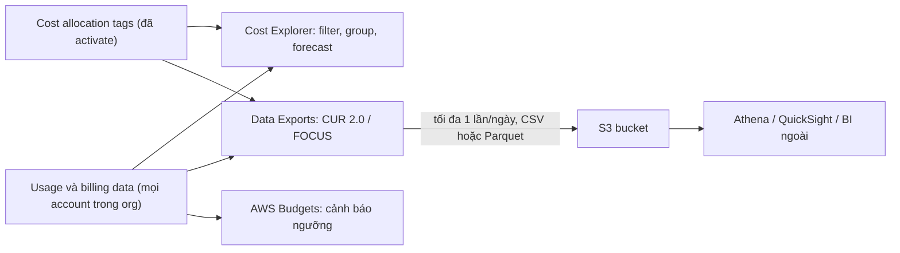

# AWS Cost Management

> **TL;DR:** Ba công cụ quản lý chi phí cần biết, đều nằm trong **Billing and Cost Management** (global; có Organizations thì xem tập trung ở **management account**): **Cost Explorer** để xem, lọc, group và **dự báo** chi phí trên console (monthly/daily miễn phí, **hourly có phí**); **Data Exports** với **CUR 2.0** (Cost and Usage Report) cho dữ liệu billing **chi tiết nhất**, giao **tối đa 1 lần/ngày** vào **S3** dạng **CSV hoặc Parquet** để phân tích bằng Athena, QuickSight hay công cụ BI; và **cost allocation tags** (user-defined + `aws:createdBy`) phải **activate** mới dùng được, giúp biết chi phí thuộc môi trường, dự án, phòng ban nào. Muốn cảnh báo khi sắp vượt ngưỡng thì dùng [[AWS Budgets]].

## 🖼️ Sơ đồ
![[AWS Cost Management.excalidraw]]
*Mở bằng plugin Excalidraw để chỉnh sửa · ảnh tĩnh: [[AWS Cost Management.svg]]*

## Khái niệm cốt lõi
- Môi trường AWS lớn hay nhỏ đều có chi phí phải trả: DBA tưởng vẫn đang dùng free tier, sysadmin, cloud ops… Dù không trực tiếp trả hóa đơn, hiểu chi phí của thứ mình triển khai là **kỹ năng cần có** với mọi vai trò.
- Khi đã có [[AWS Organizations]], không cần vào từng account để xem chi phí: **management account** thấy chi phí của mọi **linked account** (consolidated billing). Billing preferences còn có thêm thiết lập cấp organization, ví dụ có chia sẻ RI giữa các account không.

### 1. Cost Explorer
- Cách đơn giản để xem chi tiết chi phí: dùng **filter** và **dimension** để **group** hoặc chỉ xem một số service, region, **linked account**, **tag**…
- **Granularity**: **monthly**, **daily**; bật thêm được **hourly** nhưng **có phí**.
- Xem chi phí **hiện tại và quá khứ**, và **forecast** (dự báo) cho 1, 2, 3 tháng tới… dựa trên dữ liệu lịch sử; càng nhiều dữ liệu thì dự báo càng tốt.
- **Cost Explorer preferences** (trong Cost Management Preferences):
  - **Multi-year data at monthly granularity**: giữ tới **38 tháng** → **miễn phí**. Nên bật để sau một hai năm vẫn trả lời được "hóa đơn đó do đâu".
  - **Resource-level data at daily granularity**: chi phí theo **từng resource** → **miễn phí**.
  - **Hourly granularity** (kể cả resource-level): **tính phí theo số record**, console ước tính chi phí hằng tháng trước khi lưu. Hữu ích khi cần biết từ 17 giờ tới 18 giờ thứ gì tốn nhất.
- Mẹo dùng: luôn kiểm tra **date range** trước (mặc định có thể không phải khoảng bạn nghĩ; "month to date" hay dùng), có thể **Save to report** để mở lại cấu hình hay dùng.

### 2. Data Exports và Cost and Usage Report (CUR)
- Dùng khi cần thông tin **cực kỳ chi tiết** về chi phí và mức sử dụng: **từng resource, usage type, tag, giá** (trả tiền storage hay network, bao nhiêu request S3…).
- Trước đây gọi là **Cost and Usage Reports (CUR)**, nay vẫn còn ở mục **Legacy pages**. Cách mới là **Data Exports**, có **CUR 2.0**.
- Giao **tối đa 1 lần mỗi ngày** vào **S3 bucket** bạn chọn (console tự tạo bucket policy cấp quyền ghi). Bản export đầu tiên có thể mất **tới 24 giờ**.
- Định dạng: **CSV (nén gzip)** hoặc **Parquet** (dạng cột, phù hợp khi đích phân tích hỗ trợ, ví dụ [[Athena]]).
- Phân tích bằng **Athena**, **QuickSight** hoặc công cụ BI ngoài AWS (on-prem, cloud khác).
- **Loại export** khi tạo: **Standard data export** (kiểm soát nhiều nhất, tự xử lý bằng Athena hoặc tool riêng), **Cost and usage dashboard** (dựng nhanh dashboard bằng QuickSight), **Legacy CUR export** (ít tính năng hơn).
- **Nội dung bảng dữ liệu**: **CUR 2.0** (mặc định), **FOCUS** (FinOps Open Cost and Usage Specification, chuẩn đa cloud), **cost optimization recommendations** (rightsizing, chỗ tiết kiệm được), **carbon emissions**.
- Tùy chọn: **include resource IDs** (xuống tới từng resource), thêm dữ liệu riêng cho ECS/EKS, Bedrock, EC2 capacity reservation; **time granularity** hourly / daily / monthly. Bên dưới, AWS chạy một **truy vấn SQL** hằng ngày trên bảng dữ liệu của AWS theo các cột bạn chọn.
- Sau khi tạo gần như **không sửa được** cấu hình dữ liệu; muốn đổi granularity hay cột thì **xóa và tạo lại**.

### 3. Cost allocation tags
- Gắn **tag** cho tài nguyên để biết **ai phải trả** hoặc chi phí **thuộc về đâu**: môi trường (prod/dev/test), dự án, **cost center**, phòng ban…
- Hai loại:
  - **User-defined tags**: do bạn tạo, ví dụ `Environment`, `Project`, `CostCenter`, `Company`.
  - **AWS-generated tag** `aws:createdBy`: tag chính thức duy nhất do AWS tạo, cho biết **ai đã tạo** tài nguyên; **không tính vào quota** tag.
- **Không tự bật**: sau khi gắn tag phải **đợi** tag xuất hiện trong mục **Cost allocation tags** (Billing and Cost Management → Cost organization; có thể tới **một ngày**), rồi **Activate** những tag muốn dùng. Có Organizations thì làm ở **management account**.
- Sau khi activate, tag dùng được trong **Cost Explorer** (group by / filter theo tag) và trong **Data Exports (CUR)**. Cũng phải đợi thêm một thời gian mới thấy dữ liệu.
- **Backfill**: áp tag đã activate cho dữ liệu chi phí của **các tháng trước**, chỉ có tác dụng với tài nguyên **đã có tag đó** ở thời điểm phát sinh chi phí (gắn tag hôm nay không làm dữ liệu cũ có tag).
- Giới hạn (lúc quay bài): tối đa **500** tag active, mỗi lần chỉ activate được **20** tag.
- Gắn tag hàng loạt: **Tag Editor** hoặc **Resource Explorer**.

## Cách hoạt động / Kiến trúc

- **Cost Explorer** trả lời nhanh trên console: tiền đi đâu, theo service/region/account/tag nào, xu hướng và dự báo.
- **Data Exports (CUR)** là "bức tường chữ" chi tiết nhất, đưa sang công cụ phân tích của bạn.
- **Cost allocation tags** là lớp ngữ nghĩa do con người thêm vào, dùng được ở cả hai công cụ trên.

## Bảng so sánh / số liệu

| | **Cost Explorer** | **Data Exports (CUR 2.0)** | **Cost allocation tags** | [[AWS Budgets]] |
|---|---|---|---|---|
| Mục đích | Xem, lọc, group, **dự báo** trên console | Dữ liệu **chi tiết nhất** để phân tích ngoài | Gắn chi phí với env / dự án / phòng ban | **Cảnh báo** khi chạm / dự báo vượt ngưỡng |
| Đầu ra | Biểu đồ, bảng, saved report | File **CSV (gzip) / Parquet** trong **S3** | Dimension trong Cost Explorer và CUR | Email / SNS |
| Tần suất | (Bài không nói) | Tối đa **1 lần/ngày** (lần đầu tới 24 giờ) | Phải chờ hiện ra rồi **activate** | Theo chu kỳ budget |
| Chi phí | Monthly/daily miễn phí; **hourly có phí** | Trả phí lưu S3, công cụ phân tích | Miễn phí | (Xem note Budgets) |

| Con số | Giá trị |
|---|---|
| Multi-year data (monthly) trong Cost Explorer | Tới **38 tháng**, miễn phí |
| Tag active tối đa (lúc quay bài) | **500**; activate **20** tag mỗi lần |
| Data export refresh | Tối đa **1 lần/ngày** |

## Demo / Lab
**Cost Explorer** (management account General)
1. Billing and Cost Management → **Cost Management Preferences** → Cost Explorer: bật **multi-year data at monthly granularity** (38 tháng) và **resource-level data at daily granularity** (cả hai miễn phí); hourly là tùy chọn có phí, console ước tính chi phí theo số record.
2. Billing preferences: có thêm thiết lập do có organization (ví dụ chia sẻ RI giữa các account).
3. Cost Explorer: chọn **date range** (last 7 days, month to date, hoặc từ tháng 2 tới nay), đổi granularity monthly / daily, lọc **linked account** để xem account nào tốn nhất.
4. Bật **forecast** (monthly) để xem dự báo các tháng tới.
5. Group by **region**, lọc chỉ **EC2**, **Save to report** (ví dụ "month to date EC2").

**Data Exports / CUR** (tùy chọn, phải chờ tới 24 giờ)
1. Billing and Cost Management → **Data Exports** (bản cũ ở Legacy pages → Cost and Usage Reports) → **Create**.
2. Chọn **Standard data export**, tên ví dụ `AusEMart-Billing-CUR`, bảng **CUR 2.0**, billing view mặc định, tick **Include resource IDs**, time granularity **hourly**.
3. Định dạng: Parquet (cho Athena…) hoặc **gzip CSV** (demo chọn CSV để mở bằng text editor).
4. Đích: tạo bucket S3 mới (console tự tạo bucket policy), prefix `CUR` → Create.
5. Hôm sau: trong bucket có `data/BILLING_PERIOD=<năm-tháng>/…csv.gz`; giải nén thấy các cột billing period, người được xuất hóa đơn, bill ID, thời gian, discount, tiền tệ, product, SKU…
6. Muốn đổi cột/granularity thì xóa export và tạo lại.

**Cost Allocation Tags** (quay qua nhiều ngày)
1. Gắn tag cho tài nguyên trong Production (EC2, RDS…): ví dụ `Company`, `Environment`, `Project`, `CostCenter`.
2. Về management account → Billing and Cost Management → **Cost allocation tags**: đợi tag hiện ra, chọn và **Activate**; activate cả `aws:createdBy`.
3. **Backfill tags** cho tháng trước nếu tài nguyên đã mang tag từ trước.
4. Hôm sau, Cost Explorer: group by **tag** (ví dụ CostCenter thấy phần lớn chi phí là của HR, có phần "No tag" cần xử lý) hoặc filter theo tag (ví dụ chỉ dự án `Aus1`, ứng dụng HR giả lập của Aus-E-Mart, thấy chi phí RDS và EC2).

## 🎯 Mẹo thi SAA-C03
- "Xem, lọc, group, **dự báo** chi phí trên console" → **Cost Explorer**. Cần độ chi tiết **theo giờ** → bật hourly (có phí).
- "Dữ liệu chi phí và usage **chi tiết nhất**", "đưa vào **Athena / QuickSight / công cụ BI**" → **Cost and Usage Report (CUR 2.0)** qua **Data Exports** → S3 (CSV hoặc **Parquet**).
- "Phân bổ chi phí theo **phòng ban / dự án / cost center**", "chargeback" → **cost allocation tags**; nhớ phải **activate** (ở management account) mới thấy trong báo cáo.
- "Biết ai đã tạo tài nguyên" trong billing → tag `aws:createdBy`.
- "Cảnh báo khi chi phí sắp vượt X" → [[AWS Budgets]], không phải Cost Explorer.
- Có [[AWS Organizations]] → xem chi phí mọi account tập trung ở **management account** (consolidated billing, lọc theo linked account).

## Liên kết
- Tiên quyết: [[AWS Budgets]], [[AWS Organizations]]
- Liên quan: [[Athena]], [[S3 Basics]], [[Reserved Instances and Savings Plans]], [[EC2 Purchase Options]]
- MOC: [[_MOC 04 IAM Accounts and Organizations]]
