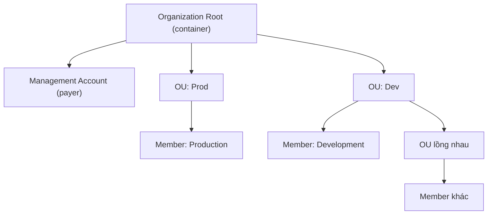
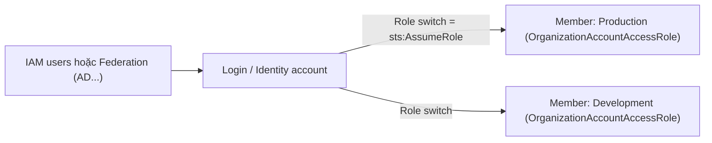

# AWS Organizations

> **TL;DR:** AWS Organizations quản lý **nhiều AWS account** tập trung: gom account vào một cây phân cấp (root → OU → account), **consolidated billing** (một hóa đơn, một payment method, gộp mức giảm giá), áp **SCP** để giới hạn account, và tạo account mới trực tiếp trong tổ chức. Mô hình đăng nhập chuẩn: một account chứa identity, rồi **role switch** (assume role) sang các account khác.

## 🖼️ Sơ đồ
![[AWS Organizations.excalidraw]]
*Mở bằng plugin Excalidraw để chỉnh sửa · ảnh tĩnh: [[AWS Organizations.svg]]*

![[AWS Organizations - role-switch.excalidraw]]
*Mở bằng plugin Excalidraw để chỉnh sửa · ảnh tĩnh: [[AWS Organizations - role-switch.svg]]*

## Khái niệm cốt lõi

### Vấn đề cần giải quyết
- Doanh nghiệp lớn có hàng chục đến hàng trăm account. Không có Organizations thì mỗi account có **bộ IAM user riêng** và **payment method riêng**; quá 5–10 account là khó quản lý.

### Các loại account
- **Standard account**: account không thuộc organization nào.
- Dùng một standard account để **tạo** organization. Organization không nằm "trong" account đó; account chỉ được dùng để tạo nó. Account này trở thành **management account** (trước đây gọi là **master account**, slide vẽ vương miện).
- Mỗi organization có **đúng một** management account và **0 hoặc nhiều member account**.
- Đưa account vào organization bằng hai cách:
  - **Invite** account có sẵn: account đó phải **chấp nhận** lời mời, sau đó standard account trở thành **member account**.
  - **Create** account mới trực tiếp trong organization: chỉ cần **email duy nhất**, không có bước invite/accept.

### Cấu trúc phân cấp (inverted tree)
- Đỉnh cây là **organization root**, một **container** chứa account và OU.
- **Organizational Unit (OU)**: container chứa account (member hoặc management) và **OU khác**, nên có thể lồng nhiều cấp. Dùng để nhóm account theo business unit, chức năng, hoặc giai đoạn phát triển (dev/test/prod).
- ⚠️ **Organization root ≠ account root user.** Account root user là user admin của một account, đăng nhập được, toàn quyền trên account đó. Organization root chỉ là container đỉnh của cây.

### Consolidated billing
- Khi vào organization, **payment method của member account bị gỡ bỏ**; member account chuyển chi phí lên management account.
- Trong ngữ cảnh billing, management account còn gọi là **payer account**. *Master = management = payer account* đều chỉ cùng một account.
- Kết quả: **một hóa đơn hàng tháng** cho toàn bộ account, giảm mạnh công việc tài chính.
- **Gộp lợi ích giá**: nhiều dịch vụ rẻ hơn khi dùng nhiều (volume tier), và các hình thức trả trước để có giá thấp (ví dụ [[Reserved Instances and Savings Plans]]) được **pool** cho cả organization.

### Service Control Policies
- Organization có thể dùng **SCP** để **giới hạn** những gì account trong tổ chức được làm. Xem [[Service Control Policies]].

### Best practice đăng nhập và quyền
- Với Organizations, **không cần IAM user ở mọi account**. Dùng [[IAM Roles]] để identity trong một account truy cập account khác.
- Mô hình: **một account duy nhất chứa identity để đăng nhập**. Có thể là management account, nhưng doanh nghiệp lớn thường giữ management account "sạch" và dùng **một account riêng chuyên cho login**.
- Identity trong account đó có thể là IAM user, hoặc identity on-premises qua **Identity Federation**.
- Từ account login, **role switch** sang các member account. Thực chất là **assume role** trong account đích; console UI che bớt chi tiết kỹ thuật.

## Bảng so sánh / số liệu
| | Invite account có sẵn | Create account trong org |
|---|---|---|
| Quy trình | Gửi invite (email hoặc account ID) → account kia **accept** | Một bước, chỉ cần tên + **email duy nhất** |
| Role `OrganizationAccountAccessRole` | **Phải tạo thủ công** trong account được mời | **AWS tự tạo**, trust management account |
| Truy cập ban đầu | Đã có identity riêng (root, IAM user) | Thường chỉ vào được bằng **role switch** |

- Có thể gặp lỗi "too many accounts" khi invite/create vì quota số account khác nhau giữa các account; khi đó mở support request để tăng quota.

## Demo / Lab
**0078 – Part 1 (tạo organization, mời Production)**
1. Đăng nhập `iamadmin` của **General** (us-east-1) → Organizations console → **Create organization**. General thành **management account**. Nếu có thông báo thì xác minh email của management account.
2. Mở trình duyệt/session riêng, đăng nhập `iamadmin` của **Production**, copy account ID.
3. Ở General: **Add account → Invite account**, nhập account ID (hoặc email) của Production → Send invitation.
4. Ở Production: Organizations → **Invitations** → **Accept**. Refresh ở General: thấy 2 account.

**0079 – Part 2 (role switch, tạo Development)**
1. Vì Production được **invite**, phải tạo role thủ công: IAM → Roles → Create role → trusted entity **Another AWS account** = account ID của **General** → attach **AdministratorAccess** → tên **`OrganizationAccountAccessRole`** (viết hoa O, A, A, R, chính tả Mỹ có chữ "z"). Tab *Trust relationships* cho thấy role trust account General.
2. Ở General (đăng nhập bằng IAM identity, role switch không dùng được với root): menu account → **Switch role** → account ID Production + tên role + display name `prod` + màu **đỏ**. Thanh trên đổi màu = đang ở account Production bằng credentials tạm thời (gọi `AssumeRole`). **Switch back** để quay lại. Shortcut nằm trong **role history** (lưu ở trình duyệt, không phải trong AWS).
3. **Create account** trong organization: tên Development, email duy nhất (mẹo `ten+...@gmail.com`), tên role mặc định `OrganizationAccountAccessRole`. Tạo mất vài phút.
4. Switch role sang Development (display `dev`, màu **vàng**). Có thể chuyển trực tiếp giữa các account bằng shortcut. Trong IAM của Development đã có sẵn `OrganizationAccountAccessRole` trust account General.
5. Kết quả cấu trúc khóa học: **General (management)**, **Production (member, invited)**, **Development (member, created)**.

## 🎯 Mẹo thi SAA-C03
- "Nhiều account, cần **một hóa đơn duy nhất**" → AWS Organizations + **consolidated billing**.
- Management = master = payer account. Chỉ có **một** management account mỗi organization.
- Member account **không còn payment method riêng**.
- Lợi ích giảm giá theo volume và giá trả trước (RI, Savings Plans) được **chia sẻ** trong organization.
- Account tạo trong org có sẵn `OrganizationAccountAccessRole`; account được invite thì phải tự tạo role này.
- Truy cập nhiều account: **một account identity + role switch (assume role)**, không tạo IAM user ở mọi account.
- Đừng nhầm **organization root** (container) với **account root user**.
- Giới hạn quyền của account trong org → [[Service Control Policies]]. Thiết lập multi-account tự động theo best practice → [[AWS Control Tower]].

## Liên kết
- Tiên quyết: [[AWS Accounts]], [[IAM Roles]]
- Đi sâu: [[Service Control Policies]], [[AWS Control Tower]], [[CloudTrail]] (organization trail)
- Liên quan: [[Reserved Instances and Savings Plans]], [[AWS Budgets]], [[CFN StackSets]], [[IAM Basics]]
- Phân biệt với: [[IAM Groups]] (nhóm *user* trong một account; OU nhóm *account*)
- MOC: [[_MOC 04 IAM Accounts and Organizations]]
