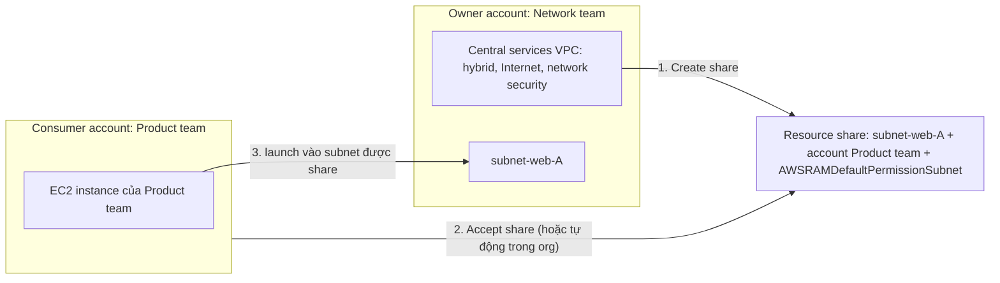

# AWS Resource Access Manager

> **TL;DR:** **RAM** (AWS Resource Access Manager) cho phép **chia sẻ quyền dùng** một tài nguyên bạn sở hữu với account khác, **không tạo bản sao**: "tạo một lần, chia sẻ, owner vẫn giữ quyền kiểm soát". Bạn tạo **resource share** gồm **resource** (subnet, Transit Gateway, dedicated host, Aurora cluster, prefix list…; không phải mọi thứ, ví dụ **không có S3 bucket, secret**), **principal** (account, OU, cả organization; vài loại cho IAM user/role) và **permission** (AWS managed hoặc customer managed). Principal phải **accept** lời mời, trừ khi bật **sharing with AWS Organizations** ở management account (bắt buộc nếu muốn share cho OU). RAM là **regional**, **miễn phí**, thành viên org **động** (vào là có, rời là mất), và **không re-share** được. Khác **CloudFormation StackSets** (tạo **bản sao** ở từng account).

## 🖼️ Sơ đồ
![[AWS Resource Access Manager.excalidraw]]
*Mở bằng plugin Excalidraw để chỉnh sửa · ảnh tĩnh: [[AWS Resource Access Manager.svg]]*

## Khái niệm cốt lõi

### Vấn đề
- **Multi-account** là best practice: doanh nghiệp lớn thường có account riêng cho từng team, từng môi trường.
- Account là **ranh giới cô lập**: kể cả khi quản lý bằng [[AWS Organizations]], tài nguyên ở account này mặc định **không dùng được** từ account khác.
- Cách cũ: dùng tính năng chia sẻ riêng của từng dịch vụ (nếu có), hoặc **tạo bản sao** ở mỗi account → tốn thêm chi phí, thêm việc quản trị, dễ **lệch best practice (drift)**.

### RAM làm gì
- **Chia sẻ tài nguyên bạn sở hữu** với account khác: cấp **quyền truy cập từ bên ngoài** vào tài nguyên trong account của bạn, **không copy, không nhân bản**.
- Đơn vị cấu hình là **resource share**, gồm 3 thứ:
  1. **Resource**: chia sẻ cái gì.
  2. **Principal**: chia sẻ cho ai.
  3. **Permission**: họ được làm gì với tài nguyên đó.

| Thành phần | Chi tiết |
|---|---|
| **Resource** | Chỉ một **tập con** dịch vụ hỗ trợ, ví dụ **subnet**, **[[Dedicated Hosts\|dedicated host]]**, **[[Aurora]] cluster**, **[[Transit Gateway]]**, **prefix list**… **Không** có S3 bucket, secret, quyền truy cập account: nhiều dịch vụ đã có **cơ chế chia sẻ riêng** |
| **Principal** | **Account cụ thể**, **OU**, hoặc **cả organization**; một số resource còn cho share với **IAM role, IAM user**. Mỗi dịch vụ hỗ trợ khác nhau |
| **Permission** | **AWS managed permission** mặc định (ví dụ với subnet: chạy instance, tạo network interface; tên `AWSRAMDefaultPermissionSubnet`) hoặc **customer managed permission** tự định nghĩa |

### Chấp nhận share
- Mặc định: resource share được gửi như một **lời mời (invitation)** tới principal; account được mời **phải accept**.
- Có Organizations: từ **management account**, vào RAM bật **sharing with AWS Organizations** → principal trong organization **tự động** có quyền, không cần accept.
- Thiết lập này **bắt buộc** nếu muốn share cho một **OU**. Không bật mà tạo share cho OU → **lỗi** khi tạo share.

## Cách hoạt động / Kiến trúc

Ví dụ Aus-E-Mart: một organization có **account của Network team** (owner) và **account của Product team** (đang làm ứng dụng HR nội bộ).

1. Network team có **central services VPC** đầy đủ: kết nối hybrid, Internet, bảo mật mạng, theo best practice.
2. Product team tự quản lý dịch vụ của mình nhưng **cần mạng**; không nên dựng lại toàn bộ kết nối mà network team đã quản lý tập trung.
3. Network team tạo **resource share**: resource = một **subnet**, principal = account của Product team, permission = managed permission mặc định cho subnet.
4. Product team **accept** share (hoặc tự động nếu bật organization sharing) và **thấy subnet đó như subnet của chính mình**: launch được EC2 vào subnet.
5. **Owner giữ toàn quyền kiểm soát**: VPC, subnet, route table, NACL, các dịch vụ mạng vẫn do Network team quản lý. RAM **không chuyển quyền kiểm soát**.
6. EC2 do Product team tạo là **của Product team** (consumer), chỉ kết nối vào mạng của owner. Owner **không có quyền** gì trên instance đó.

## Bảng so sánh / số liệu

| | **AWS RAM** | [[CFN StackSets\|CloudFormation StackSets]] |
|---|---|---|
| Bản chất | **Chia sẻ** một tài nguyên duy nhất | **Triển khai** template tạo **bản sao** ở từng account đích |
| Số bản tài nguyên | **Một**, mọi account dùng chung | Mỗi account một bản |
| Ai kiểm soát | Owner account | Mỗi account có tài nguyên riêng |

| Đặc điểm | Giá trị |
|---|---|
| Phạm vi | **Regional**: share tạo ở region nào thì consumer thấy và accept ở region đó (share subnet ở `ap-southeast-2` thì tạo share ở `ap-southeast-2`) |
| Chi phí | **Miễn phí**; chỉ trả tiền tài nguyên bên dưới như bình thường (còn tiết kiệm nhờ không phải nhân bản) |
| Thành viên org | **Động**: account mới vào org / vào OU được share → tự có quyền; rời org → **mất quyền ngay** |
| Re-share | **Không**: tài nguyên được share cho bạn thì bạn không share tiếp được; quyền luôn do **account sở hữu** cấp |
| Ngoài organization | Vẫn share được cho account ngoài org (qua lời mời) |

## 🎯 Mẹo thi SAA-C03
- "Nhiều account cần dùng **chung một** subnet / Transit Gateway / dedicated host / Aurora cluster / prefix list, **không nhân bản**" → **AWS RAM**.
- Mô hình **VPC sharing**: network team sở hữu VPC trung tâm, share **subnet** cho account ứng dụng; account ứng dụng tạo EC2 trong subnet đó nhưng **không** sửa được route table, NACL; owner **không** quản lý được EC2 của họ.
- Share cho **OU** hoặc muốn **tự động accept** trong organization → bật **sharing with AWS Organizations** ở **management account**.
- RAM = **chia sẻ**, StackSets = **sao chép**. Nhớ câu: "you are sharing access to a resource, not copying resources".
- RAM **regional**, **miễn phí**, **không re-share** được; account rời org mất quyền ngay.
- S3 bucket, secret **không** share bằng RAM (dùng cơ chế riêng như bucket policy, resource policy).

## Liên kết
- Tiên quyết: [[AWS Organizations]], [[Custom VPC]]
- Liên quan: [[Transit Gateway]], [[Dedicated Hosts]], [[Aurora]], [[VPC Sizing and Structure]], [[S3 Security]] (S3 dùng bucket policy để chia sẻ)
- Phân biệt với: [[CFN StackSets]] (tạo bản sao ở nhiều account), [[IAM Roles]] (cross-account role: truy cập *account khác*, không phải dùng chung tài nguyên)
- MOC: [[_MOC 04 IAM Accounts and Organizations]]
