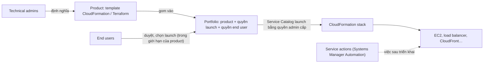

# AWS Service Catalog

> **TL;DR:** AWS Service Catalog là **cổng self-service** cho end user (kể cả người không rành kỹ thuật như sales, HR, finance) tự **launch các product dựng sẵn** do technical admin định nghĩa. Admin viết product bằng **CloudFormation hoặc Terraform**, gom vào **portfolio**, kèm **quyền để tạo hạ tầng** (giống stack role) và **quyền của end user** (ai được xem, ai được launch). End user không cần quyền hạ tầng AWS; Service Catalog dùng quyền admin cấp để tạo stack. Đây là dịch vụ **regional**. Đề hỏi "cho người dùng tự triển khai hạ tầng chuẩn, nhanh nhưng có kiểm soát chặt" → Service Catalog.

## 🖼️ Sơ đồ
![[AWS Service Catalog.excalidraw]]
*Mở bằng plugin Excalidraw để chỉnh sửa · ảnh tĩnh: [[AWS Service Catalog.svg]]*

## Khái niệm cốt lõi

### Vấn đề cần giải quyết
- Bob ở help desk nhận đủ loại yêu cầu: dựng storefront chung trên EC2, một database thật bảo mật cho app mới, SageMaker cho môi trường test AI/ML… Yêu cầu càng nhiều thì càng hỗn loạn.
- Mỗi yêu cầu đều phải **bảo mật**, **chuẩn hóa**, **tuân thủ** (compliance nội bộ hoặc bên ngoài), và ai cũng muốn **nhanh**.
- Mục tiêu: đưa **giải pháp chuẩn** tới người dùng một cách **an toàn, có kiểm soát và kịp thời**.

### Service catalog nói chung (khái niệm IT)
- Là một **tài liệu hoặc database**, thường do IT tạo (nhưng HR, finance hay phòng ban nào cũng có thể tạo), chứa **danh sách có tổ chức các product/dịch vụ** mà một team cung cấp cho phần còn lại của doanh nghiệp.
- Hay dùng khi doanh nghiệp theo **mô hình service-oriented**: phòng ban này dùng dịch vụ của phòng ban kia, đôi khi **tính phí chéo** (HR tính phí tuyển dụng và onboarding, finance tính phí xử lý lương hằng tháng, security tính phí làm thẻ nhân viên).
- Mỗi product cần kèm thông tin: **chủ sở hữu và trách nhiệm**, tên, mô tả, phân loại, loại yêu cầu liên quan, hỗ trợ đi kèm, **SLA**, **ai được xem/được yêu cầu**, **chi phí**, cách yêu cầu, cách bàn giao, đầu mối escalation, **quy trình phê duyệt**.
- Tác dụng: quản lý chi phí và cung cấp dịch vụ ở **quy mô lớn**, vì mọi thứ về product đã được định nghĩa sẵn.

### AWS Service Catalog
- **Self-service portal cho end user**: người dùng không phải admin, không có quyền đặc biệt, thậm chí không rành kỹ thuật, tự **launch product dựng sẵn**.
- **Technical admin** định nghĩa product bằng **CloudFormation** hoặc **Terraform** cùng cấu hình của Service Catalog (xem [[CloudFormation Basics]]).
- Admin định nghĩa hai loại quyền:
  - **Quyền để tạo hạ tầng** mà product cần (ví dụ được launch EC2). Quyền này nằm trong product/portfolio, có thể hiểu **giống stack role** của CloudFormation (xem [[CFN Stack Roles]]).
  - **Quyền của end user**: ai được **thấy** product, ai được **launch**.
- **Product** được gom vào **portfolio**; portfolio là cách product được **hiển thị** cho end user.
- Ví dụ trong bài: công ty hosting chuyên blog ảnh động vật (mèo, chó, thỏ, gà…). Team sales cần tự dựng một bản blog cho khách để demo hoặc chạy pilot, nhưng **không nên có quyền hạ tầng AWS** và công ty muốn kiểm soát chính xác cách triển khai → đưa blog thành product trong Service Catalog.

## Cách hoạt động / Kiến trúc

1. Service Catalog là dịch vụ **regional**: cấu hình và triển khai trong từng region có hỗ trợ (ví dụ `us-east-1`); portfolio có thể được đưa ra các region có hỗ trợ.
2. **Technical admin** viết template (CloudFormation hoặc Terraform) đại diện cho bản triển khai hoàn chỉnh, rồi thêm vào Service Catalog thành **product**, gom thành **portfolio**.
3. Product/portfolio chứa **quyền cần thiết để tạo hạ tầng** và **quyền của end user**.
4. **End user** duyệt Service Catalog, chọn product muốn triển khai, trong các **giới hạn** (restriction) đã định nghĩa trong product.
5. Service Catalog triển khai bằng **quyền mà admin cấp cho nó**: tạo stack, launch dịch vụ thật (EC2, load balancer, CloudFront distribution…). Xong thì end user dùng trực tiếp hoặc giao cho khách hàng.
6. **Service actions**: tích hợp với **Systems Manager Automation** để end user tự làm các việc **sau triển khai** (ví dụ restart EC2 instance) thay vì gửi ticket cho help desk, vẫn trong phạm vi được kiểm soát.

## Bảng so sánh / số liệu

| | Tự cấp quyền hạ tầng cho từng người | AWS Service Catalog |
|---|---|---|
| Quyền của end user | Phải có quyền tạo EC2, IAM, RDS… | Chỉ cần quyền **launch product** được chia sẻ |
| Chuẩn hóa | Mỗi người dựng một kiểu | Product dựng sẵn theo template chuẩn |
| Ai tạo tài nguyên | Chính user | Service Catalog, bằng quyền admin cấp |
| Việc sau triển khai | Gửi ticket cho help desk | **Service actions** (Systems Manager Automation) |

| Thành phần | Vai trò |
|---|---|
| **Product** | Template CloudFormation / Terraform + cấu hình Service Catalog |
| **Portfolio** | Nhóm product; chứa quyền tạo hạ tầng và quyền của end user |
| **End user** | Duyệt và launch product trong giới hạn cho phép |
| **Service action** | Hành động sau triển khai (Systems Manager Automation) |

## 🎯 Mẹo thi SAA-C03
- "Cho end user / team không chuyên / khách hàng **tự triển khai** hạ tầng AWS theo **mẫu chuẩn đã duyệt**, **không cấp quyền hạ tầng** cho họ" → **AWS Service Catalog**.
- Product = template **CloudFormation hoặc Terraform**; product gom vào **portfolio**; quyền tạo hạ tầng nằm ở product/portfolio (giống stack role), không nằm ở user.
- Service Catalog là **regional**.
- Việc lặp lại sau triển khai (restart instance…) cho end user tự làm có kiểm soát → **service actions** (Systems Manager Automation).
- Account Factory của [[AWS Control Tower]] cho end user tự tạo account qua Service Catalog.

## Liên kết
- Tiên quyết: [[CloudFormation Basics]], [[IAM Roles]]
- Liên quan: [[CFN Stack Roles]], [[Service-linked Roles and PassRole]] (cùng ý tưởng: người dùng không cần quyền trực tiếp, service dùng quyền được cấp), [[AWS Control Tower]] (Account Factory qua Service Catalog), [[AWS Organizations]]
- MOC: [[_MOC 04 IAM Accounts and Organizations]]
