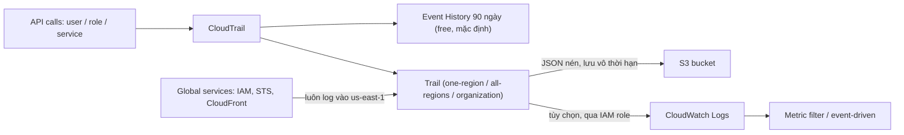

# CloudTrail

> **TL;DR:** CloudTrail ghi lại **API call / hoạt động** tác động lên AWS account (do user, role hoặc service thực hiện). Mặc định có **Event History 90 ngày miễn phí**. Muốn lưu lâu dài, đưa sang S3 / CloudWatch Logs hay tùy biến thì tạo **trail** (một region hoặc mọi region, có thể là **organization trail**). Mặc định chỉ log **management events**; **data events** phải bật riêng và tốn phí. CloudTrail **không real-time** (trễ khoảng **15 phút**).

## 🖼️ Sơ đồ
![[CloudTrail.excalidraw]]
*Mở bằng plugin Excalidraw để chỉnh sửa · ảnh tĩnh: [[CloudTrail.svg]]*

![[CloudTrail - event-types.excalidraw]]
*Mở bằng plugin Excalidraw để chỉnh sửa · ảnh tĩnh: [[CloudTrail - event-types.svg]]*

## Khái niệm cốt lõi
- Ghi gần như mọi thứ tác động lên account: stop instance, sửa Security Group, tạo/xóa bucket S3, đăng nhập console...
- Mỗi hoạt động được log là một **CloudTrail event**: bản ghi hành động của **user, role hoặc service**.
- **Event History**: bật sẵn ở mọi account, **miễn phí**, giữ **90 ngày**. Dùng để tra nhanh (ai vừa đăng nhập, `iamadmin` vừa làm gì) kể cả khi không có trail nào.

### Ba loại event
| Loại | Nội dung | Mặc định |
|---|---|---|
| **Management events** | Thao tác quản lý tài nguyên, tức **control plane**: tạo/terminate EC2, tạo VPC, tạo/xóa EBS volume, tạo/xóa bucket, đăng nhập console | **Bật** |
| **Data events** | Thao tác **trên/trong** tài nguyên: upload/đọc object S3, invoke Lambda | **Tắt** (khối lượng rất lớn), phải bật riêng, **có phí** |
| **Insights events** | Phát hiện hoạt động bất thường, lỗi, hành vi người dùng lạ | Tắt, bật riêng |

### Trail
- **Trail** là đơn vị cấu hình của CloudTrail. CloudTrail là **regional service**; trail log event cho region nó được tạo.
- Hai chế độ:
  - **One-region trail**: chỉ ở và chỉ log region đó.
  - **All-regions trail**: về mặt logic là tập hợp trail ở mọi region, quản lý như **một trail**; **tự cập nhật** khi AWS thêm region mới.
- **Global service events**: đa số service log ở region nơi event xảy ra (tạo EC2 ở `ap-southeast-2` thì log ở `ap-southeast-2`). Một số ít **global service** gồm **IAM, STS, CloudFront** luôn log vào **`us-east-1`**. Trail phải **bật global service events** mới bắt được (thường bật sẵn khi tạo trong console).
- Đích lưu:
  - **S3 bucket** (mặc định): lưu **vô thời hạn**, chỉ trả tiền dung lượng S3. Log là **file JSON nén** (gzip), nhẹ và công cụ nào cũng đọc được.
  - **CloudWatch Logs** (tùy chọn, thêm vào S3): tìm kiếm, dùng **metric filter**, xử lý theo sự kiện (ví dụ kích hoạt Lambda khi thấy một API call cụ thể). Mạnh hơn chỉ dùng S3. Xem [[CloudWatch Logs]].
- **Organization trail**: tạo từ **management account** của [[AWS Organizations]], log **mọi region trong mọi account** của tổ chức về một chỗ. Đây là điểm quản lý duy nhất cho môi trường multi-account.

## Cách hoạt động / Kiến trúc

## Bảng so sánh / số liệu
**Giá (theo khóa học)**
| Hạng mục | Giá |
|---|---|
| Event History 90 ngày | Miễn phí |
| **Một bản** management events mỗi region, mỗi account (một trail) | Miễn phí |
| Bản management events bổ sung (thêm trail) | **$2 / 100.000 events** |
| Data events | **$0.10 / 100.000 events**, tính từ event đầu tiên, bất kể số trail |
| S3 / CloudWatch Logs | Tính theo dịch vụ đích |

**Độ trễ:** thường giao log file **trong vòng 15 phút** sau hoạt động, publish nhiều lần mỗi giờ → **không real-time**.

## Demo / Lab
**0084 – Organizational Trail** (đăng nhập `iamadmin` ở **management account** General; organization trail **bắt buộc** tạo từ management account)
1. CloudTrail → Trails → **Create trail**, tên `animals4life.org`. Console mới mặc định trail cho **all regions**; tick **Enable for all accounts in my organization**.
2. Tạo **bucket S3 mới** `cloudtrail-animals4life-<số>` (tên duy nhất toàn cầu).
3. Tùy chọn khác:
   - **SSE-KMS** mã hóa log: production nên bật, demo bỏ tick để đơn giản (xem [[KMS]]).
   - **Log file validation**: phát hiện log bị sửa; nên bật cho audit.
   - **SNS notification** mỗi lần giao log file: hữu ích khi tích hợp hệ thống ngoài ([[SNS]]).
4. Bật **CloudWatch Logs**: log group mặc định, tạo **IAM role mới** để CloudTrail ghi vào CloudWatch Logs (service làm việc thay bạn thì cần role, xem [[IAM Roles]]).
5. Event type: chỉ **management events** (read + write; có thể loại trừ KMS / RDS Data API events). Không bật data events và insights.
6. Trail tạo xong: home region `us-east-1`, multi-region, organization trail. **Đợi 10–15 phút** để file log đầu tiên tới.
7. Kiểm tra S3: cấu trúc thư mục `CloudTrail/<region>/...`, mở file `.json.gz` thấy `userIdentity` (iamadmin), account ID, `eventSource`, `eventName`, region, source IP, user agent.
8. CloudWatch Logs → log group của trail → **log streams** đặt tên theo *org ID + account ID + region*, mỗi account một stream. Nội dung giống trong S3.
9. Event History vẫn luôn có, dù có trail hay không.
10. Chi phí: organization trail sinh nhiều request S3, có thể vượt free tier vài cent/tháng. Có thể **Stop logging** khi học. Production thì luôn để bật.

## 🎯 Mẹo thi SAA-C03
- Câu hỏi về **real-time logging** → **không phải CloudTrail** (trễ ~15 phút).
- Mặc định chỉ có Event History **90 ngày**; muốn lưu lâu hơn → tạo **trail** đổ vào **S3**.
- Mặc định trail chỉ log **management events**; cần log truy cập object S3 / invoke Lambda → bật **data events** (tốn phí).
- **IAM, STS, CloudFront** → global service events → **us-east-1**; trail phải bật global service events.
- Log tập trung cho mọi account trong tổ chức → **organization trail** tạo từ **management account**.
- Cần tìm kiếm, alarm, xử lý theo sự kiện trên API call → CloudTrail → **CloudWatch Logs** + metric filter.
- Phát hiện log bị chỉnh sửa → **log file validation**.
- "Ai đã xóa/sửa tài nguyên X?" → CloudTrail. "Tài nguyên có tuân thủ cấu hình không?" → [[AWS Config]].
- (Hiện nay CloudTrail còn có **CloudTrail Lake** để truy vấn SQL và **network activity events** cho VPC endpoint; ngoài phạm vi khóa học.)

## Liên kết
- Tiên quyết: [[AWS Organizations]], [[CloudWatch Logs]], [[S3 Basics]]
- Liên quan: [[IAM Roles]], [[KMS]], [[SNS]], [[AWS Control Tower]] (tự bật org trail vào Log Archive account), [[GuardDuty]] (dùng CloudTrail làm nguồn dữ liệu), [[EventBridge]]
- Phân biệt với: [[CloudWatch Logs]] (kho log chung), [[AWS Config]] (lịch sử cấu hình và compliance), [[VPC Flow Logs]] (metadata traffic mạng), [[S3 Access Logs]]
- MOC: [[_MOC 04 IAM Accounts and Organizations]]
