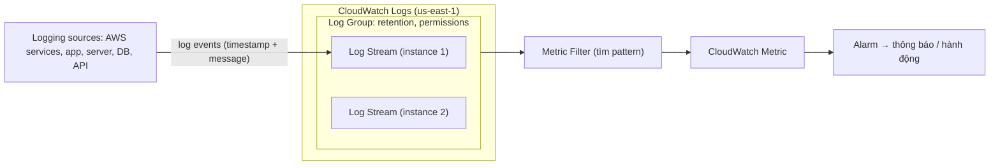

# CloudWatch Logs

> **TL;DR:** CloudWatch Logs là dịch vụ **public**, **regional** để lưu trữ, giám sát và truy cập dữ liệu log. Cấu trúc: **log event** (timestamp + message) → **log stream** (chuỗi event từ cùng một nguồn) → **log group** (container chứa các stream cùng loại; nơi đặt retention, permissions, metric filter). **Metric filter** biến mẫu trong log thành metric để đặt alarm.

## 🖼️ Sơ đồ
![[CloudWatch Logs.excalidraw]]
*Mở bằng plugin Excalidraw để chỉnh sửa · ảnh tĩnh: [[CloudWatch Logs.svg]]*

## Khái niệm cốt lõi
- **Public service**: endpoint nằm trong AWS public zone, nên dùng được từ trong VPC, từ on-premises, thậm chí từ cloud khác, miễn có kết nối mạng và quyền AWS (xem [[AWS Public vs Private Services]]).
- **Regional service** (ví dụ `us-east-1`).
- **Logging data** tối thiểu gồm **timestamp** (năm, tháng, ngày, giờ, phút, giây, múi giờ) + **dữ liệu**.
- Các cách đưa log vào:
  1. **Tích hợp sẵn với AWS service**: EC2, [[VPC Flow Logs]], [[Lambda]], [[CloudTrail]], Route 53... Bảo mật thường qua **IAM role / service role** (xem [[IAM Roles]]).
  2. **Unified CloudWatch Agent**: cho log OS/ứng dụng tùy chỉnh trên EC2, hoặc máy chủ bên ngoài AWS (on-prem). Xem [[CloudWatch Agent]].
  3. **AWS SDK** ghi log trực tiếp từ code. Thuộc phạm vi khóa developer/DevOps; với SAA chỉ cần nhớ hai cách trên.

## Cách hoạt động / Kiến trúc

| Thành phần | Mô tả | Ví dụ `/var/log/messages` trên nhiều EC2 |
|---|---|---|
| **Log event** | Một bản ghi: **timestamp + message**. Message được coi là khối dữ liệu thô, nhưng có thể định nghĩa cách tách field/cột | Một dòng mới được ghi vào `/var/log/messages` |
| **Log stream** | Chuỗi log event **có thứ tự từ cùng một nguồn** | Một stream cho mỗi instance |
| **Log group** | Container chứa nhiều log stream **cùng loại log**. Nơi cấu hình **retention**, **permissions**, **metric filter**; cấu hình áp cho mọi stream bên trong | Một log group cho `/var/log/messages` |

### Metric filter
- Định nghĩa **trên log group**, liên tục quét log event của mọi stream trong group để tìm pattern (mã lỗi ứng dụng, SSH login thất bại...).
- Mỗi lần khớp → **tăng một metric** trong CloudWatch → đặt **alarm** trên metric đó để thông báo admin hoặc kích hoạt hành động trong AWS/hệ thống ngoài (xem [[CloudWatch Basics]]).
- Ví dụ: instance Linux ghi log mỗi lần SSH thất bại → metric filter đếm → alarm khi vượt ngưỡng.

## 🎯 Mẹo thi SAA-C03
- CloudWatch Logs là **public service** và **regional**.
- Log OS/ứng dụng bên trong EC2 hoặc server on-prem → cần **CloudWatch Agent** (CloudWatch mặc định không thấy được bên trong instance).
- "Tạo metric/alarm từ nội dung log" → **metric filter** trên log group.
- **Retention** và **permissions** đặt ở **log group**, không phải từng stream.
- Nhiều service đổ log vào đây: CloudTrail, Lambda, VPC Flow Logs, Route 53...

## Liên kết
- Tiên quyết: [[CloudWatch Basics]], [[AWS Public vs Private Services]]
- Dùng cùng: [[CloudTrail]], [[CloudWatch Agent]], [[VPC Flow Logs]], [[Lambda]]
- Liên quan: [[IAM Roles]], [[EventBridge]], [[S3 Access Logs]]
- Phân biệt với: [[CloudTrail]] (ghi lại *API call / hoạt động tài khoản*; CloudWatch Logs là *kho chứa log* nói chung), [[CloudWatch Basics]] (metrics)
- MOC: [[_MOC 04 IAM Accounts and Organizations]]
