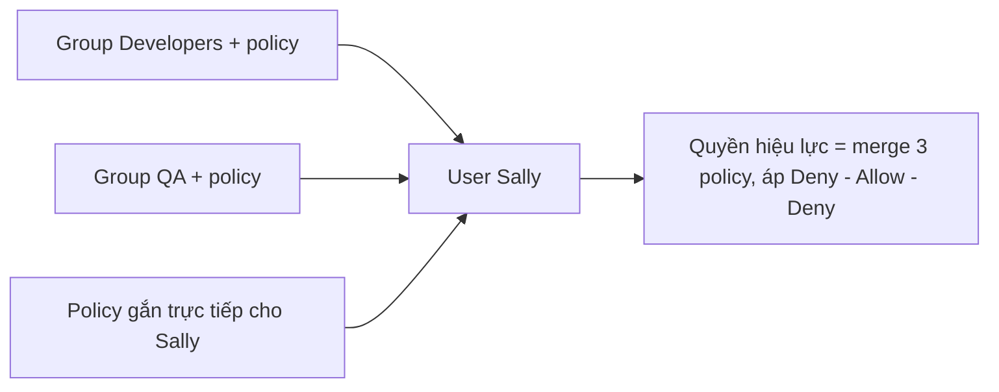

# IAM Groups

> **TL;DR:** IAM group chỉ là **container chứa IAM user**, giúp quản lý quyền cho nhiều user cùng lúc. Group có thể gắn policy (inline hoặc managed) để user thành viên thừa hưởng. Group **không có credentials, không đăng nhập được, không lồng nhau được**, và **không phải identity thật**: không thể làm principal trong resource policy.

## 🖼️ Sơ đồ
![[IAM Groups.excalidraw]]
*Mở bằng plugin Excalidraw để chỉnh sửa · ảnh tĩnh: [[IAM Groups.svg]]*

## Khái niệm cốt lõi
- **Mục đích duy nhất**: tổ chức IAM user (theo team, dự án, chức năng) và gán quyền cho cả nhóm.
- **Không đăng nhập vào group được**, group không có credentials. Đáp án nào gợi ý "log in vào group" đều sai.
- Một user **thuộc được nhiều group** (tối đa **10**). Trong slide, Sally vừa ở *Developers* vừa ở *QA*; đó là cùng một IAM user.
- Group gắn được cả **inline** và **managed policy** (xem [[IAM Identity Policies]]).
- **Không có nesting**: không có group trong group.
- **Không có group "All Users" có sẵn** như ở một số hệ thống quản lý danh tính khác. Muốn có thì tự tạo group và tự thêm/quản lý thành viên.

## Cách hoạt động / Kiến trúc

### Gộp quyền (merge)
User nhận quyền từ ba nguồn: policy gắn trực tiếp + policy của **mọi** group mà user thuộc về. AWS gộp tất cả allow/deny thành một tập rồi áp dụng **Deny – Allow – Deny** như bình thường. Logic đánh giá không phức tạp hơn; chỉ có thêm nguồn statement.

### Groups không phải "true identity"
- **Resource policy** (ví dụ bucket policy của S3, xem [[S3 Security]]) có thể tham chiếu identity qua ARN làm `Principal`, nhưng chỉ tham chiếu được **IAM user** và **IAM role**, **không** tham chiếu được group.
- Vì vậy không thể viết bucket policy "cho phép group Developers" rồi mong mọi developer truy cập được. Muốn cấp quyền theo nhóm thì gắn **identity policy vào group**.
- Đừng đánh giá quá cao group: chứa user + gắn quyền, chỉ vậy.

## Bảng so sánh / số liệu
| Giới hạn | Giá trị | Có tăng được? |
|---|---|---|
| Group mà một user được tham gia | **10** | Không (hard limit) |
| IAM user mỗi account | **5.000** | Không, theo khóa học (hard limit) |
| Số user trong một group | Không có giới hạn riêng (tối đa là toàn bộ user trong account) | — |
| Group mỗi account | **300** | Có, qua support ticket/Service Quotas (hiện nay tối đa 500) |

| | IAM User | IAM Group | IAM Role |
|---|---|---|---|
| Có credentials / đăng nhập | Có (password, access key) | **Không** | Không có credentials dài hạn; được *assume* |
| Gắn policy | Có | Có | Có (permissions + trust policy) |
| Làm principal trong resource policy | Có | **Không** | Có |

## Demo / Lab
**0073 – Permissions control using IAM Groups**
1. Dựng lại hạ tầng của demo trước bằng CloudFormation: user Sally, bucket catpics/animalpics, upload ảnh, attach managed policy *AllowAllS3ExceptCats* trực tiếp cho Sally. Sally (đăng nhập ở trình duyệt riêng) xem được animalpics, catpics bị access denied.
2. **Detach** policy khỏi Sally → Sally mất mọi quyền S3.
3. Tạo group **Developers**, attach cùng managed policy đó. Trang group rất đơn giản, chỉ có *user membership* và *permissions*, vì group không làm được gì khác.
4. Thêm Sally vào Developers → refresh: Sally lại có quyền S3 như cũ (trừ catpics).
5. Kết luận: policy gắn trực tiếp hay qua group thì user đều nhận quyền như nhau.
6. Dọn dẹp: detach policy, xóa group (không do stack tạo nên phải xóa tay), empty hai bucket, delete stack. Nếu delete stack lỗi thì xem tab *Events* để biết lý do.

## 🎯 Mẹo thi SAA-C03
- "Đăng nhập bằng group" → **sai**. Group không có credentials.
- "Resource policy cấp quyền cho group" → **sai**. Principal chỉ có thể là user, role (hoặc account, service...), không phải group.
- **Không nesting** group; **không có group All Users** mặc định.
- Nhớ số: user ≤ **10 group**, **300 group**/account (tăng được), **5.000 user**/account.
- Quyền hiệu lực = gộp quyền trực tiếp và quyền từ mọi group, rồi áp Deny – Allow – Deny.

## Liên kết
- Tiên quyết: [[IAM Basics]], [[IAM Identity Policies]], [[IAM Users and ARNs]]
- Liên quan: [[S3 Security]] (resource policy và Principal), [[IAM Roles]]
- Phân biệt với: [[IAM Roles]] (role là identity thật, được assume và có thể làm principal), [[AWS Organizations]] (nhóm *account*, không phải nhóm user)
- MOC: [[_MOC 04 IAM Accounts and Organizations]]
