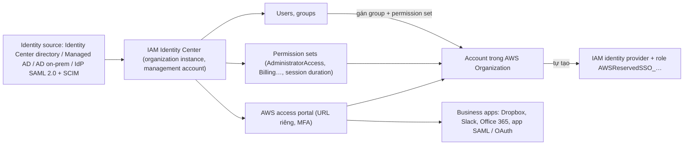

# IAM Identity Center

> **TL;DR:** IAM Identity Center (tên cũ **AWS Single Sign-On / AWS SSO**) cho nhân viên **một identity duy nhất** để **single sign-on** vào **mọi AWS account trong AWS Organizations** và vào **business application** (Dropbox, Slack, Office 365, Salesforce, app SAML/OAuth riêng). Bạn chọn **identity source** (directory có sẵn của Identity Center, AWS Managed Microsoft AD, AD on-prem, hoặc IdP SAML 2.0 ngoài như Okta / Entra ID, tự đồng bộ bằng **SCIM**), tạo **user/group** và **permission set**, rồi gán vào account; Identity Center **tự tạo IdP và role** (`AWSReservedSSO_…`) trong từng account. **Organization instance** luôn nằm ở **management account** (có thể giao **delegated administrator**). Đây là cách AWS **khuyên dùng** cho workforce identity, thay cấu hình federation thủ công trong IAM. Khách hàng đăng nhập Google/Facebook → [[Cognito]], không phải Identity Center.

## 🖼️ Sơ đồ
![[IAM Identity Center.excalidraw]]
*Mở bằng plugin Excalidraw để chỉnh sửa · ảnh tĩnh: [[IAM Identity Center.svg]]*

## Khái niệm cốt lõi
- **SSO (single sign-on)**: người dùng chỉ có **một username/password** (và cấu hình **MFA** một lần) để vào **mọi AWS account** và **app** được phép, thay vì nhớ nhiều identity.
- Identity Center **quản lý tập trung** quyền SSO: cấu hình identity và quyền cho mọi account do [[AWS Organizations]] quản lý, và cả SSO cho **business application** bên ngoài.
- Về khái niệm, Identity Center vừa là **phần mở rộng của AWS Organizations**, vừa là **bước tiến** của cách tự cấu hình federation trước đây (xem [[SAML 2.0 Identity Federation]]). Là dịch vụ managed, **highly available**, quản lý ở một màn hình duy nhất.
- Với federation thủ công, ứng dụng và cấu hình phải tự lo việc đổi identity ngoài lấy credentials tạm thời, và mỗi kiểu federation làm một kiểu. Identity Center **giấu toàn bộ phần đó**: chọn identity store xong thì mọi thứ (token, role, credentials) được quản lý phía sau, dùng store nào cũng như nhau.

### Identity source (identity store)
Nơi lưu dữ liệu identity: username, password, họ tên, phòng ban… Chọn **một** trong:
| Identity source | Ghi chú |
|---|---|
| **Identity Center directory** (built-in, **mặc định**) | Dùng khi chỉ cần quản lý truy cập các account AWS, không có hệ thống identity ngoài; vẫn được lợi ích quản lý quyền tập trung |
| **AWS Managed Microsoft AD** | Qua [[Directory Service]] |
| **Active Directory on-prem** do bạn tự quản lý | Dùng **two-way trust** giữa AD và Identity Center |
| **IdP ngoài hỗ trợ SAML 2.0** (Okta, Microsoft Entra ID…) | Có thể **tự động import user và group** bằng **SCIM** (System for Cross-domain Identity Management) |

### Hai loại instance
- **Organization instance**: dùng khi quản lý truy cập vào **các account trong AWS Organization**. Luôn được triển khai ở **management account**. Nếu management account bị khóa chặt (best practice, ít người được vào), dùng **delegated administration** để quản trị Identity Center từ **một account khác**.
- **Account instance**: triển khai trong **một account đơn lẻ** (không dùng Organizations). Chỉ quản lý được truy cập **application**, **không** quản lý được truy cập các AWS account.
- Muốn quản lý truy cập AWS account thì các account đó **phải nằm trong AWS Organization**.

### Quyền: user, group, permission set
- **Users** và **groups** trong Identity Center là cơ sở để cấp quyền (best practice: gán quyền theo group).
- **Permission set**: bộ quyền (dùng **predefined** như `AdministratorAccess`, `Billing`, hoặc tự tạo custom) kèm **session duration** (ví dụ 1 giờ, 4 giờ).
- Gán **group/user + permission set** vào **một hay nhiều account** → Identity Center **provision** vào từng account: tạo **IAM identity provider** và các role `AWSReservedSSO_…`. Có thể cấp quyền console, CLI, toàn quyền hay giới hạn.

### SSO cho application
- Catalog app dựng sẵn: **Dropbox, Slack, Office 365, Salesforce, Adobe**… chỉ cần điền vài thông tin.
- App doanh nghiệp tự viết: hỗ trợ nếu app dùng **SAML** (hoặc **OAuth**).

### AWS khuyên dùng gì
- Vẫn có thể vào **IAM** (không phải Identity Center) để **tự cấu hình identity provider** cho federation, ví dụ cần kiểm soát rất chi tiết, triển khai ngắn hạn hoặc quy mô nhỏ. Nhưng đó là **cách cũ (legacy)**.
- Khuyến nghị của AWS gần như luôn là **Identity Center**: cả thực tế lẫn đề thi, cho org lớn và cho kiểm soát truy cập ứng dụng.
- **Workforce identity** (nhân viên, account, app nội bộ) → Identity Center. **Customer identity** (app web của bạn, đăng nhập bằng X, Google, Facebook) → **không** phải Identity Center, thường là [[Cognito]].

## Cách hoạt động / Kiến trúc

1. Bật Identity Center trong **management account** → tạo **organization instance**.
2. Chọn **identity source** (mặc định là directory của Identity Center).
3. Tạo **permission sets**, **groups**, **users** (hoặc import từ IdP ngoài bằng SCIM).
4. Gán group + permission set vào các **AWS account** → Identity Center **reprovision** các account theo "nguồn sự thật" này: tạo IAM identity provider và role trong từng account.
5. Người dùng đăng nhập **AWS access portal**, thấy danh sách account (kèm permission set) và app được phép, bấm vào là vào bằng **federated identity** với **credentials tạm thời**.

## Bảng so sánh / số liệu

| | **IAM user ở từng account** | **SAML federation thủ công trong IAM** | **IAM Identity Center** |
|---|---|---|---|
| Số identity nhân viên phải nhớ | Một cho mỗi account | Một (từ IdP) | **Một** |
| Cấu hình | Lặp lại ở từng account | IdP + role + trust ở từng account | **Một chỗ**, tự provision vào account |
| Credentials | Long-term | Tạm thời | **Tạm thời** |
| SSO cho business app | Không | Không | **Có** |
| AWS khuyên dùng cho workforce | Không | Legacy | **Có** |

| | **Organization instance** | **Account instance** |
|---|---|---|
| Nằm ở | **Management account** (giao quản trị bằng delegated administrator) | Một account đơn lẻ |
| Quản lý truy cập AWS account | **Có** (account trong org) | **Không** |
| Quản lý truy cập app | Có | Có |

## Demo / Lab
**Configure Single Sign-on for the Aus-E-Mart ORG** (đăng nhập `iamadmin` ở General = management account, `us-east-1`)

*Part 1*
1. Trong IAM, mỗi account vẫn đang phải tự quản lý user/role riêng. Mở **IAM Identity Center** → **Enable**: vì có Organizations nên tạo **organization instance**.
2. **Confirm identity source**: dùng **Identity Center directory** (tách biệt với IAM); có thể đổi sang AD hoặc IdP ngoài.
3. **Customize AWS access portal URL** (phải duy nhất, ví dụ thêm vài ký tự sau `ausemart`).
4. **Create permission set**: predefined **AdministratorAccess**, session duration **4 giờ**; tạo thêm permission set **Billing** (4 giờ).
5. **Groups** → tạo group **Billing Department**. **Users** → tạo user **Sarah** (email dùng plus addressing, **one-time password**), thêm vào Billing Department.
6. Lúc này mọi thứ mới chỉ nằm trong directory của Identity Center: IAM của các account chưa có gì đổi.
7. **AWS accounts** → chọn General, Production, Development → **Assign users or groups** → Billing Department + permission set **Billing** → Submit. Các account được **reprovision**; refresh IAM thấy xuất hiện **identity provider** và role mới.

*Part 2*
1. Mở **access portal URL** trong trình duyệt/container riêng, đăng nhập **Sarah**, đăng ký **MFA** (authenticator app), đổi password.
2. Portal hiện 3 account với permission set **Billing**. Vào Development hoặc Production: Sarah xem được **Bills**, nhưng mở EC2 thì **access denied** → đúng quyền đã cấp. Sarah là một loại **federated user**.
3. **Applications**: có thể thêm app riêng hỗ trợ SAML/OAuth, hoặc app từ catalog (ví dụ Dropbox) để Sarah dùng cùng một identity.
4. Tạo user **iamadmin** (one-time password) trong group mới **Admin Access**; vào group → **AWS accounts** → **Assign accounts**: General, Production, Development với permission set **AdministratorAccess**. IAM của các account có thêm role **`AWSReservedSSO_…`**.
5. Đăng xuất Sarah, đăng nhập portal bằng iamadmin (MFA, đổi password, nên lưu trong password manager) → vào được mọi account với toàn quyền.
6. Dọn dẹp: xóa group Billing Department và user Sarah. Có thể **giữ iamadmin** của Identity Center làm cách đăng nhập chính cho mọi account (đặt password mạnh, bật MFA).

## 🎯 Mẹo thi SAA-C03
- "Nhân viên cần **single sign-on** vào **nhiều AWS account** trong organization và các **business app**, quản lý tập trung" → **IAM Identity Center**.
- Doanh nghiệp có **Active Directory** / **Okta / Entra ID** muốn dùng identity sẵn có cho AWS → Identity Center với identity source tương ứng (IdP ngoài: **SAML 2.0**, đồng bộ user/group bằng **SCIM**).
- Quyền trong Identity Center cấp qua **permission set** gán cho **user/group** trên **account**.
- **Organization instance** nằm ở **management account**; muốn quản trị từ account khác → **delegated administrator**. Account instance không quản lý được truy cập account.
- **Workforce identity → Identity Center**; **customer identity / web identity (Google, Facebook, X) → [[Cognito]]**.
- Cấu hình IdP thủ công trong IAM ([[SAML 2.0 Identity Federation]]) là cách **legacy**; đáp án hiện đại thường là Identity Center.
- Tên cũ **AWS SSO**: đề cũ ghi "AWS Single Sign-On" là dịch vụ này.

## Liên kết
- Tiên quyết: [[AWS Organizations]], [[IAM Roles]], [[SAML 2.0 Identity Federation]]
- Liên quan: [[Directory Service]], [[AWS Control Tower]] (landing zone dùng Identity Center cho SSO), [[MFA]], [[IAM Basics]]
- Phân biệt với: [[Cognito]] (customer identity), [[IAM Users and ARNs]] (identity long-term trong từng account)
- MOC: [[_MOC 04 IAM Accounts and Organizations]]
