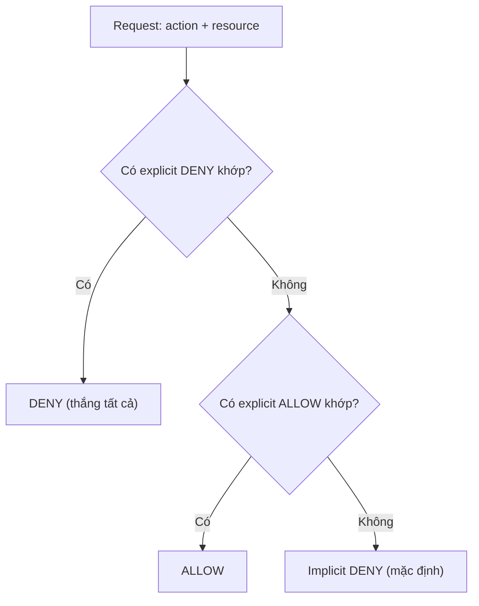
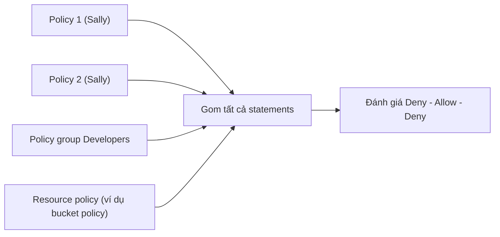

# IAM Identity Policies

> **TL;DR:** Identity policy (policy document) là một tài liệu **JSON** gồm một hoặc nhiều *statement* cho phép (Allow) hoặc từ chối (Deny) truy cập dịch vụ/tài nguyên AWS. Policy được attach vào identity (IAM user, group, role). Khi nhiều statement chồng nhau, AWS áp dụng quy tắc **Deny – Allow – Deny**: explicit deny thắng tất cả, sau đó tới explicit allow, còn lại là implicit deny.

## 🖼️ Sơ đồ
![[IAM Identity Policies.excalidraw]]
*Mở bằng plugin Excalidraw để chỉnh sửa · ảnh tĩnh: [[IAM Identity Policies.svg]]*

![[IAM Identity Policies - inline-managed.excalidraw]]
*Mở bằng plugin Excalidraw để chỉnh sửa · ảnh tĩnh: [[IAM Identity Policies - inline-managed.svg]]*

## Khái niệm cốt lõi
- Ba mức hiểu policy: (1) kiến trúc và cách hoạt động, (2) **đọc** được policy, (3) tự viết. Cho kỳ thi chỉ cần (1) và (2); kỹ năng viết sẽ có dần qua các demo.
- Identity policy gắn vào **identities**: [[IAM Users and ARNs|IAM users]], [[IAM Groups]], [[IAM Roles]]. Tự policy không làm gì cho tới khi được attach (xem [[IAM Basics]]).
- Viết bằng [[JSON]]. Cấu trúc tối thiểu:

```json
{
  "Version": "2012-10-17",
  "Statement": [
    { "Sid": "FullAccess",    "Effect": "Allow", "Action": ["s3:*"], "Resource": ["*"] },
    { "Sid": "DenyCatBucket", "Effect": "Deny",  "Action": ["s3:*"],
      "Resource": ["arn:aws:s3:::catgifs", "arn:aws:s3:::catgifs/*"] }
  ]
}
```

### Các thành phần của một statement
| Thành phần | Ý nghĩa | Ghi chú |
|---|---|---|
| `Sid` | Statement ID, nhãn mô tả statement làm gì | **Optional**, nhưng best practice là luôn đặt |
| `Action` | Hành động được khớp | Định dạng `service:operation` (ví dụ `s3:PutObject`). Có 3 kiểu: một action cụ thể, wildcard (`s3:*`), hoặc danh sách nhiều action |
| `Resource` | Tài nguyên được khớp | `*` = mọi tài nguyên; còn lại dùng [[IAM Users and ARNs\|ARN]], có thể là một ARN hoặc danh sách ARN |
| `Effect` | `Allow` hoặc `Deny` | Quyết định AWS làm gì **khi Action và Resource cùng khớp** |

- Mọi tương tác với AWS = **tài nguyên** bạn chạm vào + **hành động** bạn muốn làm. Một statement chỉ có tác dụng nếu cả Action lẫn Resource khớp với request.

## Cách hoạt động / Kiến trúc

### Quy trình đánh giá
1. Principal **authenticate** để trở thành *authenticated identity*.
2. AWS biết identity đó có những policy nào (có thể nhiều policy, mỗi policy nhiều statement) → gom **tất cả statement** liên quan.
3. AWS biết bạn đang truy cập resource nào, với action nào → xét từng statement khớp.
4. Áp quy tắc ưu tiên **Deny – Allow – Deny**.



- **Ưu tiên 1, Explicit Deny:** đã có statement deny khớp thì không gì ghi đè được.
- **Ưu tiên 2, Explicit Allow:** có hiệu lực *trừ khi* cũng có explicit deny.
- **Ưu tiên 3, Implicit Deny:** không có allow nào thì bị từ chối. Mọi identity (trừ **account root user**) khởi đầu với **không có quyền gì**.
- Ví dụ trong slide: statement 1 cho `s3:*` trên `*` (thực chất là S3 admin), statement 2 deny `s3:*` trên bucket `catgifs` và object trong đó. Kết quả: dùng được mọi bucket **trừ** `catgifs`.
- Quy tắc giữ nguyên dù có 1 hay 10 statement, 1 hay 10 policy.

### Nhiều nguồn policy cùng lúc
Ví dụ Sally (developer): 2 policy gắn trực tiếp + là thành viên group *Developers* có policy riêng + resource cô truy cập có **resource policy**. AWS gom **toàn bộ statement** từ: policy trực tiếp của user, policy của các group user thuộc về, resource policy trên tài nguyên → đánh giá cùng lúc, vẫn theo Deny – Allow – Deny.



(Trong cùng một account như ví dụ trên thì đúng như vậy. Khi có thêm [[Service Control Policies|SCP]] hoặc permissions boundary thì chúng chỉ *giới hạn* quyền, xem note SCP.)

### Inline vs Managed policy
Hai loại đều là JSON policy document; khác nhau ở **cách quản lý**.

| | **Inline policy** | **Managed policy** |
|---|---|---|
| Cách gắn | JSON áp **riêng lẻ** vào từng identity; mỗi bản là một khối JSON độc lập | Là **object riêng**, tạo một lần rồi attach vào nhiều identity |
| Tái sử dụng | Không. 300 user = 300 bản phải sửa | Có, dùng cho 3 hay 300 identity như nhau |
| Chi phí quản lý | Cao | Thấp: sửa một lần, có hiệu lực ngay cho mọi identity được gắn |
| Khi dùng | **Ngoại lệ**: allow/deny đặc biệt cho một identity | Quyền vận hành **mặc định, thông thường** của tổ chức |

- Managed policy có 2 loại:
  - **AWS managed**: AWS tạo và duy trì (ví dụ `AdministratorAccess`, `IAMUserChangePassword`). Không phải bảo trì nhưng có thể không khớp chính xác nhu cầu.
  - **Customer managed**: bạn tự tạo và quản lý, khớp đúng yêu cầu doanh nghiệp.

## Demo / Lab
Phần thực hành nằm ở demo 0071 (xem [[IAM Users and ARNs]]): gắn inline policy `s3:*` cho Sally, rồi gỡ đi và attach managed policy "allow all S3 except cats" để thấy explicit deny thắng explicit allow.

## 🎯 Mẹo thi SAA-C03
- Thuộc lòng **Deny, Allow, Deny**. Đề thường hỏi tình huống có allow và deny chồng nhau: **explicit deny luôn thắng**.
- Không có allow nào khớp = **không có quyền** (implicit deny). Identity mới tạo không có quyền gì.
- Root user là ngoại lệ duy nhất, không bị giới hạn bởi identity policy (nhưng trong member account của Organization thì bị [[Service Control Policies|SCP]] giới hạn).
- Quyền chung cho nhiều người: **managed policy**. Ngoại lệ cho một người: **inline policy**.
- Policy có thể nằm ở user, group, và resource; AWS gom hết rồi mới đánh giá.
- `Sid` là optional; `Effect`, `Action`, `Resource` là các phần đề hay cho đọc.

## Liên kết
- Tiên quyết: [[IAM Basics]], [[JSON]]
- Dùng cùng: [[IAM Users and ARNs]], [[IAM Groups]], [[IAM Roles]]
- Liên quan: [[S3 Security]] (resource policy / bucket policy), [[Service Control Policies]], [[KMS]] (key policy)
- Phân biệt với: [[Service Control Policies]] (SCP không cấp quyền, chỉ giới hạn), [[S3 Security]] (resource policy có `Principal`)
- MOC: [[_MOC 04 IAM Accounts and Organizations]]
