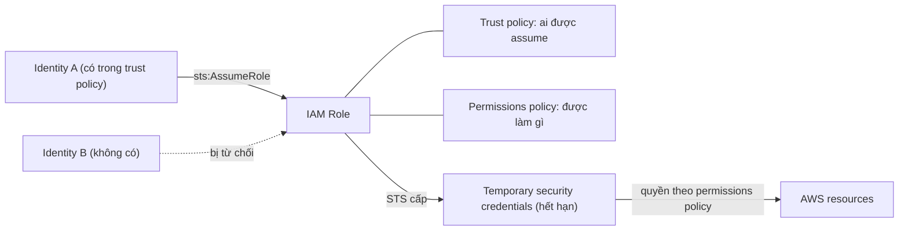
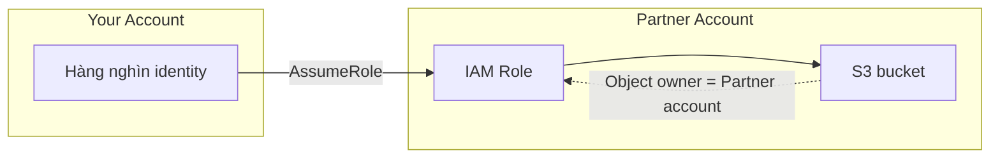

# IAM Roles

> **TL;DR:** IAM role là một identity trong account, đại diện cho **một mức truy cập** chứ không đại diện cho một người cụ thể. Các principal được phép sẽ **assume** role trong thời gian ngắn và nhận **temporary security credentials** do **STS** cấp (`sts:AssumeRole`). Role có hai policy: **trust policy** (ai được assume) và **permissions policy** (assume rồi được làm gì). Đây là nền tảng cho AWS service truy cập tài nguyên, cross-account access, break-glass và identity federation.

## 🖼️ Sơ đồ
![[IAM Roles.excalidraw]]
*Mở bằng plugin Excalidraw để chỉnh sửa · ảnh tĩnh: [[IAM Roles.svg]]*

![[IAM Roles - use-cases.excalidraw]]
*Mở bằng plugin Excalidraw để chỉnh sửa · ảnh tĩnh: [[IAM Roles - use-cases.svg]]*

## Khái niệm cốt lõi

### Role khác user ở đâu
- **IAM user**: một principal cụ thể, dùng dài hạn, "đại diện cho bạn" (xem [[IAM Users and ARNs]]).
- **IAM role**: phù hợp khi có **nhiều principal hoặc số lượng không xác định**: nhiều user trong account, con người/ứng dụng/AWS service trong hoặc ngoài account. Cũng là ứng viên khi có **hơn 5.000 principal**.
- Role dùng **tạm thời**: principal assume role, *trở thành* role đó trong thời gian ngắn, dùng quyền của role rồi thôi. Bạn "mượn" quyền chứ không đăng nhập vào một danh tính đại diện cho mình. Một external identity assume role trong account bạn thì tạm thời là một identity trong account bạn.

### Hai loại policy của role
| Policy | Trả lời câu hỏi | Ghi chú |
|---|---|---|
| **Trust policy** | **Ai** được assume role? | Có thể tham chiếu: identity trong cùng account (user, role khác), **AWS service** (EC2, Lambda...), identity ở **account khác**, thậm chí truy cập ẩn danh và web identity (Google, Facebook...) |
| **Permissions policy** | Assume xong thì **được làm gì**? | Giống identity policy thông thường (xem [[IAM Identity Policies]]) |

- User chỉ có permissions policy (inline/managed); role có **thêm trust policy**.

### Temporary security credentials và STS
- Khi principal được trust policy cho phép assume role, **STS (Security Token Service)** sinh **temporary security credentials** qua thao tác `sts:AssumeRole`.
- Giống access key nhưng **có thời hạn**; hết hạn thì phải assume lại để nhận credentials mới.
- Mỗi lần dùng credentials, quyền được kiểm tra theo permissions policy **hiện tại**. Sửa permissions policy thì quyền của credentials đang dùng cũng đổi theo.
- Role là **identity thật**: có thể được tham chiếu làm principal trong **resource policy** (khác với [[IAM Groups]]). Ai assume role thành công thì truy cập được những gì role được phép, dù quyền đến từ permissions policy hay resource policy.

## Cách hoạt động / Kiến trúc

## Khi nào dùng role: các tình huống điển hình

### 1. AWS service hành động thay bạn (ví dụ Lambda execution role)
- Lambda function không phải AWS identity và mặc định không có quyền gì. Thay vì **hard-code access key** vào code (rủi ro bảo mật, khó rotate), tạo **Lambda execution role**:
  - Trust policy tin **dịch vụ Lambda**.
  - Permissions policy cấp quyền cần thiết.
  - Khi function chạy, **runtime environment** assume role, nhận credentials tạm thời; code trong môi trường đó dùng credentials để gọi AWS.
- Số bản chạy đồng thời không xác định (0, 1, 50, 100+), đúng với quy tắc "số principal không xác định thì dùng role".
- Quy tắc chung: **AWS service làm việc thay bạn → luôn dùng role**, không cung cấp static credentials. Cùng cơ chế với [[EC2 Instance Roles]]. Xem [[Lambda]].

### 2. Break-glass / truy cập khẩn cấp
- Wayne ở helpdesk, thuộc group có quyền **read-only** với account khách hàng. 99% thời gian thế là đủ.
- Lúc 3 giờ sáng Chủ nhật cần stop/start/terminate EC2 gấp → Wayne **assume emergency role** để có thêm quyền trong thời gian ngắn.
- Giống hộp kính chứa chìa khóa: ai cũng đập được, nhưng phải có chủ ý, và **biết được khi nào nó bị dùng** (việc assume role được log lại, xem [[CloudTrail]]). Quyền thường ngày vẫn giữ ở mức read-only.

### 3. Doanh nghiệp có identity provider sẵn (ID Federation, SSO)
- Doanh nghiệp đã có IdP như **Microsoft Active Directory** và muốn **SSO**, hoặc có **hơn 5.000 nhân viên** (vượt giới hạn IAM user).
- **External identity không thể dùng trực tiếp** để truy cập tài nguyên AWS (không dùng tài khoản AD, Facebook, Google để gọi S3 trực tiếp được).
- Cho phép role trong account được assume bởi external identity (AD) → nhận credentials tạm thời → truy cập tài nguyên. Console có thể che bước này nên trông liền mạch.
- Cấp quyền cho IdP bên ngoài và để external identity assume role như vậy gọi là **ID Federation**: chỉ phải quản lý vài role thay vì hàng nghìn user. Xem [[Directory Service]].

### 4. Ứng dụng mobile hàng triệu người dùng (Web Identity Federation)
- Ví dụ app ride-sharing cần đọc/ghi DynamoDB. Không thể dùng IAM user vì giới hạn 5.000.
- Người dùng đăng nhập bằng **web identity** (Google, Facebook...), trust policy của role tin các IdP đó → assume role → credentials tạm thời → truy cập DynamoDB.
- Lợi ích:
  - **Không lưu AWS credentials trong app**, app bị khai thác cũng không lộ credentials.
  - Dùng tài khoản khách hàng đã có, không bắt tạo tài khoản mới.
  - Scale tới **hàng trăm triệu** người dùng.
- Trong thực tế thường triển khai qua [[Cognito]].

### 5. Cross-account access
- Đối tác có ứng dụng xử lý dữ liệu khoa học và muốn bạn đặt dữ liệu vào bucket S3 trong **account của họ**. Bạn có hàng nghìn identity; họ không muốn tạo IAM user cho từng người.
- Giải pháp: tạo **role trong account đối tác**; user của bạn assume role đó và upload.
- Vì role là identity của account đối tác, **object upload lên thuộc sở hữu account đối tác** (object owner), giúp quản lý quyền giữa hai account đơn giản.
- Role cross-account có thể cấp quyền vào một tài nguyên cụ thể hoặc **cả một account**; đây là cách [[AWS Organizations]] dùng `OrganizationAccountAccessRole` để "role switch" sang các account khác mà không phải đăng nhập lại.

## Bảng so sánh / số liệu
| | IAM User | IAM Role |
|---|---|---|
| Số principal | Một, xác định | Nhiều / không xác định / > 5.000 |
| Credentials | Long-term (password, access key) | **Temporary** (STS), tự hết hạn |
| Policy | Permissions policy | Trust policy + permissions policy |
| Thời gian sử dụng | Dài hạn | Ngắn hạn, assume khi cần |
| Principal trong resource policy | Có | Có |
| Use case tiêu biểu | Nhân viên, app/service account cụ thể | AWS service, cross-account, break-glass, federation, mobile app |

## 🎯 Mẹo thi SAA-C03
- Không đếm được số principal, hoặc > 5.000 → **role**.
- AWS service cần quyền (Lambda, EC2...) → **role**, không bao giờ hard-code access key.
- App mobile/web hàng triệu người dùng, đăng nhập Google/Facebook → **Web Identity Federation** dùng role (thường qua [[Cognito]]). Đáp án "tạo IAM user cho mỗi người" là sai.
- Doanh nghiệp có Active Directory, cần SSO hoặc > 5.000 nhân viên → **ID Federation + role**.
- Đối tác/account khác cần truy cập → **cross-account role**; object upload qua role thuộc account sở hữu role.
- **Trust policy** = ai được assume; **permissions policy** = được làm gì. Credentials do **STS** cấp qua `sts:AssumeRole`.
- External identity không bao giờ truy cập tài nguyên AWS trực tiếp; luôn phải đổi sang credentials AWS (assume role).

## Liên kết
- Tiên quyết: [[IAM Basics]], [[IAM Identity Policies]], [[IAM Users and ARNs]]
- Đi sâu: [[Service-linked Roles and PassRole]], [[EC2 Instance Roles]], [[AWS Organizations]]
- Liên quan: [[Lambda]], [[Cognito]], [[Directory Service]], [[CloudTrail]], [[DynamoDB Architecture]], [[CFN Stack Roles]]
- Phân biệt với: [[IAM Users and ARNs]] (credentials dài hạn), [[IAM Groups]] (không phải identity thật)
- MOC: [[_MOC 04 IAM Accounts and Organizations]]
