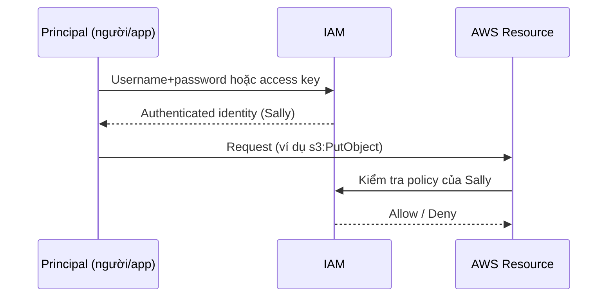

# IAM Users and ARNs

> **TL;DR:** IAM user là identity cho thứ cần truy cập AWS **dài hạn**: con người, ứng dụng, service account. User xác thực bằng long-term credentials (password hoặc access key) rồi được ủy quyền theo policy. ARN là định danh duy nhất của mọi tài nguyên AWS, dùng trong policy. Hai con số phải nhớ: **5.000 IAM user/account** và **một user thuộc tối đa 10 group**.

## 🖼️ Sơ đồ
![[IAM Users and ARNs.excalidraw]]
*Mở bằng plugin Excalidraw để chỉnh sửa · ảnh tĩnh: [[IAM Users and ARNs.svg]]*

![[IAM Users and ARNs - arn.excalidraw]]
*Mở bằng plugin Excalidraw để chỉnh sửa · ảnh tĩnh: [[IAM Users and ARNs - arn.svg]]*

## Khái niệm cốt lõi

### Khi nào dùng IAM user
- Dùng cho thứ cần truy cập **long-term**: người (James phòng kế toán, Mike kiến trúc sư), ứng dụng (ví dụ app backup cài trên từng laptop, mỗi laptop một user), service account.
- Mẹo của Adrian: nếu bạn **hình dung được một thực thể cụ thể, có tên**, thì 99% đáp án đúng là IAM user.

### Principal, Authentication, Authorization
- **Principal**: thực thể (người, máy, service, hoặc nhóm các thứ đó) đang cố truy cập account. Lúc đầu chưa được định danh.
- **Authentication**: principal chứng minh với IAM rằng nó đúng là identity nó tự nhận (ví dụ chứng minh mình là Sally).
  - IAM user xác thực bằng **username + password** (người dùng console UI) hoặc **access keys** (ứng dụng, hoặc người dùng CLI, xem [[IAM Access Keys and AWS CLI]]). Cả hai đều là **long-term credentials**.
  - Xác thực xong, principal trở thành **authenticated identity**.
- **Authorization**: khi authenticated identity thực hiện hành động (upload lên S3, terminate EC2), IAM kiểm tra các statement áp dụng cho identity đó rồi allow hoặc deny (xem [[IAM Identity Policies]]).



### Amazon Resource Name (ARN)
- ARN **định danh duy nhất** một tài nguyên trong *bất kỳ* account nào. Cần thiết vì tài nguyên ở account khác nhau, region khác nhau có thể trùng tên/đặc điểm. Có thể dùng wildcard để chỉ một nhóm tài nguyên.
- Định dạng (các trường ngăn bởi dấu `:`):

```
arn:partition:service:region:account-id:resource-id
arn:partition:service:region:account-id:resource-type/resource-id
arn:partition:service:region:account-id:resource-type:resource-id
```

| Trường | Ý nghĩa | Ví dụ |
|---|---|---|
| partition | Phân vùng AWS. Gần như luôn là `aws`; region khác phân vùng thì `aws-<tên>` | `aws`, `aws-cn` (China Beijing) |
| service | Namespace của dịch vụ | `s3`, `iam`, `rds`, `ec2` |
| region | Region chứa tài nguyên; một số ARN bỏ trống, một số cần wildcard | `us-east-1` |
| account-id | Account sở hữu tài nguyên (12 chữ số); EC2 cần, S3 không cần | `123456789012` |
| resource | Tên/ID hoặc đường dẫn, tùy dịch vụ | `user/sally`, `instance/i-0abc...` |

- **`::` (trống) khác `*` (wildcard)**:
  - `::` nghĩa là trường đó *không cần chỉ định* (ví dụ S3 không cần region và account vì tên bucket là duy nhất toàn cầu).
  - `*` nghĩa là *mọi giá trị* (ví dụ mọi region để cấp quyền EC2 ở mọi region). Không được bỏ trống thay cho `*`.

### Bẫy kinh điển: bucket vs object
```
arn:aws:s3:::catgifs      ← chính BUCKET (không bao gồm object)
arn:aws:s3:::catgifs/*    ← mọi OBJECT trong bucket (không bao gồm bucket)
```
- Hai ARN này **không chồng nhau**. Action cấp bucket (ví dụ `s3:ListBucket`, tạo bucket) cần ARN thứ nhất; action cấp object (`s3:GetObject`, `s3:PutObject`) cần ARN thứ hai. Muốn vừa làm việc với bucket vừa với object thì đưa **cả hai** vào policy. Lỗi này "gần như ai cũng từng vấp".

## Bảng so sánh / số liệu
| Giới hạn | Giá trị | Ghi chú |
|---|---|---|
| IAM users mỗi account | **5.000** | IAM là global nên đây là giới hạn **per account**, không phải per region |
| Số group một user được tham gia | **10** | Xem [[IAM Groups]] |

Hệ quả thiết kế: hệ thống có hơn 5.000 identity (ứng dụng quy mô Internet với hàng triệu người dùng, doanh nghiệp lớn hơn 5.000 nhân viên, sáp nhập công ty) **không thể** cấp mỗi người một IAM user. Giải pháp: [[IAM Roles]] và **Identity Federation** (dùng identity sẵn có như AD, Google… thay vì IAM user; xem [[Cognito]], [[Directory Service]]).

## Demo / Lab
**0071 – Simple Identity Permissions** (account General, `us-east-1`)
1. Deploy CloudFormation stack (one-click): tạo IAM user **Sally**, 2 bucket S3 (*catpics*, *animalpics*) và một customer managed policy. Tham số là password của Sally; password phải thỏa **password policy** của account (mặc định khi đó: tối thiểu 8 ký tự, có ít nhất 3 trong các loại hoa/thường/số/ký tự đặc biệt, không trùng tên account/email). Phải tick ô *capabilities* vì stack tạo tài nguyên IAM.
2. Không đặt tên cố định nên CloudFormation tự sinh physical ID = *tên stack + logical ID + chuỗi ngẫu nhiên*, luôn duy nhất (xem [[CFN Physical and Logical Resources]]).
3. Sally chỉ có AWS managed policy **IAMUserChangePassword** để đổi password khi đăng nhập lần đầu (login profile bắt reset). Đăng nhập Sally trong trình duyệt/tab riêng: không list được bucket, không xem EC2. Chứng minh **user mới không có quyền gì**.
4. Thêm **inline policy** `s3:*` trên `*` (dán JSON, đặt tên `S3AdminInline`) → Sally upload/đọc được ở cả hai bucket.
5. Xóa inline policy → access denied trở lại.
6. Attach **managed policy** "AllowAllS3ExceptCats" (allow `s3:*` + deny `s3:*` trên bucket catpics và `catpics/*`) → list được bucket, vào animalpics được, vào catpics bị **access denied**. Minh họa Deny – Allow – Deny.
7. Dọn dẹp: gỡ policy khỏi Sally, **empty** cả hai bucket (gõ "permanently delete"), rồi delete stack. CloudFormation không xóa được bucket còn object.

## 🎯 Mẹo thi SAA-C03
- Đề nói **hơn 5.000 user** hoặc ứng dụng web/mobile có hàng triệu người dùng mà đáp án là "tạo IAM user cho mỗi người dùng" → **sai**. Chọn federation / IAM roles (web identity → [[Cognito]]).
- "Một người/ứng dụng cụ thể cần truy cập dài hạn" → IAM user.
- Password dùng cho console, access key dùng cho CLI/API; đều là long-term credentials.
- Phân biệt `arn:aws:s3:::bucket` và `arn:aws:s3:::bucket/*` khi đọc policy.
- `::` trong ARN = không cần chỉ định; `*` = wildcard. Không thay thế nhau được.
- User thuộc tối đa **10 group**.

## Liên kết
- Tiên quyết: [[IAM Basics]], [[IAM Identity Policies]]
- Liên quan: [[IAM Access Keys and AWS CLI]], [[IAM Groups]], [[MFA]], [[S3 Basics]], [[CloudFormation Basics]]
- Thay thế khi vượt giới hạn: [[IAM Roles]], [[Cognito]], [[Directory Service]]
- Phân biệt với: [[IAM Roles]] (credentials tạm thời, không gắn cố định với một thực thể)
- MOC: [[_MOC 04 IAM Accounts and Organizations]]
