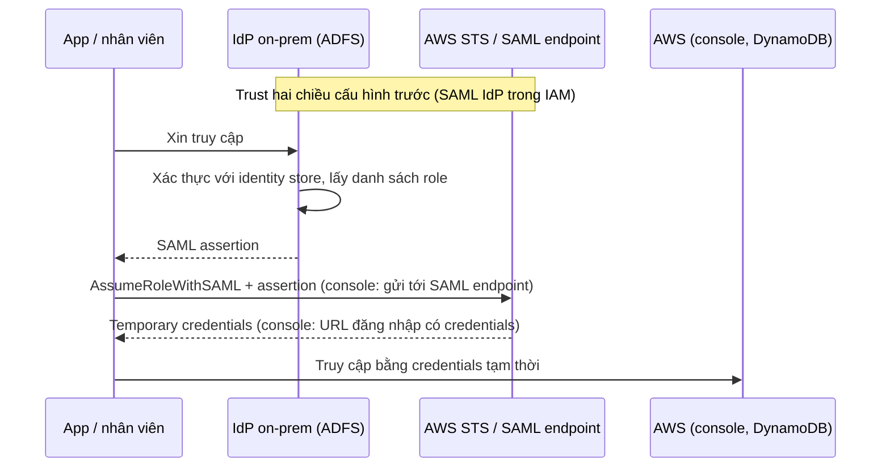

# SAML 2.0 Identity Federation

> **TL;DR:** **Identity Federation** là dùng identity từ một identity provider (IdP) **bên ngoài AWS** để truy cập tài nguyên AWS, nhưng **gián tiếp**: chỉ **AWS credentials** mới truy cập được tài nguyên AWS, nên identity ngoài phải được **đổi** lấy credentials AWS. Với **SAML 2.0** (Security Assertion Markup Language, chuẩn mở, ví dụ **Microsoft ADFS**), IdP on-prem xác thực người dùng hoặc ứng dụng rồi cấp **SAML assertion**; AWS (đã có **trust hai chiều** với IdP) đổi assertion lấy **temporary credentials** của một **IAM role** qua **`sts:AssumeRoleWithSAML`** (mặc định 1 giờ, tối đa 12 giờ). Dùng cho cả **API/CLI** lẫn **console**. Chỉ chọn khi doanh nghiệp **đã có IdP tương thích SAML 2.0**; Google/Facebook/web identity thì không phải SAML. Ngày nay [[IAM Identity Center]] thay thế phần lớn trường hợp cấu hình SAML thủ công.

## 🖼️ Sơ đồ
![[SAML 2.0 Identity Federation.excalidraw]]
*Mở bằng plugin Excalidraw để chỉnh sửa · ảnh tĩnh: [[SAML 2.0 Identity Federation.svg]]*

## Khái niệm cốt lõi
- **Identity Federation**: dùng identity của một identity provider **ngoài AWS** để truy cập tài nguyên AWS. Không bao giờ truy cập **trực tiếp** được, vì **chỉ AWS credentials** mới dùng được với tài nguyên AWS → phải có bước **trao đổi (exchange)** identity ngoài lấy credentials AWS hợp lệ.
- **SAML** = **Security Assertion Markup Language**; **SAML2** là phiên bản 2 của chuẩn. Là **chuẩn mở**, được nhiều IdP on-prem dùng, ví dụ **Microsoft Active Directory Federation Services (ADFS)**.
- SAML 2.0 federation cho phép dùng identity on-prem để **gián tiếp** truy cập **AWS Console** và **CLI/API**.
- Federation trong AWS luôn dùng **[[IAM Roles]]** và **temporary credentials**. Với SAML 2.0: credentials có hiệu lực **tối đa 12 giờ**, **mặc định 1 giờ**.

### Khi nào chọn SAML 2.0 federation
- Doanh nghiệp **đang dùng IdP doanh nghiệp** **và** IdP đó **tương thích SAML 2.0**. Phải đúng **cả hai** điều kiện.
- Có sẵn **team quản lý identity** và muốn team đó tiếp tục quản lý quyền truy cập AWS cùng với identity, tài nguyên on-prem.
- Muốn **một nguồn identity duy nhất** (single source of truth): nhân viên không phải có thêm identity riêng trong AWS, không phải nhớ nhiều tài khoản.
- **Không** chọn khi identity đến từ **Google, Facebook** hay web/social identity provider khác (không hỗ trợ SAML 2.0) → xem web identity federation trong [[IAM Roles]] và [[Cognito]].

## Cách hoạt động / Kiến trúc

### Chuẩn bị: trust hai chiều
- AWS được **đăng ký trong IdP**, và một **SAML identity provider được tạo trong IAM** của account → **trust hai chiều** giữa IAM và IdP on-prem.
- Trong IdP, identity được **ánh xạ (map) tới một hoặc nhiều IAM role**; một identity có thể dùng được nhiều role.
- Khi trust đã có, AWS **tôn trọng SAML assertion** do IdP cấp như bằng chứng đã xác thực.

### Luồng API / CLI (ứng dụng nội bộ)
Ví dụ: ứng dụng nội bộ Kangagram Enterprise của Aus-E-Mart cần đọc/ghi DynamoDB.
1. Ứng dụng **gửi yêu cầu truy cập tới IdP**.
2. IdP **xác thực** yêu cầu với identity store, rồi lấy **danh sách role** mà identity đó được dùng; ứng dụng chọn một role.
3. IdP trả về **SAML assertion**: giống một "thẻ" chứng minh identity đã được xác thực, AWS tin thẻ này.
4. Ứng dụng gọi **STS** bằng thao tác **`AssumeRoleWithSAML`**, gửi kèm assertion.
5. STS đổi assertion lấy **temporary credentials** của role.
6. Ứng dụng dùng credentials đó để truy cập dịch vụ AWS (ví dụ DynamoDB).
- Đây là kiến trúc khi bạn **tự phát triển** ứng dụng trong doanh nghiệp và muốn dùng federation để gọi AWS.

### Luồng console (nhân viên)
1. Trust được cấu hình giữa IdP (ví dụ ADFS) và **AWS SSO endpoint** (còn gọi là **AWS SAML endpoint**), tạo trong IAM của account.
2. Nhân viên (ví dụ Leo) mở **portal của IdP**. IdP xác thực: hoặc yêu cầu đăng nhập, hoặc dùng luôn phiên đăng nhập sẵn có nếu máy đã join domain Active Directory.
3. IdP đưa ra **danh sách role** Leo được dùng (admin, normal, auditing…), mỗi role một mức quyền AWS khác nhau.
4. Trình duyệt gửi **SAML assertion** tới **SAML endpoint** của AWS.
5. Endpoint **assume role** đã chọn qua STS thay cho Leo, nhận temporary credentials, rồi **tạo URL đăng nhập console** có kèm credentials và trả về trình duyệt.
6. Trình duyệt dùng URL đó để vào **AWS Management Console**. Toàn bộ diễn ra phía sau, người dùng gần như không thấy.

## Bảng so sánh / số liệu

| | **SAML 2.0 federation** | **Web identity federation** | [[IAM Identity Center]] |
|---|---|---|---|
| Nguồn identity | IdP doanh nghiệp tương thích **SAML 2.0** (ADFS…) | Google, Facebook, Apple… (web/social) | Directory sẵn có, AD, IdP SAML 2.0 ngoài |
| Thao tác STS | `AssumeRoleWithSAML` | `AssumeRoleWithWebIdentity` | Quản lý tự động phía sau |
| Người dùng điển hình | **Nhân viên** doanh nghiệp | **Khách hàng** của app web/mobile | **Nhân viên**, nhiều account trong org + business app |
| Cấu hình | Thủ công trong IAM (SAML IdP, role, trust) | Thường qua [[Cognito]] | Một chỗ, AWS khuyên dùng |

| Con số | Giá trị |
|---|---|
| Thời hạn credentials khi dùng SAML 2.0 federation | Mặc định **1 giờ**, tối đa **12 giờ** |

## 🎯 Mẹo thi SAA-C03
- "Doanh nghiệp đã có **Active Directory / ADFS** hoặc IdP **tương thích SAML 2.0**, muốn nhân viên dùng identity sẵn có để vào **console / CLI**" → **SAML 2.0 federation** (ngày nay ưu tiên qua [[IAM Identity Center]]).
- Identity ngoài **không bao giờ** truy cập AWS trực tiếp: luôn **đổi** lấy temporary credentials của **IAM role** qua STS (`AssumeRoleWithSAML`).
- Google / Facebook / social login cho **khách hàng** → **không phải SAML**; chọn web identity federation / [[Cognito]].
- Credentials của SAML federation: mặc định **1 giờ**, tối đa **12 giờ**.
- Truy cập console qua SAML: assertion gửi tới **AWS SAML (SSO) endpoint**, endpoint tạo **URL đăng nhập console**.

## Liên kết
- Tiên quyết: [[IAM Roles]], [[IAM Users and ARNs]]
- Thay thế hiện đại: [[IAM Identity Center]]
- Liên quan: [[Directory Service]], [[Cognito]], [[AWS Organizations]]
- Phân biệt với: [[Cognito]] (customer / web identity), [[IAM Users and ARNs]] (long-term credentials trong IAM)
- MOC: [[_MOC 04 IAM Accounts and Organizations]]
