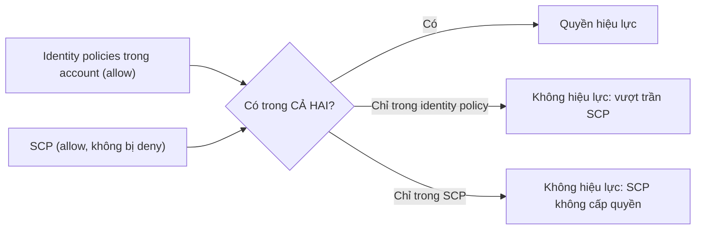

# Service Control Policies

> **TL;DR:** SCP là policy JSON của [[AWS Organizations]], attach vào root, OU hoặc account để **giới hạn tối đa** những gì account (kể cả **account root user**) được làm. SCP **không cấp quyền**; nó là **account permissions boundary**. Quyền hiệu lực = phần **giao** giữa identity policy và SCP. **Deny** gắn ở tầng nào cũng chảy xuống, còn **Allow** phải có ở **mọi tầng** (root, OU, account). **Management account không bao giờ bị SCP ảnh hưởng.**

## 🖼️ Sơ đồ
![[Service Control Policies.excalidraw]]
*Mở bằng plugin Excalidraw để chỉnh sửa · ảnh tĩnh: [[Service Control Policies.svg]]*

![[Service Control Policies - allow-deny-list.excalidraw]]
*Mở bằng plugin Excalidraw để chỉnh sửa · ảnh tĩnh: [[Service Control Policies - allow-deny-list.svg]]*

## Khái niệm cốt lõi
- SCP là **policy document JSON**, cú pháp giống IAM policy.
- Attach được vào:
  - **Organization root** → ảnh hưởng mọi account trong tổ chức.
  - **OU** → ảnh hưởng mọi account trực tiếp trong OU **và** mọi OU lồng bên dưới.
  - **Account cụ thể** → chỉ account đó.
- SCP áp theo cây tổ chức, nhưng **Deny và Allow đi xuống khác nhau** (khóa mới nhấn mạnh qua demo):
  - **Deny** gắn ở bất kỳ tầng nào (root, OU) đều **chảy xuống** và có hiệu lực với mọi OU, account bên dưới.
  - **Allow không "kế thừa" trọn vẹn**: quyền đi từ root xuống và bị **lọc ở từng tầng**, nên mỗi tầng trên đường đi (root → OU → account) đều phải có một SCP **allow**. Thiếu allow ở một tầng là account bên dưới **mất hết quyền** (implicit deny).
  - Vì thế khi bật SCP, AWS gắn `FullAWSAccess` **trực tiếp ở mọi tầng** (root, từng OU, từng account), và console **không cho detach policy cuối cùng** còn lại ở một tầng.
- **Management account là đặc biệt**: dù SCP được gắn trực tiếp, qua OU hay qua root, management account **không bao giờ bị hạn chế**. Vì vậy khóa học khuyên **không chạy tài nguyên trong management account** ở môi trường production, vì đó là account duy nhất không thể khóa bằng SCP.
- **SCP giới hạn account, kể cả root user (gián tiếp)**:
  - Account root user không thể bị giới hạn trực tiếp; nó luôn có 100% quyền *trên account*.
  - Nhưng SCP giới hạn chính **account**, tức mọi identity trong đó, nên quyền hiệu lực của root user cũng bị thu hẹp theo.
- Ví dụ dùng: chặn mọi hoạt động ngoài một region (ví dụ chỉ `us-east-1`), chỉ cho dùng một số kích thước EC2 instance.
- **SCP không cấp quyền.** Identity trong account vẫn cần identity policy; SCP chỉ quy định **trần** quyền có thể được cấp.
- SCP chỉ là một trong các loại policy của Organizations; trang Policies còn có các loại khác (ví dụ chặn dùng dữ liệu cho AI, backup policy). Phải **Enable** từng loại trước khi dùng.

## Cách hoạt động / Kiến trúc

### Logic đánh giá
- SCP dùng cùng quy tắc **Deny – Allow – Deny** (xem [[IAM Identity Policies]]):
  - Explicit deny trong SCP → service đó **không thể** được cấp trong account.
  - Explicit allow trong SCP → service đó **có thể** được cấp (nếu identity policy cũng allow).
  - Không có gì → **implicit deny** (khi SCP được bật).
- Khi **bật SCP**, AWS tự gắn policy **`FullAWSAccess`** (`Allow` `*` trên `*`) vào root và mọi OU/account → mặc định **không hạn chế gì**.
- Ví dụ trong demo: OU `prod` có `FullAWSAccess` + `DenyS3` → Production dùng mọi thứ trừ S3. Gỡ `FullAWSAccess` khỏi OU `prod` (chỉ còn `DenyS3`) → Production bị **từ chối mọi thứ**, dù root vẫn có `FullAWSAccess`, vì tầng OU không còn allow nào.

### Quyền hiệu lực = giao của identity policy và SCP

- Slide dùng sơ đồ Venn: phần chỉ nằm trong identity policy (identity allow nhưng vượt quá SCP) → **bị từ chối**; phần chỉ nằm trong SCP (SCP cho phép nhưng không identity nào được cấp) → **không có tác dụng**. Chỉ phần **giao nhau** mới thực sự được phép.

### Allow list vs Deny list
| | **Deny list** (mặc định) | **Allow list** |
|---|---|---|
| Cách làm | Giữ `FullAWSAccess`, thêm SCP **explicit deny** cho service muốn chặn (ví dụ `DenyS3`) | **Gỡ** `FullAWSAccess` (chỉ còn implicit deny), tạo SCP **explicit allow** từng service (ví dụ chỉ S3 và EC2) |
| Service mới AWS ra mắt | Tự động được phép (wildcard) | Bị chặn cho tới khi thêm vào |
| Bảo mật | Thấp hơn | **Cao hơn**: chỉ service được liệt kê mới dùng được |
| Admin overhead | **Thấp** | Cao, dễ vô tình chặn nhầm service |
| Khóa học khuyên | **Thường dùng** cái này | Khi cần kiểm soát chặt |

## Demo / Lab
Đăng nhập `iamadmin` ở General (management account); đã có OU `prod`, `dev` từ demo [[AWS Organizations]].

**Part 1 – Enable SCPs**
1. Role switch vào **Production** (assume `OrganizationAccountAccessRole` có **AdministratorAccess**), tạo bucket `catpics<ký tự ngẫu nhiên>`, upload ảnh, mở được. EC2 cũng dùng bình thường.
2. Về General → Organizations → **Policies** (có nhiều loại policy) → **Service control policies** → **Enable**. `FullAWSAccess` được gắn ở **mọi tầng**: tab *Targets* cho thấy root, mọi OU và mọi account.
3. Production vẫn dùng S3, EC2 bình thường (chưa hạn chế gì).
4. Thử **detach** `FullAWSAccess` gắn trực tiếp trên OU `prod` → bị chặn: không được detach policy **cuối cùng** ở một tầng, vì allow phải có ở mọi tầng.

**Part 2 – Configure Custom SCPs**
1. Tạo SCP **DenyS3** (`Deny s3:*` trên `*`), attach vào **OU prod**. Production: S3 báo **không có quyền**, EC2 và service khác vẫn dùng được (deny gắn ở OU chảy xuống account).
2. Detach `FullAWSAccess` khỏi OU `prod` (giờ được vì còn DenyS3) → Production bị **access denied ở mọi service**: allow từ root không đi qua được tầng OU. Gắn lại `FullAWSAccess` vào OU.
3. Detach DenyS3 khỏi OU, attach vào **root** → Production và Development bị chặn S3, còn General (management) vẫn dùng S3 bình thường.
4. Dọn dẹp: detach DenyS3 khỏi root, chỉ để lại `FullAWSAccess`.
- Bài học: SCP giới hạn được cả một role **AdministratorAccess** trong member account; deny chảy xuống từ tầng bất kỳ, allow phải có ở mọi tầng; management account không bao giờ bị ảnh hưởng.

## 🎯 Mẹo thi SAA-C03
- **SCP không bao giờ cấp quyền**, chỉ giới hạn. Đáp án "dùng SCP để cấp quyền cho user" là sai.
- **Management account không bị SCP ảnh hưởng.** Muốn hạn chế thì đừng đặt workload ở đó.
- SCP **gián tiếp giới hạn cả root user** của member account. Đây là cách duy nhất "giới hạn root" trong các lựa chọn của đề.
- Yêu cầu "chặn mọi account trong tổ chức dùng region X / service Y" → **SCP** gắn ở root hoặc OU.
- Quyền hiệu lực = **identity policy ∩ SCP**, explicit deny ở bất kỳ đâu đều thắng.
- Mặc định là **deny list** với `FullAWSAccess`; allow list phải gỡ `FullAWSAccess`.
- **Deny** gắn ở root/OU chảy xuống mọi account; **Allow** phải có ở **mọi tầng** root → OU → account. Gỡ hết allow ở một OU là account trong OU đó mất mọi quyền.
- (Ngoài khóa học: SCP cũng không ảnh hưởng tới **service-linked role**. Từ cuối 2024 Organizations có thêm **Resource Control Policies (RCP)** để đặt trần cho *resource-based policy*; SCP thì đặt trần cho *principal* trong account.)

## Liên kết
- Tiên quyết: [[AWS Organizations]], [[IAM Identity Policies]]
- Liên quan: [[IAM Roles]], [[AWS Control Tower]] (guardrails dạng preventive dùng SCP), [[AWS Accounts]], [[Service-linked Roles and PassRole]]
- Phân biệt với: [[IAM Identity Policies]] (cấp quyền cho identity), [[S3 Security]] (resource policy)
- MOC: [[_MOC 04 IAM Accounts and Organizations]]
