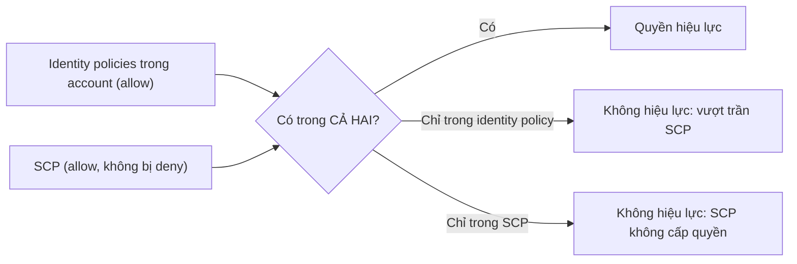

# Service Control Policies

> **TL;DR:** SCP là policy JSON của [[AWS Organizations]], attach vào root, OU hoặc account để **giới hạn tối đa** những gì account (kể cả **account root user**) được làm. SCP **không cấp quyền**; nó là **account permissions boundary**. Quyền hiệu lực = phần **giao** giữa identity policy và SCP. **Management account không bao giờ bị SCP ảnh hưởng.**

## 🖼️ Sơ đồ
![[Service Control Policies.excalidraw]]
*Mở bằng plugin Excalidraw để chỉnh sửa · ảnh tĩnh: [[Service Control Policies.svg]]*

![[Service Control Policies - allow-deny-list.excalidraw]]
*Mở bằng plugin Excalidraw để chỉnh sửa · ảnh tĩnh: [[Service Control Policies - allow-deny-list.svg]]*

## Khái niệm cốt lõi
- SCP là **policy document JSON**, cú pháp giống IAM policy.
- Attach được vào:
  - **Organization root** → ảnh hưởng mọi account trong tổ chức.
  - **OU** → ảnh hưởng mọi account trực tiếp trong OU **và** mọi OU lồng bên dưới.
  - **Account cụ thể** → chỉ account đó.
- SCP **kế thừa xuống** cây tổ chức.
- **Management account là đặc biệt**: dù SCP được gắn trực tiếp, qua OU hay qua root, management account **không bao giờ bị hạn chế**. Vì vậy Adrian khuyên **không chạy tài nguyên trong management account** ở môi trường production, vì đó là account duy nhất không thể khóa bằng SCP.
- **SCP giới hạn account, kể cả root user (gián tiếp)**:
  - Account root user không thể bị giới hạn trực tiếp; nó luôn có 100% quyền *trên account*.
  - Nhưng SCP giới hạn chính **account**, tức mọi identity trong đó, nên quyền hiệu lực của root user cũng bị thu hẹp theo.
- Ví dụ dùng: chặn mọi hoạt động ngoài một region (ví dụ chỉ `us-east-1`), chỉ cho dùng một số kích thước EC2 instance.
- **SCP không cấp quyền.** Identity trong account vẫn cần identity policy; SCP chỉ quy định **trần** quyền có thể được cấp.

## Cách hoạt động / Kiến trúc

### Logic đánh giá
- SCP dùng cùng quy tắc **Deny – Allow – Deny** (xem [[IAM Identity Policies]]):
  - Explicit deny trong SCP → service đó **không thể** được cấp trong account.
  - Explicit allow trong SCP → service đó **có thể** được cấp (nếu identity policy cũng allow).
  - Không có gì → **implicit deny** (khi SCP được bật).
- Khi **bật SCP**, AWS tự gắn policy **`FullAWSAccess`** (`Allow` `*` trên `*`) vào root và mọi OU/account → mặc định **không hạn chế gì**.

### Quyền hiệu lực = giao của identity policy và SCP

- Slide dùng sơ đồ Venn: phần chỉ nằm trong identity policy (identity allow nhưng vượt quá SCP) → **bị từ chối**; phần chỉ nằm trong SCP (SCP cho phép nhưng không identity nào được cấp) → **không có tác dụng**. Chỉ phần **giao nhau** mới thực sự được phép.

### Allow list vs Deny list
| | **Deny list** (mặc định) | **Allow list** |
|---|---|---|
| Cách làm | Giữ `FullAWSAccess`, thêm SCP **explicit deny** cho service muốn chặn (ví dụ `DenyS3`) | **Gỡ** `FullAWSAccess` (chỉ còn implicit deny), tạo SCP **explicit allow** từng service (ví dụ chỉ S3 và EC2) |
| Service mới AWS ra mắt | Tự động được phép (wildcard) | Bị chặn cho tới khi thêm vào |
| Bảo mật | Thấp hơn | **Cao hơn**: chỉ service được liệt kê mới dùng được |
| Admin overhead | **Thấp** | Cao, dễ vô tình chặn nhầm service |
| Adrian khuyên | **Thường dùng** cái này | Khi cần kiểm soát chặt |

## Demo / Lab
**0081 – Using SCPs** (đăng nhập General = management account)
1. Organizations: tạo OU **prod** và **dev** dưới root, **move** account Production vào `prod`, Development vào `dev`. General vẫn ở root.
2. Role switch vào **Production** (assume `OrganizationAccountAccessRole` có **AdministratorAccess**), tạo bucket `catpics<số ngẫu nhiên>` ở `us-east-1`, upload ảnh *samson.jpg*, mở được.
3. Về General → Organizations → Policies → **Enable Service Control Policies**. AWS gắn `FullAWSAccess` lên toàn tổ chức (chưa hạn chế gì).
4. Tạo SCP **AllowAllExceptS3** gồm 2 statement: `Allow *` trên `*` và `Deny s3:*` trên `*`.
5. Attach vào **OU prod**, rồi **detach** `FullAWSAccess` gắn trực tiếp trên OU (vẫn còn bản kế thừa từ root).
6. Ở General (management) vẫn dùng S3 bình thường. Switch sang Production: S3 console báo **không có quyền list bucket**, dù role là admin. EC2 và các service khác vẫn dùng được (đi tới bước launch instance không lỗi).
7. Gắn lại `FullAWSAccess`, detach AllowAllExceptS3 → Production truy cập S3 lại được. Dọn dẹp: empty và delete bucket.
- Bài học: SCP giới hạn được cả một role **AdministratorAccess** trong member account.

## 🎯 Mẹo thi SAA-C03
- **SCP không bao giờ cấp quyền**, chỉ giới hạn. Đáp án "dùng SCP để cấp quyền cho user" là sai.
- **Management account không bị SCP ảnh hưởng.** Muốn hạn chế thì đừng đặt workload ở đó.
- SCP **gián tiếp giới hạn cả root user** của member account. Đây là cách duy nhất "giới hạn root" trong các lựa chọn của đề.
- Yêu cầu "chặn mọi account trong tổ chức dùng region X / service Y" → **SCP** gắn ở root hoặc OU.
- Quyền hiệu lực = **identity policy ∩ SCP**, explicit deny ở bất kỳ đâu đều thắng.
- Mặc định là **deny list** với `FullAWSAccess`; allow list phải gỡ `FullAWSAccess`.
- (Ngoài khóa học: SCP cũng không ảnh hưởng tới **service-linked role**. Từ cuối 2024 Organizations có thêm **Resource Control Policies (RCP)** để đặt trần cho *resource-based policy*; SCP thì đặt trần cho *principal* trong account.)

## Liên kết
- Tiên quyết: [[AWS Organizations]], [[IAM Identity Policies]]
- Liên quan: [[IAM Roles]], [[AWS Control Tower]] (guardrails dạng preventive dùng SCP), [[AWS Accounts]], [[Service-linked Roles and PassRole]]
- Phân biệt với: [[IAM Identity Policies]] (cấp quyền cho identity), [[S3 Security]] (resource policy)
- MOC: [[_MOC 04 IAM Accounts and Organizations]]
