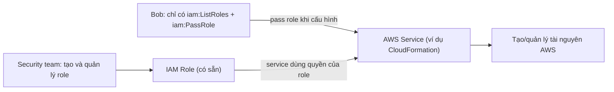

# Service-linked Roles and PassRole

> **TL;DR:** Service-linked role là một IAM role đặc biệt **gắn với một AWS service cụ thể**, có quyền do chính service định nghĩa sẵn để service đó gọi các service khác thay bạn. Khác biệt chính: **không xóa được khi service còn dùng nó**. `iam:PassRole` là quyền cho phép một identity **gán (pass) một role đã có sẵn** cho service mà không cần quyền tạo/sửa role. Đây là cơ chế **role separation**.

## 🖼️ Sơ đồ
![[Service-linked Roles and PassRole.excalidraw]]
*Mở bằng plugin Excalidraw để chỉnh sửa · ảnh tĩnh: [[Service-linked Roles and PassRole.svg]]*

## Khái niệm cốt lõi

### Service-linked role (SLR)
- Là [[IAM Roles|IAM role]] liên kết với **một** AWS service; quyền được **service định nghĩa trước**, đúng những gì service đó cần để tương tác với các service khác thay bạn.
- Có thể được tạo theo 3 cách:
  - Service **tự tạo** (thường khi bạn dùng tính năng lần đầu).
  - Service cho phép bạn tạo trong **quá trình setup**.
  - Tạo thủ công trong **IAM**.
- **Khác biệt then chốt với role thường**: **không xóa được** SLR cho tới khi nó **không còn được dùng** trong service đó.
- Quyền để tạo SLR: action `iam:CreateServiceLinkedRole`, với tên service dạng `<service-name>.amazonaws.com` (ví dụ trong policy dùng điều kiện `iam:AWSServiceName`).
  - **Đừng đoán** chuỗi tên service: mỗi service viết khác nhau, **phân biệt hoa thường**, không suy ra được từ tên sản phẩm. Phải tra tài liệu của service.

### PassRole và role separation
- *Role separation* ở đây là **phân tách vai trò công việc**: một nhóm (ví dụ security team) được tạo/sửa role, nhóm khác (ví dụ Bob) chỉ được **dùng** role đó với service.
- Muốn Bob gán một role có sẵn cho service mà **không** được tạo hay sửa role, cấp cho Bob quyền `iam:PassRole` (thường kèm `iam:ListRoles`) **trên đúng ARN role đó**:

```json
{
  "Effect": "Allow",
  "Action": ["iam:ListRoles", "iam:PassRole"],
  "Resource": "arn:aws:iam::123456789012:role/my-role-for-XYZ"
}
```

## Cách hoạt động / Kiến trúc



### Ví dụ với CloudFormation
- **Mặc định**: CloudFormation dùng **quyền của identity đang tạo stack**. Bạn cần quyền tạo stack **và** quyền tạo mọi tài nguyên trong stack.
- **Với PassRole**: Bob có quyền tạo stack + pass một role vào CloudFormation. **Role đó có thể có quyền lớn hơn quyền của Bob**, ví dụ được tạo tài nguyên mà Bob không được tạo trực tiếp. CloudFormation dùng quyền của role để làm việc với AWS (xem [[CFN Stack Roles]]).
- Cùng mô hình áp dụng cho service-linked role và các role gán cho service khác (ví dụ gán role cho EC2 qua [[EC2 Instance Roles|instance profile]]).

## Bảng so sánh / số liệu
| | IAM role thường | Service-linked role |
|---|---|---|
| Ai định nghĩa quyền | Bạn | **AWS service** định nghĩa sẵn |
| Gắn với | Bất kỳ principal nào trong trust policy | **Một service cụ thể** |
| Tạo bởi | Bạn | Service tự tạo / trong setup / qua IAM |
| Xóa | Bất cứ lúc nào | **Chỉ khi service không còn dùng** |

## 🎯 Mẹo thi SAA-C03
- "User cần cấu hình service với một role có sẵn nhưng không được tạo/sửa role" → cấp **`iam:PassRole`** trên ARN role đó.
- PassRole cho phép user khởi chạy service với quyền **cao hơn** quyền của chính user, có kiểm soát (ví dụ CloudFormation stack role). Đây là kiến trúc bảo mật quan trọng.
- Service-linked role **không xóa được** khi service còn dùng.
- Đề hỏi "role do service tự tạo, quyền do service định nghĩa" → service-linked role.

## Liên kết
- Tiên quyết: [[IAM Roles]], [[IAM Identity Policies]]
- Liên quan: [[CFN Stack Roles]], [[CloudFormation Basics]], [[EC2 Instance Roles]], [[Lambda]]
- Phân biệt với: [[IAM Roles]] (role thường, bạn tự định nghĩa trust/permissions policy)
- MOC: [[_MOC 04 IAM Accounts and Organizations]]
