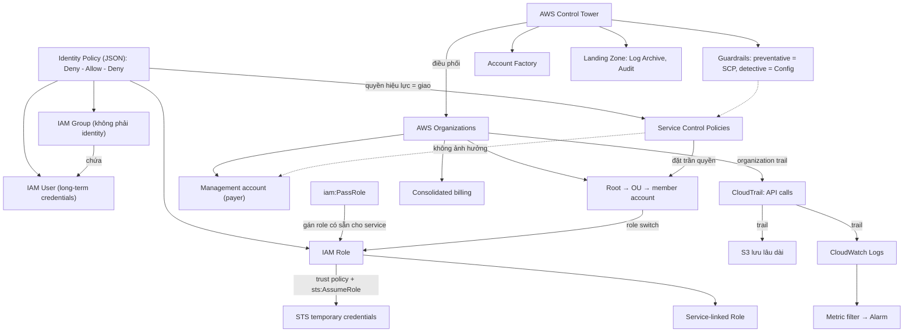

# 04 IAM Accounts and Organizations

Section đi sâu vào quản lý danh tính và quản trị nhiều account: cách policy được đánh giá (Deny – Allow – Deny), khi nào dùng user, group hay role, cách AWS service nhận quyền (service-linked role, PassRole), rồi mở rộng lên AWS Organizations, SCP và Control Tower. Section kết thúc bằng hai dịch vụ ghi nhận hoạt động là CloudWatch Logs và CloudTrail. Đây là nền cho mọi câu hỏi "Design Secure Architectures" và được dùng lại ở S3 (bucket policy), EC2 (instance role) và Security.

← [[00 Home]] · Section trước: [[_MOC 03 AWS Fundamentals]] · Section tiếp theo: [[_MOC 05 S3]] →

## Lộ trình học
1. [[IAM Identity Policies]]: policy JSON gồm các statement Allow/Deny gắn vào user/group/role; đánh giá theo Deny – Allow – Deny, explicit deny luôn thắng.
2. [[IAM Users and ARNs]]: user là identity dài hạn dùng long-term credentials; ARN định danh mọi tài nguyên; 5.000 user/account, 10 group/user.
3. [[IAM Groups]]: container chứa user để gán quyền chung; không có credentials, không lồng nhau, không làm principal được.
4. [[IAM Roles]]: identity đại diện cho một mức truy cập, được assume để nhận temporary credentials từ STS; có trust policy và permissions policy.
5. [[Service-linked Roles and PassRole]]: role do service định nghĩa và không xóa được khi còn dùng; `iam:PassRole` cho phép gán role có sẵn cho service.
6. [[AWS Organizations]]: gom nhiều account vào cây root → OU → account, consolidated billing, SCP, role switch giữa account.
7. [[Service Control Policies]]: policy của Organizations đặt trần quyền cho account (kể cả root user), không cấp quyền; management account không bị ảnh hưởng.
8. [[CloudWatch Logs]]: dịch vụ log public, regional; log event → log stream → log group; metric filter biến log thành metric.
9. [[CloudTrail]]: ghi API call vào account; Event History 90 ngày; trail đổ ra S3/CloudWatch Logs; management vs data events; trễ ~15 phút.
10. [[AWS Control Tower]]: dựng môi trường multi-account có quản trị bằng Landing Zone, Guardrails, Account Factory, điều phối Organizations và các dịch vụ khác.

## Bản đồ khái niệm

## Liên kết sang section khác
- [[IAM Basics]] và [[AWS Accounts]]: nền tảng IAM và account từ section 01.
- [[EC2 Instance Roles]]: role áp dụng cho ứng dụng chạy trên EC2.
- [[S3 Security]]: resource policy, nơi principal được dùng và group không làm principal được.
- [[Cognito]]: web identity federation cho app hàng triệu người dùng.
- [[Directory Service]]: nguồn identity doanh nghiệp cho ID federation.
- [[CFN Stack Roles]]: ví dụ PassRole để chạy CloudFormation với quyền cao hơn user.
- [[AWS Config]]: detective guardrail và câu hỏi "tài nguyên có tuân thủ không".
- [[CloudWatch Agent]]: đưa log trong OS/on-prem vào CloudWatch Logs.
- [[Reserved Instances and Savings Plans]]: giảm giá được chia sẻ trong organization.

## 🎯 Top mẹo thi của section
- Thuộc lòng **Deny – Allow – Deny**: explicit deny luôn thắng; không có allow nào khớp = implicit deny ([[IAM Identity Policies]]).
- Quyền chung cho nhiều người → **managed policy**; ngoại lệ cho một người → **inline policy** ([[IAM Identity Policies]]).
- Hơn 5.000 user hoặc app hàng triệu người dùng mà đáp án "tạo IAM user cho mỗi người" → **sai**; dùng federation / role / Cognito ([[IAM Users and ARNs]]).
- Phân biệt `arn:aws:s3:::bucket` và `arn:aws:s3:::bucket/*` khi đọc policy ([[IAM Users and ARNs]]).
- Group **không có credentials**, **không lồng nhau**, **không làm principal** trong resource policy; user tối đa 10 group ([[IAM Groups]]).
- AWS service cần quyền → **role**, không hard-code access key; trust policy = ai được assume, permissions policy = được làm gì ([[IAM Roles]]).
- Đối tác/account khác cần truy cập → **cross-account role**; doanh nghiệp có AD cần SSO → **ID federation + role** ([[IAM Roles]]).
- User cần cấu hình service với role có sẵn nhưng không được tạo/sửa role → cấp **`iam:PassRole`** ([[Service-linked Roles and PassRole]]).
- "Nhiều account, một hóa đơn" → Organizations + **consolidated billing**; giảm giá volume, RI, Savings Plans được chia sẻ ([[AWS Organizations]]).
- Truy cập nhiều account: **một account identity + role switch**; đừng nhầm organization root với account root user ([[AWS Organizations]]).
- **SCP không cấp quyền**, chỉ giới hạn; gián tiếp giới hạn cả root user của member account; **management account không bị SCP ảnh hưởng** ([[Service Control Policies]]).
- "Chặn mọi account trong tổ chức dùng region X / service Y" → SCP gắn ở root hoặc OU ([[Service Control Policies]]).
- "Tạo metric/alarm từ nội dung log" → **metric filter**; retention và permissions đặt ở **log group** ([[CloudWatch Logs]]).
- CloudTrail **không real-time** (~15 phút); mặc định chỉ management events 90 ngày; cần S3 object-level hoặc Lambda invoke → bật **data events** ([[CloudTrail]]).
- "Quickly set up / govern multi-account environment, landing zone" → **Control Tower**; preventative guardrail = SCP, detective = Config ([[AWS Control Tower]]).
