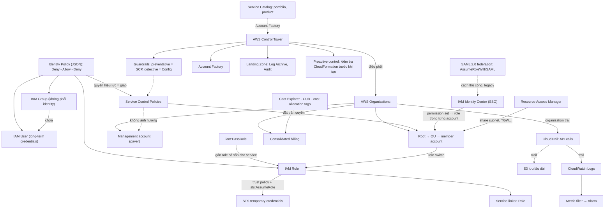

# 04 IAM Accounts and Organizations

Section đi sâu vào quản lý danh tính và quản trị nhiều account: cách policy được đánh giá (Deny – Allow – Deny), khi nào dùng user, group hay role, cách AWS service nhận quyền (service-linked role, PassRole), rồi mở rộng lên AWS Organizations, SCP và Control Tower. Tiếp theo là hai dịch vụ ghi nhận hoạt động (CloudWatch Logs, CloudTrail), rồi các công cụ quản trị nhiều account mà bản khóa mới bổ sung: Service Catalog, quản lý chi phí (Cost Explorer, CUR, cost allocation tags), federation bằng SAML 2.0 và IAM Identity Center, Resource Access Manager, Artifact và License Manager. Đây là nền cho mọi câu hỏi "Design Secure Architectures" và được dùng lại ở S3 (bucket policy), EC2 (instance role) và Security.

← [[00 Home]] · Section trước: [[_MOC 03 AWS Fundamentals]] · Section tiếp theo: [[_MOC 05 S3]] →

## Lộ trình học
1. [[IAM Identity Policies]]: policy JSON gồm các statement Allow/Deny gắn vào user/group/role; đánh giá theo Deny – Allow – Deny, explicit deny luôn thắng.
2. [[IAM Users and ARNs]]: user là identity dài hạn dùng long-term credentials; ARN định danh mọi tài nguyên; 5.000 user/account, 10 group/user.
3. [[IAM Groups]]: container chứa user để gán quyền chung; không có credentials, không lồng nhau, không làm principal được.
4. [[IAM Roles]]: identity đại diện cho một mức truy cập, được assume để nhận temporary credentials từ STS; có trust policy và permissions policy.
5. [[Service-linked Roles and PassRole]]: role do service định nghĩa và không xóa được khi còn dùng; `iam:PassRole` cho phép gán role có sẵn cho service.
6. [[AWS Organizations]]: gom nhiều account vào cây root → OU → account, consolidated billing, SCP, role switch giữa account.
7. [[Service Control Policies]]: policy của Organizations đặt trần quyền cho account (kể cả root user), không cấp quyền; management account không bị ảnh hưởng.
8. [[CloudWatch Logs]]: dịch vụ log public, regional; log event → log stream → log group; metric filter biến log thành metric.
9. [[CloudTrail]]: ghi API call vào account; Event History 90 ngày; trail đổ ra S3/CloudWatch Logs; management, data, network activity events; không real-time (log giao khoảng 5 phút một lần).
10. [[AWS Service Catalog]]: cổng self-service cho end user launch product (CloudFormation/Terraform) gom trong portfolio, quyền tạo hạ tầng do admin cấp.
11. [[AWS Cost Management]]: Cost Explorer (lọc, dự báo), Data Exports/CUR 2.0 (chi tiết nhất, vào S3), cost allocation tags (phải activate).
12. [[SAML 2.0 Identity Federation]]: IdP doanh nghiệp tương thích SAML 2.0 cấp assertion, STS AssumeRoleWithSAML đổi lấy credentials tạm thời cho API/CLI và console.
13. [[IAM Identity Center]]: SSO một identity vào mọi account trong organization và business app; identity source, permission set, organization instance ở management account.
14. [[AWS Control Tower]]: dựng môi trường multi-account có quản trị bằng Landing Zone, controls (guardrails), Account Factory, điều phối Organizations và các dịch vụ khác.
15. [[AWS Resource Access Manager]]: chia sẻ (không sao chép) subnet, Transit Gateway… cho account, OU, organization; regional, miễn phí, không re-share.
16. [[AWS Artifact and License Manager]]: Artifact tải báo cáo compliance của AWS; License Manager theo dõi license và chặn launch vượt license (self-managed license).

## Bản đồ khái niệm

## Liên kết sang section khác
- [[IAM Basics]] và [[AWS Accounts]]: nền tảng IAM và account từ section 01.
- [[EC2 Instance Roles]]: role áp dụng cho ứng dụng chạy trên EC2.
- [[S3 Security]]: resource policy, nơi principal được dùng và group không làm principal được.
- [[Cognito]]: web identity federation cho app hàng triệu người dùng (customer identity; workforce dùng [[IAM Identity Center]]).
- [[AWS Budgets]]: cảnh báo chi phí, đi cùng [[AWS Cost Management]].
- [[Directory Service]]: nguồn identity doanh nghiệp cho ID federation.
- [[CFN Stack Roles]]: ví dụ PassRole để chạy CloudFormation với quyền cao hơn user.
- [[AWS Config]]: detective guardrail và câu hỏi "tài nguyên có tuân thủ không".
- [[CloudWatch Agent]]: đưa log trong OS/on-prem vào CloudWatch Logs.
- [[Reserved Instances and Savings Plans]]: giảm giá được chia sẻ trong organization.

## 🎯 Top mẹo thi của section
- Thuộc lòng **Deny – Allow – Deny**: explicit deny luôn thắng; không có allow nào khớp = implicit deny ([[IAM Identity Policies]]).
- Quyền chung cho nhiều người → **managed policy**; ngoại lệ cho một người → **inline policy** ([[IAM Identity Policies]]).
- Hơn 5.000 user hoặc app hàng triệu người dùng mà đáp án "tạo IAM user cho mỗi người" → **sai**; dùng federation / role / Cognito ([[IAM Users and ARNs]]).
- Phân biệt `arn:aws:s3:::bucket` và `arn:aws:s3:::bucket/*` khi đọc policy ([[IAM Users and ARNs]]).
- Group **không có credentials**, **không lồng nhau**, **không làm principal** trong resource policy; user tối đa 10 group ([[IAM Groups]]).
- AWS service cần quyền → **role**, không hard-code access key; trust policy = ai được assume, permissions policy = được làm gì ([[IAM Roles]]).
- Đối tác/account khác cần truy cập → **cross-account role**; doanh nghiệp có AD cần SSO → **ID federation + role** ([[IAM Roles]]).
- User cần cấu hình service với role có sẵn nhưng không được tạo/sửa role → cấp **`iam:PassRole`** ([[Service-linked Roles and PassRole]]).
- "Nhiều account, một hóa đơn" → Organizations + **consolidated billing**; giảm giá volume, RI, Savings Plans được chia sẻ ([[AWS Organizations]]).
- Truy cập nhiều account: **một account identity + role switch**; đừng nhầm organization root với account root user ([[AWS Organizations]]).
- **SCP không cấp quyền**, chỉ giới hạn; gián tiếp giới hạn cả root user của member account; **management account không bị SCP ảnh hưởng** ([[Service Control Policies]]).
- SCP **Deny** gắn ở root/OU chảy xuống mọi account; **Allow** phải có ở **mọi tầng** root → OU → account, thiếu một tầng là mất hết quyền ([[Service Control Policies]]).
- "Chặn mọi account trong tổ chức dùng region X / service Y" → SCP gắn ở root hoặc OU ([[Service Control Policies]]).
- "Tạo metric/alarm từ nội dung log" → **metric filter** (không áp ngược log cũ); retention, quyền, **log class** (Standard / Infrequent Access, không đổi được) đặt ở **log group** ([[CloudWatch Logs]]).
- CloudTrail **không real-time** (log giao khoảng 5 phút một lần); mặc định chỉ management events 90 ngày; cần S3 object-level hoặc Lambda invoke → bật **data events** ([[CloudTrail]]).
- End user tự triển khai hạ tầng chuẩn, có kiểm soát, không cần quyền hạ tầng → **Service Catalog** ([[AWS Service Catalog]]).
- Xem/dự báo chi phí → **Cost Explorer**; dữ liệu chi tiết nhất cho Athena/BI → **CUR (Data Exports)**; chargeback theo dự án/phòng ban → **cost allocation tags** (phải activate) ([[AWS Cost Management]]).
- Nhân viên SSO vào nhiều account + app → **IAM Identity Center**; IdP SAML 2.0 (ADFS) cấu hình thủ công → `AssumeRoleWithSAML`; khách hàng đăng nhập Google/Facebook → Cognito ([[IAM Identity Center]], [[SAML 2.0 Identity Federation]]).
- "Quickly set up / govern multi-account environment, landing zone" → **Control Tower**; preventative control = SCP, detective = Config, proactive = kiểm tra CloudFormation trước khi tạo ([[AWS Control Tower]]).
- Nhiều account dùng **chung** subnet / Transit Gateway, không nhân bản → **RAM** (không phải StackSets) ([[AWS Resource Access Manager]]).
- Báo cáo compliance của AWS → **Artifact**; ép tuân thủ license, chặn launch vượt license → **License Manager** ([[AWS Artifact and License Manager]]).
