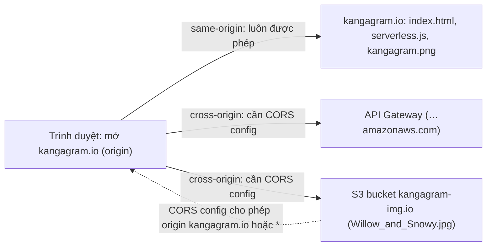

# CORS

> **TL;DR:** **Cross-Origin Resource Sharing (CORS)** là cơ chế bảo mật web (chuẩn web, không riêng AWS) mà nhiều dịch vụ AWS dùng, như S3 và API Gateway. Trang web bạn mở đầu tiên xác định **origin** (protocol + domain + port). Request tới **cùng origin** luôn được phép; request tới **origin khác** (bucket ảnh ở domain khác, API Gateway) **mặc định bị hạn chế**, và chỉ chạy được khi phía được gọi có **CORS configuration** cho phép origin đó (hoặc `*`). Với S3, CORS configuration viết bằng **JSON hoặc XML**, các rule được xét **theo thứ tự**, rule khớp đầu tiên được dùng. CORS **không phải permission**: nó không thay cho bucket policy.

## 🖼️ Sơ đồ
![[CORS.excalidraw]]
*Mở bằng plugin Excalidraw để chỉnh sửa · ảnh tĩnh: [[CORS.svg]]*

## Khái niệm cốt lõi
- **Origin** là chỗ trình duyệt kết nối tới **đầu tiên**. Ví dụ Aus-E-Mart làm app **Kangagram** chia sẻ ảnh thú Úc: mở `kangagram.io` thì `kangagram.io` là origin.
  - Về kỹ thuật, origin là **cả URI gốc**: `https://kangagram.io`. **Protocol** và **port** khác cũng là origin khác, không chỉ domain. Bài chỉ nói theo domain cho dễ hiểu.
- **Same-origin request**: `index.html` của `kangagram.io` tham chiếu `serverless.js` và `kangagram.png` cũng ở `kangagram.io` → **luôn được phép**, trình duyệt không lo gì.
- **Cross-origin request**: trang tham chiếu tài nguyên ở **domain khác** với origin. Ví dụ `serverless.js` gọi **API Gateway** (domain `…amazonaws.com`) để lấy metadata ảnh, rồi tải `Willow_and_Snowy.jpg` từ bucket `kangagram-img.io`.
  - Cross-origin **mặc định bị hạn chế**. Phía được gọi (bucket `kangagram-img.io`, API Gateway) phải có **CORS configuration** cho phép origin `kangagram.io` hoặc `*`, nếu không request **thất bại**.
  - Mỗi resource tự quyết định nó chấp nhận request từ những origin nào.
- CORS là khái niệm cần biết dù bạn là architect, developer hay engineer, vì gặp ở mọi ứng dụng web gọi tài nguyên từ nhiều domain.

## Cách hoạt động / Kiến trúc



### CORS configuration trên S3
- Viết bằng **JSON hoặc XML**, gồm nhiều rule. Mỗi rule có `AllowedHeaders`, `AllowedMethods`, `AllowedOrigins`, `ExposeHeaders`.
- Ví dụ trên slide (CORS config của bucket `kangagram-img.io`):

```json
[
  {
    "AllowedHeaders": ["*"],
    "AllowedMethods": ["PUT", "POST", "DELETE"],
    "AllowedOrigins": ["http://kangagram.io"],
    "ExposeHeaders": []
  },
  {
    "AllowedHeaders": [],
    "AllowedMethods": ["GET"],
    "AllowedOrigins": ["*"],
    "ExposeHeaders": []
  }
]
```

  - Rule 1: origin `kangagram.io` được gửi PUT, POST, DELETE.
  - Rule 2: **mọi origin** (`*`) được GET.
- Các rule được xử lý **theo thứ tự**, **rule khớp đầu tiên** được dùng.
- Slide nhấn mạnh: đây **không phải permission**. CORS chỉ cho trình duyệt biết có được gửi request cross-origin hay không; quyền đọc/ghi object vẫn do bucket policy / identity policy quyết định (xem [[S3 Security]]).

### Simple request và preflighted request
- **Simple request**: gọi thẳng sang origin khác, không cần gì đặc biệt; chỉ cần origin kia được cấu hình cho phép origin gốc.
- **Preflighted request**: với request phức tạp hơn simple request, trình duyệt **gửi trước một HTTP request** tới origin kia để hỏi request thật có an toàn để gửi không, rồi mới gửi request thật.
- Phía được gọi trả lời bằng các **response header**:

| Response header | Ý nghĩa |
|---|---|
| `Access-Control-Allow-Origin` | `*` hoặc một origin cụ thể được phép gửi request |
| `Access-Control-Max-Age` | Kết quả preflight được **cache bao lâu** trước khi phải preflight lại |
| `Access-Control-Allow-Methods` | `*` hoặc danh sách method được dùng cho cross-origin request (GET, PUT, DELETE…) |
| `Access-Control-Allow-Headers` | Những HTTP header được phép dùng trong request thật (trả về khi preflight) |

- Chi tiết preflight đầy đủ không cần cho đề thi (giảng viên để link đọc thêm).

## Bảng so sánh / số liệu
| | Same-origin | Cross-origin |
|---|---|---|
| Định nghĩa | Cùng protocol + domain + port với trang gốc | Khác ít nhất một trong protocol, domain, port |
| Mặc định | **Luôn được phép** | **Bị hạn chế** |
| Cần làm gì | Không cần gì | Phía được gọi bật **CORS configuration** cho phép origin gốc hoặc `*` |
| Ví dụ trong bài | `kangagram.io` → `serverless.js`, `kangagram.png` | `kangagram.io` → bucket `kangagram-img.io`, API Gateway |

## 🎯 Mẹo thi SAA-C03
- Trang web ở domain A gọi object trong S3 bucket / API ở domain B và trình duyệt báo lỗi CORS → bật **CORS configuration trên bucket B** (hoặc trên API Gateway) cho phép origin A.
- Origin = **protocol + domain + port**: `http` và `https` của cùng domain là hai origin khác nhau.
- S3 CORS config viết bằng **JSON hoặc XML**; rule xét **theo thứ tự**, **rule khớp đầu tiên** thắng.
- CORS **không cấp quyền**: bucket private vẫn cần bucket policy / presigned URL để đọc được; CORS chỉ cho trình duyệt phép gọi cross-origin.
- Request phức tạp → trình duyệt gửi **preflight** trước; `Access-Control-Max-Age` quyết định kết quả preflight được cache bao lâu.

## Liên kết
- Tiên quyết: [[S3 Basics]], [[S3 Security]]
- Liên quan: [[S3 Static Website Hosting]] (website ở một domain, ảnh/dữ liệu ở bucket khác), [[API Gateway]], [[S3 Presigned URLs]], [[CloudFront Architecture]]
- Tổng quan: [[_MOC 05 S3]]
