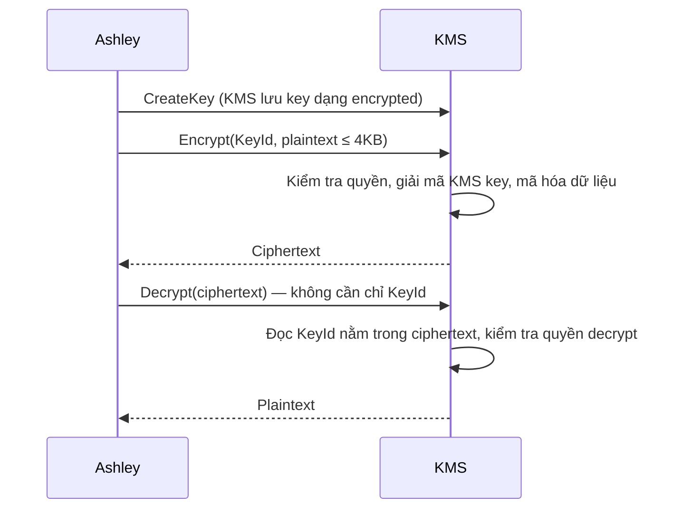
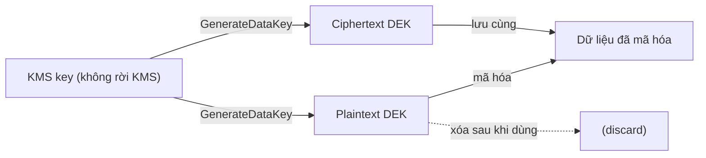

# KMS

> **TL;DR:** AWS Key Management Service là dịch vụ **regional, public** để tạo, lưu, quản lý **cryptographic key** và thực hiện thao tác mã hóa/giải mã. Nguyên tắc nền tảng: **key không bao giờ rời khỏi KMS** (và mặc định không rời region). KMS key chỉ mã hóa trực tiếp được tối đa **4 KB**; dữ liệu lớn hơn dùng **Data Encryption Key (DEK)** theo mô hình envelope encryption.

## 🖼️ Sơ đồ
![[KMS.excalidraw]]
*Mở bằng plugin Excalidraw để chỉnh sửa · ảnh tĩnh: [[KMS.svg]]*

![[KMS - keys.excalidraw]]
*Mở bằng plugin Excalidraw để chỉnh sửa · ảnh tĩnh: [[KMS - keys.svg]]*

## Khái niệm cốt lõi
- **Regional + public service**: mỗi region là một KMS tách biệt; nằm ở AWS public zone, truy cập được từ bất kỳ đâu tới được zone đó (vẫn cần quyền). Xem [[AWS Public vs Private Services]].
- Hỗ trợ **symmetric** và **asymmetric** key (xem [[Encryption Fundamentals]]); bài này mặc định nói về symmetric.
- Thực hiện thao tác mật mã: Encrypt, Decrypt, ReEncrypt, GenerateDataKey...
- **Key không bao giờ rời KMS**: KMS tạo key hoặc cho import key, dùng key để thực hiện thao tác, nhưng không cho export key ra ngoài. Key không bao giờ lưu dạng plaintext trên đĩa (chỉ plaintext tạm trong bộ nhớ).
- Chuẩn tuân thủ: khóa học nói **FIPS 140-2 Level 2** (một số tính năng đạt Level 3). Đây là điểm phân biệt kinh điển với [[CloudHSM]] (Level 3). (Hiện nay HSM của KMS đã được chứng nhận FIPS 140-2/140-3 **Level 3**; nhưng trong đề, khi yêu cầu "Level 3, single-tenant, tự quản HSM" thì đáp án vẫn là CloudHSM.)

### KMS key
- Tên cũ: **CMK (Customer Master Key)**, nay gọi là **KMS key**.
- Là một **container logic** chứa: key ID, creation date, **key policy** (resource policy), description, key state, và **physical backing key material**.
- Key material do KMS **sinh ra** hoặc **import** vào.
- Dùng trực tiếp để mã hóa/giải mã dữ liệu **tối đa 4 KB**. Thực tế KMS key chủ yếu dùng cho dữ liệu nhỏ hoặc để **sinh key khác** (DEK).

### Luồng Encrypt / Decrypt trực tiếp

- **Decrypt không cần chỉ định key**: thông tin key nằm sẵn trong ciphertext.
- Quyền tách biệt từng thao tác (`kms:Encrypt`, `kms:Decrypt`, `kms:CreateKey`...) → **role separation**: admin quản lý key có thể **không** đọc được dữ liệu; người chỉ được encrypt mà không được decrypt...

### Data Encryption Key (DEK) — envelope encryption
- Sinh bằng API **`GenerateDataKey`** từ một KMS key; dùng cho dữ liệu > 4 KB.
- KMS trả về **hai bản** của DEK:
  1. **Plaintext DEK** — dùng ngay để mã hóa dữ liệu.
  2. **Ciphertext DEK** — chính DEK đó đã được mã hóa bằng KMS key.
- **KMS không lưu, không theo dõi DEK** và **không tự mã hóa dữ liệu bằng DEK**; bạn hoặc dịch vụ dùng KMS (vd. S3) làm việc đó.
- Quy trình mã hóa: GenerateDataKey → mã hóa dữ liệu bằng plaintext DEK → **xóa plaintext DEK** → lưu **ciphertext DEK cạnh dữ liệu đã mã hóa**.
- Quy trình giải mã: gửi ciphertext DEK cho KMS Decrypt → nhận plaintext DEK → giải mã dữ liệu → xóa plaintext DEK.
- Một DEK có thể dùng cho 1 hay hàng triệu file, tùy yêu cầu. **S3 sinh một DEK riêng cho mỗi object** (xem [[S3 Encryption]], [[S3 Bucket Keys]]).

### Loại key
| Loại | Ai tạo/quản lý | Đặc điểm |
|---|---|---|
| **AWS owned keys** | AWS, dùng chung cho nhiều account | Chạy ngầm, bạn không thấy, gần như không cần quan tâm |
| **AWS managed keys** (customer owned) | AWS tự tạo khi một dịch vụ (vd. S3) dùng KMS lần đầu, tên dạng `aws/s3` | Không tùy biến key policy được; rotation **bắt buộc**, khoảng **1 năm/lần**, không tắt được |
| **Customer managed keys** (customer owned) | Bạn tạo tường minh | Cấu hình được nhiều hơn: sửa key policy, **cho phép cross-account**, bật/tắt rotation, import material... |

- **Rotation**: thay physical backing material. KMS key giữ cả **backing key hiện tại và mọi backing key cũ**, nên dữ liệu mã hóa bằng bản cũ vẫn giải mã được.
  - Khóa học nói rotation của customer managed key "optional, enabled by default"; demo trên console cho thấy **mặc định tắt**. Đúng theo AWS: customer managed key rotation **mặc định tắt**, bật lên thì mặc định 1 năm (hiện nay tùy chỉnh được 90–2560 ngày và rotate on-demand).
- **Alias**: tên tắt trỏ tới key (vd. `alias/cat-robot`), cho phép đổi key phía sau mà không đổi ứng dụng. **Alias cũng là per-region**: cùng tên alias ở mỗi region trỏ tới key khác nhau.
- **Multi-region keys**: có tồn tại (key được replicate sang region khác), nhưng mặc định key là single-region.

## Key policy và quyền
- Mỗi KMS key **luôn có một key policy** (resource policy, giống bucket policy nhưng cho key). Customer managed key thì sửa được.
- **Khác với hầu hết dịch vụ**: KMS **không mặc định tin account chứa nó**. Phải có statement trong key policy cho phép account, ví dụ `Principal: {"AWS": "arn:aws:iam::111122223333:root"}`, `Action: kms:*`.
  - Có statement này → mới dùng được **IAM identity policy** để cấp quyền cho user/role (vd. `kms:Encrypt`, `kms:Decrypt` trên `arn:aws:kms:*:111122223333:key/*`).
  - Không có → mọi quyền phải ghi trực tiếp trong key policy. Môi trường bảo mật cao có thể cố tình bỏ account trust.
- Ba cách cấp quyền: **Key policy**, **Key policy + IAM policy**, **Key policy + Grants**.

## Demo / Lab
1. KMS console (us-east-1) → Create key → **Symmetric**; Advanced: key material origin = **KMS** (khác: External/import, Custom key store → liên quan [[CloudHSM]]); **Single-Region key**.
2. Alias `catrobot`. Chọn **key administrators** (iamadmin, cho phép xóa key) và **key users** (iamadmin được encrypt/decrypt/GenerateDataKey...). Có thể thêm account khác làm key user.
3. Xem key policy wizard sinh ra: statement trust account root, statement cho admin, statement cho user dùng key.
4. Tab key rotation: customer managed **mặc định tắt**; AWS managed keys **luôn bật**, khoảng mỗi năm. Mỗi dịch vụ lần đầu dùng KMS sẽ tạo một AWS managed key.
5. CloudShell: tạo `battleplans.txt` → `aws kms encrypt --key-id alias/catrobot --plaintext fileb://battleplans.txt --output text --query CiphertextBlob | base64 --decode > not_battleplans.enc` (output KMS là base64 nên phải decode thành binary).
6. `aws kms decrypt --ciphertext-blob fileb://not_battleplans.enc --output text --query Plaintext | base64 --decode > decryptedplans.txt` → **không cần chỉ key**.
7. Dọn dẹp: **Schedule key deletion**, waiting period **7–30 ngày** (chọn 7) → trạng thái Pending deletion.

## 🎯 Mẹo thi SAA-C03
- KMS **regional**, key **không rời region và không rời KMS** (trừ multi-region keys). Cần dùng ở region khác → multi-region key hoặc re-encrypt.
- KMS key mã hóa trực tiếp tối đa **4 KB**; lớn hơn → **GenerateDataKey** / envelope encryption.
- **FIPS 140-2 Level 2 → KMS; Level 3, HSM riêng, single-tenant, tự quản key → [[CloudHSM]]**.
- Cần **cross-account** dùng key, sửa key policy, kiểm soát rotation → **customer managed key** (AWS managed key không làm được).
- Cần **role separation** (admin không đọc được dữ liệu) → KMS với quyền tách biệt, hoặc SSE-KMS trên S3 (xem [[S3 Encryption]]).
- Key policy phải trust account thì IAM policy mới có tác dụng; xóa nhầm statement này có thể khóa luôn quyền truy cập key.
- Xóa key: không xóa ngay, có **waiting period 7–30 ngày** (mặc định 30).
- KMS là nền tảng cho mã hóa ở [[S3 Encryption]], [[EBS Encryption]], [[RDS Security]], [[Secrets Manager]], [[SSM Parameter Store]] (SecureString).

## Liên kết
- Tiên quyết: [[Encryption Fundamentals]], [[IAM Identity Policies]], [[AWS Public vs Private Services]]
- Liên quan: [[S3 Encryption]], [[S3 Bucket Keys]], [[EBS Encryption]], [[RDS Security]], [[Secrets Manager]], [[SSM Parameter Store]], [[CloudTrail]] (ghi lại mọi API call tới KMS)
- Phân biệt với: [[CloudHSM]]
