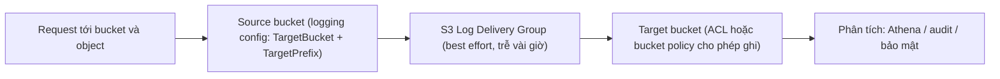

# S3 Access Logs

> **TL;DR:** S3 Server Access Logging ghi lại chi tiết các request truy cập vào **source bucket** (cả bucket lẫn object) và gửi log file vào một **target bucket**. Việc giao log do **S3 Log Delivery Group** thực hiện theo kiểu **best effort**, thường trễ vài giờ. Dùng cho audit, bảo mật, phân tích access pattern và giải thích hóa đơn S3.

## 🖼️ Sơ đồ
![[S3 Access Logs.excalidraw]]
*Mở bằng plugin Excalidraw để chỉnh sửa · ảnh tĩnh: [[S3 Access Logs.svg]]*

## Khái niệm cốt lõi
- **Source bucket**: bucket cần theo dõi. **Target bucket**: nơi nhận log.
- Bật logging **trên source bucket**, qua console hoặc API/CLI **PUT Bucket logging** (`put-bucket-logging`). Cấu hình gồm `TargetBucket` và `TargetPrefix`, ví dụ:
  ```xml
  <BucketLoggingStatus>
    <LoggingEnabled>
      <TargetBucket>targetcats</TargetBucket>
      <TargetPrefix>catlogslogs/</TargetPrefix>
    </LoggingEnabled>
  </BucketLoggingStatus>
  ```
- **S3 Log Delivery Group** đọc logging config trên source và ghi log vào target.
- **Best effort**: bật tính năng hoặc đổi cấu hình có thể mất **vài giờ** mới có hiệu lực. Access thường xuất hiện trong target bucket sau vài giờ.
- **Quyền ghi vào target**: khóa học dùng **bucket ACL** trên target, cấp quyền write cho "S3 Log Delivery Group". (Hiện nay AWS khuyến nghị dùng **bucket policy** cấp quyền cho service principal `logging.s3.amazonaws.com`. Bucket mới mặc định *Bucket owner enforced* nên ACL bị tắt.)
- **Định dạng log**:
  - Log **file** gồm nhiều log **record**. Các record **phân cách bằng xuống dòng** (newline-delimited).
  - Mỗi record gồm nhiều **attribute** (thời gian, requester, operation, status code, error code...), **phân cách bằng dấu cách** (space-delimited). Rất giống log Apache.
- **Một target bucket nhận log từ nhiều source bucket**, phân tách bằng **prefix** (cấu hình trên source).
- **Bạn tự quản lý vòng đời log**: S3 không tự xóa hay chuyển class cho log file. Hãy dùng [[S3 Lifecycle Configuration]] để chuyển sang class rẻ hơn hoặc xóa sau một thời gian.
- Lưu ý thực tế: target bucket phải cùng region và cùng account với source. Không nên dùng chính source làm target vì sẽ sinh log vô tận.

## Cách hoạt động / Kiến trúc



## Use case
- **Security** và **access audit**: ai truy cập gì, khi nào, kết quả ra sao.
- Hiểu **access pattern** của khách hàng.
- Giải thích các khoản phí trên **hóa đơn S3**.
- Thường kết hợp [[Athena]] để truy vấn log bằng SQL.

## 🎯 Mẹo thi SAA-C03
- Cần **log chi tiết từng request** vào bucket/object (requester, operation, HTTP status, bytes...) để audit → **S3 Server Access Logging**.
- So với **CloudTrail data events** (xem [[CloudTrail]]): CloudTrail ghi API call vào CloudTrail log, giao nhanh hơn và có tính đảm bảo cao hơn. Server access logs là best effort, rẻ (chỉ trả tiền lưu trữ) và chi tiết kiểu web log.
- Nhớ: bật trên **source**, cấp quyền ghi trên **target**, và **tự quản lý lifecycle** log.
- Từ khóa "best effort, trễ vài giờ" → server access logs, không dùng cho cảnh báo real-time (real-time thì dùng [[S3 Events]] hoặc [[EventBridge]]).

## Liên kết
- Tiên quyết: [[S3 Basics]], [[S3 Security]]
- Liên quan: [[S3 Lifecycle Configuration]], [[Athena]], [[Macie]]
- Phân biệt với: [[CloudTrail]], [[CloudWatch Logs]], [[VPC Flow Logs]], [[S3 Events]]
- Tổng quan: [[_MOC 05 S3]]
