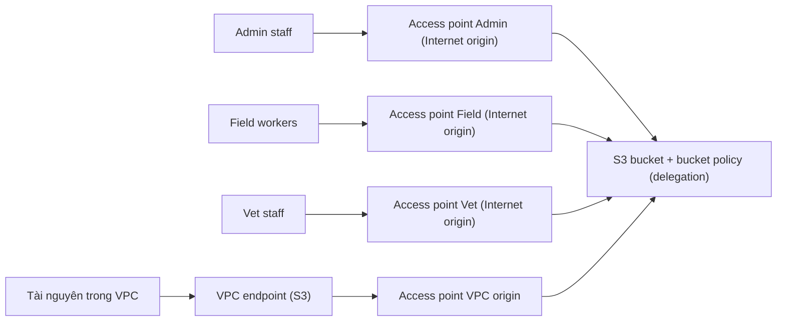

# S3 Access Points

> **TL;DR:** S3 Access Points chia một bucket lớn, dùng chung bởi nhiều team, thành nhiều "**mini-bucket**" hay "**view**" logic. Mỗi access point có **endpoint/DNS riêng**, **policy riêng** và **giới hạn network origin riêng** (Internet hoặc một VPC). Nhờ đó không phải nhét mọi thứ vào một bucket policy khổng lồ khó quản lý.

## 🖼️ Sơ đồ
![[S3 Access Points.excalidraw]]
*Mở bằng plugin Excalidraw để chỉnh sửa · ảnh tĩnh: [[S3 Access Points.svg]]*

## Khái niệm cốt lõi
- **Vấn đề**: một bucket có hàng tỷ object, nhiều prefix, được hàng trăm team truy cập. Nếu chỉ dùng **một bucket policy** thì policy rất lớn, phức tạp và dễ sai (xem [[S3 Security]]).
- **Access point** là một điểm truy cập vào bucket:
  - **Endpoint address (DNS name) riêng**: đưa cho từng team thay vì endpoint S3 mặc định.
  - **Access point policy riêng**: **tương đương về chức năng với bucket policy**, kiểm soát quyền khi truy cập *qua access point đó*. Có thể giới hạn theo **prefix**, **tag** hoặc **action**.
  - **Network origin**: **Internet** hoặc **VPC** (chỉ cho truy cập từ một VPC cụ thể).
- Một bucket có thể có **nhiều access point**, mỗi cái cho một nhóm người dùng hoặc ứng dụng.
- Tạo bằng console hoặc CLI/API: **`create-access-point`** (`aws s3control create-access-point ...`). Adrian nhắc **nhớ tên lệnh này**.

## Cách hoạt động / Kiến trúc
Ví dụ Animals4life có bucket chứa dữ liệu sức khỏe nhạy cảm (của động vật và nhân viên): Admin staff, Field workers, Vet staff, cộng với tài nguyên phân tích trong một VPC.

- **VPC origin**: access point gắn với một VPC cụ thể, cần một **VPC endpoint** trong VPC đó (xem [[Gateway VPC Endpoints]], [[Interface VPC Endpoints]]). Có thể dùng **endpoint policy** để ép buộc chỉ được truy cập S3 qua access point này.
- **Quy tắc quyền quan trọng**: quyền cấp ở access point policy **cũng phải được cho phép ở bucket policy**. Ví dụ vet staff được cấp qua access point policy thì bucket policy cũng phải cho phép.
- **Delegation** (cách làm phổ biến): bucket policy cho phép **mọi action, miễn là request đi qua access point** (của account sở hữu), rồi đặt kiểm soát chi tiết ở từng access point policy. Bucket policy trở nên đơn giản, phần phân quyền chi tiết nằm ở access point.

## 🎯 Mẹo thi SAA-C03
- "Bucket dùng chung bởi **nhiều team/ứng dụng**, bucket policy **quá phức tạp**, muốn quản lý quyền **riêng cho từng nhóm**" → **S3 Access Points**.
- "Chỉ cho phép truy cập bucket **từ một VPC cụ thể**" → access point với **VPC origin** + VPC endpoint (+ endpoint policy).
- Nhớ: quyền phải được cho phép ở **cả access point policy và bucket policy** (hoặc bucket policy delegate cho access point).
- Lệnh CLI: **`create-access-point`**.
- Phân biệt với [[S3 Multi-Region Access Points]]: một endpoint **toàn cầu** route tới bucket gần nhất ở nhiều region. Access Point thường thuộc **một bucket, một region**.

## Liên kết
- Tiên quyết: [[S3 Basics]], [[S3 Security]], [[IAM Identity Policies]]
- Liên quan: [[Gateway VPC Endpoints]], [[Interface VPC Endpoints]], [[Compare - Gateway vs Interface Endpoints]], [[S3 Multi-Region Access Points]]
- Phân biệt với: [[S3 Presigned URLs]], [[S3 Multi-Region Access Points]]
- Tổng quan: [[_MOC 05 S3]]
