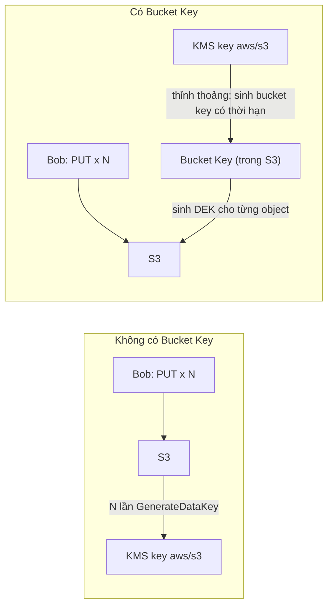

# S3 Bucket Keys

> **TL;DR:** Với [[S3 Encryption|SSE-KMS]] thường, **mỗi object = một lần gọi KMS** để sinh DEK → tốn phí và dễ bị **throttle**. **S3 Bucket Key** cho KMS key sinh ra một **bucket key có thời hạn**, rồi S3 dùng bucket key đó để tự sinh DEK cho các object trong một khoảng thời gian → **giảm mạnh số API call tới KMS**, giảm chi phí, tăng khả năng scale.

## 🖼️ Sơ đồ
![[S3 Bucket Keys.excalidraw]]
*Mở bằng plugin Excalidraw để chỉnh sửa · ảnh tĩnh: [[S3 Bucket Keys.svg]]*

## Khái niệm cốt lõi
### Vấn đề với SSE-KMS không có bucket key
- Ví dụ: Bob PUT object với SSE-KMS, key `aws/s3`. Mỗi object cần **một DEK riêng**, tức **một lệnh `GenerateDataKey` tới KMS**; S3 mã hóa object rồi lưu object + DEK đã mã hóa cạnh nhau (xem [[KMS]]).
- 3 PUT thì không sao, nhưng 30 / 300 / 300.000 PUT mỗi giây thì:
  - **Chi phí**: phí request KMS tăng theo số object.
  - **Throttling**: `GenerateDataKey` bị giới hạn khoảng **5.500, 10.000 hoặc 50.000 request/giây** tùy region. Đây là trần số PUT/giây mà bucket SSE-KMS đạt được với một KMS key.
  - (Khóa học nói giới hạn này "shared across regions"; chính xác theo AWS: quota KMS tính **theo account, theo từng region**, dùng chung cho mọi key trong region đó.)

### Cách bucket key giải quyết
- KMS key không sinh từng DEK nữa mà sinh một **bucket key giới hạn thời gian**, gắn (về mặt khái niệm) cho bucket.
- Trong thời gian đó, **S3 dùng bucket key để tự sinh DEK** cho từng object → chuyển phần việc từ KMS sang S3.
- Kết quả: **ít KMS API call hơn nhiều** → **giảm chi phí** (AWS công bố tới ~99%) và **tăng scalability**.
- **Không hồi tố (not retroactive)**: chỉ áp dụng cho object được mã hóa **sau khi** bật trên bucket.

## Lưu ý vận hành
- **[[CloudTrail]]**: sau khi bật, log KMS hiển thị **ARN của bucket** thay vì ARN của object, và **số event KMS ít đi** (vì KMS chỉ được gọi để sinh bucket key).
  - Hệ quả: nếu key policy/IAM policy dùng **encryption context** là ARN object thì phải đổi sang ARN bucket (bổ sung).
- **Replication** ([[S3 Replication]], SRR và CRR): bucket key hoạt động được.
  - Object đã mã hóa khi replicate thường **giữ nguyên thiết lập mã hóa** ở bucket đích.
  - Object **plaintext** replicate sang bucket đích có default encryption/bucket key → S3 **mã hóa ở phía đích** theo cấu hình bucket đích → **ETag có thể khác** giữa nguồn và đích.

## 🎯 Mẹo thi SAA-C03
- Đề nói "dùng SSE-KMS, chi phí KMS quá cao" hoặc "bị **KMS throttling** / `ThrottlingException` khi upload số lượng lớn" → **bật S3 Bucket Key**.
- Bucket key **không áp dụng ngược** cho object cũ; muốn áp cho object cũ phải copy/re-encrypt chúng.
- Sau khi bật, CloudTrail thấy **bucket ARN**, không thấy object ARN; ít event KMS hơn.
- Bucket key chỉ liên quan **SSE-KMS** (không liên quan SSE-S3 hay SSE-C).
- Vẫn giữ được lợi ích của SSE-KMS (kiểm soát key, role separation) trong khi giảm chi phí.

## Liên kết
- Tiên quyết: [[KMS]], [[S3 Encryption]]
- Liên quan: [[CloudTrail]], [[S3 Replication]], [[S3 Basics]]
- Phân biệt với: SSE-S3 trong [[S3 Encryption]] (không gọi KMS nên không có vấn đề throttling)
