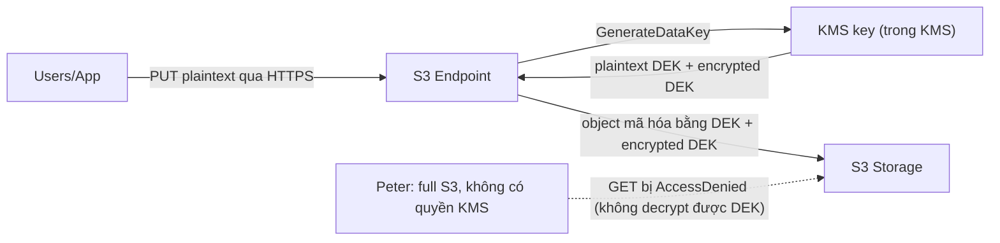

# S3 Encryption

> **TL;DR:** Trong S3, **object** được mã hóa, không phải bucket. Có **client-side encryption** (bạn tự mã hóa trước khi gửi) và **server-side encryption**, nay là **bắt buộc** (mặc định **SSE-S3**), với 4 kiểu: **SSE-C** (bạn giữ key, S3 mã hóa; legacy, mặc định bị chặn), **SSE-S3** (S3 lo hết, AES-256), **SSE-KMS** (key nằm trong [[KMS]], cho phép kiểm soát key, rotation, audit và **role separation**), **DSSE-KMS** (SSE-KMS cộng một lớp mã hóa thứ hai của S3, cho compliance đòi 2 lớp). **Bucket default encryption** chỉ là giá trị mặc định, không phải ràng buộc.

## 🖼️ Sơ đồ
![[S3 Encryption.excalidraw]]
*Mở bằng plugin Excalidraw để chỉnh sửa · ảnh tĩnh: [[S3 Encryption.svg]]*

![[S3 Encryption - sse-kms.excalidraw]]
*Mở bằng plugin Excalidraw để chỉnh sửa · ảnh tĩnh: [[S3 Encryption - sse-kms.svg]]*

## Khái niệm cốt lõi
- **"Buckets aren't encrypted, objects are"**: mã hóa định nghĩa ở **mức object**; mỗi object trong cùng bucket có thể dùng kiểu mã hóa khác nhau. "Bucket default encryption" là chuyện khác (xem dưới).
- Mọi kiểu dưới đây nói về **encryption at rest** (lưu trên đĩa). **Encryption in transit** (HTTPS/TLS tới S3 endpoint) là chuyện riêng và có sẵn ở cả hai phương pháp. Xem [[SSL and TLS]].
- Server-side encryption gồm hai phần việc: (1) **quá trình mã hóa/giải mã** (tốn CPU, mã hóa đối xứng: cùng một key để mã hóa và giải mã) và (2) **sinh và quản lý key**. Mỗi kiểu chia hai phần việc này khác nhau giữa bạn và AWS.
- **Server-side encryption nay là bắt buộc**: mặc định là **SSE-S3**, nên dù không dùng client-side encryption thì object vẫn luôn được lưu ở dạng mã hóa. Bạn chỉ chọn **kiểu** SSE nào.

### Client-side vs server-side
- **Client-side encryption**: object được mã hóa **trên client trước khi rời máy**; AWS chỉ nhận và lưu ciphertext, **không bao giờ thấy plaintext**. Bạn tự sinh, giữ, quản lý key, tự ghi nhận key nào cho file nào, tự tốn CPU mã hóa. S3 chỉ là nơi lưu trữ. Kiểm soát cao nhất, công sức cao nhất. Thường làm bằng cách mã hóa trước mọi object hoặc dùng client-side encryption SDK trong ứng dụng. Đây **không phải** một kiểu mã hóa của S3, đừng nhầm với SSE-C.
- **Server-side encryption**: dữ liệu đi trong tunnel HTTPS nhưng bản thân object là plaintext khi tới S3 endpoint; S3 mã hóa khi ghi xuống storage. Bạn phải tin AWS ở mức nào đó.

## Bốn kiểu server-side encryption
SSE-C, SSE-S3 (mặc định), SSE-KMS và DSSE-KMS. Khác nhau ở chỗ bạn tin S3 phần nào: ai giữ key, ai làm mã hóa.

### SSE-C (customer-provided keys)
- **Legacy**: AWS nay **tắt (chặn) SSE-C mặc định** (bài nói từ 04/2026) và đang loại dần. Trong cài đặt encryption của bucket, SSE-C hiện ở trạng thái **blocked**; muốn dùng phải bỏ chặn.
- **Bạn quản lý key**, **S3 thực hiện mã hóa/giải mã**.
- PUT: gửi object (plaintext) **kèm key** → S3 mã hóa object, lấy **hash một chiều của key** gắn vào object, rồi **hủy key**. Lưu ciphertext + hash.
- GET: gửi request **kèm đúng key** → S3 so hash để xác nhận đúng key → giải mã, hủy key, trả plaintext.
- Hash không dùng để tái tạo key được, chỉ để kiểm tra key đúng/sai.
- Lợi: giữ quyền kiểm soát key (hợp môi trường nặng quy định), **offload CPU** mã hóa sang S3 (tốt cho thiết bị yếu, khối lượng lớn). Bất lợi: vẫn phải tự quản lý key; phải tin S3 hủy key (có audit độc lập chứng minh).
- Có thể dùng một key cho mọi object (không khuyến nghị) hoặc mỗi object một key, tùy bạn.
- **Mất key = mất object**: S3 không giữ key, AWS Support cũng không giúp được.
- (Bổ sung, bài không nói: SSE-C bắt buộc dùng HTTPS.)

### SSE-S3 (Amazon S3 managed keys, "AES256")
- **S3 lo cả mã hóa lẫn key**. Bạn chỉ gửi plaintext.
- S3 có một **root key** của riêng S3: bạn không thấy, không chọn, không cấu hình, S3 tự rotate.
- Mỗi object được mã hóa bằng một **key riêng cho object đó**; key này lại được mã hóa bằng root key; bản plaintext của key bị hủy. Object mã hóa và key mã hóa được lưu cạnh nhau.
- Thuật toán **AES-256** (chế độ **GCM**). Gần như không có admin overhead → là **kiểu mặc định** cho mọi bucket, hợp với đa số trường hợp.
- **Ba hạn chế** (giảng viên nhấn mạnh):
  1. Không kiểm soát được key và quyền truy cập key (không hợp môi trường quy định chặt).
  2. Không kiểm soát được **rotation** key material.
  3. Không có **role separation**: S3 full admin đương nhiên đọc được dữ liệu. Ngành tài chính, y tế thường không được phép như vậy.

### SSE-KMS (KMS keys)
- Giống SSE-S3 ở chỗ AWS làm cả mã hóa và key, nhưng key gốc là **KMS key nằm trong [[KMS]]**, không phải root key nội bộ S3.
- Lần đầu dùng SSE-KMS, S3 tạo một **AWS managed key** `aws/s3` làm mặc định. Có thể chọn **customer managed key** của mình để kiểm soát key policy và rotation.
- Mỗi object: S3 gọi KMS `GenerateDataKey` → nhận **plaintext DEK** (mã hóa object rồi hủy) + **encrypted DEK** (lưu cạnh object). Đây chính là kiến trúc DEK đã học ở [[KMS]], một DEK riêng cho mỗi object.
- Giải mã: S3 gửi encrypted DEK cho KMS decrypt → dùng DEK giải mã object. **Không có quyền trên KMS key thì không đọc được object**, dù có full quyền S3.
- Lợi ích: kiểm soát key policy, rotation, **audit qua [[CloudTrail]]** mọi lần dùng key, và quan trọng nhất là **role separation** (vd. "Peter" là S3 admin nhưng không có quyền KMS → quản lý được object nhưng **không đọc được** dữ liệu).
- Chi phí/giới hạn: mỗi object gọi KMS → tốn phí request KMS và có thể chạm quota; giải pháp là [[S3 Bucket Keys]].

### DSSE-KMS (dual-layer SSE với KMS)
- Hoạt động như SSE-KMS (KMS key, DEK, audit, role separation), nhưng **trước khi ghi xuống đĩa**, S3 **mã hóa thêm một lớp nữa** bằng key của chính S3. Lớp thứ hai này do S3 quản lý hoàn toàn: bạn không thấy, không cấu hình được.
- Dùng **chỉ khi** có chuẩn hoặc quy định bắt buộc **hai lớp mã hóa độc lập**, thường gặp với chính phủ, quốc phòng: ví dụ CNSSP 15 của NSA, Data at Rest Capability Package (DAR-CP) v5.
- Header: `aws:kms:dsse`. Cũng cần quyền KMS như SSE-KMS.

## Bảng so sánh / số liệu
| Phương pháp | Ai quản lý key | Ai mã hóa/giải mã | Kiểm soát rotation/quyền key | Role separation | Khi nào dùng |
|---|---|---|---|---|---|
| Client-side | Bạn | Bạn (client) | Toàn quyền | Tự xây | Không tin AWS / phải giữ cả key lẫn quy trình; AWS không được thấy plaintext |
| **SSE-C** | Bạn | S3 | Bạn (ngoài AWS) | Không theo nghĩa KMS | Phải giữ key nhưng muốn offload CPU; legacy, mặc định bị chặn |
| **SSE-S3** | S3 | S3 | Không | **Không** | **Mặc định** của mọi bucket, không có yêu cầu compliance về key |
| **SSE-KMS** | KMS (AWS managed hoặc customer managed) | S3 | Có (customer managed key) | **Có** | Quy định chặt, cần audit, rotation, tách quyền admin/dữ liệu |
| **DSSE-KMS** | KMS + key riêng của S3 cho lớp thứ hai | S3 (2 lớp) | Có (với KMS key) | **Có** | Chỉ khi compliance bắt buộc mã hóa 2 lớp (chính phủ, quốc phòng) |

## Bucket default encryption
- Upload thực chất là `PutObject`; muốn chọn kiểu mã hóa thì gửi header **`x-amz-server-side-encryption`** (bản khóa cũ nêu tên header, bài mới không nói):
  - `AES256` → **SSE-S3**
  - `aws:kms` → **SSE-KMS**
  - `aws:kms:dsse` → **DSSE-KMS**
- Bucket có một **default encryption**, **mặc định là SSE-S3** cho mọi bucket; đổi được (vd. sang SSE-KMS với key của mình). Áp dụng khi request **không** chỉ định kiểu mã hóa.
- Đổi default chỉ ảnh hưởng **object mới**; object đã có giữ nguyên kiểu mã hóa của nó.
- Default **không phải giới hạn/ràng buộc**: object chỉ định kiểu khác vẫn được chấp nhận và ưu tiên. Muốn **bắt buộc** một kiểu mã hóa → dùng **bucket policy** (Deny `s3:PutObject` khi header không đúng; bản khóa cũ nêu, bài mới không nói). Xem [[S3 Security]].
- Không còn object "không mã hóa": server-side encryption là bắt buộc, không chỉ định gì thì object dùng default của bucket. (Bổ sung, bài không nói: AWS áp SSE-S3 mặc định cho object mới từ 01/2023.)

## Demo / Lab
1. Tạo bucket general purpose `aem-dev-web-images-<random>` (ảnh sản phẩm Aus-E-Mart), giữ mọi setting mặc định.
2. Upload `product1` → Properties → Server-side encryption → **Specify an encryption key** → override bucket default → **SSE-S3**.
3. Upload `product2` → override → **SSE-KMS**, chọn key có sẵn **`aws/s3`** (AWS managed key, không cần tạo trước; console cũng nhắc tới bucket key). DSSE-KMS có trong danh sách nhưng demo không dùng.
4. Bucket → Properties → Default encryption: mặc định là **SSE-S3**; mục **SSE-C hiện "blocked"** (AWS chặn mặc định, có thể bỏ chặn), nên lúc upload không thấy SSE-C.
5. Tạo customer managed key symmetric alias `aem/dev/web-images`, single-region, **bỏ qua** bước chọn admin và user → key policy chỉ trust account, mọi quyền đi qua IAM.
6. Đặt default encryption = SSE-KMS với key vừa tạo → upload `product3` không chọn gì → object tự dùng SSE-KMS với key đó. `product1` vẫn giữ SSE-S3: đổi default không đổi object cũ.
7. Là iamadmin (full quyền S3 và KMS) → mở được cả ba ảnh.
8. Gắn **inline policy Deny KMS** cho iamadmin → KMS console báo Access Denied; mở `product2`, `product3` (SSE-KMS) bị **Access Denied** vì S3 không nhờ KMS decrypt DEK được; `product1` (SSE-S3) không cần KMS. Đây là role separation, không làm được với SSE-S3.
9. Gỡ deny policy. So sánh: AWS managed key (`aws/s3`) gần như **không cấu hình hay quản lý được**; customer managed key thì rotate được, kiểm soát quyền đầy đủ.
10. Dọn dẹp: schedule key deletion 7 ngày (KMS không cho xóa ngay để tránh mất dữ liệu); empty + delete bucket.
- Rút ra: SSE-KMS (và DSSE-KMS) cần **cả quyền S3 lẫn quyền KMS** để đọc object.

## 🎯 Mẹo thi SAA-C03
- "Bucket được mã hóa" là cách nói sai về bản chất: **object** mới được mã hóa.
- **Role separation**, "admin S3 không được đọc dữ liệu", audit việc dùng key, kiểm soát rotation → **SSE-KMS với customer managed key**.
- "Ít overhead nhất, AWS lo hết" → **SSE-S3** (AES-256), cũng là **mặc định**: S3 luôn mã hóa at rest, không có lựa chọn "không mã hóa".
- "Công ty phải tự giữ key nhưng không muốn tốn CPU mã hóa" → **SSE-C** (nhớ: legacy, mặc định bị chặn, mất key là mất object).
- "Quy định bắt buộc **hai lớp mã hóa** độc lập" (chính phủ, quốc phòng) → **DSSE-KMS**.
- "AWS không được phép thấy dữ liệu plaintext bao giờ" / tự quản toàn bộ → **client-side encryption**.
- Default bucket encryption **không ép buộc**; muốn ép → bucket policy kiểm tra header `x-amz-server-side-encryption`.
- AWS managed key `aws/s3`: không sửa key policy, không đổi rotation, không dùng cross-account được → cần cross-account đọc object SSE-KMS thì dùng **customer managed key** và cấp quyền trong key policy.
- Mỗi object SSE-KMS = một lần gọi KMS → chi phí/throttling khi khối lượng lớn → bật [[S3 Bucket Keys]].
- Encryption at rest ≠ in transit; in transit dùng HTTPS (có thể ép bằng `aws:SecureTransport` trong bucket policy).

## Liên kết
- Tiên quyết: [[Encryption Fundamentals]], [[KMS]], [[S3 Basics]]
- Liên quan: [[S3 Bucket Keys]], [[S3 Security]], [[CloudTrail]], [[S3 Replication]] (replicate object SSE-KMS cần cấu hình key), [[EBS Encryption]], [[Macie]]
- Phân biệt với: [[CloudHSM]] (HSM riêng, single-tenant), [[SSL and TLS]] (in transit)
