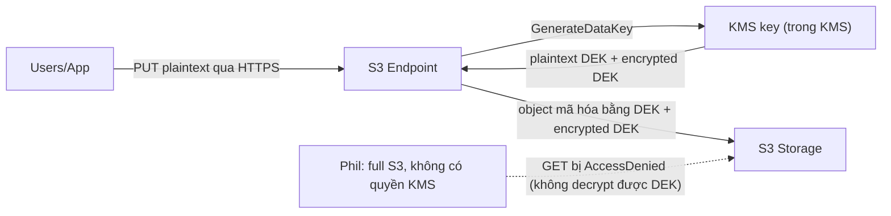

# S3 Encryption

> **TL;DR:** Trong S3, **object** được mã hóa, không phải bucket. Có **client-side encryption** (bạn tự mã hóa trước khi gửi) và **server-side encryption** với 3 kiểu: **SSE-C** (bạn giữ key, S3 mã hóa), **SSE-S3** (S3 lo hết, AES-256), **SSE-KMS** (key nằm trong [[KMS]], cho phép kiểm soát key, rotation, audit và **role separation**). **Bucket default encryption** chỉ là giá trị mặc định, không phải ràng buộc.

## 🖼️ Sơ đồ
![[S3 Encryption.excalidraw]]
*Mở bằng plugin Excalidraw để chỉnh sửa · ảnh tĩnh: [[S3 Encryption.svg]]*

![[S3 Encryption - sse-kms.excalidraw]]
*Mở bằng plugin Excalidraw để chỉnh sửa · ảnh tĩnh: [[S3 Encryption - sse-kms.svg]]*

## Khái niệm cốt lõi
- **"Buckets aren't encrypted, objects are"**: mã hóa định nghĩa ở **mức object**; mỗi object trong cùng bucket có thể dùng kiểu mã hóa khác nhau. "Bucket default encryption" là chuyện khác (xem dưới).
- Mọi kiểu dưới đây nói về **encryption at rest** (lưu trên đĩa). **Encryption in transit** (HTTPS/TLS tới S3 endpoint) là chuyện riêng và có sẵn ở cả hai phương pháp. Xem [[SSL and TLS]].
- Server-side encryption gồm hai phần việc: (1) **quá trình mã hóa/giải mã** (tốn CPU) và (2) **sinh và quản lý key**. Mỗi kiểu chia hai phần việc này khác nhau giữa bạn và AWS.

### Client-side vs server-side
- **Client-side encryption**: object được mã hóa **trên client trước khi rời máy**; AWS chỉ nhận và lưu ciphertext, **không bao giờ thấy plaintext**. Bạn tự sinh, giữ, quản lý key, tự ghi nhận key nào cho file nào, tự tốn CPU mã hóa. S3 chỉ là nơi lưu trữ. Kiểm soát cao nhất, công sức cao nhất.
- **Server-side encryption**: dữ liệu đi trong tunnel HTTPS nhưng bản thân object là plaintext khi tới S3 endpoint; S3 mã hóa khi ghi xuống storage. Bạn phải tin AWS ở mức nào đó.

## Ba kiểu server-side encryption
### SSE-C (customer-provided keys)
- **Bạn quản lý key**, **S3 thực hiện mã hóa/giải mã**.
- PUT: gửi object (plaintext) **kèm key** → S3 mã hóa object, lấy **hash một chiều của key** gắn vào object, rồi **hủy key**. Lưu ciphertext + hash.
- GET: gửi request **kèm đúng key** → S3 so hash để xác nhận đúng key → giải mã, hủy key, trả plaintext.
- Hash không dùng để tái tạo key được, chỉ để kiểm tra key đúng/sai.
- Lợi: giữ quyền kiểm soát key (hợp môi trường nặng quy định), **offload CPU** mã hóa sang S3 (tốt cho thiết bị yếu, khối lượng lớn). Bất lợi: vẫn phải tự quản lý key; phải tin S3 hủy key (có audit chứng minh).
- (Bổ sung: SSE-C bắt buộc dùng HTTPS; mất key = mất dữ liệu.)

### SSE-S3 (Amazon S3 managed keys, "AES256")
- **S3 lo cả mã hóa lẫn key**. Bạn chỉ gửi plaintext.
- S3 có một **root key** của riêng S3: bạn không thấy, không chọn, không cấu hình, S3 tự rotate.
- Mỗi object được mã hóa bằng một **key riêng cho object đó**; key này lại được mã hóa bằng root key; bản plaintext của key bị hủy. Object mã hóa và key mã hóa được lưu cạnh nhau.
- Thuật toán **AES-256**. Gần như không có admin overhead → **mặc định hợp lý** cho đa số trường hợp.
- **Ba hạn chế** (Adrian nhấn mạnh):
  1. Không kiểm soát được key và quyền truy cập key (không hợp môi trường quy định chặt).
  2. Không kiểm soát được **rotation** key material.
  3. Không có **role separation**: S3 full admin đương nhiên đọc được dữ liệu.

### SSE-KMS (KMS keys)
- Giống SSE-S3 ở chỗ AWS làm cả mã hóa và key, nhưng key gốc là **KMS key nằm trong [[KMS]]**, không phải root key nội bộ S3.
- Lần đầu dùng SSE-KMS, S3 tạo một **AWS managed key** `aws/s3` làm mặc định. Có thể chọn **customer managed key** của mình để kiểm soát key policy và rotation.
- Mỗi object: S3 gọi KMS `GenerateDataKey` → nhận **plaintext DEK** (mã hóa object rồi hủy) + **encrypted DEK** (lưu cạnh object). Đây chính là kiến trúc DEK đã học ở [[KMS]], một DEK riêng cho mỗi object.
- Giải mã: S3 gửi encrypted DEK cho KMS decrypt → dùng DEK giải mã object. **Không có quyền trên KMS key thì không đọc được object**, dù có full quyền S3.
- Lợi ích: kiểm soát key policy, rotation, **audit qua [[CloudTrail]]** mọi lần dùng key, và quan trọng nhất là **role separation** (vd. "Phil" là S3 admin nhưng không có quyền KMS → quản lý bucket/xóa object được nhưng **không đọc được** dữ liệu).
- Chi phí/giới hạn: mỗi object gọi KMS → tốn phí request KMS và có thể chạm quota; giải pháp là [[S3 Bucket Keys]].

## Bảng so sánh / số liệu
| Phương pháp | Ai quản lý key | Ai mã hóa/giải mã | Kiểm soát rotation/quyền key | Role separation | Khi nào dùng |
|---|---|---|---|---|---|
| Client-side | Bạn | Bạn (client) | Toàn quyền | Tự xây | Không tin AWS / phải giữ cả key lẫn quy trình; AWS không được thấy plaintext |
| **SSE-C** | Bạn | S3 | Bạn (ngoài AWS) | Không theo nghĩa KMS | Phải giữ key nhưng muốn offload CPU |
| **SSE-S3** | S3 | S3 | Không | **Không** | Mặc định, ít overhead |
| **SSE-KMS** | KMS (AWS managed hoặc customer managed) | S3 | Có (customer managed key) | **Có** | Quy định chặt, cần audit, rotation, tách quyền admin/dữ liệu |

## Bucket default encryption
- Upload thực chất là `PutObject`; muốn S3 mã hóa thì gửi header **`x-amz-server-side-encryption`**:
  - `AES256` → **SSE-S3**
  - `aws:kms` → **SSE-KMS**
- Bucket có thể đặt **default encryption**: áp dụng khi request **không** có header đó.
- Default **không phải giới hạn/ràng buộc**: object chỉ định kiểu khác vẫn được chấp nhận và ưu tiên. Muốn **bắt buộc** một kiểu mã hóa → dùng **bucket policy** (Deny `s3:PutObject` khi header không đúng). Xem [[S3 Security]].
- Khóa học nói: không có header thì object không mã hóa. (**Hiện nay từ 01/2023**, mọi bucket mặc định áp **SSE-S3** cho object mới, nên không còn object mới nào ở trạng thái không mã hóa. Ngoài ra có thêm **DSSE-KMS** — dual-layer với KMS, header `aws:kms:dsse`.)

## Demo / Lab
1. Tạo bucket `catpics-<random>`; tạo KMS key symmetric alias `catpics`, **không** thêm admin/user → key policy chỉ trust account.
2. Upload từng ảnh với setting khác nhau trong Properties → Server-side encryption: `no-enc-prissy.jpg` (tắt), `sse-s3-dweez.jpg` (Amazon S3 key), `sse-kms-ginny.jpg` (lần đầu dùng AWS managed key `aws/s3` → key này tự xuất hiện trong KMS; sau đó upload lại với customer managed key `catpics`).
3. Là iamadmin (full admin) → mở được cả ba.
4. Gắn **inline policy Deny `kms:*` trên `*`** cho iamadmin → mở lại: không mã hóa và SSE-S3 vẫn mở được; **SSE-KMS bị Access Denied** vì S3 không nhờ KMS decrypt DEK được (explicit deny thắng). Nhưng vẫn **xóa** được object → minh họa role separation.
5. Gỡ deny policy. So sánh: AWS managed key (`aws/s3`) **không sửa được key policy, không chỉnh rotation**; customer managed key thì sửa được.
6. Đặt bucket default encryption = SSE-KMS với key `catpics` → upload `default-merlin.jpg` không chọn gì → object tự dùng SSE-KMS.
7. Dọn dẹp: empty + delete bucket; schedule key deletion 7 ngày (tối thiểu).
- Rút ra: SSE-KMS cần **cả quyền S3 lẫn quyền KMS** để đọc object.

## 🎯 Mẹo thi SAA-C03
- "Bucket được mã hóa" là cách nói sai về bản chất: **object** mới được mã hóa.
- **Role separation**, "admin S3 không được đọc dữ liệu", audit việc dùng key, kiểm soát rotation → **SSE-KMS với customer managed key**.
- "Ít overhead nhất, AWS lo hết" → **SSE-S3** (AES-256).
- "Công ty phải tự giữ key nhưng không muốn tốn CPU mã hóa" → **SSE-C**.
- "AWS không được phép thấy dữ liệu plaintext bao giờ" / tự quản toàn bộ → **client-side encryption**.
- Default bucket encryption **không ép buộc**; muốn ép → bucket policy kiểm tra header `x-amz-server-side-encryption`.
- AWS managed key `aws/s3`: không sửa key policy, không đổi rotation, không dùng cross-account được → cần cross-account đọc object SSE-KMS thì dùng **customer managed key** và cấp quyền trong key policy.
- Mỗi object SSE-KMS = một lần gọi KMS → chi phí/throttling khi khối lượng lớn → bật [[S3 Bucket Keys]].
- Encryption at rest ≠ in transit; in transit dùng HTTPS (có thể ép bằng `aws:SecureTransport` trong bucket policy).

## Liên kết
- Tiên quyết: [[Encryption Fundamentals]], [[KMS]], [[S3 Basics]]
- Liên quan: [[S3 Bucket Keys]], [[S3 Security]], [[CloudTrail]], [[S3 Replication]] (replicate object SSE-KMS cần cấu hình key), [[EBS Encryption]], [[Macie]]
- Phân biệt với: [[CloudHSM]] (HSM riêng, single-tenant), [[SSL and TLS]] (in transit)
