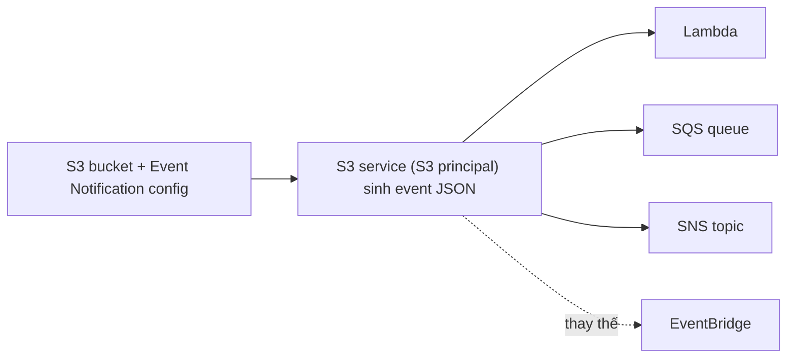

# S3 Events

> **TL;DR:** S3 Event Notifications sinh ra một sự kiện (JSON) khi có chuyện xảy ra trong bucket, như object được tạo, xóa, restore hoặc có sự cố replication, rồi gửi tới **Lambda**, **SQS** hoặc **SNS**. Đây là nền tảng cho các workflow **event-driven** dựa trên S3. **EventBridge** là lựa chọn thay thế mạnh hơn: hỗ trợ nhiều loại event và nhiều đích hơn.

## 🖼️ Sơ đồ
![[S3 Events.excalidraw]]
*Mở bằng plugin Excalidraw để chỉnh sửa · ảnh tĩnh: [[S3 Events.svg]]*

## Khái niệm cốt lõi
- Bạn tạo một **event notification configuration** trên bucket, chỉ ra loại sự kiện cần bắt và đích nhận.
- **Đích (destinations)**: **SNS topic**, **SQS queue** (chỉ Standard, FIFO queue không làm đích trực tiếp được) và **Lambda function**.
- **Các nhóm sự kiện**:
  | Nhóm | Ví dụ | Use case |
  |---|---|---|
  | **Object Created** | `Put`, `Post`, `Copy`, `CompleteMultipartUpload` (có thể dùng wildcard `s3:ObjectCreated:*`) | Gắn watermark, tạo thumbnail, biến ảnh thành pixel art... |
  | **Object Removed** | `Delete`, `DeleteMarkerCreated`, hoặc `*` | Hệ thống bảo mật tự phản ứng khi object bị xóa |
  | **Object Restore** | Bắt đầu và hoàn tất restore từ Glacier / Deep Archive | Báo khách hàng hoặc nhân viên khi restore bắt đầu và kết thúc |
  | **Replication** | Lỡ ngưỡng **15 phút**, replicate **sau** ngưỡng, object **không còn được theo dõi**, replicate **thất bại** | Giám sát [[S3 Replication]] (đi kèm RTC) |
- (Hiện nay còn có thêm các event khác như lifecycle expiration/transition, Intelligent-Tiering, object tagging, object ACL.)

## Cách hoạt động / Kiến trúc

- Event do **service S3 (S3 principal)** sinh ra, nên mỗi đích cần **resource policy cho phép S3 principal** gửi vào: **SQS queue policy**, **SNS topic policy**, **Lambda resource policy** (xem [[IAM Identity Policies]] và [[S3 Security]] về resource policy).
  - Khóa học nói thời đó chỉ sửa được Lambda resource policy qua CLI/API. Hiện nay console tự thêm permission khi bạn chọn Lambda làm đích.
- **Event là một JSON object**, chứa thông tin như `configurationId`, bucket (`name`, `ownerIdentity.principalId`, `arn`), object (`key`...). Ví dụ Lambda nhận JSON này trong `event`, parse ra rồi xử lý.
- **S3 Event Notifications là tính năng cũ**: ít loại sự kiện và ít dịch vụ đích. **[[EventBridge]]** hỗ trợ nhiều loại event hơn và tích hợp với nhiều dịch vụ AWS hơn. Adrian mặc định **ưu tiên EventBridge** trừ khi có lý do cụ thể.

## 🎯 Mẹo thi SAA-C03
- "Khi có file upload lên S3 thì tự động xử lý" → S3 Event Notification → **Lambda** (hoặc SQS để đệm, SNS để fan-out). Đây là mẫu event-driven kinh điển (xem [[Event-Driven Architecture]]).
- Cần **fan-out** một event tới nhiều consumer → S3 → **SNS** → nhiều SQS/Lambda, hoặc dùng **EventBridge**.
- Cần nhiều loại đích hơn Lambda/SQS/SNS, lọc nâng cao, hoặc nhiều rule cho cùng một event → **EventBridge**.
- Nếu đề hỏi vì sao event không tới được đích: kiểm tra **resource policy** của SQS/SNS/Lambda có cho phép S3 gửi vào không.
- Muốn biết khi nào **restore từ Glacier hoàn tất** → event `s3:ObjectRestore:Completed`.
- Replication trễ quá 15 phút (RTC) → có event Replication để cảnh báo.

## Liên kết
- Tiên quyết: [[S3 Basics]], [[Event-Driven Architecture]]
- Đích: [[Lambda]], [[SQS]], [[SNS]]
- Liên quan: [[S3 Replication]], [[S3 Storage Classes]], [[Serverless Architecture]], [[DynamoDB Streams and Triggers]]
- Phân biệt với: [[EventBridge]], [[CloudTrail]] (log API, không phải cơ chế trigger), [[S3 Access Logs]]
- Tổng quan: [[_MOC 05 S3]]
