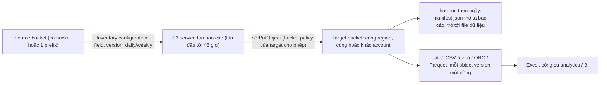

# S3 Inventory

> **TL;DR:** S3 Inventory tự động tạo **báo cáo danh sách object** của **một bucket** (hoặc một prefix), kèm các field bạn chọn: **encryption, size, storage class, replication status, Object Lock, last modified, multipart upload, Intelligent-Tiering tier**... Báo cáo chạy **daily hoặc weekly**, **không ép chạy ngay được**, lần đầu có thể chờ **tới 48 giờ**. Kết quả xuất ra **CSV, Apache ORC hoặc Parquet** vào một **target bucket cùng region** (cùng hoặc khác account), cần **bucket policy** cho S3 ghi vào target.

## 🖼️ Sơ đồ
![[S3 Inventory.excalidraw]]
*Mở bằng plugin Excalidraw để chỉnh sửa · ảnh tĩnh: [[S3 Inventory.svg]]*

## Khái niệm cốt lõi
- **Vấn đề**: Aus-E-Mart có rất nhiều bucket (web app, backup, AI/ML, big data, archive). Cần biết object nào **đã mã hóa chưa**, **replication** ra sao, dữ liệu archive thế nào, **multipart upload** dở dang, **dung lượng**, **lần sửa cuối**... Vào console xem từng object rồi ghi chép tay là không thể.
- **S3 Inventory** lấy thông tin đó **tự động** cho mọi object trong bucket.
- Cấu hình **theo từng bucket**: báo cáo về **cả bucket** hoặc **một prefix** trong bucket.
- Bạn **chọn field** muốn có trong báo cáo; tính năng nào không dùng thì không cần đưa vào. Có thể chọn **chỉ current version** hoặc **mọi version**.
- Một bucket có thể có **nhiều inventory configuration**, mỗi cái khác field và khác tần suất.
- **Tần suất**: **daily** hoặc **weekly**.
  - **Không ép chạy được** ngay; lần đầu phải chờ **tới 48 giờ**.
  - Daily: lần đầu trong 48 giờ, sau đó mỗi 24 giờ. Weekly: lần đầu trong 48 giờ, các lần sau vào **Chủ nhật**.
  - Vì vậy nếu nghĩ sẽ cần dữ liệu này thì **bật sớm**, ít nhất là weekly.
- **Định dạng**: **CSV** (mở bằng Excel cho đơn giản), hoặc **Apache ORC**, **Parquet** cho công cụ analytics / BI.
- **Đích**: **source bucket** là bucket được kiểm kê; báo cáo ghi vào **target (destination) bucket**:
  - **Cùng region** với source (console sẽ cảnh báo), **cùng account hoặc khác account**, thậm chí có thể là chính source bucket.
  - Target cần **bucket policy cho phép S3 ghi** (`s3:PutObject`) vào. Làm trên console thì console tự tạo policy này.

## Cách hoạt động / Kiến trúc

## Bảng so sánh / số liệu
| Thông số | Giá trị |
|---|---|
| Phạm vi | 1 bucket, cả bucket hoặc 1 prefix; nhiều configuration cho 1 bucket |
| Field có thể chọn (trong demo) | Size, last modified, multipart upload, replication status, encryption, lifecycle, storage class, Intelligent-Tiering access tier, Object Lock... |
| Tần suất | Daily hoặc weekly (weekly: vào Chủ nhật) |
| Lần đầu | Chờ **tới 48 giờ**, không ép chạy được |
| Định dạng | CSV, Apache ORC, Apache Parquet |
| Target bucket | **Cùng region**; cùng hoặc khác account; cần bucket policy cho S3 ghi |

## Demo / Lab
1. Tạo **source bucket** (general purpose) và **bật versioning** để báo cáo có nhiều version; tạo thêm **target bucket**.
2. Upload vài object với thuộc tính khác nhau: ảnh 2 con mèo Willow và Snowy (Standard), ảnh khác với storage class **Intelligent-Tiering**, file `hello world` upload 2 lần để có 2 version.
3. Source bucket → **Management** → **Inventory configurations** → Create: đặt tên, prefix để trống (cả bucket), chọn **all versions**.
4. Chọn destination: bucket cùng account hoặc nhập account ID khác (phải cùng region). Console hiện **bucket policy** sẽ được thêm vào target cho S3 service `PutObject`.
5. Frequency **daily**, format **CSV**, status Enabled, không dùng encryption key riêng. Chọn field: size, last modified, multipart upload, replication, encryption (bucket mặc định đã SSE-S3), storage class, Intelligent-Tiering, Object Lock...
6. Create → console báo có thể mất tới 48 giờ. Target bucket đã có bucket policy, nhưng chưa có object nào.
7. Sau 24–48 giờ: target có prefix theo source bucket và tên configuration; mỗi thư mục ngày có **`manifest.json`** (mô tả báo cáo và chỉ tới dữ liệu); thư mục **`data/`** chứa file **CSV nén gzip**. Giải nén ra thấy mỗi **version** một dòng, kèm các field đã chọn (vd. tier Intelligent-Tiering).
8. Dọn dẹp: empty rồi delete cả hai bucket.

## 🎯 Mẹo thi SAA-C03
- Cần **danh sách object định kỳ** kèm trạng thái mã hóa, replication, storage class, Object Lock của một bucket lớn (vd. để audit "object nào chưa mã hóa", "object nào replicate lỗi") → **S3 Inventory**, không phải tự LIST bằng script.
- Inventory **không real-time**: daily hoặc weekly, lần đầu tới 48 giờ, không ép chạy được. Cần phản ứng ngay khi có thay đổi → [[S3 Events]].
- Target bucket phải **cùng region** với source (khác account được) và có **bucket policy** cho S3 ghi vào.
- Định dạng **CSV / ORC / Parquet**; ORC và Parquet hợp với công cụ analytics (ví dụ [[Athena]], bổ sung, bài không nói).
- Phân biệt: Inventory = **danh sách object và thuộc tính**; [[S3 Access Logs]] = **log từng request** truy cập bucket.

## Liên kết
- Tiên quyết: [[S3 Basics]], [[S3 Security]]
- Liên quan: [[S3 Storage Classes]], [[S3 Encryption]], [[S3 Replication]], [[S3 Object Lock]], [[S3 Versioning and MFA Delete]], [[Athena]]
- Phân biệt với: [[S3 Access Logs]], [[S3 Events]]
- Tổng quan: [[_MOC 05 S3]]
