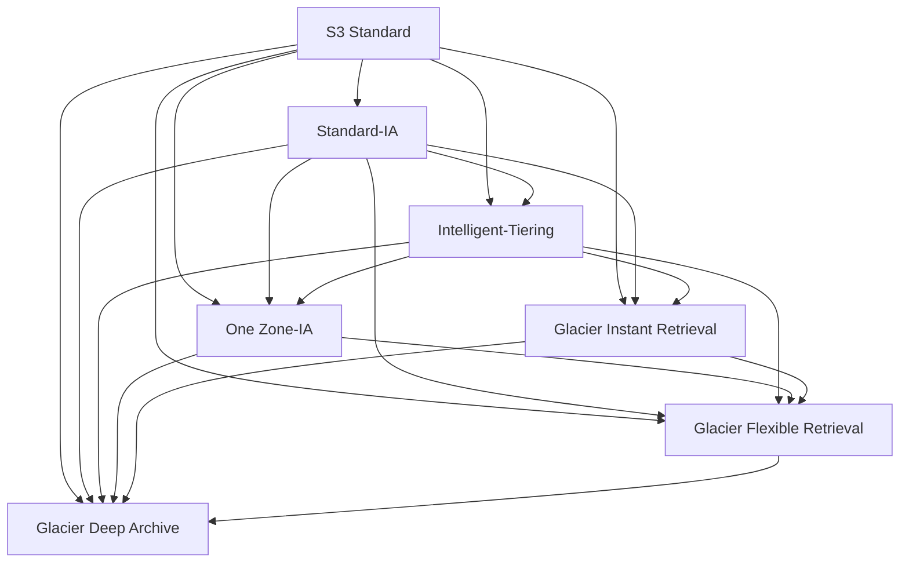

# S3 Lifecycle Configuration

> **TL;DR:** Lifecycle configuration là tập **rule** gắn vào bucket để **tự động chuyển storage class** (transition) hoặc **xóa** (expiration) object/version theo **thời gian**, nhằm tối ưu chi phí cho bucket lớn. Lifecycle **không dựa trên tần suất truy cập** (đó là việc của Intelligent-Tiering), và transition chỉ đi **"xuống" như thác nước**.

## 🖼️ Sơ đồ
![[S3 Lifecycle Configuration.excalidraw]]
*Mở bằng plugin Excalidraw để chỉnh sửa · ảnh tĩnh: [[S3 Lifecycle Configuration.svg]]*

![[S3 Lifecycle Configuration - 30 ngày.excalidraw]]
*Mở bằng plugin Excalidraw để chỉnh sửa · ảnh tĩnh: [[S3 Lifecycle Configuration - 30 ngày.svg]]*

## Khái niệm cốt lõi
- Lifecycle configuration = **tập rule** trên bucket; mỗi rule = **action** áp dụng khi **criteria** thỏa ("làm X nếu Y đúng").
- Phạm vi rule: **cả bucket** hoặc nhóm object lọc theo **prefix** hoặc **tag**.
- Hai loại action:
  - **Transition actions**: đổi storage class. Ví dụ Standard → Standard-IA sau 30 ngày, rồi → Glacier Deep Archive sau 90 ngày.
  - **Expiration actions**: xóa object hoặc **object version** sau một khoảng thời gian, giữ bucket gọn.
- Cả hai đều áp dụng được cho **version** trong bucket bật versioning (current và noncurrent versions), nhưng phức tạp nên phải lên kế hoạch kỹ. Xem [[S3 Versioning and MFA Delete]].
- **Không dựa trên truy cập**: không thể nói "object nào ít đọc thì chuyển". Muốn tự động theo truy cập → **S3 Intelligent-Tiering** (xem [[S3 Storage Classes]]).
- Ví dụ vòng đời trọn vẹn: 30 ngày đầu truy cập nhiều → transition sang Intelligent-Tiering / Standard-IA / One Zone-IA → sau 90 ngày sang một class Glacier để archive → expiration khi chắc chắn không cần nữa.

## Cách hoạt động / Kiến trúc
### Mô hình "thác nước" (waterfall)

| Từ | Transition được sang |
|---|---|
| Standard | **Mọi** class khác |
| Standard-IA | Intelligent-Tiering, One Zone-IA, Glacier IR, Glacier Flexible, Deep Archive |
| Intelligent-Tiering | One Zone-IA, Glacier IR, Glacier Flexible, Deep Archive |
| One Zone-IA | Glacier Flexible, Deep Archive — **KHÔNG sang Glacier Instant Retrieval** (ngoại lệ cần nhớ) |
| Glacier Instant Retrieval | Glacier Flexible, Deep Archive |
| Glacier Flexible Retrieval | Deep Archive |
| Deep Archive | (đáy, không đi đâu) |

- **Không bao giờ transition ngược lên** bằng lifecycle. Thực tế thường đi nhiều bước theo access pattern, nhưng đi thẳng giữa hầu hết các class cũng được.

### Các ràng buộc quan trọng
1. **Object nhỏ**: chuyển nhiều object nhỏ từ Standard sang Standard-IA / Intelligent-Tiering / One Zone-IA có thể **tốn bằng hoặc hơn** vì minimum billable size (128 KB). (Hiện nay AWS mặc định **không transition object < 128 KB** trừ khi cấu hình lọc kích thước.)
2. **30 ngày ở Standard trước khi lifecycle sang Standard-IA hoặc One Zone-IA**. Upload thẳng vào Standard-IA/One Zone-IA thì được; đổi class thủ công qua CLI/console cũng được; nhưng **lifecycle rule** thì object phải ở Standard đủ 30 ngày.
3. **Một rule duy nhất** đi Standard → IA/One Zone-IA → Glacier: object phải nằm ở IA/One Zone-IA **thêm ít nhất 30 ngày** trước khi rule đó chuyển tiếp sang Glacier. Dùng **hai rule riêng** thì không bị khoảng 30 ngày này.

## 🎯 Mẹo thi SAA-C03
- "Tự động chuyển dữ liệu cũ sang class rẻ hơn sau N ngày", "xóa log sau 365 ngày" → **lifecycle rule** (transition + expiration).
- "Chuyển theo **mức độ truy cập**, pattern không biết trước" → **Intelligent-Tiering**, không phải lifecycle.
- Transition chỉ đi **xuống**; **One Zone-IA không sang được Glacier Instant Retrieval**.
- Lifecycle Standard → Standard-IA/One Zone-IA cần **tối thiểu 30 ngày** ở Standard; đáp án có "transition sang IA sau 7 ngày bằng lifecycle" là bẫy.
- Một rule: IA → Glacier phải chờ thêm 30 ngày; hai rule thì không.
- Bucket bật versioning tốn tiền vì noncurrent version → dùng lifecycle để **expire/transition noncurrent versions** (và dọn expired delete markers, incomplete multipart uploads — bổ sung).
- Nhiều object nhỏ → transition có thể làm **tăng** chi phí.

## Liên kết
- Tiên quyết: [[S3 Storage Classes]], [[S3 Basics]]
- Liên quan: [[S3 Versioning and MFA Delete]], [[S3 Performance Optimization]] (multipart upload dang dở), [[S3 Replication]], [[S3 Object Lock]], [[DynamoDB TTL]]
- Phân biệt với: Intelligent-Tiering trong [[S3 Storage Classes]] (theo truy cập, không theo thời gian), [[AWS Backup]] (lifecycle của backup)
