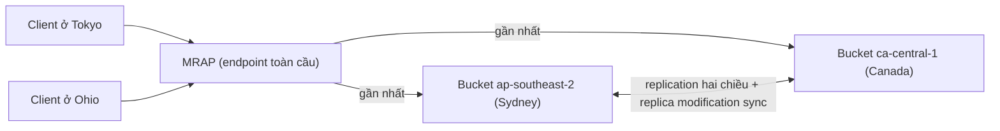

# S3 Multi-Region Access Points

> **TL;DR:** Multi-Region Access Point (MRAP) cung cấp **một endpoint S3 toàn cầu duy nhất** trỏ tới **nhiều bucket ở nhiều region**, rồi tự động route request tới bucket **gần nhất hoặc có hiệu năng tốt nhất**. Kết hợp với [[S3 Replication]] hai chiều để các bucket có cùng dữ liệu. Có cấu hình failover **active-active** hoặc **active-passive**.

## 🖼️ Sơ đồ
![[S3 Multi-Region Access Points.excalidraw]]
*Mở bằng plugin Excalidraw để chỉnh sửa · ảnh tĩnh: [[S3 Multi-Region Access Points.svg]]*

![[S3 Multi-Region Access Points - lag.excalidraw]]
*Mở bằng plugin Excalidraw để chỉnh sửa · ảnh tĩnh: [[S3 Multi-Region Access Points - lag.svg]]*

## Khái niệm cốt lõi
- **Một endpoint, nhiều bucket, nhiều region**: ứng dụng chỉ cần biết ARN hoặc alias của MRAP. Request được đưa tới S3 gần nhất (đi qua mạng toàn cầu của AWS, cùng hạ tầng với [[Global Accelerator]]).
- **Tên MRAP** chỉ cần unique **trong account**, không cần unique toàn cầu như bucket name.
- **Danh sách bucket không sửa được sau khi tạo**: phải thêm đủ bucket ngay lúc tạo.
- **Thời gian tạo**: tệ nhất **tới 24 giờ**, thường **10–30 phút**. Phải đợi status = **Ready**.
- Mỗi MRAP có **ARN** và **alias**. CLI dùng ARN: `s3://arn:aws:s3::<account>:accesspoint/<alias>.mrap`. (Request tới MRAP được ký bằng **SigV4A**, nên dùng CLI/SDK bản mới.)
- **MRAP không tự đồng bộ dữ liệu**. Bạn phải cấu hình **replication** giữa các bucket, nếu không người dùng ở region khác sẽ thấy dữ liệu khác nhau.
- **Failover configuration** (tab *Replication and failover*):
  - **Active-active**: request đi tới bất kỳ bucket nào đang sẵn sàng (gần nhất).
  - **Active-passive**: đặt một bucket là *passive*, chỉ dùng khi không còn bucket active nào.

## Cách hoạt động / Kiến trúc

### Replication cho MRAP
- Hai template khi tạo replication rule từ MRAP:
  1. **Replicate objects among all specified buckets**: mọi bucket replicate qua lại với nhau (full mesh, hai chiều). Phù hợp **active-active**.
  2. **Replicate objects from one or more source buckets to one or more destination buckets**: một chiều, phù hợp active-passive.
- Template 1 tự tạo IAM role cần thiết. **Không chọn được destination storage class**.
- Tùy chọn bổ sung: **RTC** (SLA 15 phút, tốn phí), **replication metrics and notifications**, **delete marker replication**, **replica modification sync**.

### Vấn đề: consistency lag
- Ghi object qua MRAP từ Canada thì object vào bucket Canada trước, vài phút sau mới replicate sang Sydney.
- Nếu ngay lúc đó một client ở Sydney đọc object qua MRAP, nó bị route tới bucket Sydney và nhận lỗi **object không tồn tại**, cho đến khi replication xong.
- Giảm vấn đề bằng **RTC** (có thêm chi phí). Kiến trúc dùng MRAP phải **chấp nhận eventual consistency giữa các region**.

## Demo / Lab
Mini project 0382:
1. Tạo 2 bucket **bật versioning**: `multi-region-demo-sydney-<rand>` (ap-southeast-2) và `multi-region-demo-canada-<rand>` (ca-central-1).
2. S3 → **Multi-Region Access Points** → Create, đặt tên, **add cả 2 bucket** (không sửa được về sau). Đợi status Ready.
3. Tab **Replication and failover**: failover mặc định active-active. Tạo replication rule bằng template "replicate among all specified buckets", chọn cả 2 bucket, phạm vi toàn bucket, bật **metrics and notifications** và **replica modification sync**, không bật RTC và delete marker replication. Kết quả là replication hai chiều Sydney ↔ Canada.
4. Test bằng **CloudShell** ở region khác:
   - Tạo file 10 MB: `dd if=/dev/urandom of=test1.file bs=1M count=10`.
   - Upload: `aws s3 cp test1.file s3://<MRAP ARN>`.
   - Từ **Tokyo**: object vào bucket **Sydney** trước, sau vài phút có ở Canada.
   - Từ **Ohio (us-east-2)**: vào **Canada** trước.
   - Từ **Mumbai (ap-south-1)**, nằm giữa hai bên: trong demo vào Sydney trước.
5. Test consistency: upload `test4.file` từ CloudShell **Canada** và ngay lập tức `aws s3 cp s3://<MRAP ARN>/test4.file .` từ CloudShell **Sydney** → lỗi không tồn tại, lặp lại đến khi replication xong thì tải được.
6. Dọn dẹp: xóa MRAP, empty và delete hai bucket.

## 🎯 Mẹo thi SAA-C03
- "Ứng dụng toàn cầu cần **một endpoint S3 duy nhất**, tự route tới bucket **gần nhất**, có **failover giữa region**" → **S3 Multi-Region Access Points** + replication.
- MRAP **không tự replicate**. Phải cấu hình **S3 Replication (CRR) hai chiều** và bật **replica modification sync**.
- Đọc ngay sau khi ghi ở region khác có thể **không thấy object** (replication lag). Cần giảm lag thì dùng **RTC**.
- Active-passive → failover controls trên MRAP.
- Phân biệt: [[S3 Access Points]] là **một bucket**, phân quyền theo nhóm. MRAP là **nhiều bucket, nhiều region**, route theo vị trí. [[CloudFront Architecture]] là cache nội dung tĩnh ở edge, không phải routing ghi/đọc trực tiếp vào bucket.

## Liên kết
- Tiên quyết: [[S3 Replication]], [[S3 Access Points]], [[S3 Versioning and MFA Delete]], [[AWS Global Infrastructure]]
- Liên quan: [[Global Accelerator]], [[Regional and Global Architecture]], [[HA vs FT vs DR]]
- Phân biệt với: [[S3 Access Points]], [[CloudFront Architecture]], [[DynamoDB Global Tables]]
- Tổng quan: [[_MOC 05 S3]]
