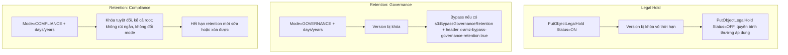

# S3 Object Lock

> **TL;DR:** S3 Object Lock áp mô hình **WORM (Write Once, Read Many)** lên từng **object version**: version đã khóa thì không ghi đè và không xóa được. Có hai cơ chế độc lập là **Retention Period** (hai mode: **Compliance** và **Governance**) và **Legal Hold** (bật/tắt). Một version có thể có cả hai, một trong hai, hoặc không có cái nào.

## 🖼️ Sơ đồ
![[S3 Object Lock.excalidraw]]
*Mở bằng plugin Excalidraw để chỉnh sửa · ảnh tĩnh: [[S3 Object Lock.svg]]*

## Khái niệm cốt lõi
- **Bật trên bucket**: khóa học nói chỉ bật được khi **tạo bucket mới**, bucket cũ phải liên hệ AWS Support. (Từ 11/2023, AWS đã cho phép bật Object Lock trên bucket **đã có** bằng console/API, với điều kiện bucket đã bật versioning.)
- Bật Object Lock thì **versioning tự động được bật**. Sau khi bật, **không thể tắt Object Lock và không thể suspend versioning** trên bucket đó.
- Vì phụ thuộc versioning nên **cái bị khóa là từng object version**, không phải "object" nói chung (xem [[S3 Versioning and MFA Delete]]).
- Cả Retention lẫn Legal Hold đều có thể đặt **trên từng object version** hoặc đặt **bucket default** (giống bucket default encryption).
- Retention và Legal Hold **dùng chung được** và hiệu lực **chồng lên nhau**: version bị khóa chừng nào còn ít nhất một cơ chế đang có hiệu lực.

## Retention Period
Khi khóa, bạn chỉ định thời hạn theo **ngày và/hoặc năm**. Ví dụ "1 năm" nghĩa là hết hạn 1 năm sau thời điểm áp dụng. Có hai mode:

### Compliance mode (nghiêm nhất)
- Trong thời hạn retention: object version **không xóa và không ghi đè được**.
- **Không rút ngắn được retention period**, **không đổi được mode**.
- Áp dụng cho **mọi identity, kể cả account root user**.
- Chỉ khi retention hết hạn mới sửa hoặc xóa được (theo quyền thông thường).
- Dùng cho **yêu cầu pháp lý/compliance**, ví dụ dữ liệu y tế hoặc tài chính phải giữ 3 năm không có ngoại lệ. Đừng bật nếu không thật sự muốn version đó tồn tại nguyên vẹn đến hết hạn.

### Governance mode (mềm hơn)
- Mặc định cũng không xóa, không sửa được version trong thời hạn.
- Nhưng có thể **cấp quyền đặc biệt** để bypass: identity có permission **`s3:BypassGovernanceRetention`** **và** gửi header **`x-amz-bypass-governance-retention: true`** thì được xóa/ghi đè version hoặc chỉnh/gỡ lock.
- **Console mặc định gửi header này**, nên user có `s3:BypassGovernanceRetention` thao tác trên console là bypass được.
- Use case: **chống xóa nhầm**; lý do quy trình hoặc governance cần giữ version; **thử nghiệm cấu hình trước khi chuyển sang Compliance**.

## Legal Hold
- **Không có retention period**. Chỉ là cờ **ON/OFF** (binary) trên một object version.
- Khi ON: version **không xóa, không ghi đè được**. Khi OFF: quyền bình thường áp dụng trở lại.
- Cần permission **`s3:PutObjectLegalHold`** để bật hoặc tắt.
- Use case: chống xóa nhầm, hoặc **tình huống pháp lý thật**: đánh dấu version quan trọng cho một vụ việc hay dự án, giữ đến khi hết vụ (không biết trước thời hạn).

## Cách hoạt động / Kiến trúc

## Bảng so sánh
| | Legal Hold | Governance | Compliance |
|---|---|---|---|
| Có thời hạn? | Không (ON/OFF) | Có (ngày/năm) | Có (ngày/năm) |
| Xóa/ghi đè version khi đang khóa | Không | Không, trừ khi có quyền bypass + header | Không, **kể cả root** |
| Gỡ khóa sớm | Tắt bằng `s3:PutObjectLegalHold` | Được, với `s3:BypassGovernanceRetention` | **Không thể** |
| Rút ngắn retention / đổi mode | — | Được (với quyền bypass) | **Không** |
| Use case | Vụ kiện, điều tra, giữ không biết đến khi nào | Chống xóa nhầm, test trước compliance | Quy định pháp lý bắt buộc (SEC, y tế, tài chính) |

## 🎯 Mẹo thi SAA-C03
- "WORM", "không ai, **kể cả root user**, được xóa hoặc sửa trong N năm", "quy định pháp lý" → **Object Lock, Compliance mode**.
- "Ngăn xóa nhưng **một số admin đặc biệt** vẫn được phép xóa hoặc chỉnh" → **Governance mode** + `s3:BypassGovernanceRetention`.
- "Giữ object cho vụ kiện, **không biết thời hạn**" → **Legal Hold**.
- Object Lock **cần versioning**, và khóa ở mức **object version**.
- Bẫy: Compliance mode **không thể** rút ngắn hay gỡ, kể cả root, kể cả AWS Support. Muốn thử thì dùng Governance trước.
- Phân biệt với **MFA Delete** ([[S3 Versioning and MFA Delete]]): MFA Delete chỉ bắt buộc MFA khi xóa version hoặc đổi trạng thái versioning, không phải WORM theo thời hạn.

## Liên kết
- Tiên quyết: [[S3 Basics]], [[S3 Versioning and MFA Delete]], [[IAM Identity Policies]]
- Liên quan: [[S3 Security]], [[S3 Replication]], [[S3 Lifecycle Configuration]], [[AWS Backup]]
- Phân biệt với: [[S3 Versioning and MFA Delete]], [[Service Control Policies]]
- Tổng quan: [[_MOC 05 S3]]
