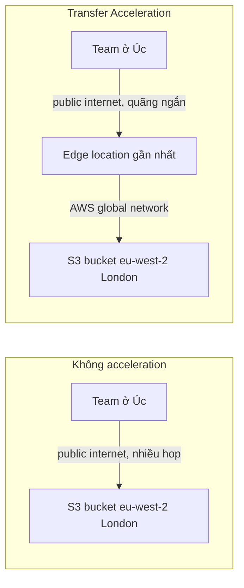

# S3 Performance Optimization

> **TL;DR:** Hai tính năng chính giúp upload lên S3 nhanh và tin cậy hơn: **Multipart Upload** (chia dữ liệu thành nhiều part upload song song, part lỗi thì chỉ gửi lại part đó) và **S3 Transfer Acceleration** (đưa dữ liệu vào **edge location** gần nhất rồi đi trên **AWS global network** tới bucket ở xa).

## 🖼️ Sơ đồ
![[S3 Performance Optimization.excalidraw]]
*Mở bằng plugin Excalidraw để chỉnh sửa · ảnh tĩnh: [[S3 Performance Optimization.svg]]*

![[S3 Performance Optimization - acceleration.excalidraw]]
*Mở bằng plugin Excalidraw để chỉnh sửa · ảnh tĩnh: [[S3 Performance Optimization - acceleration.svg]]*

## Khái niệm cốt lõi
- Bối cảnh Aus-E-Mart: trụ sở và workload AWS ở Úc, nhân viên làm việc từ xa khắp thế giới qua laptop, mạng di động, vệ tinh, phải upload file lớn lên S3. Mục tiêu là **hiệu năng + độ tin cậy**.

### Single PUT upload (mặc định)
- File được upload thành **một blob, một stream** qua API `PutObject`.
- Stream đứt là **hỏng cả upload**, phải làm lại từ đầu (đứt ở 4,5 GB của file 5 GB → mất trắng 4,5 GB).
- Một stream thường **không tận dụng hết băng thông** của cả hai đầu, nhất là khi truyền xa. (Tốc độ tối đa luôn bị giới hạn bởi đầu chậm hơn, nhưng single stream thường còn không đạt tới mức đó.)
- Giới hạn: single PUT tối đa **5 GB**. Giảng viên: đừng bao giờ tin single PUT với lượng dữ liệu gần mức đó.

### Multipart Upload
- Chia blob gốc thành nhiều **part**, mỗi part là một upload độc lập: lỗi thì **chỉ retry part đó**.
- Upload các part **song song** → tốc độ tổng = tổng tốc độ các part, tận dụng băng thông tốt hơn, vượt qua giới hạn single-stream của ISP/mạng.
- Số liệu:

| Thông số | Giá trị |
|---|---|
| Ngưỡng dùng (theo khóa học) | dữ liệu từ **100 MB** trở lên |
| Số part tối đa | **10.000** |
| Kích thước mỗi part | **5 MB – 5 GB** (part cuối được nhỏ hơn 5 MB) |
| Single PUT tối đa | **5 GB** |

- Khuyến nghị: dùng multipart **ngay khi có thể** (>100 MB); hầu hết tool AWS (CLI, SDK) tự bật multipart. Trên 100 MB gần như không có lý do dùng single PUT.
- (Chính xác theo AWS: về kỹ thuật multipart dùng được với object lớn hơn 5 MB; 100 MB là ngưỡng AWS **khuyến nghị**. Với object > 5 GB thì **bắt buộc** multipart.)

### S3 Transfer Acceleration
- Vấn đề: S3 là **public service, regional**. Upload từ Úc tới bucket London phải đi suốt **public internet** tới tận UK mới vào AWS public zone. Đường đi do router/ISP quyết định theo lợi ích thương mại, có thể vòng vèo, nhiều hop, chậm dần.
- Giải pháp: dùng mạng **edge location của CloudFront** (cùng hạ tầng với CDN [[CloudFront Architecture|CloudFront]]):
  1. Client upload tới **edge location gần nhất, tốt nhất** (vẫn qua public internet nhưng rất ngắn, ít mạng trung gian).
  2. Edge location chuyển dữ liệu qua **AWS global network** (mạng riêng AWS kiểm soát, ít điểm dừng, độ trễ thấp và ổn định) tới bucket.
- Ví von: internet như hệ thống xe buýt công cộng (linh hoạt, đến mọi nơi nhưng nhiều lần chuyển tuyến); AWS network như **tàu tốc hành** chỉ dừng ở điểm đầu và cuối.
- Ngoài đường đi tốt hơn, Transfer Acceleration còn **tối ưu thêm giao thức mạng**: lợi ích đến từ cả định tuyến lẫn giao thức, không chỉ do địa lý.
- **Mặc định tắt**, bật ở mức bucket. Tên bucket phải **DNS-compliant** để dùng làm endpoint. (Bản khóa cũ nói rõ thêm: tên bucket **không được chứa dấu chấm (`.`)**; bài mới chỉ nói DNS-compliant.)
- Bật xong có thể mất **tới khoảng 20 phút** mới có hiệu lực, đừng mong tăng tốc ngay.
- Khi bật, bucket có **endpoint riêng**: IPv4 dạng `<bucket>.s3-accelerate.amazonaws.com`, IPv6 thì dùng endpoint **dual-stack**. Phải trỏ ứng dụng tới endpoint này mới có hiệu quả; vẫn dùng endpoint thường thì không được tăng tốc.
- **Chỉ trả phí** khi transfer thực sự đi qua endpoint tăng tốc **và được tăng tốc**; tiếp tục dùng endpoint thường thì không tốn thêm.
- Lợi ích tăng theo **khoảng cách** và **chất lượng đường truyền gốc càng kém** thì càng lợi.

## Bổ sung (không có trong bài, hay gặp trong đề)
- S3 tự scale: tối thiểu **3.500 PUT/COPY/POST/DELETE** và **5.500 GET/HEAD request/giây cho mỗi prefix**; dùng nhiều prefix để tăng throughput song song.
- **Byte-range fetches**: tải song song nhiều đoạn byte của một object để tăng tốc download (tương tự multipart cho chiều tải xuống).
- Muốn giảm độ trễ **download** cho người dùng toàn cầu → [[CloudFront Architecture|CloudFront]] (cache); Transfer Acceleration chủ yếu tối ưu **upload** đường dài.

## Demo / Lab
- Demo chỉ để xem, không cần làm theo (phải có người dùng khắp thế giới mới thấy rõ tác dụng).
- Tạo bucket → Properties → **Transfer acceleration: Enabled** → console hiện **accelerated endpoint**. Không dùng endpoint này thì không tốn thêm tiền.
- Dùng công cụ **S3 Transfer Acceleration Speed Comparison** của AWS: trình duyệt sinh file rồi upload (multipart) lên các bucket của AWS ở nhiều region, so sánh endpoint thường với endpoint tăng tốc. Giảng viên chạy từ Úc: tới region Sydney gần như không cải thiện, thậm chí có thể chậm hơn chút; tới các region xa thì nhanh hơn rõ.

## 🎯 Mẹo thi SAA-C03
- Upload file lớn qua mạng không ổn định, muốn **resume/retry từng phần**, tăng tốc → **Multipart Upload**.
- Object **> 5 GB** → bắt buộc multipart (single PUT tối đa 5 GB). Từ **100 MB** nên dùng multipart.
- Người dùng **ở xa region của bucket** (khác lục địa) upload chậm → **S3 Transfer Acceleration**.
- Tên bucket phải DNS-compliant; bucket có dấu chấm trong tên → **không** bật được Transfer Acceleration (bản khóa cũ nêu).
- Phải dùng **accelerate endpoint** (IPv6: endpoint dual-stack); bật tính năng mà vẫn dùng endpoint thường thì không có tác dụng (và cũng không tốn phí tăng tốc).
- Chỉ trả phí Transfer Acceleration khi transfer **thực sự được tăng tốc**. Bật xong có thể mất tới ~20 phút mới có hiệu lực.
- Phân biệt: Transfer Acceleration dùng edge location cho **S3**; [[Global Accelerator]] dùng edge/anycast cho ứng dụng TCP/UDP (ALB, NLB, EC2); [[CloudFront Architecture|CloudFront]] dùng edge để **cache nội dung** khi đọc.
- Dữ liệu cực lớn (hàng chục TB+) mà mạng yếu → cân nhắc [[Snow Family]] hoặc [[DataSync]]/[[Direct Connect]] thay vì chỉ tối ưu upload.

## Liên kết
- Tiên quyết: [[S3 Basics]], [[AWS Global Infrastructure]], [[AWS Public vs Private Services]]
- Liên quan: [[CloudFront Architecture]], [[DataSync]], [[Snow Family]]
- Phân biệt với: [[Global Accelerator]], [[CloudFront Architecture]]
