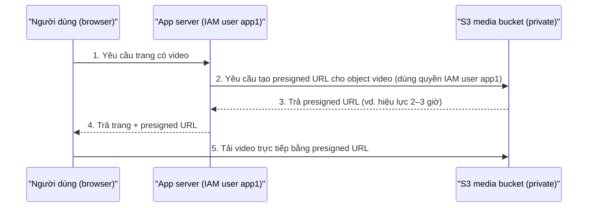

# S3 Presigned URLs

> **TL;DR:** Presigned URL là URL có sẵn thông tin xác thực của identity đã tạo ra nó. URL này cho phép bất kỳ ai cầm nó **GET (tải xuống) hoặc PUT (tải lên) một object cụ thể** trong một bucket **private**, trong một khoảng thời gian giới hạn, mà không cần có identity AWS và không phải public bucket.

## 🖼️ Sơ đồ
![[S3 Presigned URLs.excalidraw]]
*Mở bằng plugin Excalidraw để chỉnh sửa · ảnh tĩnh: [[S3 Presigned URLs.svg]]*

## Khái niệm cốt lõi
- **Vấn đề**: bucket private (mặc định) chỉ cho identity đã xác thực truy cập. Người ngoài (không có identity AWS) muốn truy cập thì có 3 cách "dở":
  1. Tạo cho họ một identity AWS: quá tốn công nếu chỉ cần truy cập ngắn hạn.
  2. Đưa credential cho họ: rủi ro bảo mật, nhất là khi đưa credential của người khác.
  3. Public bucket/object: không chấp nhận được với dữ liệu nhạy cảm.
- **Giải pháp**: một identity có quyền (ví dụ IAM user `iamadmin`) yêu cầu S3 tạo presigned URL bằng cách cung cấp: **credential của mình, bucket, object key, thời điểm hết hạn, và phương thức truy cập** (GET/PUT).
- URL trả về mã hóa sẵn: bucket nào, object nào, **ai tạo**, hết hạn khi nào.
- **Người dùng URL hành động *như chính* identity đã tạo ra nó**, chỉ với object đó, cho đến khi URL hết hạn.
- Dùng được cho cả **download (GET)** và **upload (PUT)**. Ví dụ nhân viên làm việc từ xa không có account AWS vẫn upload được đúng một file.

## Cách hoạt động / Kiến trúc

### Kiến trúc ứng dụng media (use case điển hình)
Ứng dụng xử lý video động vật hoang dã chuyển các file video lớn từ app server sang một **media bucket private** trên S3. Muốn người dùng xem video mà không cần public bucket và không cần cấp IAM user cho từng người:



- Ứng dụng dùng một **IAM user** riêng (service account), vì chỉ có một ứng dụng và quyền tương đối cố định (xem [[IAM Users and ARNs]]).
- Mô hình này hay gặp khi **offload media sang S3** hoặc trong [[Serverless Architecture]]: không cần app server "dày" làm trung gian truyền dữ liệu, chỉ cần cấp URL.

## Exam PowerUp: các hành vi "lạ" cần nhớ
| Hành vi | Ý nghĩa |
|---|---|
| **Tạo được URL cho object mình không có quyền** | Chỉ cần chỉ định object và thời hạn là tạo được. Nhưng URL đó cũng **không có quyền** gì, vì nó gắn với bạn |
| **Tạo được URL cho object không tồn tại** | Dùng URL sẽ nhận lỗi "The specified key does not exist" |
| **Quyền của URL = quyền HIỆN TẠI của identity tạo ra nó** | Không phải quyền tại thời điểm tạo. Thu hồi quyền của identity thì URL cũng mất quyền ngay; trả lại quyền thì URL hoạt động lại |
| **Access Denied khi dùng URL** | Identity tạo URL **chưa bao giờ có quyền**, **hiện không còn quyền**, hoặc URL đã hết hạn ("Request has expired") |
| **Đừng tạo URL bằng IAM role** | Role cho credential tạm thời. URL **ngừng hoạt động khi credential tạm hết hạn**, dù expiry của URL dài hơn. Nên dùng identity dài hạn (thường là IAM user) |

## Demo / Lab
Demo 0105 với bucket `animals4life-media` (private) chứa một ảnh:
1. **Open** object từ console mở được, vì console tự gắn thông tin xác thực (`X-Amz-Security-Token`...) vào URL. Còn dán **Object URL** thô vào trình duyệt thì nhận **Access Denied**, vì đó là request không xác thực vào bucket private.
2. Mở **CloudShell** (chạy với credential của user đang đăng nhập) rồi tạo URL:
   ```bash
   aws s3 presign s3://<bucket>/<key> --expires-in 180
   ```
   `--expires-in` tính bằng **giây** (180 = 3 phút). URL hoạt động, sau 180 giây thì báo "Request has expired".
3. Tạo URL với `--expires-in 604800` (7 ngày), rồi gắn **inline policy explicit Deny S3** cho `iamadmin`. URL đang mở báo **Access Denied** (explicit deny luôn thắng, xem [[IAM Identity Policies]]). Gỡ policy thì URL **dùng lại được**. Điều này chứng minh URL dùng quyền hiện tại của identity.
4. Khi đang bị deny vẫn **tạo được** URL mới, nhưng URL đó cũng bị deny.
5. Tạo URL cho key không tồn tại vẫn được, khi dùng thì báo key không tồn tại.
6. Console giờ cũng tạo được: **Object actions → Share with a presigned URL**, chọn thời hạn (ví dụ 60 phút).

## Bảng số liệu
| Thông số | Giá trị |
|---|---|
| Đơn vị `--expires-in` (CLI) | giây (mặc định 3600) |
| Thời hạn tối đa (SigV4, IAM user) | **7 ngày = 604800 giây** |
| Tạo từ console | tối đa 12 giờ |
| Tạo bằng credential tạm (role, instance profile) | hết hiệu lực khi credential tạm hết hạn |

## 🎯 Mẹo thi SAA-C03
- Đề nói "cho người dùng **không có tài khoản AWS** tải lên hoặc tải xuống **một object cụ thể** trong bucket **private**, **trong thời gian giới hạn**" → **presigned URL**.
- "Ứng dụng phục vụ file media trên S3 private mà không muốn public bucket" → app tạo presigned URL. Nếu phân phối qua CloudFront thì dùng **CloudFront signed URL/cookie** (xem [[CloudFront Private Distributions]]).
- Presigned URL đột nhiên trả Access Denied trước khi hết hạn → nghi ngay: quyền của identity tạo URL đã bị thay đổi, hoặc URL được tạo bằng **role** mà credential tạm đã hết hạn.
- Hãy dùng **IAM user** (long-term credential) để tạo URL có thời hạn dài, không dùng role.
- Presigned URL hỗ trợ **PUT**: là cách cho client upload trực tiếp lên S3 mà không đi qua server (hay gặp trong kiến trúc serverless).

## Liên kết
- Tiên quyết: [[S3 Basics]], [[S3 Security]], [[IAM Users and ARNs]], [[IAM Roles]]
- Liên quan: [[IAM Identity Policies]], [[IAM Access Keys and AWS CLI]], [[EC2 Instance Roles]], [[Serverless Architecture]], [[Lambda]]
- Phân biệt với: [[CloudFront Private Distributions]] (CloudFront signed URL), [[CloudFront OAI and OAC]], [[S3 Access Points]]
- Tổng quan: [[_MOC 05 S3]]
