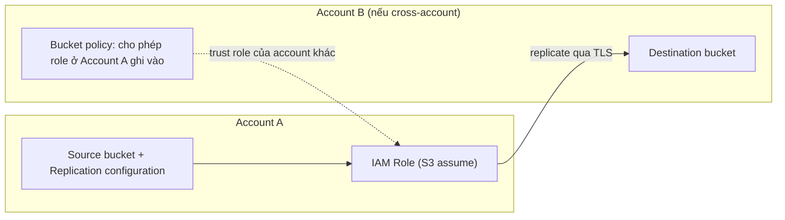

# S3 Replication

> **TL;DR:** S3 Replication tự động sao chép object từ một **source bucket** sang một **destination bucket**, cùng region (**SRR**) hoặc khác region (**CRR**), cùng account hoặc khác account. Bạn đặt replication configuration trên source bucket, kèm một IAM role để S3 assume và thực hiện việc copy. Dùng cho DR, giảm latency, gom log, đồng bộ prod/test và đáp ứng yêu cầu data sovereignty.

## 🖼️ Sơ đồ
![[S3 Replication.excalidraw]]
*Mở bằng plugin Excalidraw để chỉnh sửa · ảnh tĩnh: [[S3 Replication.svg]]*

![[S3 Replication - scope.excalidraw]]
*Mở bằng plugin Excalidraw để chỉnh sửa · ảnh tĩnh: [[S3 Replication - scope.svg]]*

## Khái niệm cốt lõi
- **Hai loại replication:**
  - **CRR (Cross-Region Replication)**: source và destination ở **hai region khác nhau**. Đây là loại có từ lâu.
  - **SRR (Same-Region Replication)**: cả hai bucket ở **cùng một region**. Ra đời sau.
  - Cả hai loại đều chạy được **trong cùng account** lẫn **giữa hai account khác nhau**.
- **Replication configuration** gắn trên **source bucket**, gồm:
  - Destination bucket.
  - **IAM role** dùng cho quá trình replicate. Trust policy của role cho phép service S3 assume; permissions policy cho phép **đọc object ở source** và **ghi/replicate object vào destination** (xem [[IAM Roles]]).
- Dữ liệu replicate được truyền qua kênh mã hóa (SSL/TLS).
- **Versioning bắt buộc bật ở CẢ source và destination** (xem [[S3 Versioning and MFA Delete]]). Console có nút bật versioning ngay trong lúc tạo rule.

## Cách hoạt động / Kiến trúc

### Cùng account vs khác account
- **Cùng account**: cả hai bucket đều tin cùng một account, tức là tin IAM của account đó, nên role tự động truy cập được cả hai bucket, miễn là permissions policy của role cho phép.
- **Khác account**: destination bucket **không mặc định tin** role của account nguồn. Phải thêm **bucket policy** (resource policy) trên destination bucket cho phép role của account nguồn replicate object vào (xem [[S3 Security]]).

### Các tùy chọn trong replication configuration
| Tùy chọn | Mặc định | Có thể đổi thành |
|---|---|---|
| **Phạm vi replicate** | Toàn bộ bucket (mọi object, prefix, tag) | Lọc theo **prefix**, **tag** hoặc kết hợp cả hai |
| **Storage class ở destination** | **Giống source** | Class rẻ hơn, ví dụ **S3 One Zone-IA** cho bản sao thứ cấp (xem [[S3 Storage Classes]]) |
| **Ownership object ở destination** | Thuộc **account của source** | Đổi sang **destination account** sở hữu (quan trọng khi cross-account, nếu không destination account có thể không đọc được object) |
| **Replication Time Control (RTC)** | Tắt (best effort) | Bật để có SLA: **99,99% object mới được replicate trong 15 phút**, kèm metrics và notification, **tốn thêm phí** |
| **Delete marker replication** | **Không** replicate delete marker | Bật để xóa ở source cũng phản ánh sang destination |
| **Replica modification sync** | Tắt | Đồng bộ thay đổi metadata của replica ngược lại (dùng khi làm replication hai chiều, xem [[S3 Multi-Region Access Points]]) |

- Lý do dùng storage class rẻ hơn: bản sao ở destination là dữ liệu thứ cấp, bản chính vẫn nằm ở source, nên chấp nhận độ resilience thấp hơn để tiết kiệm.
- Với Object Ownership "Bucket owner enforced" (ACL bị tắt, mặc định cho bucket mới từ 4/2023), destination bucket owner tự động sở hữu mọi object được replicate vào. (Khóa học mô tả tùy chọn owner override; hiện nay phần lớn trường hợp đã được Object Ownership xử lý.)

### Những điểm cần nhớ (considerations)
- **Không retroactive**: chỉ object được ghi **sau khi** bật replication mới được copy. Object có sẵn trước đó không tự replicate. (Khóa học có nhắc console giờ hỏi có muốn replicate existing objects không; việc này chạy bằng **S3 Batch Replication**.)
- **Một chiều**: source → destination. Object thêm tay vào destination **không** chảy ngược về source. Muốn hai chiều thì phải cấu hình hai rule ngược nhau (như trong demo MRAP).
- **Mã hóa**:
  - Unencrypted: OK.
  - **SSE-S3**: OK.
  - **SSE-KMS**: OK nhưng cần **cấu hình thêm** và thêm quyền KMS cho role (xem [[KMS]], [[S3 Encryption]]).
  - **SSE-C**: khóa học nói **không** replicate được vì S3 không giữ key. (Từ 10/2022 AWS đã hỗ trợ replicate object SSE-C. Khi đi thi, nếu đáp án dựa trên kiến thức cũ "SSE-C không replicate" thì hiểu ý đề hỏi gì.)
- **Source bucket owner phải có quyền trên object**. Nếu bucket cho account khác upload và account nguồn không sở hữu object đó, object có thể không được replicate.
- **Không replicate system events**: thay đổi do [[S3 Lifecycle Configuration]] gây ra không được replicate, chỉ **user events** mới được replicate.
- **Không replicate object ở Glacier / Glacier Deep Archive** (nay là Glacier Flexible Retrieval / Deep Archive). Hãy coi chúng như sản phẩm lưu trữ riêng.
- **Delete mặc định không replicate**: delete marker không được copy trừ khi bật tùy chọn. Việc xóa hẳn một version cụ thể thì không bao giờ được replicate (để chống xóa độc hại).

## Use case (Why use replication?)
| Loại | Use case |
|---|---|
| SRR | **Log aggregation**: gom log từ nhiều bucket về một bucket |
| SRR | **Đồng bộ PROD và TEST** (hoặc giữa các team/account khác nhau), chiều nào cũng được |
| SRR | **Resilience khi có yêu cầu sovereignty nghiêm ngặt**: dữ liệu không được rời region, replicate sang bucket ở **account khác** để cô lập (ví dụ account riêng cho audit/security) |
| CRR | **Tăng resilience toàn cầu**: bản backup ở region khác để chịu được sự cố quy mô lớn (xem [[HA vs FT vs DR]], [[RPO and RTO]]) |
| CRR | **Giảm latency**: đặt bản sao gần người dùng ở region xa |

## Demo / Lab
Demo 0103: CRR cho một static website (xem [[S3 Static Website Hosting]]) để làm DR.
1. Tạo source bucket ở `us-east-1` và destination bucket ở `us-west-1`, bật static website hosting (index và error document đều là `index.html`), tắt Block Public Access, gắn bucket policy cho phép `s3:GetObject` công khai trên `arn:aws:s3:::<bucket>/*`.
2. Ở source bucket → tab **Management** → **Create replication rule**: bật versioning cho source, đặt tên rule, phạm vi "all objects", chọn destination (cùng account) và bật versioning cho destination, chọn **create new IAM role**.
3. Không bật SSE-KMS, RTC, delete marker replication. Chọn **không** replicate existing objects.
4. Upload `index.html` và ảnh vào source, sau vài phút chúng xuất hiện ở destination và website ở destination hiển thị y hệt. Upload bản mới cùng tên thì destination cập nhật sau khoảng 3–4 phút. **Không có RTC thì thời gian replicate thay đổi nhiều.**
5. Dọn dẹp: empty và delete cả hai bucket, xóa IAM role tự tạo có tên bắt đầu bằng `s3crr_...`.

Rút ra: replication cho phép làm DR đơn giản cho static website. Độ trễ không được đảm bảo nếu thiếu RTC.

## 🎯 Mẹo thi SAA-C03
- Đề nhắc **"15 phút"** hoặc cần **SLA/thời gian replicate dự đoán được** → **S3 Replication Time Control (RTC)**.
- **Versioning bắt buộc ở cả hai bucket.** Đáp án nào replicate mà không bật versioning là sai.
- Bật replication **không** copy object cũ. Muốn copy dữ liệu sẵn có thì dùng **S3 Batch Replication** (hoặc copy thủ công).
- Replication **một chiều**, **không replicate delete marker** theo mặc định, **không replicate thay đổi do lifecycle**.
- Cross-account: cần **bucket policy ở destination** và nên đổi **ownership** sang destination account.
- Muốn giảm chi phí bản sao DR → đổi **storage class ở destination** (ví dụ One Zone-IA).
- Dữ liệu **không được rời region** nhưng vẫn cần bản sao cô lập → **SRR sang account khác**.
- SSE-KMS replicate được nhưng cần cấu hình KMS và quyền thêm. Gặp câu hỏi kiểu cũ thì SSE-C là "không replicate".

## Liên kết
- Tiên quyết: [[S3 Basics]], [[S3 Versioning and MFA Delete]], [[IAM Roles]]
- Liên quan: [[S3 Storage Classes]], [[S3 Encryption]], [[KMS]], [[S3 Lifecycle Configuration]], [[S3 Events]], [[S3 Multi-Region Access Points]], [[S3 Static Website Hosting]]
- Kiến trúc: [[HA vs FT vs DR]], [[RPO and RTO]], [[AWS Backup]]
- Phân biệt với: [[DynamoDB Global Tables]], [[Aurora Global Database]] (replication ở tầng database)
- Tổng quan: [[_MOC 05 S3]]
