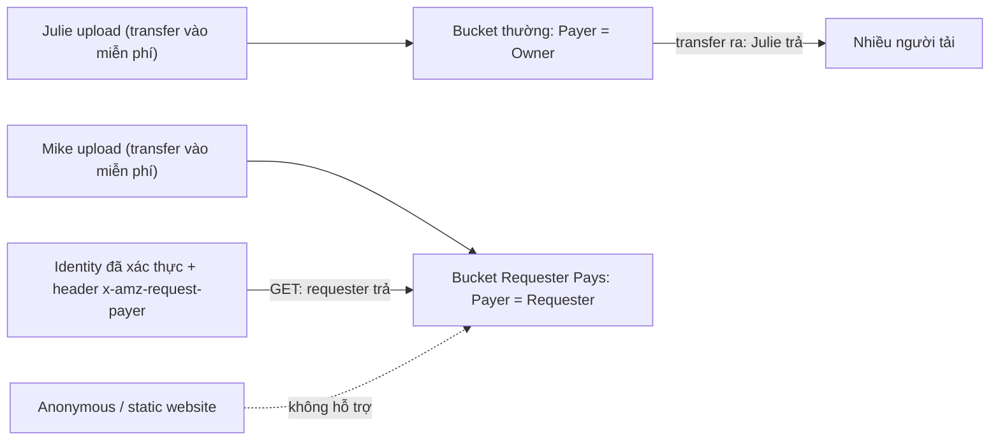

# S3 Requester Pays

> **TL;DR:** Mặc định **bucket owner trả** mọi chi phí của bucket, kể cả phí **data transfer ra** khi người khác tải dữ liệu. Bật **Requester Pays** (cấu hình **theo bucket**, đổi payer từ *owner* sang *requester*) thì **người tải** trả phí request và data transfer của họ, còn owner vẫn trả **phí lưu trữ** (GB-tháng). Điều kiện: requester phải là **identity AWS đã xác thực** (không anonymous, nên **không dùng được với static website hosting**) và phải gửi header **`x-amz-request-payer`**; thiếu header thì S3 trả **403** và owner chịu phí request đó. Presigned URL do owner tạo thì owner trả.

## 🖼️ Sơ đồ
![[S3 Requester Pays.excalidraw]]
*Mở bằng plugin Excalidraw để chỉnh sửa · ảnh tĩnh: [[S3 Requester Pays.svg]]*

## Khái niệm cốt lõi
- Kịch bản "chuyện hai bucket": **Julie** (bucket thường) và **Mike** (bucket Requester Pays) cùng host **dataset lớn ảnh thú Úc** cho các dự án machine learning.
- **Upload**: cả hai chịu trách nhiệm cho hoạt động này, nhưng **data transfer vào S3 miễn phí** nên không ai bị tính tiền.
- **Lưu trữ**: phí **GB-tháng** luôn là trách nhiệm của **bucket owner**, dù bucket thường hay Requester Pays. S3 rẻ nên khoản này thường không lớn.
- **Tải xuống**:
  - Bucket thường (**Payer = Owner**): mỗi lượt tải tốn một khoản nhỏ phí **transfer ra Internet**. Bốn người thì không sao, nhưng 400 hay 400 triệu lượt với dataset phổ biến thì Julie phải trả khoản rất lớn, nhất là với doanh nghiệp nhỏ hoặc account cá nhân.
  - Bucket Requester Pays (**Payer = Requester**): AWS **tính phí cho identity đang request**, mỗi người trả phần tải của mình. Người dùng có thể kém vui hơn, nhưng **Mike không mất phí transfer ra**.
- **Cấu hình theo bucket**: thuộc tính Requester Pays của bucket đổi từ *owner* sang *requester*. **Không đặt riêng cho từng object được.**

## Cách hoạt động / Kiến trúc

### Hai điều kiện để requester trả tiền
1. **Requester phải là identity đã xác thực**: AWS cần biết tính tiền cho ai. Truy cập **anonymous không được hỗ trợ**, nên bucket Requester Pays **không dùng được static website hosting** (người xem website không xác thực). Xem [[S3 Static Website Hosting]].
2. **Requester phải gửi header `x-amz-request-payer`** để xác nhận mình chịu phí. **Thiếu header → S3 trả 403**, và **bucket owner (Mike) bị tính phí** cho request đó.

### Ngoại lệ
- Nếu Mike tạo [[S3 Presigned URLs|presigned URL]] bằng credential của chính mình, mọi lượt truy cập qua URL đó được tính cho **Mike**: URL hoạt động như chính identity tạo ra nó.

## Bảng so sánh / số liệu
| | Bucket thường (Payer = Owner) | Requester Pays (Payer = Requester) |
|---|---|---|
| Transfer vào S3 | Miễn phí | Miễn phí |
| Phí lưu trữ (GB-tháng) | Owner | **Owner** (luôn luôn) |
| Phí request + transfer ra khi tải | Owner | **Requester** (identity đã xác thực) |
| Truy cập anonymous / static website | Được (nếu cấp quyền) | **Không** |
| Header bắt buộc khi tải | Không | **`x-amz-request-payer`** (thiếu → 403, owner trả phí request) |
| Presigned URL của owner | Owner trả | **Owner trả** |
| Phạm vi cấu hình | — | Theo **bucket**, không theo object |

## 🎯 Mẹo thi SAA-C03
- "Chia sẻ **dataset lớn** cho nhiều tổ chức / người dùng khác, nhưng **không muốn trả phí data transfer** khi họ tải" → **S3 Requester Pays**.
- Owner **vẫn trả phí lưu trữ**; Requester Pays chỉ chuyển phí **request và data transfer ra** sang người tải.
- Requester phải **xác thực với AWS** (có identity, account để tính tiền) và gửi **`x-amz-request-payer`**; anonymous hay static website hosting → **không dùng được**.
- Thiếu header → **403**, owner chịu phí request. Presigned URL do owner tạo → owner trả.
- Requester Pays là thuộc tính **của bucket**, không bật riêng cho object.

## Liên kết
- Tiên quyết: [[S3 Basics]], [[S3 Security]]
- Liên quan: [[S3 Presigned URLs]], [[S3 Static Website Hosting]], [[S3 Storage Classes]] (phí lưu trữ, request)
- Tổng quan: [[_MOC 05 S3]]
