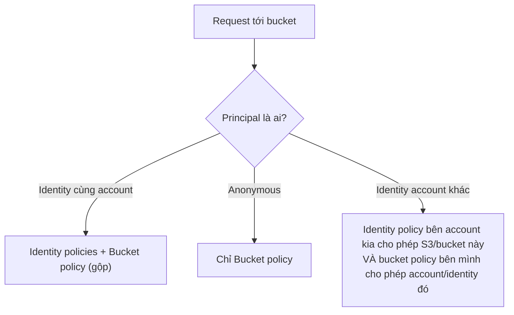

# S3 Security

> **TL;DR:** S3 **private by default**: ban đầu chỉ root user của account sở hữu bucket có quyền. Mọi quyền khác phải cấp tường minh qua **identity policy** (IAM), **bucket policy** (resource policy) hoặc **ACL** (legacy). **Block Public Access** là lớp fail-safe cuối cùng chặn truy cập public/anonymous bất kể policy nói gì.

## 🖼️ Sơ đồ
![[S3 Security.excalidraw]]
*Mở bằng plugin Excalidraw để chỉnh sửa · ảnh tĩnh: [[S3 Security.svg]]*

## Khái niệm cốt lõi
- **Private by default**: bucket mới tạo chỉ có account root user của account tạo bucket truy cập được. Không có quyền nào "ngầm" cho ai khác.
- Ba cơ chế cấp quyền:
  1. **Identity policy** ([[IAM Identity Policies]]) gắn vào user/group/role → trả lời câu hỏi "identity này được làm gì".
  2. **Bucket policy** = một loại **resource policy** gắn vào bucket → trả lời câu hỏi "ai được truy cập resource này". Góc nhìn ngược với identity policy.
  3. **ACL** (Access Control List) — một **subresource** của bucket hoặc object, legacy, AWS khuyên không dùng.
- Cộng thêm **Block Public Access** là ranh giới an toàn nằm ngoài cả ba.

### Identity policy vs resource policy
| | Identity policy | Resource (bucket) policy |
|---|---|---|
| Gắn vào | Identity (user, group, role) | Resource (bucket) |
| Góc nhìn | Identity này truy cập được gì | Ai truy cập được resource này |
| Phạm vi | Chỉ identity **trong account của mình** | Identity cùng account, **account khác**, và **anonymous** |
| Có `Principal`? | Không (principal ngầm định là identity được gắn policy) | **Có**, bắt buộc để nói statement áp dụng cho ai |
| Anonymous | Không thể (phải gắn vào một identity có thật) | Được, dùng `"Principal": "*"` |

- Mẹo nhận diện: policy có phần tử **`Principal`** thì gần như chắc chắn là resource policy.

## Bucket policy
- Mỗi bucket có **tối đa một** bucket policy, nhưng policy chứa được **nhiều statement** (ví dụ một statement cho account của mình, một cho account đối tác, một cho một user cụ thể).
- Dạng [[JSON]] giống IAM policy: `Version`, `Statement[]` với `Sid`, `Effect`, `Principal`, `Action`, `Resource`, `Condition`.
- Ví dụ trong bài (bucket `secretcatproject`):
  - **Public read**: `Effect: Allow`, `Principal: "*"`, `Action: s3:GetObject`, `Resource: arn:aws:s3:::secretcatproject/*` → bất kỳ ai (cùng account, account khác, kể cả anonymous) đọc được mọi object. Lưu ý `/*` ở cuối ARN nghĩa là "mọi object trong bucket", khác với ARN của chính bucket.
  - **Chặn theo IP**: statement `Deny` với điều kiện `NotIpAddress` `aws:SourceIp` = `1.3.3.7` → ai không đến từ IP đó bị từ chối; đến từ đúng IP thì statement deny không khớp, quyền khác vẫn áp dụng.
  - **Bảo vệ một prefix bằng MFA**: statement 1 `Deny s3:*` trên `secretcatproject/boris/*` khi `"Null": {"aws:MultiFactorAuthAge": true}` (tức là không đăng nhập bằng [[MFA]]); statement 2 `Allow s3:GetObject` trên cả bucket. Vì **explicit Deny thắng Allow**, prefix `boris/` chỉ đọc được khi có MFA, phần còn lại đọc tự do.
- Bucket policy còn dùng để đặt **quyền mặc định** cho mọi người trên bucket, rồi cộng/trừ quyền cho từng identity.

### Quyền hiệu lực (effective access)

- **Cùng account**: quyền = hợp của mọi identity policy áp dụng + bucket policy.
- **Anonymous**: chỉ bucket policy có tác dụng (không có identity nên không có identity policy).
- **Cross-account**: cần **hai bước**: account kia phải cho identity quyền gọi S3 trên bucket của bạn, và bucket policy của bạn phải cho phép identity/account đó.
- Quy tắc đánh giá chung: explicit Deny > explicit Allow > implicit (default) Deny.

## ACL (legacy)
- Gắn vào **bucket hoặc object** (là subresource), không gắn được cho một nhóm object → kém linh hoạt hơn bucket policy nhiều.
- Chỉ có **5 permission**: `READ`, `WRITE`, `READ_ACP`, `WRITE_ACP`, `FULL_CONTROL`. Không có condition.
  - `READ` trên bucket = list object; `WRITE` trên bucket = ghi đè/xóa mọi object.
  - `READ` trên object = đọc object và metadata; `READ_ACP`/`WRITE_ACP` = đọc/ghi chính ACL.
- AWS khuyến nghị dùng bucket policy hoặc identity policy thay thế. (Hiện nay từ 04/2023 bucket mới mặc định **Object Ownership = Bucket owner enforced**, tức ACL bị **tắt**; khóa học chưa nhắc chi tiết này.)

## Block Public Access
- Ra đời sau hàng loạt sự cố lộ dữ liệu do cấu hình bucket public nhầm hoặc hiểu sai mô hình quyền S3.
- Là một **ranh giới bổ sung** nằm trước bucket: áp dụng **bất kể** bucket policy/ACL nói gì, nhưng **chỉ với truy cập public/anonymous**, không ảnh hưởng identity AWS được cấp quyền đúng cách.
- Đặt khi tạo bucket, sửa được sau. Có 1 công tắc tổng + 4 công tắc con độc lập:

| Setting | Tác dụng |
|---|---|
| **Block all public access** | Bật cả 4 setting bên dưới, chặn hoàn toàn (fail-safe) |
| Block public access qua **new** ACLs | Giữ public access của ACL đã có, chặn ACL public mới |
| Block public access qua **any** ACLs | Bỏ qua mọi ACL cấp public, cũ hay mới |
| Block public access qua **new** bucket/access point policies | Giữ policy public đã có, chặn policy public mới |
| Block public **và cross-account** access qua **any** bucket/access point policies | Bỏ qua mọi policy cấp public, cũ hay mới |

- Hiện nay Block Public Access **bật mặc định** cho bucket mới, và có thể đặt ở **mức account** (áp cho mọi bucket); khóa học chỉ mô tả mức bucket.
- Nếu đã cấp public qua bucket policy mà vẫn bị **403 Access Denied**, nghi ngay Block Public Access còn bật (xem [[S3 Static Website Hosting]]).

## Khi nào dùng gì (Exam PowerUp)
| Tình huống | Chọn |
|---|---|
| Kiểm soát quyền trên **nhiều loại resource/dịch vụ khác nhau** (không phải dịch vụ nào cũng có resource policy) | Identity policy |
| Muốn quản lý tập trung một chỗ ("preference for IAM") | Identity policy ([[IAM Basics]] — IAM là nơi duy nhất quản lý được mọi thứ) |
| Chỉ trong **cùng account** | Identity policy |
| Chỉ quản lý một sản phẩm (S3), cấp một quyền cơ bản cho mọi người trên một resource | Bucket policy |
| **Anonymous** hoặc **cross-account** | **Bucket policy** |
| ACL | **NEVER**, trừ khi bắt buộc |

## 🎯 Mẹo thi SAA-C03
- "S3 is private by default" là điểm xuất phát của mọi câu hỏi quyền S3.
- Đề yêu cầu **public/anonymous read** hoặc **cho account khác truy cập bucket** → **bucket policy** (`Principal: "*"` hoặc ARN account khác).
- Cross-account cần **cả hai phía** cho phép: identity policy ở account nguồn + bucket policy ở account đích. Thiếu một bên → bị từ chối. (Với cross-account còn có thể dùng [[IAM Roles]] để assume role vào account sở hữu bucket.)
- Thấy `Principal` trong policy → resource policy; IAM identity policy không có `Principal`.
- Explicit Deny luôn thắng: dùng Deny + Condition (`aws:SourceIp`, `aws:MultiFactorAuthAge`, `aws:SecureTransport`...) để siết quyền.
- ACL là đáp án sai trong hầu hết câu hỏi thiết kế mới; chỉ đúng khi đề nói rõ cần quyền ở mức **từng object** theo kiểu legacy.
- Cấp public rồi mà vẫn bị chặn → **Block Public Access**.
- Bucket chỉ có **một** bucket policy (nhiều statement).

## Liên kết
- Tiên quyết: [[S3 Basics]], [[IAM Identity Policies]], [[IAM Users and ARNs]]
- Liên quan: [[S3 Static Website Hosting]], [[S3 Versioning and MFA Delete]], [[S3 Encryption]], [[S3 Presigned URLs]], [[S3 Access Points]], [[CloudFront OAI and OAC]], [[MFA]]
- Phân biệt với: [[Service Control Policies]] (giới hạn quyền tối đa ở mức account, không cấp quyền)
