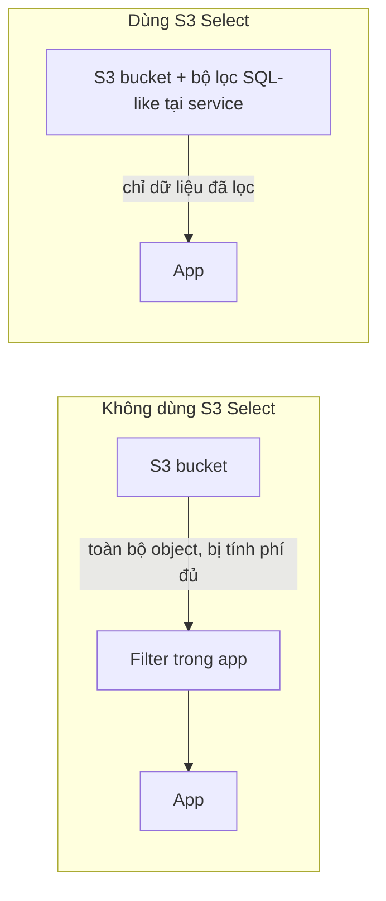

# S3 Select and Glacier Select

> **TL;DR:** S3 Select và Glacier Select cho phép lấy **một phần** nội dung của object thay vì cả object, bằng một câu lệnh **SQL-like** rút gọn. Việc lọc diễn ra **ngay trong service S3/Glacier**, nên ứng dụng chỉ nhận dữ liệu đã lọc. Slide nêu con số: **nhanh hơn tới 400% và rẻ hơn tới 80%**.

## 🖼️ Sơ đồ
![[S3 Select and Glacier Select.excalidraw]]
*Mở bằng plugin Excalidraw để chỉnh sửa · ảnh tĩnh: [[S3 Select and Glacier Select.svg]]*

## Khái niệm cốt lõi
- S3 chứa được object tới **5 TB** và số lượng object không giới hạn. Lấy nguyên một object 5 TB thì **tốn thời gian và tốn đủ 5 TB truyền tải**.
- **Lọc ở phía client không cứu được**: dữ liệu đã tải về và đã bị tính phí rồi mới bị vứt đi. Lọc ở client chỉ là bỏ bớt dữ liệu thừa.
- S3/Glacier Select chuyển điểm lọc vào **trong service**: bạn gửi một biểu thức SQL-like, service áp lên dữ liệu thô và chỉ trả về phần được chọn.
- **Định dạng hỗ trợ**: **CSV**, **JSON**, **Parquet**. Nén **BZIP2** (và GZIP) được hỗ trợ cho CSV và JSON.
- Ứng dụng phải **chủ động gọi** API này (không tự động áp dụng).
- Theo Adrian, chủ đề này chỉ xuất hiện **rất ít** trong đề, và chỉ ở mức kiến trúc và tính năng, không cần biết cách implement.
- (Khóa học giới thiệu như tính năng đang dùng; **từ 25/07/2024 AWS ngừng cung cấp S3 Select và S3 Glacier Select cho khách hàng mới**. Khách hàng cũ vẫn dùng được. AWS khuyến nghị thay bằng [[Athena]], Redshift Spectrum hoặc lọc phía client.)

## Cách hoạt động / Kiến trúc

| | Không dùng Select | Dùng S3/Glacier Select |
|---|---|---|
| Nơi lọc | Trong ứng dụng | Tại service S3/Glacier |
| Lượng dữ liệu truyền và bị tính phí | Toàn bộ object | Chỉ phần được chọn |
| Hiệu năng | Chậm (phải tải hết) | Nhanh hơn tới ~400% |
| Chi phí | Cao | Rẻ hơn tới ~80% |

## 🎯 Mẹo thi SAA-C03
- Đề nói "chỉ cần **một tập con** dữ liệu trong một object CSV/JSON lớn trên S3, muốn **giảm dữ liệu truyền và chi phí**, lọc **phía server**" → **S3 Select** (với object ở Glacier → **Glacier Select**).
- Phân biệt: S3 Select chạy trên **một object**. Còn truy vấn SQL ad-hoc trên **nhiều object, cả dataset** thì dùng **[[Athena]]**, và cho data warehouse thì dùng [[Redshift]] (Spectrum).
- Bẫy: "tải về rồi lọc trong ứng dụng" không giảm chi phí transfer.

## Liên kết
- Tiên quyết: [[S3 Basics]], [[S3 Storage Classes]]
- Liên quan: [[S3 Performance Optimization]], [[Glue]]
- Phân biệt với: [[Athena]], [[Redshift]]
- Tổng quan: [[_MOC 05 S3]]
