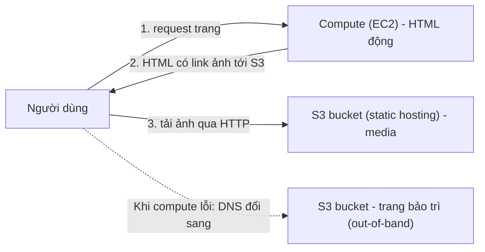

# S3 Static Website Hosting

> **TL;DR:** Bật tính năng này để S3 phục vụ object qua **HTTP thông thường** cho trình duyệt (không cần gọi S3 API có xác thực). Cần khai báo **index document** và **error document**; AWS sinh ra một **website endpoint** theo tên bucket + region. Hai use case kinh điển: **offloading** media khỏi compute và **out-of-band pages** (trang bảo trì/trạng thái).

## 🖼️ Sơ đồ
![[S3 Static Website Hosting.excalidraw]]
*Mở bằng plugin Excalidraw để chỉnh sửa · ảnh tĩnh: [[S3 Static Website Hosting.svg]]*

## Khái niệm cốt lõi
- Bình thường mọi truy cập S3 (console, CLI) đều đi qua **S3 API** (ví dụ `GetObject`), cần xác thực và phân quyền. Static website hosting cho phép truy cập bằng **HTTP** chuẩn từ trình duyệt, nên S3 hoạt động như một web server tĩnh (blog, trang HTML, ảnh...).
- Khi bật phải đặt:
  - **Index document**: trang mặc định khi không chỉ định object cụ thể (vd. `index.html`).
  - **Error document**: trả về khi object không tồn tại hoặc có lỗi (vd. `error.html`).
  - Cả hai là **HTML** và là object trong bucket.
- **Website endpoint** do AWS tự sinh từ **tên bucket + region**, không tự đặt được. Ví dụ: `<bucket-name>.s3-website-us-east-1.amazonaws.com` (một số region dùng dạng `s3-website.<region>`).
- Endpoint này chỉ hỗ trợ **HTTP**. Muốn HTTPS + custom domain thì đặt [[CloudFront Architecture|CloudFront]] phía trước (kiến thức bổ sung, khóa học nói ở phần sau).
- Một kiểu cấu hình khác: **Redirect requests for an object** — chuyển hướng request sang bucket/domain khác.

### Custom domain
- Muốn dùng custom domain (vd. `top10.animals4life.org`) thì **tên bucket phải trùng đúng với FQDN** đó (host + domain).
- Vì tên bucket là duy nhất toàn cầu, Adrian khuyên **đặt trước tên bucket** trùng với các tên miền website bạn định dùng.
- Trong [[Route 53 Fundamentals|Route 53]]: tạo record trong hosted zone (simple routing) kiểu **Alias → S3 website endpoint**, chọn đúng region; bucket chỉ hiện trong dropdown khi tên record khớp tên bucket và đúng region. Xem [[CNAME vs Alias]], [[R53 Public Hosted Zones]].

## Cách hoạt động / Kiến trúc
### Offloading
- Ứng dụng chạy trên compute (vd. [[EC2 Basics|EC2]]) vừa sinh **HTML động** (cần database) vừa trả **media tĩnh** (ảnh). Media thường chiếm >95% dung lượng truyền và gần như toàn bộ storage.
- Chuyển media sang bucket bật static hosting; HTML do compute sinh ra trỏ link ảnh về S3 → trình duyệt tải media trực tiếp từ S3. S3 rẻ hơn compute nhiều cho việc lưu và phân phối dữ liệu lớn.

### Out-of-band pages
- "Out-of-band" = đường truy cập nằm ngoài kênh chính. Trang bảo trì/trạng thái **không nên** đặt trên cùng server (đang bảo trì thì offline) hay trên một EC2 khác (nếu chính EC2 gặp sự cố).
- Khi server chính có sự cố/bảo trì, **đổi DNS** trỏ khách sang website tĩnh trên S3 hiển thị thông báo trạng thái hoặc thông tin support.

## Bảng so sánh / số liệu
**Ba thành phần giá của S3**
| Thành phần | Tính thế nào |
|---|---|
| Storage | Theo **GB-tháng** (lưu ít hơn 1 tháng hoặc ít hơn 1 GB thì trả theo tỉ lệ) |
| Data transfer | **Vào S3 luôn miễn phí**; ra khỏi S3 tính theo GB |
| Requests | Tính theo mỗi **1.000 request**; mỗi loại (GET, PUT, LIST...) giá khác nhau |

- Với static website: dữ liệu lưu và truyền thường nhỏ, nhưng nếu nhiều người dùng thì **chi phí request** mới là thứ cần để ý.
- Ví dụ bảng giá us-east-2 trên slide (thời điểm quay): S3 Standard PUT/COPY/POST/LIST ~$0.005/1.000 request, GET ~$0.0004/1.000 request.
- Free tier (theo khóa học): **5 GB** storage Standard, **20.000 GET** và **2.000 PUT** mỗi tháng. (Từ 07/2025 AWS chuyển free tier cho account mới sang mô hình credit; con số trên áp dụng cho account cũ.)
- Blog cá nhân của Adrian chạy trên S3 static hosting, tháng cao nhất chỉ tốn khoảng 17 cent.

## Demo / Lab
1. Tạo bucket ở us-east-1. Nếu dùng custom domain thì đặt tên dạng DNS, vd. `top10.animalsforlife.org` (nếu tên đã bị người khác dùng → lỗi, phải chọn tên khác).
2. **Bỏ tick Block all public access** (và xác nhận hiểu rủi ro). Bỏ tick **không** tự cấp quyền public, chỉ cho phép cấp sau đó.
3. Properties → Static website hosting → Enable, "Host a static website", index `index.html`, error `error.html`. Ghi lại URL endpoint.
4. Upload `index.html`, `error.html` và thư mục `img/`.
5. Mở endpoint → **403 Forbidden**: S3 vẫn private; truy cập qua website endpoint là **anonymous**, không có cách gửi credential.
6. Permissions → Bucket policy: `Allow`, `Principal: "*"`, `s3:GetObject`, Resource = ARN bucket + `/*` → refresh thấy trang. Gõ object không tồn tại → hiện error document.
7. (Tùy chọn) Route 53: hosted zone → Create record → simple routing → **Alias to S3 website endpoint** → region us-east-1 → chọn bucket. Truy cập bằng custom domain.
8. Dọn dẹp: xóa record, **Empty** bucket rồi **Delete** bucket.
- Bài học: bật static hosting ≠ cấp quyền. Cần cả (a) tắt Block Public Access và (b) bucket policy cho anonymous read. Xem [[S3 Security]].

## 🎯 Mẹo thi SAA-C03
- Website tĩnh, rẻ, không server → **S3 static website hosting**. Cần HTTPS/custom cert/caching toàn cầu → thêm **CloudFront** (và [[ACM]]).
- Custom domain qua Route 53 → **tên bucket phải trùng tên miền** + dùng **Alias record**.
- Bị **403** khi mở website endpoint → thiếu bucket policy public read hoặc Block Public Access đang bật.
- Kịch bản "giảm tải ảnh/video cho EC2", "giảm chi phí phục vụ media" → offload sang S3 (thường kèm CloudFront).
- Kịch bản "trang bảo trì khi site chính chết" → S3 static site + DNS failover (xem [[R53 Failover Routing]]).
- Transfer **vào** S3 miễn phí; ra ngoài và request mới tính tiền.

## Liên kết
- Tiên quyết: [[S3 Basics]], [[S3 Security]], [[DNS Fundamentals]]
- Liên quan: [[Route 53 Fundamentals]], [[CNAME vs Alias]], [[R53 Failover Routing]], [[CloudFront Architecture]], [[CloudFront Origins]], [[S3 Versioning and MFA Delete]]
- Phân biệt với: website động chạy trên [[EC2 Basics]] (cần compute, database)
