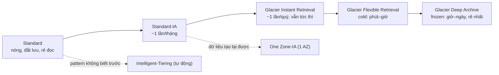

# S3 Storage Classes

> **TL;DR:** Mỗi object S3 có một **storage class** quyết định giá lưu trữ, phí truy xuất, độ bền theo AZ, độ trễ byte đầu tiên và các mức tối thiểu (thời gian, kích thước). Càng "lạnh" thì lưu càng rẻ nhưng truy xuất càng đắt/chậm và mức tối thiểu càng dài. **S3 Standard là mặc định**; chỉ chuyển sang class khác khi có lý do cụ thể.

## 🖼️ Sơ đồ
![[S3 Storage Classes.excalidraw]]
*Mở bằng plugin Excalidraw để chỉnh sửa · ảnh tĩnh: [[S3 Storage Classes.svg]]*

![[S3 Storage Classes - chọn.excalidraw]]
*Mở bằng plugin Excalidraw để chỉnh sửa · ảnh tĩnh: [[S3 Storage Classes - chọn.svg]]*

## Khái niệm cốt lõi
- Cần nắm cho cả Associate và Professional: **chi phí tương đối**, đặc điểm kỹ thuật, thỏa hiệp, và **tình huống nên/không nên dùng** từng class.
- Mọi class (trừ One Zone-IA) lưu dữ liệu trên **ít nhất 3 AZ** trong region; tất cả đều có độ bền **11 nines (99.999999999%)**: lưu 10 triệu object thì trung bình mất 1 object mỗi 10.000 năm.
- S3 dùng **Content-MD5 checksum** và **CRC (cyclic redundancy check)** để phát hiện và sửa hỏng dữ liệu.
- Khi object đã được lưu bền vững, S3 trả **HTTP/1.1 200 OK**. Trong đề: thấy 200 → dữ liệu đã lưu durable.

### S3 Standard
- Mặc định. ≥3 AZ, chịu được hỏng nhiều AZ.
- Tính tiền: GB-tháng lưu trữ + $/GB transfer **out** (transfer in miễn phí) + giá theo 1.000 request.
- **Không** có retrieval fee, **không** minimum duration, **không** minimum object size. Không bị phạt, cũng không được giảm giá: class cân bằng nhất.
- First byte latency **mili giây**; object có thể public (permission hoặc [[S3 Static Website Hosting]]).
- Dùng cho: dữ liệu **truy cập thường xuyên, quan trọng, không thay thế được**.

### S3 Standard-IA (Infrequent Access)
- Kiến trúc giống Standard: ≥3 AZ, cùng durability, availability, latency mili giây, public được.
- Giá lưu trữ khoảng **một nửa** Standard (lúc quay bài). Request + transfer out như Standard.
- Thỏa hiệp:
  - **Retrieval fee** theo mỗi GB đọc ra (cộng thêm transfer fee) → càng truy cập nhiều càng mất lợi thế.
  - **Minimum duration 30 ngày** (lưu ít hơn vẫn bị tính 30 ngày).
  - **Minimum billable size 128 KB/object**.
- Dùng cho: dữ liệu **sống lâu, quan trọng/không thay thế được, truy cập không thường xuyên**. Không dùng cho nhiều file nhỏ, dữ liệu tạm, dữ liệu truy cập liên tục, hoặc dữ liệu dễ tạo lại.

### S3 One Zone-IA
- Rẻ hơn Standard-IA. Vẫn có retrieval fee, 30 ngày tối thiểu, 128 KB tối thiểu.
- Khác biệt lớn: dữ liệu chỉ ở **1 AZ** (vẫn nhân bản nhiều bản trong AZ đó). Durability vẫn 11 nines **với điều kiện AZ không hỏng**; AZ hỏng là có thể mất dữ liệu.
- Dùng cho: dữ liệu **sống lâu, truy cập không thường xuyên, không quan trọng hoặc dễ thay thế**: bản sao từ [[S3 Replication]] (SRR/CRR), dữ liệu trung gian tạo lại được.
- Không dùng cho bản dữ liệu duy nhất, dữ liệu quan trọng, dữ liệu truy cập/thay đổi thường xuyên hoặc tạm thời.

### S3 Glacier Instant Retrieval
- Như Standard-IA nhưng **lưu rẻ hơn, truy xuất đắt hơn, minimum dài hơn**: **90 ngày**.
- Standard-IA hợp với dữ liệu cần ngay nhưng ~1 lần/tháng; Glacier IR hợp với dữ liệu cần ngay nhưng ~1 lần/quý.
- Vẫn **truy cập tức thì** (mili giây), không cần retrieval job, dùng như Standard/Standard-IA.

### S3 Glacier Flexible Retrieval (tên cũ: S3 Glacier)
- ≥3 AZ, 11 nines. Giá lưu khoảng **1/6 Standard** (lúc quay bài).
- Hình dung là object **"lạnh" (cold)**: không sẵn sàng ngay, **không public được**. Trong bucket chỉ thấy object/metadata như một con trỏ.
- Muốn đọc phải chạy **retrieval job** (có phí). Dữ liệu được khôi phục **tạm thời vào Standard-IA**, dùng xong thì bị xóa. Muốn lấy lại vĩnh viễn thì đổi storage class (thao tác khác).
- Ba loại job:

| Job | Thời gian | Giá |
|---|---|---|
| Expedited | **1–5 phút** | Đắt nhất |
| Standard | **3–5 giờ** | Trung bình |
| Bulk | **5–12 giờ** | Rẻ nhất (hiện nay miễn phí) |

- First byte latency: **phút đến giờ**. Minimum billable size **40 KB**, minimum duration **90 ngày**.
- Dùng cho: **dữ liệu lưu trữ (archival)** không cần truy cập thường xuyên/realtime (vd. mỗi năm một lần), chấp nhận chờ phút–giờ.

### S3 Glacier Deep Archive
- **Rẻ nhất**. Hình dung là dữ liệu **"đóng băng" (frozen)**.
- Minimum **40 KB**, minimum duration **180 ngày**. Không public được, cần retrieval job, khôi phục tạm vào Standard-IA.
- Job: **Standard ~12 giờ**, **Bulk tới 48 giờ**.
- Dùng cho: dữ liệu lưu trữ **hiếm khi hoặc không bao giờ** cần đọc, chấp nhận chờ giờ–ngày: backup dài hạn thứ cấp, dữ liệu phải giữ theo **quy định pháp lý/compliance**. **Không** hợp với backup chính (restore quá lâu).

### S3 Intelligent-Tiering
- Một storage class chứa **nhiều tier**; hệ thống **tự giám sát truy cập và tự di chuyển** object giữa các tier:

| Tier | Tương đương giá/hiệu năng | Khi nào object vào tier | Truy cập |
|---|---|---|---|
| Frequent Access | S3 Standard | Mặc định, khi được truy cập | Tức thì |
| Infrequent Access | Standard-IA | Không truy cập **30 ngày** | Tức thì |
| Archive Instant Access | Glacier Instant Retrieval | Không truy cập **90 ngày** (tự động) | Tức thì |
| Archive Access (tùy chọn) | Glacier Flexible Retrieval | Cấu hình 90–270 ngày theo khóa học (hiện nay 90–730) | Cần retrieval, bất đồng bộ |
| Deep Archive Access (tùy chọn) | Glacier Deep Archive | Cấu hình 180–730 ngày | Cần retrieval, bất đồng bộ |

- Archive configuration đặt theo bucket, prefix hoặc object tag.
- Hai tier archive tùy chọn yêu cầu ứng dụng **chấp nhận truy cập bất đồng bộ** và gọi API restore. Archive Instant Access thì không cần thay đổi gì ở ứng dụng.
- Object ở IA/Archive Instant Access mà lại được truy cập (vd. ảnh "whiskers" bỗng viral) → tự chuyển về Frequent Access, **không có retrieval fee**.
- Thay vì retrieval fee, có **phí monitoring & automation theo mỗi 1.000 object**. Giá các tier bằng class tương ứng, cộng phí quản lý.
- Dùng cho: dữ liệu **sống lâu với pattern truy cập thay đổi hoặc không biết trước**. Nếu pattern ổn định (luôn nhiều hoặc luôn ít) thì dùng thẳng Standard hoặc Standard-IA sẽ rẻ hơn.
- (Bổ sung: object < 128 KB không được giám sát/tự chuyển tier, luôn ở Frequent Access.)

## Bảng so sánh / số liệu
| Class | Số AZ | Min duration | Min size | Retrieval fee | First byte latency | Public được |
|---|---|---|---|---|---|---|
| Standard | ≥3 | Không | Không | Không | ms | Có |
| Standard-IA | ≥3 | 30 ngày | 128 KB | Có (/GB) | ms | Có |
| One Zone-IA | **1** | 30 ngày | 128 KB | Có (/GB) | ms | Có |
| Glacier Instant Retrieval | ≥3 | 90 ngày | 128 KB | Có (cao hơn) | ms | Có |
| Glacier Flexible Retrieval | ≥3 | 90 ngày | 40 KB | Có (job) | phút–giờ | **Không** |
| Glacier Deep Archive | ≥3 | 180 ngày | 40 KB | Có (job) | giờ–ngày (12h/48h) | **Không** |
| Intelligent-Tiering | ≥3 | Không | Không (<128 KB không tiering) | Không (thay bằng phí monitoring) | ms (tier archive tùy chọn: chậm) | Có |

- (Bổ sung ngoài khóa: **S3 Express One Zone** — class 1 AZ, độ trễ một chữ số mili giây, dùng "directory bucket", cho workload hiệu năng cao như ML/analytics.)

## 🎯 Mẹo thi SAA-C03
- Mặc định chọn **Standard**; chỉ đổi khi đề có lý do (truy cập ít, dữ liệu tạo lại được, archive...).
- **Truy cập không thường xuyên nhưng cần ngay khi cần**, dữ liệu quan trọng → **Standard-IA**. Nếu còn ít hơn nữa (theo quý) → **Glacier Instant Retrieval**.
- **Dữ liệu tạo lại được / bản replica / không quan trọng**, truy cập ít → **One Zone-IA**. Bẫy: dữ liệu quan trọng duy nhất mà chọn One Zone-IA là sai.
- **Archive, chấp nhận phút–giờ** → **Glacier Flexible Retrieval** (cần trong vài phút → Expedited). **Archive rẻ nhất, chấp nhận 12–48 giờ, compliance giữ nhiều năm** → **Glacier Deep Archive**.
- **Pattern truy cập không biết/thay đổi** → **Intelligent-Tiering** (không retrieval fee, có phí monitoring).
- Nhiều **file nhỏ** hoặc **dữ liệu tạm/ngắn hạn** → tránh IA/Glacier vì minimum size (128 KB / 40 KB) và minimum duration (30/90/180 ngày).
- Object ở Glacier Flexible/Deep Archive **không public được**, không dùng làm nguồn website trực tiếp.
- Ghi nhớ minimum duration: **30 (IA, One Zone-IA) / 90 (Glacier IR, Flexible) / 180 (Deep Archive)**.
- HTTP **200 OK** từ S3 = đã lưu durable.

## Liên kết
- Tiên quyết: [[S3 Basics]], [[AWS Global Infrastructure]]
- Liên quan: [[S3 Lifecycle Configuration]], [[S3 Replication]], [[S3 Versioning and MFA Delete]], [[S3 Select and Glacier Select]], [[Storage Gateway]], [[AWS Backup]]
- Phân biệt với: [[EBS Volume Types]], [[Instance Store]], [[Storage Fundamentals]] (block/file vs object storage)
