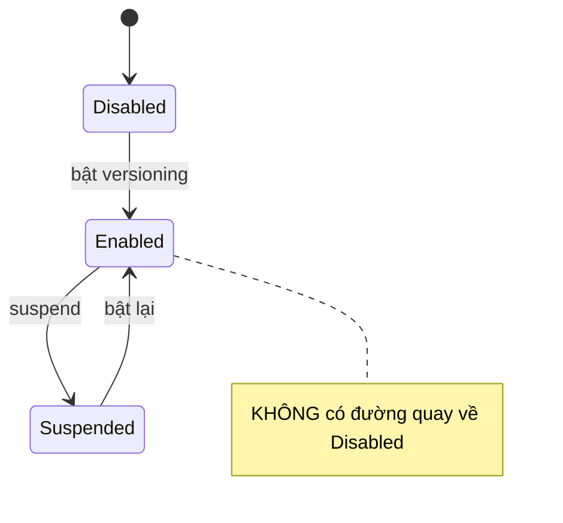
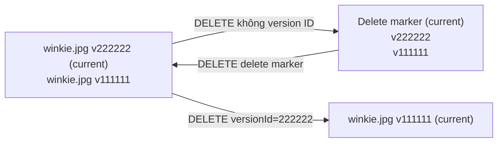

# S3 Versioning and MFA Delete

> **TL;DR:** Versioning (bật ở **mức bucket**) giữ lại mọi phiên bản của object thay vì ghi đè/xóa hẳn: thao tác sửa tạo version mới, thao tác xóa thêm **delete marker**. Một khi đã bật thì **không bao giờ tắt (Disabled) lại được**, chỉ **Suspended**. **MFA Delete** bắt buộc MFA khi đổi trạng thái versioning hoặc xóa vĩnh viễn một version.

## 🖼️ Sơ đồ
![[S3 Versioning and MFA Delete.excalidraw]]
*Mở bằng plugin Excalidraw để chỉnh sửa · ảnh tĩnh: [[S3 Versioning and MFA Delete.svg]]*

## Khái niệm cốt lõi
### Ba trạng thái versioning

- Bucket khởi đầu ở **Disabled**. Disabled → Enabled. Enabled ↔ Suspended.
- **Enabled → Disabled là không thể.** Adrian nhấn mạnh đây là điểm hay bị hỏi bẫy trong đề.

### Version ID
- Không có versioning: object chỉ được định danh bằng **key** (tên, duy nhất trong bucket); sửa là thay thế bản gốc. Thực chất mọi object có **version ID = `null`**.
- Có versioning: mỗi lần PUT, S3 cấp một version ID mới (vd. `111111`). Upload đè cùng key (vd. ảnh chó tên `winkie.jpg`) → version mới `222222`, bản cũ vẫn giữ.
- Version mới nhất = **current version**. Request không chỉ định version ID → luôn trả current version. Muốn bản cũ → truyền version ID cụ thể.

### Xóa khi có versioning
- **Xóa object không chỉ định version ID** → S3 **không xóa gì**, chỉ thêm một version đặc biệt là **delete marker**, che mọi version trước → object "trông như" đã bị xóa.
- **Xóa delete marker** → **undelete**: object hiện lại, current version trở lại hoạt động.
- **Xóa một version cụ thể (có version ID)** → xóa **vĩnh viễn** version đó. Nếu đó là current version thì version kế trước trở thành current.

### Chi phí
- Mọi version đều chiếm dung lượng và **bị tính tiền**: một object 5 GB với 5 version = 25 GB.
- **Suspend không xóa version cũ** → vẫn trả tiền cho chúng; suspend chỉ dừng tạo version mới.
- Cách duy nhất về 0 chi phí version: xóa bucket và upload lại vào bucket không versioning, hoặc tự dọn từng version không cần thiết (thực tế nên dùng [[S3 Lifecycle Configuration]] để expire noncurrent versions).
- Bucket ghi đè nhiều lần object lớn + bật versioning → chi phí tăng mạnh.

## MFA Delete
- Bật trong **versioning configuration** của bucket.
- Khi bật, cần MFA để:
  1. **Đổi trạng thái versioning** (Enabled ↔ Suspended).
  2. **Xóa vĩnh viễn bất kỳ version nào** của object.
- Cách dùng: gửi kèm API call **serial number của thiết bị MFA + mã MFA hiện tại** (nối lại với nhau).
- (Bổ sung, đúng với AWS hiện tại: chỉ **root user** của account sở hữu bucket mới bật/tắt được MFA Delete, và phải làm bằng **CLI/API**, không bật được trên console.)

## Demo / Lab
1. Tạo bucket, bỏ Block all public access, **Enable Bucket Versioning** ngay lúc tạo.
2. Bật static website hosting (`index.html`, `error.html`), thêm bucket policy public read (như [[S3 Static Website Hosting]]).
3. Upload `index.html` và `img/winky.jpg` → web hiện ảnh Winky. Bật toggle **Show versions** để thấy version ID.
4. Upload "nhầm" một `winky.jpg` khác (ảnh Truffles) cùng key → giao diện mặc định trông như bị ghi đè, web hiện Truffles; Show versions thấy **2 version**.
5. Delete object (không bật Show versions) → console cảnh báo "adds delete markers"; Show versions thấy delete marker trên cùng.
6. Xóa delete marker (thao tác trên version → phải gõ `permanently delete`) → object trở lại.
7. Xóa version Truffles (current) → version Winky gốc thành current, web hiện đúng ảnh.
8. Dọn dẹp: Empty rồi Delete bucket.
- Rút ra: thao tác trên **object** → tạo version mới / delete marker (không mất gì). Thao tác trên **version cụ thể** → **vĩnh viễn**.

## 🎯 Mẹo thi SAA-C03
- **Không thể tắt versioning sau khi bật**, chỉ suspend. Câu hỏi "disable versioning để giảm chi phí" → sai.
- Suspend **không** xóa version cũ, vẫn tính tiền.
- "Chống xóa nhầm / ghi đè nhầm", "khôi phục object bị xóa" → **bật versioning** (xóa delete marker để khôi phục).
- "Thêm một lớp bảo vệ để không ai xóa vĩnh viễn version hoặc tắt versioning" → **MFA Delete**.
- Versioning là **điều kiện bắt buộc** cho [[S3 Replication]] (cả bucket nguồn và đích) và cho [[S3 Object Lock]].
- Kết hợp lifecycle rule để expire/transition noncurrent versions nhằm kiểm soát chi phí.
- Object trong bucket chưa từng bật versioning có version ID = `null`.

## Liên kết
- Tiên quyết: [[S3 Basics]], [[MFA]]
- Liên quan: [[S3 Lifecycle Configuration]], [[S3 Replication]], [[S3 Object Lock]], [[S3 Security]], [[AWS Backup]]
- Phân biệt với: [[EBS Snapshots]] (sao lưu point-in-time của volume, không phải versioning từng object)
