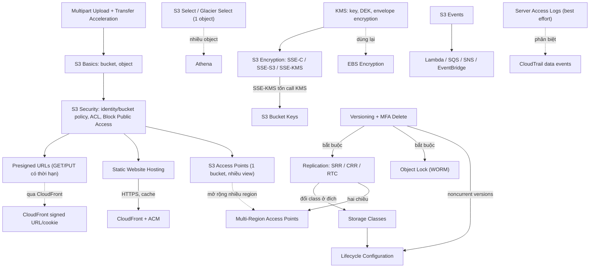

# 05 S3

Section đi sâu vào Amazon S3 sau phần nhập môn [[S3 Basics]]: phân quyền và Block Public Access, static website, versioning, tối ưu upload, [[KMS]] và các kiểu mã hóa, storage class và lifecycle, replication, presigned URL, cùng các tính năng như Select, Events, Access Logs, Object Lock và Access Points. Đây là một trong những section nặng điểm nhất của SAA-C03 vì S3 xuất hiện trong rất nhiều câu hỏi về chi phí, bảo mật, DR và event-driven. Section này dựa trên kiến thức IAM của section trước. KMS học ở đây sẽ được dùng lại cho EBS, RDS và Secrets Manager.

← [[00 Home]] · Trước: [[_MOC 04 IAM Accounts and Organizations]] · Sau: [[_MOC 06 VPC Basics]]

## Lộ trình học
1. [[S3 Security]]: S3 private by default; quyền cấp qua identity policy, bucket policy hoặc ACL (legacy); Block Public Access là lớp chặn cuối cùng.
2. [[S3 Static Website Hosting]]: phục vụ object qua HTTP với index/error document và website endpoint; dùng để offload media và làm trang out-of-band.
3. [[S3 Versioning and MFA Delete]]: giữ mọi version, xóa thì sinh delete marker; bật rồi chỉ suspend được, không tắt hẳn; MFA Delete bảo vệ thao tác xóa vĩnh viễn.
4. [[S3 Performance Optimization]]: Multipart Upload (bắt buộc với object > 5 GB) và Transfer Acceleration qua edge location.
5. [[KMS]]: dịch vụ key regional; key không rời KMS; mã hóa trực tiếp tối đa 4 KB, dữ liệu lớn hơn dùng DEK theo mô hình envelope encryption.
6. [[S3 Encryption]]: mã hóa áp lên object; client-side hoặc SSE-C / SSE-S3 / SSE-KMS; default encryption không mang tính ép buộc.
7. [[S3 Bucket Keys]]: bucket key có thời hạn giúp giảm số lần gọi KMS của SSE-KMS, nhờ đó giảm chi phí và tránh throttling.
8. [[S3 Storage Classes]]: Standard → IA → One Zone-IA → Glacier IR / Flexible / Deep Archive và Intelligent-Tiering; đánh đổi giá lưu trữ, phí truy xuất và mức tối thiểu.
9. [[S3 Lifecycle Configuration]]: rule transition/expiration theo thời gian; chỉ đi "xuống" như thác nước; không dựa vào tần suất truy cập.
10. [[S3 Replication]]: SRR/CRR, cùng hoặc khác account, cần versioning ở cả hai bucket; RTC cho SLA 15 phút.
11. [[S3 Presigned URLs]]: cho người không có identity AWS GET/PUT một object cụ thể trong bucket private, có thời hạn.
12. [[S3 Select and Glacier Select]]: lọc một phần object bằng SQL-like ngay phía server để giảm dữ liệu truyền và chi phí.
13. [[S3 Events]]: event notification tới Lambda/SQS/SNS khi object được tạo, xóa hoặc restore; EventBridge là lựa chọn mạnh hơn.
14. [[S3 Access Logs]]: log chi tiết từng request vào target bucket theo kiểu best effort, thường trễ vài giờ.
15. [[S3 Object Lock]]: WORM trên từng object version; retention Compliance/Governance và Legal Hold.
16. [[S3 Access Points]]: chia bucket dùng chung thành nhiều "view", mỗi view có endpoint, policy và network origin riêng.
17. [[S3 Multi-Region Access Points]]: một endpoint toàn cầu route tới bucket gần nhất ở nhiều region; cần replication hai chiều.

## Bản đồ khái niệm

## Liên kết sang section khác
- Nền tảng: [[S3 Basics]], [[IAM Identity Policies]], [[IAM Roles]]
- Audit: [[CloudTrail]] (data events, khác với server access logs)
- Phân phối nội dung: [[CloudFront OAI and OAC]], [[CloudFront Private Distributions]]
- Truy vấn dữ liệu trên S3: [[Athena]]
- Kiến trúc dựa trên S3 Events: [[Event-Driven Architecture]]
- KMS dùng lại ở: [[EBS Encryption]]
- Truy cập S3 từ private subnet không qua NAT: [[Gateway VPC Endpoints]]

## 🎯 Top mẹo thi của section
- S3 **private by default**. Cần public/anonymous read hoặc cho account khác truy cập thì dùng **bucket policy**. Đã cấp public mà vẫn bị chặn thì kiểm tra **Block Public Access**. ACL hầu như luôn là đáp án sai cho thiết kế mới. ([[S3 Security]])
- Cross-account cần **cả hai phía** cho phép: identity policy bên gọi và bucket policy bên sở hữu. Explicit Deny luôn thắng. ([[S3 Security]])
- **Versioning không tắt được**, chỉ suspend. Versioning là điều kiện bắt buộc cho Replication (ở cả hai bucket) và Object Lock. ([[S3 Versioning and MFA Delete]])
- Object **> 5 GB** bắt buộc multipart; người dùng ở xa region upload chậm thì dùng **Transfer Acceleration** (tên bucket không được có dấu chấm). ([[S3 Performance Optimization]])
- Cần role separation, audit việc dùng key, cross-account cho object mã hóa → **SSE-KMS + customer managed key**. Cần ít overhead nhất → **SSE-S3**. Muốn tự giữ key → **SSE-C**. ([[S3 Encryption]])
- KMS key mã hóa trực tiếp tối đa **4 KB**; key không rời region (trừ multi-region key). Cần FIPS 140-2 Level 3 / single-tenant → CloudHSM. ([[KMS]])
- SSE-KMS bị **throttle** hoặc chi phí KMS cao khi có nhiều object → bật **S3 Bucket Key**. ([[S3 Bucket Keys]])
- Chọn storage class theo pattern: ít truy cập nhưng cần ngay → **Standard-IA**; dữ liệu tạo lại được → **One Zone-IA**; archive 12–48 giờ → **Deep Archive**; pattern không biết trước → **Intelligent-Tiering**. Minimum duration: **30 / 90 / 180 ngày**. ([[S3 Storage Classes]])
- Lifecycle dựa vào **thời gian**, không dựa vào tần suất truy cập. Phải ở Standard **≥ 30 ngày** trước khi sang IA. Dùng lifecycle để expire noncurrent version. ([[S3 Lifecycle Configuration]])
- Replication **không copy object có sẵn** (dùng Batch Replication), không replicate delete marker theo mặc định. Đề nhắc "15 phút" → **RTC**. ([[S3 Replication]])
- Người không có tài khoản AWS cần upload/download **một object** trong bucket private trong thời gian giới hạn → **presigned URL**. URL hỏng sớm thường do credential của role tạo URL đã hết hạn. ([[S3 Presigned URLs]])
- Lọc một phần **một object** → S3 Select. Truy vấn SQL ad-hoc trên **cả dataset** → Athena. ([[S3 Select and Glacier Select]])
- Upload file thì tự xử lý → **S3 Event → Lambda/SQS/SNS**. Cần nhiều đích hoặc lọc nâng cao → **EventBridge**. ([[S3 Events]])
- "Không ai, kể cả root, được xóa trong N năm" → **Object Lock Compliance**. Admin đặc biệt vẫn được gỡ → **Governance**. Không biết thời hạn → **Legal Hold**. ([[S3 Object Lock]])
- Bucket dùng chung có bucket policy quá phức tạp → **Access Points**. Cần một endpoint toàn cầu route tới bucket gần nhất → **Multi-Region Access Points** (kèm CRR hai chiều). ([[S3 Access Points]], [[S3 Multi-Region Access Points]])
