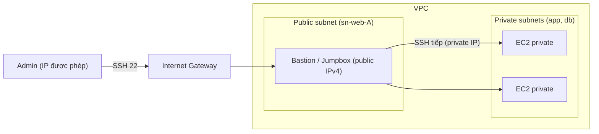

# Bastion Host

> **TL;DR:** Bastion host (hay **jumpbox**) là một EC2 instance đặt trong **public subnet**, dùng làm **điểm vào duy nhất** cho các kết nối quản trị (SSH/RDP) từ bên ngoài. Từ đó admin mới đi tiếp vào các tài nguyên private trong VPC. Adrian coi đây là cách "cũ" và kém an toàn hơn các phương án hiện đại, nhưng nó vẫn xuất hiện trong đề thi.

## 🖼️ Sơ đồ
![[Bastion Host.excalidraw]]
*Mở bằng plugin Excalidraw để chỉnh sửa · ảnh tĩnh: [[Bastion Host.svg]]*

## Khái niệm cốt lõi
- **Bastion host = jumpbox**: hai tên cho cùng một thứ.
- Về kiến trúc: chỉ là một instance trong public subnet, nhận **incoming management connections**. Sau khi vào bastion, admin "nhảy" tiếp tới các instance chỉ có private IP.
- Hai vai trò:
  - **Điểm quản trị** cho VPC.
  - **Lối vào duy nhất** của một VPC private, bảo mật cao.
- Có thể siết bastion theo nhu cầu:
  - chỉ cho phép kết nối từ một số IP nguồn nhất định (qua [[Security Groups]] / [[NACL]]);
  - xác thực bằng SSH key;
  - tích hợp với identity server on-premises.
- Trong lịch sử, bastion từng là **cách duy nhất** để quản lý EC2 private. Nay đã có lựa chọn khác (xem bên dưới), nhưng bastion vẫn có trong đề.
- Trong khóa học, bastion được dựng để thấy "cách không nên làm" trước, rồi học các phương án an toàn hơn ở các section sau.

## Cách hoạt động / Kiến trúc

Điều kiện để bastion truy cập được từ internet: subnet public (IGW + default route + public IP) như ở [[VPC Routing and Internet Gateway]], và security group cho phép SSH inbound.

## Demo / Lab
- Launch `a4l-bastion` (Amazon Linux, t2.micro/t3.micro free tier) vào **sn-web-A** của VPC A4L; auto-assign public IPv4 và IPv6 bật; tạo SG `a4l-bastion-sg` cho **SSH từ 0.0.0.0/0 và ::/0** (lab mở rộng cho tiện; thực tế nên giới hạn IP nguồn).
- Key pair `a4l` (RSA, định dạng PEM).
- Chờ **2/2 status checks**, rồi kết nối bằng:
  1. **EC2 Instance Connect**: qua trình duyệt, cần instance có public IPv4, user `ec2-user`.
  2. **SSH client**: `ssh -i "a4l.pem" ec2-user@<public-dns>`. Trên macOS/Linux, nếu báo key permissions quá mở (0644) thì chạy `chmod 400 a4l.pem`. Windows 10 thường không gặp lỗi này.
  3. **Session Manager**: không cần public IPv4, cần cấu hình thêm, học ở phần sau.
- Instance thuộc free tier. Dọn dẹp: terminate instance, rồi xóa VPC.

## Bảng so sánh / số liệu
Các cách truy cập quản trị instance private (phần ngoài khóa học bổ sung theo AWS hiện tại):

| Cách | Cần public IP / inbound port? | Ghi chú |
|---|---|---|
| Bastion host + SSH | Bastion cần public IP, mở port 22 | Phải vá, quản lý key; là điểm tấn công |
| EC2 Instance Connect (public) | Instance cần public IP, mở port 22 | Push key tạm thời qua API |
| EC2 Instance Connect **Endpoint** (từ 2023) | Không cần public IP, không cần IGW | Endpoint trong VPC; cách mới thay bastion |
| SSM Session Manager | Không cần public IP, không cần port inbound | Cần SSM Agent + instance role; có audit log |
| VPN / Direct Connect | Không cần public IP | Kết nối mạng riêng từ on-prem ([[Site-to-Site VPN]], [[Direct Connect]]) |

## 🎯 Mẹo thi SAA-C03
- Từ khóa "jumpbox", "bastion", "entry point duy nhất để SSH vào instance private" ⇒ instance trong **public subnet** với SG chỉ cho phép IP admin.
- Bastion phải ở **public subnet** (có route tới IGW + public IP). Instance đích ở private subnet; SG của chúng chỉ nên cho phép SSH từ **SG của bastion**.
- Câu hỏi "cách an toàn nhất / ít vận hành nhất để quản trị instance private, không mở port inbound" ⇒ thường là **SSM Session Manager** (hoặc EC2 Instance Connect Endpoint), không phải bastion.
- Bastion nên đặt nhiều AZ hoặc trong ASG nếu cần HA; một bastion đơn lẻ là single point of failure.

## Liên kết
- Tiên quyết: [[VPC Routing and Internet Gateway]], [[VPC Subnets]], [[EC2 Basics]]
- Dùng cùng: [[Security Groups]], [[NACL]], [[EC2 Instance Connect and SSH]]
- Thay thế: [[EC2 Instance Roles]] (nền tảng cho Session Manager), [[Site-to-Site VPN]], [[Direct Connect]]
- Liên quan: [[NAT Gateway]] (instance private đi ra internet, ngược chiều với bastion)
- MOC: [[_MOC 06 VPC Basics]]
