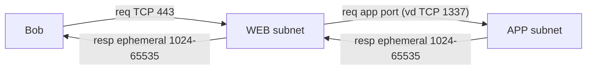
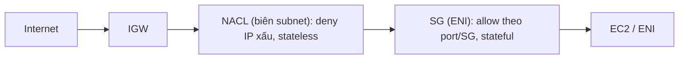

# Compare - Security Groups vs NACL

> **TL;DR:** Đây là hai lớp lọc traffic trong VPC. [[NACL]] lọc ở **ranh giới subnet**, **stateless**, có cả **allow lẫn deny** và xét rule **theo số thứ tự**. [[Security Groups]] lọc ở **ENI**, **stateful**, **chỉ allow** nhưng tham chiếu được **logical resource** (SG khác, chính nó). Mô hình chuẩn: **SG để allow, NACL để deny bad actor.**

## 🖼️ Sơ đồ
![[Compare - Security Groups vs NACL.excalidraw]]
*Mở bằng plugin Excalidraw để chỉnh sửa · ảnh tĩnh: [[Compare - Security Groups vs NACL.svg]]*

![[Compare - Security Groups vs NACL - rules.excalidraw]]
*Mở bằng plugin Excalidraw để chỉnh sửa · ảnh tĩnh: [[Compare - Security Groups vs NACL - rules.svg]]*

## Bảng so sánh nhiều chiều
| Tiêu chí | Security Group | NACL |
|---|---|---|
| Gắn vào | **ENI** (network interface). Console hiển thị là "instance" nhưng thực tế gắn vào primary ENI | **Subnet** |
| Phạm vi tác động | Mọi traffic vào/ra ENI, **kể cả** giữa hai instance cùng subnet | Chỉ traffic **băng qua ranh giới subnet**. Traffic giữa instance A và B trong cùng subnet **không bị NACL ảnh hưởng** |
| Trạng thái | **Stateful**: response tự được cho qua | **Stateless**: request và response là hai luồng riêng, mỗi luồng cần rule riêng |
| Ephemeral port | Không cần quan tâm | Phải mở response trên dải ephemeral (khóa học dùng TCP 1024–65535) |
| Loại rule | Chỉ **allow**, còn lại implicit deny | **Allow và Deny** tường minh, cộng rule `*` implicit deny ở cuối |
| Chặn một IP/dải xấu cụ thể | **Không làm được** | **Làm được** (deny rule) |
| Thứ tự xử lý | Không có thứ tự, xét toàn bộ rule | Từ **rule number nhỏ nhất**. Rule khớp đầu tiên quyết định, rồi **dừng xét**. Deny đứng trước sẽ che allow phía sau |
| Đối tượng trong rule | IP, CIDR, port, protocol **và logical resource** (SG khác, self-reference) | Chỉ IP, CIDR, port, protocol. **Không** tham chiếu logical resource |
| Tầng [[OSI Model]] | Cao hơn, nhiều tính năng hơn | Thấp hơn, kiểu firewall truyền thống |
| Số lượng gắn | Một ENI gắn được nhiều SG. Một SG dùng cho nhiều ENI | **Mỗi subnet đúng 1 NACL** (default hoặc custom). **Một NACL gắn được nhiều subnet** |
| Mặc định | SG mới: không có inbound rule, outbound allow all *(bổ sung theo tài liệu AWS)* | **Default NACL** của VPC: allow all vào/ra, nên coi như không có tác dụng. **Custom NACL mới tạo: chỉ có implicit deny**, nên gắn vào subnet là **chặn hết** |
| Scale với ASG / IP thay đổi | Rất tốt nhờ tham chiếu SG | Kém, phải sửa CIDR thủ công |
| Lọc traffic của [[NAT Gateway]] | **Không** (NATGW không gắn được SG) | **Có**, qua NACL của subnet chứa NATGW |
| AWS khuyến nghị dùng chính | Có | Bổ sung khi cần deny |

## Số rule cần cho một luồng: ví dụ Web → App
Kiến trúc: Bob (Internet) → web subnet → app subnet. Mỗi subnet có NACL riêng, mỗi tầng có SG riêng.

| Luồng | Với NACL (stateless) | Với SG (stateful) |
|---|---|---|
| Bob → Web (443) | NACL-web: **inbound** 443 + **outbound** ephemeral | SG-web: **1 inbound** 443 từ `0.0.0.0/0` |
| Web → App (1337) | NACL-web: **outbound** 1337 + **inbound** ephemeral. NACL-app: **inbound** 1337 + **outbound** ephemeral | SG-app: **1 inbound** 1337, source = SG-web |
| Tổng | **6 rule** trên 2 NACL | **2 rule** |

- Một kết nối đi qua **hai ranh giới subnet** cần **hai rule trên mỗi NACL** (request + response).
- Thêm software update, NAT, hay traffic từ VPC ra ngoài thì số rule NACL còn tăng nữa.
- Lưu ý: inbound và outbound là hai rule set riêng. Số thứ tự rule chỉ cần duy nhất **trong một rule set**, nên inbound và outbound có thể cùng dùng rule 110.

## Hai lớp phối hợp

Packet vào phải qua **cả hai**: NACL ở biên subnet trước, sau đó tới SG ở ENI. Traffic nội subnet chỉ đi qua SG.

## Khi nào chọn cái nào
- **Cho phép traffic tới resource**, nhất là kiến trúc nhiều tầng hoặc instance co giãn: dùng **SG**. Tham chiếu SG của tầng trước, dùng self-reference cho cluster.
- **Chặn một IP hoặc dải IP cụ thể** (kẻ tấn công, mạng xấu): dùng **NACL deny**, đánh số rule nhỏ hơn rule allow.
- **Kiểm soát thô ở cấp subnet** (ví dụ chặn toàn bộ một port cho cả subnet): dùng NACL.
- **Lọc traffic qua NAT Gateway**: chỉ NACL.
- Chặn ở tầng ứng dụng (HTTP header, SQLi, rate limit): không phải SG hay NACL mà là [[WAF]] (xem [[Layer 7 Firewall]]).

## 🎯 Mẹo thi SAA-C03
- "Block a specific malicious IP address" thì chọn **NACL**. SG **không có deny**.
- "Stateful" là SG, "stateless / phải mở ephemeral ports" là NACL.
- "Attached to subnet" là NACL. "Attached to ENI / instance" là SG.
- "Reference another security group / allow traffic from instances of tier X regardless of IP" thì chọn SG.
- Hai instance **cùng subnet** không nói chuyện được thì nghi **SG**. NACL không ảnh hưởng traffic nội subnet.
- Gắn **custom NACL** mới tạo vào subnet thì **mọi traffic bị chặn** vì chỉ có implicit deny. Ngược lại, default NACL cho qua hết.
- NACL xử lý theo thứ tự, gặp rule khớp đầu tiên thì dừng. Đề cho rule allow số 100 và deny số 200 với cùng IP thì kết quả là **allow**.
- Mỗi subnet có đúng 1 NACL. Một NACL dùng cho nhiều subnet được.
- NAT Gateway không gắn được SG, chỉ dùng NACL.

## Liên kết
- Tiên quyết: [[Stateful vs Stateless Firewalls]], [[Layer 4 Transport]], [[VPC Subnets]]
- Chi tiết từng bên: [[Security Groups]], [[NACL]]
- Liên quan: [[EC2 Network Interfaces IPs and DNS]], [[NAT Gateway]], [[Auto Scaling Groups]], [[VPC Flow Logs]]
- Phân biệt với: [[WAF]], [[Layer 7 Firewall]]
- Section: [[_MOC 06 VPC Basics]], [[Exam Cheat Sheet]]
