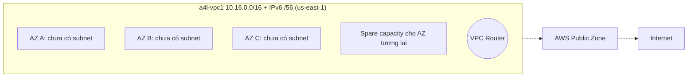

# Custom VPC

> **TL;DR:** Custom VPC là mạng riêng do mình tự thiết kế trong một region: chọn CIDR IPv4 (/28 đến /16), có thể thêm IPv6 /56, chọn tenancy, rồi tự thêm subnet, route table, IGW... Khác với [[Default VPC]], custom VPC mặc định **không có gì cả** và **không có gì ra vào được** nếu chưa cấu hình rõ ràng.

## 🖼️ Sơ đồ
![[Custom VPC.excalidraw]]
*Mở bằng plugin Excalidraw để chỉnh sửa · ảnh tĩnh: [[Custom VPC.svg]]*

## Khái niệm cốt lõi
- **Regionally isolated & regionally resilient**: VPC tạo trong một region và hoạt động trên mọi AZ của region đó.
- Một account, một region có thể có **nhiều VPC cách ly nhau**.
- **Không gì vào/ra VPC** nếu không có cấu hình tường minh. VPC là ranh giới mạng và tạo ra **blast radius** cách ly: nếu một tài nguyên bị khai thác, ảnh hưởng chỉ gói trong VPC đó (và những gì nối với nó).
- So với default VPC (cấu trúc cố định: 1 subnet/AZ, cùng dải 172.31.0.0/16, không cần cấu hình): custom VPC cho phép **mọi kiểu cấu hình**, từ đơn giản tới multi-tier phức tạp.
- Hỗ trợ **hybrid networking**: nối với cloud khác và on-premises (xem [[Site-to-Site VPN]], [[Direct Connect]]).

### Tenancy
- **Default**: tài nguyên chạy trên phần cứng dùng chung; khi tạo từng tài nguyên (ví dụ EC2) vẫn có thể chọn dedicated cho riêng nó.
- **Dedicated**: mọi tài nguyên trong VPC **bắt buộc** chạy trên phần cứng dedicated, đắt hơn đáng kể.
- Quy tắc: chưa chắc cần dedicated thì chọn **default**. (Khóa học nói dedicated ở mức VPC là "khóa cứng"; hiện nay AWS cho phép đổi tenancy VPC từ dedicated về default qua API/CLI, nhưng không đổi được chiều ngược lại.)
- Liên quan: [[Dedicated Hosts]].

### IPv4
- Mỗi VPC có **1 primary private IPv4 CIDR bắt buộc**, đặt lúc tạo VPC.
  - Nhỏ nhất **/28** (16 IP, một số IP không dùng được), lớn nhất **/16** (65,536 IP).
- Có thể thêm **secondary IPv4 CIDR** sau khi tạo: mặc định tối đa **5** CIDR mỗi VPC, tăng được qua yêu cầu tăng quota (support ticket).
- Private IP là phương thức giao tiếp chính trong VPC. Public IP chỉ dùng khi tài nguyên cần nói chuyện với internet hoặc AWS public zone (xem [[AWS Public vs Private Services]]).
- Cách nghĩ đơn giản: VPC có một "pool" private IPv4, và tùy chọn dùng thêm public IP.

### IPv6
- Tùy chọn: gán **IPv6 /56** cho VPC.
- Không tự chọn được dải như IPv4: hoặc để **AWS cấp (Amazon-provided)**, hoặc dùng dải IPv6 **mình sở hữu** (BYOIP). (Console hiện nay có thêm tùy chọn cấp từ IPAM.)
- IPv6 **không có khái niệm private/public**: mọi địa chỉ IPv6 AWS cấp đều **publicly routable**. Tuy vậy vẫn phải cấu hình tường minh (route, IGW, firewall) mới có kết nối internet, nên không phải lo về bảo mật; chỉ bớt việc phân biệt public/private.
- Tính năng IPv6 chưa đầy đủ bằng IPv4 ở mọi dịch vụ, nhưng nên cân nhắc bật IPv6 làm mặc định.

### DNS trong VPC
- DNS do Route 53 cung cấp (Route 53 Resolver), nằm ở địa chỉ **base IP của VPC + 2**. Ví dụ VPC 10.0.0.0 ⇒ DNS ở **10.0.0.2**. (AWS cũng phục vụ resolver tại 169.254.169.253.)
- Hai thuộc tính **cực kỳ quan trọng cho đề thi**:

| Thuộc tính | Ý nghĩa | Mặc định custom VPC |
|---|---|---|
| `enableDnsHostnames` | Instance có public IP sẽ được cấp **public DNS hostname** | **Tắt** |
| `enableDnsSupport` | Bật **DNS resolution** trong VPC, cho phép dùng resolver VPC+2 | Bật |

- Gặp sự cố DNS trong VPC (thực tế hoặc đề thi) thì kiểm tra hai thuộc tính này trước tiên. Chúng cũng là điều kiện cần cho [[R53 Private Hosted Zones]] và private DNS của [[Interface VPC Endpoints]].

## Cách hoạt động / Kiến trúc
Kiến trúc mục tiêu của cả section: VPC `a4l-vpc1` 10.16.0.0/16 ở us-east-1, 4 tier (reserved, db, app, web) × 3 AZ dùng thật + chừa chỗ cho AZ thứ tư. Sau đó dần thêm [[VPC Routing and Internet Gateway|Internet Gateway]], [[NAT Gateway]], [[Bastion Host]], [[NACL]].

Ở trạng thái này VPC chỉ là cái vỏ: chưa có subnet, chưa có IGW nên chưa ra được public zone.

## Demo / Lab
1. Đăng nhập IAM admin của management account, region **us-east-1**. Vào VPC console → Create VPC.
2. Chọn **VPC only** (wizard "VPC and more" tạo luôn subnet/route table/gateway; khóa học cố ý làm từng bước).
3. Name `a4l-vpc1`, IPv4 CIDR **10.16.0.0/16** (lấy từ IP plan ở [[VPC Sizing and Structure]]), tenancy **Default**, chọn **Amazon-provided IPv6 CIDR block**.
4. Sau khi tạo: Actions → **Edit VPC settings** → bật cả **DNS resolution** (thường đã bật) và **DNS hostnames** (custom VPC mặc định tắt).
5. Kết quả: VPC có VPC ID, IPv4 10.16.0.0/16, IPv6 /56 do AWS cấp (mỗi người một dải khác nhau), **không có subnet nào**. VPC đi kèm main route table, main (default) NACL và DHCP option set.
- VPC và subnet **không tính phí**.

## 🎯 Mẹo thi SAA-C03
- VPC: **regional**, trải trên mọi AZ của region; subnet mới là AZ-level.
- Kích thước IPv4: **/28 → /16**; IPv6 VPC: **/56**, không tự chọn dải (AWS cấp hoặc BYOIP).
- Đề nói "instance có public IP nhưng không có public DNS name" ⇒ bật **enableDnsHostnames**. Đề nói "không phân giải được DNS trong VPC/private hosted zone" ⇒ kiểm tra **enableDnsSupport** (và enableDnsHostnames).
- DNS resolver luôn ở **network + 2** của VPC.
- **Dedicated tenancy** ở mức VPC ép mọi tài nguyên lên phần cứng dedicated và tốn tiền. Muốn chỉ một vài instance dedicated thì để VPC default và chọn ở instance.
- Custom VPC mặc định **riêng tư hoàn toàn**: muốn ra internet phải thêm IGW + route + public IP.

## Liên kết
- Tiên quyết: [[VPC Sizing and Structure]], [[Default VPC]], [[AWS Public vs Private Services]]
- Tiếp theo: [[VPC Subnets]], [[VPC Routing and Internet Gateway]]
- Liên quan: [[Route 53 Fundamentals]], [[R53 Private Hosted Zones]], [[Dedicated Hosts]], [[EC2 Network Interfaces IPs and DNS]], [[Egress-Only Internet Gateway]]
- MOC: [[_MOC 06 VPC Basics]]
