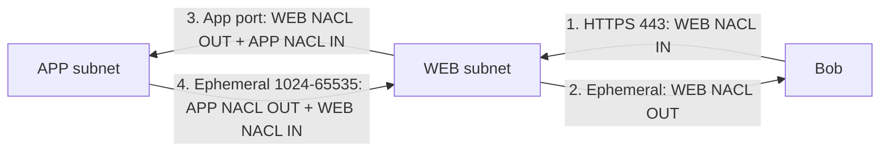

# NACL

> **TL;DR:** Network ACL là firewall **stateless** gắn ở **biên subnet**, lọc traffic **đi vào và đi ra subnet** theo IP/CIDR, port và protocol. Rule được xét **theo số thứ tự tăng dần, khớp rule đầu tiên thì dừng**, có cả **ALLOW và DENY tường minh**. Điểm mạnh riêng là **chặn được IP xấu**, việc mà [[Security Groups]] không làm được.

## 🖼️ Sơ đồ
![[NACL.excalidraw]]
*Mở bằng plugin Excalidraw để chỉnh sửa · ảnh tĩnh: [[NACL.svg]]*

![[NACL - scope.excalidraw]]
*Mở bằng plugin Excalidraw để chỉnh sửa · ảnh tĩnh: [[NACL - scope.svg]]*

## Khái niệm cốt lõi
- Có thể coi NACL như **firewall truyền thống** trong VPC.
- **Gắn với subnet**: mỗi subnet có đúng một NACL; NACL lọc dữ liệu khi nó **vượt qua ranh giới subnet** (vào hoặc ra).
- Traffic **giữa hai tài nguyên trong cùng subnet không bị NACL ảnh hưởng** (ví dụ instance A ↔ B cùng subnet).
- Mỗi NACL có **hai bộ rule**:
  - **Inbound**: chỉ áp cho dữ liệu **đi vào** subnet.
  - **Outbound**: chỉ áp cho dữ liệu **đi ra** subnet.
  - Hai bộ này nói về **chiều traffic**, không phải request hay response. Vì NACL **stateless**, nó không biết gói nào là request, gói nào là response (xem [[Stateful vs Stateless Firewalls]]).
- Mỗi rule gồm: **rule number**, loại/**protocol**, **port range**, **CIDR** (source với inbound, destination với outbound) và **ALLOW / DENY**.
- Rule number là duy nhất **trong từng bộ** inbound/outbound; dùng cùng số 110 ở cả inbound và outbound vẫn hợp lệ.

### Thứ tự xử lý
1. Xác định áp bộ inbound hay outbound.
2. Xét từ **rule number thấp nhất** trở lên.
3. Gặp rule **khớp đầu tiên** ⇒ ALLOW hoặc DENY theo rule đó và **dừng xử lý**.
4. Không rule nào khớp ⇒ rule `*` (**implicit deny**) chặn.

⇒ Nếu một rule DENY và một rule ALLOW cùng khớp một traffic, rule nào **số nhỏ hơn** thắng. Muốn chặn một IP xấu thì đặt DENY ở số **nhỏ hơn** rule ALLOW chung.

## Cách hoạt động / Kiến trúc

### Ví dụ: Bob truy cập web server qua HTTPS
NACL của web subnet:

| Bộ | Rule # | Type | Protocol | Port | CIDR | Action |
|---|---|---|---|---|---|---|
| Inbound | 110 | HTTPS | TCP | 443 | 0.0.0.0/0 | ALLOW (request của Bob) |
| Inbound | * | ALL | ALL | ALL | 0.0.0.0/0 | DENY |
| Outbound | 120 | Custom | TCP | 1024–65535 | 0.0.0.0/0 | ALLOW (response về ephemeral port) |
| Outbound | * | ALL | ALL | ALL | 0.0.0.0/0 | DENY |

Rule outbound mở cả dải ephemeral không an toàn lắm, nhưng với firewall stateless thì đó là cách duy nhất.

### Kiến trúc multi-tier: số rule tăng nhanh

- Mỗi luồng giao tiếp cần **một cặp rule (app port + ephemeral port)** trên **mỗi NACL nó đi qua**.
- Traffic web → app vượt **hai** ranh giới subnet ⇒ cần rule outbound trên NACL web **và** inbound trên NACL app; response cần outbound trên NACL app **và** inbound trên NACL web.
- Cần thêm rule nếu có software update, NAT... Áp dụng cho mọi traffic **trong VPC (giữa subnet), vào VPC, và ra khỏi VPC**.

### Default NACL và custom NACL

| | Default NACL (tạo cùng VPC) | Custom NACL |
|---|---|---|
| Rule ban đầu | ALLOW all (rule 100) + `*` DENY, ở cả inbound và outbound | **Chỉ `*` DENY** ở cả hai chiều |
| Hiệu ứng | **Cho phép tất cả**, NACL coi như "không có tác dụng" | **Chặn tất cả** ngay khi gắn vào subnet |
| Gắn subnet | Mọi subnet không được gắn NACL khác | Lúc tạo **chưa gắn subnet nào** |

- Default thân thiện cho người mới; AWS khuyến khích dùng [[Security Groups]] làm lớp chính.
- Cẩn thận: gắn custom NACL mới tạo vào subnet đang chạy ⇒ **mất toàn bộ kết nối** cho tới khi thêm rule.

## Bảng so sánh / số liệu
- Dải ephemeral thường dùng trong rule: **TCP 1024–65535** (theo slide). Thực tế tùy OS client: Linux thường 32768–60999, Windows 49152–65535; ELB và NAT gateway dùng 1024–65535. Nên mở 1024–65535 cho chắc.
- Bổ sung theo tài liệu AWS hiện tại (ngoài khóa học): rule number 1–32766; mặc định tối đa **20 rule mỗi chiều** (tăng được tới 40); NACL **không lọc** traffic tới Amazon DNS (VPC+2), Instance Metadata (169.254.169.254), DHCP, Amazon Time Sync.

## 🎯 Mẹo thi SAA-C03
- **Stateless** ⇒ luôn cần cặp rule request + response. "Đã mở inbound mà không có phản hồi" ⇒ thiếu **outbound ephemeral 1024–65535**.
- **Chỉ ảnh hưởng traffic vượt biên subnet**; hai instance cùng subnet không bị NACL chặn (dùng SG nếu cần).
- **Có DENY tường minh** ⇒ đề hỏi "chặn một IP/dải IP độc hại cụ thể" ⇒ **NACL** (security group không có deny).
- Rule xét **theo số nhỏ đến lớn, khớp đầu tiên là dừng**. Bẫy: DENY đặt số lớn hơn ALLOW thì không bao giờ có tác dụng.
- NACL **chỉ dùng IP/CIDR, port, protocol**; **không tham chiếu được logical resource** (instance, SG...) và **chỉ gắn được vào subnet**, không gắn vào instance/ENI.
- **1 subnet ⇒ đúng 1 NACL** (default hoặc custom); **1 NACL ⇒ nhiều subnet**.
- Default NACL cho phép tất cả; **custom NACL mới tạo chặn tất cả**.
- Mô hình thường gặp: **SG để ALLOW** cái cần thiết, **NACL để DENY** IP/mạng xấu (xem [[Compare - Security Groups vs NACL]]).

## Liên kết
- Tiên quyết: [[Stateful vs Stateless Firewalls]], [[VPC Subnets]], [[Layer 4 Transport]]
- Dùng cùng: [[Security Groups]], [[VPC Flow Logs]] (kiểm tra traffic bị REJECT)
- So sánh: [[Compare - Security Groups vs NACL]]
- Liên quan: [[VPC Routing and Internet Gateway]], [[NAT Gateway]], [[Bastion Host]], [[WAF]], [[Layer 7 Firewall]]
- MOC: [[_MOC 06 VPC Basics]]
