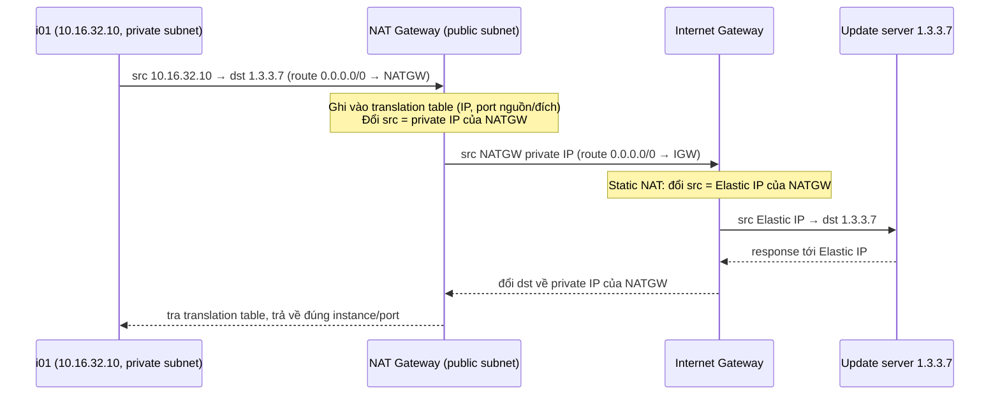
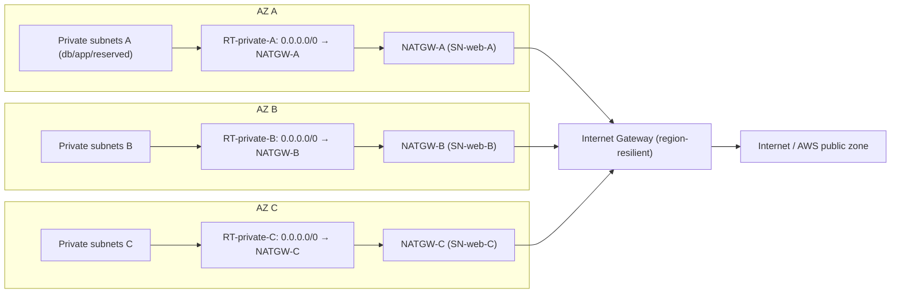
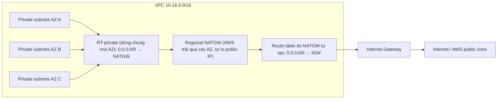

# NAT Gateway

> **TL;DR:** NAT Gateway là dịch vụ managed của AWS làm **IP masquerading**. Nó cho resource IPv4 private trong VPC kết nối **ra ngoài** (outgoing only) tới Internet và các AWS public service, mà không cần biến subnet thành public. Có hai **availability mode**: **zonal** (kiểu cổ điển: đặt trong **public subnet** của một AZ, dùng **Elastic IP**, chỉ **AZ-resilient**, nên cần **1 NATGW và 1 route table cho mỗi AZ**) và **regional** (mới: chỉ chọn VPC, AWS tự trải NATGW qua các AZ, tự lo public IP và đường ra IGW; một route table private dùng cho mọi AZ).

## 🖼️ Sơ đồ
![[NAT Gateway.excalidraw]]
*Mở bằng plugin Excalidraw để chỉnh sửa · ảnh tĩnh: [[NAT Gateway.svg]]*

![[NAT Gateway - flow.excalidraw]]
*Mở bằng plugin Excalidraw để chỉnh sửa · ảnh tĩnh: [[NAT Gateway - flow.svg]]*

## Khái niệm cốt lõi

### NAT là gì (xem nền tảng ở [[NAT Fundamentals]])
- **NAT (Network Address Translation)** là một nhóm kỹ thuật sửa IP packet bằng cách đổi **source IP hoặc destination IP**.
- **Static NAT** là kiểu 1 private IP ↔ 1 public IP. **Internet Gateway** làm đúng việc này để cấp public IPv4 cho resource (xem [[VPC Routing and Internet Gateway]]): packet đi ra thì đổi source từ private sang public, packet quay về thì đổi destination ngược lại.
- **IP masquerading** là cái người ta thường gọi là "NAT": **nhiều private IP (cả một CIDR) ẩn sau một public IP**.
  - Lý do tồn tại: public IPv4 đang cạn.
  - Chỉ cho kết nối **đi ra** (outgoing). Private device khởi tạo được kết nối và nhận response, nhưng **Internet không khởi tạo kết nối vào được** các private IP này.
- AWS có hai cách làm NAT:
  - **NAT instance**: EC2 tự cấu hình NAT, là cách cũ (legacy), chỉ dùng trong trường hợp đặc biệt.
  - **NAT Gateway**: dịch vụ managed, cách được khuyến nghị.

### Vì sao cần NAT cho private subnet
Ví dụ subnet app `10.16.32.0/20` có 3 instance `.10`, `.20`, `.30`. Đây là private IP nên không route được ra Internet hay [[AWS Public vs Private Services|AWS public zone]] (ví dụ S3). Muốn các instance tải software update thì có ba lựa chọn:
1. Biến subnet thành public. Cách này phá thiết kế nhiều tầng, vì tầng app không nên public.
2. Tự host update server (WSUS, Linux mirror) trong VPC. Tốn công quản trị.
3. **Dùng NAT**: instance vẫn private nhưng có đường ra ngoài một chiều.

## Cách hoạt động / Kiến trúc

### Luồng packet (NATGW zonal)
- NATGW được đặt trong **public web subnet**. Route table của subnet này có `0.0.0.0/0 → IGW`.
- Route table của **private app subnet** có `0.0.0.0/0 → NATGW`.

- NATGW lưu **translation table** gồm IP và port nguồn/đích của từng luồng. Nhờ đó nó phân biệt được nhiều instance, mỗi instance lại có nhiều kết nối song song.
- Trong VPC không resource nào gắn trực tiếp public IPv4. NATGW chỉ đổi source sang IP của chính nó, sau đó **IGW** mới đổi sang Elastic IP public. Router NAT ở nhà làm cả hai bước trong một thiết bị.
- Tóm lại:
  - Cần **public IPv4 riêng** cho một instance: chỉ cần **IGW**.
  - Cần cho **private instance đi ra** Internet hay AWS public zone: cần **cả NATGW** (many-to-one) **và IGW** (đổi sang public IP thật).

### Hai availability mode: zonal và regional
Khi tạo NATGW, việc đầu tiên là chọn **availability mode**:

| | **Zonal** (cổ điển) | **Regional** (mới) |
|---|---|---|
| Triển khai vào | **Một subnet** (public), tức **một AZ** | **Cả VPC**, không chọn subnet |
| Resilience | Chết theo AZ. Muốn HA thì tự đặt **mỗi AZ có workload một NATGW** | AWS quản lý nhiều NATGW qua các AZ, **tự scale theo AZ có nhu cầu** |
| Public IP | Tự cấp **Elastic IP** cho từng NATGW | AWS **tự quản lý** public IP (vẫn cấu hình tay được nếu muốn) |
| Đường ra IGW | Nằm trong public subnet đã có route `0.0.0.0/0 → IGW` | NATGW **tự tạo route table riêng** trỏ `0.0.0.0/0 → IGW`, không cần public subnet |
| Route của private subnet | **Mỗi AZ một route table** `0.0.0.0/0 → NATGW cùng AZ` | **Một route table** `0.0.0.0/0 → NATGW` gắn được cho private subnet ở **mọi AZ** |
| Connectivity type | **Public** hoặc **private** | Hiện **chỉ public** |
| NACL | Lọc được bằng NACL của subnet chứa NATGW | Không nằm trong subnet của mình |

- Chi phí (theo demo, lúc quay bài): **như nhau** cho cùng quy mô. Regional tự trải 3 AZ, mỗi AZ một NATGW, thì trả như tự dựng 3 NATGW zonal.
- Giảng viên đánh giá: regional đơn giản hơn nhiều, nên gần như luôn dùng NATGW (thay vì NAT instance), nhất là khi đã có regional mode.

**Private NAT Gateway** (connectivity type private): NATGW đặt trong private subnet, dùng private IP, làm NAT giữa các **mạng private**: giữa các VPC, hoặc giữa VPC và on-premises, đặc biệt khi **dải IP chồng lấn** (vốn không nối trực tiếp được). Chỉ NATGW **zonal** hỗ trợ private.

### Thiết kế resilient với NATGW zonal: 1 NATGW cho mỗi AZ
Theo slide "NATGW Full Resilience" của bản khóa cũ (bài mới vẽ cùng kiến trúc cho chế độ zonal), VPC `10.16.0.0/16` ở us-east-1 có 3 AZ (A/B/C), mỗi AZ có các tầng reserved/db/app/web. Trong mỗi AZ:
- Đặt NATGW trong web subnet (public) của AZ đó.
- Tạo route table private riêng cho AZ, có `0.0.0.0/0 → NATGW cùng AZ`, và gắn vào mọi private subnet (reserved, db, app) của AZ.

Khi một AZ hỏng, các AZ còn lại vẫn ra Internet qua NATGW của chính chúng (xem [[HA vs FT vs DR]], [[AWS Global Infrastructure]]).

### Thiết kế với NATGW regional

Một NATGW, một route table private, không cần public subnet cho NAT.

## Bảng số liệu / đặc điểm NAT Gateway
| Thuộc tính | Giá trị |
|---|---|
| Availability mode | **Zonal** (một subnet/AZ) hoặc **regional** (cả VPC, AWS trải qua các AZ) |
| Vị trí | Zonal public: **public subnet**, VPC phải có IGW, subnet public và route `0.0.0.0/0 → IGW` sẵn. Regional: chỉ chọn VPC |
| Public IP | Zonal: **Elastic IP** (IPv4 public tĩnh, cấp cho account trong một region, giữ đến khi release). Regional: AWS tự quản lý |
| Resilience | Zonal: **AZ-resilient**, HA trong AZ nhưng **chết theo AZ**. Regional: AWS quản lý qua nhiều AZ |
| HA cấp region | Zonal: 1 NATGW + 1 route table private trên mỗi AZ dùng tới. Regional: có sẵn |
| Connectivity type | **Public** hoặc **private** (private chỉ có ở zonal) |
| Bandwidth | Managed, **scale tới 100 Gbps**. *(Bản khóa cũ nêu: tối đa 45 Gbps)* |
| Cần thêm băng thông | Tạo thêm NATGW, chia subnet nặng tải sang các NATGW khác nhau |
| Quản trị | Managed hoàn toàn, không truy cập được OS |
| Chi phí | 2 thành phần: **giá theo giờ** + **giá mỗi GB dữ liệu xử lý**. Regional và zonal cùng giá cho cùng số NATGW. *(Bản khóa cũ nêu, bài mới không nói: giờ lẻ tính tròn 1 giờ; khoảng $0.04/giờ và $0.04/GB tùy region; không có free tier)* |
| Security Group | **Không hỗ trợ**. NATGW zonal lọc được bằng [[NACL]] của subnet chứa nó |
| IPv6 | Không cần NATGW cho IPv6 ra Internet; NATGW chỉ giúp **IPv6 → IPv4** (NAT64 + DNS64, xem bên dưới) |

## NAT Instance vs NAT Gateway
NAT instance là một EC2 tự quản lý chạy NAT, trước đây AWS có sẵn AMI dựng sẵn. Bài mới xếp nó là **legacy**, chỉ dùng trong trường hợp đặc biệt: cần **port forwarding**, muốn gộp **bastion host** và NAT trên một máy tự quản, hoặc dùng phần mềm NAT bên thứ ba. Bài dẫn link tới bảng so sánh của AWS, và khuyên gần như luôn dùng NAT Gateway, nhất là khi đã có regional mode.

**Bắt buộc phải tắt Source/Destination Check** trên NAT instance. Mặc định EC2 drop mọi packet mà nó không phải là source hoặc destination. NAT instance lại nhận packet có source là instance khác trong VPC và destination là host ngoài Internet, nên không tắt check thì traffic bị drop. Tắt được qua console (chuột phải lên instance), CLI hoặc API. Câu này từng xuất hiện trong đề. (Khóa mới nhắc ý này ở bài về network interface của EC2, xem [[EC2 Network Interfaces IPs and DNS]].)

*Bảng dưới là bảng so sánh của bản khóa cũ; bài mới không trình bày lại mà chỉ dẫn link tới bảng của AWS.*

| Tiêu chí | NAT Gateway | NAT Instance (EC2) |
|---|---|---|
| Availability | HA trong AZ. Mỗi AZ một NATGW để độc lập AZ | Một EC2 đơn lẻ: chết khi hỏng phần cứng, storage, network hoặc AZ. Failover phải tự viết script |
| Bandwidth | Tự scale (bài mới: tới 100 Gbps) | Phụ thuộc instance type |
| Maintenance | AWS quản lý | Bạn tự patch OS và cập nhật phần mềm |
| Performance | Phần mềm tối ưu riêng cho NAT | EC2 general purpose |
| Cost | Theo số NATGW, thời gian chạy và GB xử lý. Không free tier | Theo số, loại và kích cỡ instance. Instance nhỏ có thể nằm trong free tier. Chi phí cố định, dễ dự đoán, **rẻ hơn ở volume lớn hoặc môi trường test** |
| Type/size | Đồng nhất, không phải chọn | Tự chọn theo tải |
| Security Group | **Không gắn được** | Gắn được |
| NACL | Có, trên subnet chứa NATGW | Có |
| Flow logs | Có | Có |
| Port forwarding | **Không** | Có, cấu hình thủ công |
| Dùng làm [[Bastion Host]] | **Không** | Có, đa năng như mọi EC2 |
| Truy cập OS | Không | Có, SSH như EC2 thường |

Điểm chung: cả hai đều cần public IP, nằm trong public subnet và cần IGW hoạt động.

Khi nào chọn cái nào:
- **Mặc định chọn NAT Gateway**, cả ngoài thực tế lẫn trong đề, khi đề ưu tiên availability, bandwidth, ít bảo trì hoặc performance. Ít vận hành nhất: **NATGW regional**.
- Chọn **NAT instance** khi đề nhấn mạnh **chi phí thấp nhất** (VPC test, lưu lượng rất thấp hoặc rất cao), hoặc cần **port forwarding, bastion, SG trên NAT**.

## IPv6 và NAT
- **IPv6 không cần NAT.** Phần lớn IPv6 trong AWS, nhất là dải Amazon cấp, đều publicly routable.
- **IGW làm việc trực tiếp với IPv6**. Route `::/0 → IGW` cho instance kết nối **hai chiều** với Internet và AWS public zone. Instance khi đó thành public nếu SG/NACL không chặn.
- **NAT Gateway không dùng cho IPv6.** Đáp án có IPv6 + NAT Gateway thì loại.
- IPv6 **chỉ đi ra (outbound only)**: route `::/0 → `[[Egress-Only Internet Gateway]].
- Trường hợp đặc biệt: NATGW hỗ trợ **NAT64**, kết hợp **DNS64** bật trên VPC, để workload **IPv6-only** gọi tới dịch vụ **IPv4-only**. Đây không phải cách cho IPv6 ra Internet IPv6, nên quy tắc thi ở trên vẫn đúng.

## Demo / Lab
Demo dựng **NATGW regional**. Hạ tầng Aus-E-Mart deploy bằng one-click [[CloudFormation Basics|CloudFormation]] stack (`aem-vpc`, mất khoảng 5–10 phút): VPC `aem-vpc1` có private subnet và web subnet public ở AZ A/B/C, một EC2 test trong subnet app-A, và một **EC2 Instance Connect Endpoint** (tạo lâu nhất, nhưng rẻ hơn các lựa chọn khác).
1. Kết nối vào instance private bằng **EC2 Instance Connect → Connect using a private IP** (qua endpoint, không cần public IP; xem [[EC2 Instance Connect and SSH]]). `ping 1.1.1.1` thất bại. Tab **Resource map** của VPC cho thấy chỉ web A/B/C có route ra IGW.
2. **Create NAT gateway** `aem-vpc1-natgw1`: availability mode **Regional** (zonal thì có public/private; regional hiện chỉ public), chọn **VPC** chứ không chọn subnet, connectivity **Public**, để AWS tự quản lý Elastic IP qua các AZ. Chờ trạng thái *Available*.
3. Trong Route tables (lọc theo VPC) có 3 bảng: bảng web → IGW do stack tạo, main route table, và **một route table do chính NATGW regional tạo** với `0.0.0.0/0 → IGW` (với NATGW zonal thì phải tự làm phần này qua public subnet).
4. Tạo route table `aem-vpc1-rt-private`, thêm `0.0.0.0/0 → NATGW` (chỉ IPv4).
5. Ping vẫn lỗi. Lý do: **route table chưa associate với subnet**. Subnet không có association tường minh thì dùng **main route table**.
6. **Edit subnet associations**: chọn **mọi private subnet ở cả 3 AZ** cho một route table này (web subnet giữ bảng riêng ra IGW). Sau đó ping hoạt động.
7. Dọn dẹp: bỏ association, xóa route table, xóa NATGW và chờ *Deleted*, rồi xóa stack.

Rút ra: với NATGW regional chỉ cần **1 NATGW + 1 route table** cho mọi AZ; nếu dùng zonal thì phải 3 NATGW (mỗi AZ một cái) và 3 route table. Dễ quên nhất vẫn là bước subnet association.

*(Bản khóa cũ nêu, bài mới không làm)*: demo cũ dựng 3 NATGW zonal `natgw-A/B/C` trong `sn-web-A/B/C`, mỗi cái **Allocate Elastic IP** riêng, 3 route table `rt-privateA/B/C` gắn với private subnet cùng AZ, kết nối instance bằng Session Manager; khi dọn dẹp phải **release các Elastic IP** (EIP không release vẫn bị tính tiền).

## 🎯 Mẹo thi SAA-C03
- NATGW **zonal** (public) đặt trong **public subnet**, không bao giờ đặt trong private subnet. Route của private subnet trỏ `0.0.0.0/0 → NATGW`. Route của public subnet trỏ `0.0.0.0/0 → IGW`.
- Với NATGW **zonal**, đáp án "một NAT Gateway là đủ cho HA toàn region" là **sai**: muốn resilient phải có **1 NATGW mỗi AZ + route table riêng mỗi AZ**. NATGW **regional** thì AWS tự trải qua các AZ: một NATGW, một route table cho mọi private subnet, ít vận hành nhất.
- **NATGW không hỗ trợ Security Group**, chỉ dùng **NACL** (với NATGW zonal là NACL của subnet chứa nó). Bản khóa cũ nhấn mạnh ý này "comes up all the time".
- **NATGW không làm bastion và không port forwarding** được vì không truy cập được OS. Cần mấy việc đó thì dùng NAT instance (legacy) hoặc [[Bastion Host]] riêng.
- NAT instance thì **phải disable Source/Destination Check**.
- NATGW tính tiền theo **giờ chạy và GB dữ liệu xử lý**. Nhớ có hai thành phần, không cần nhớ giá cụ thể. *(Bản khóa cũ: cần rẻ nhất cho môi trường test thì NAT instance là ứng viên.)*
- NAT giữa các mạng **private** (VPC ↔ VPC, VPC ↔ on-prem), nhất là khi **CIDR chồng lấn**: **private NAT Gateway** (chỉ zonal).
- **IPv6 + NAT Gateway thì loại ngay**, trừ trường hợp IPv6-only cần gọi dịch vụ IPv4-only (**NAT64 + DNS64**). IPv6 outbound-only dùng **Egress-Only IGW**, IPv6 hai chiều dùng IGW.
- Private instance chỉ cần gọi **S3/DynamoDB**: [[Gateway VPC Endpoints]] thường là lựa chọn rẻ hơn NATGW vì không tốn phí xử lý dữ liệu.
- Từ khóa nhận diện NAT: "private subnet cần tải update hoặc patch từ Internet nhưng không được truy cập từ Internet", "outbound-only IPv4".

## Liên kết
- Tiên quyết: [[NAT Fundamentals]], [[VPC Routing and Internet Gateway]], [[VPC Subnets]], [[AWS Public vs Private Services]]
- Liên quan: [[Custom VPC]], [[VPC Sizing and Structure]], [[NACL]], [[Security Groups]], [[Bastion Host]], [[VPC Flow Logs]], [[Gateway VPC Endpoints]], [[HA vs FT vs DR]]
- Phân biệt với: [[Egress-Only Internet Gateway]] (IPv6 outbound), Internet Gateway (static NAT 1:1, xem [[VPC Routing and Internet Gateway]])
- Section: [[_MOC 06 VPC Basics]]
