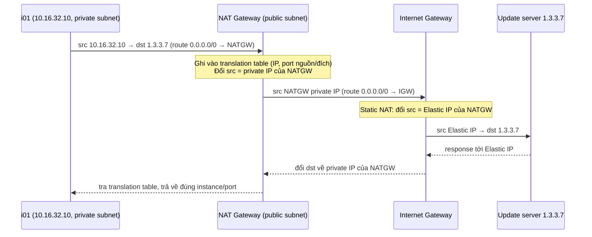
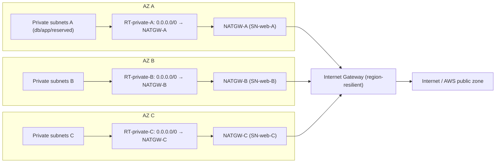

# NAT Gateway

> **TL;DR:** NAT Gateway là dịch vụ managed của AWS làm **IP masquerading**. Nó cho resource IPv4 private trong VPC kết nối **ra ngoài** (outgoing only) tới Internet và các AWS public service, mà không cần biến subnet thành public. NATGW nằm trong **public subnet**, dùng **Elastic IP**, và chỉ **AZ-resilient**. Muốn chịu lỗi cấp region phải đặt **1 NATGW và 1 route table cho mỗi AZ**.

## 🖼️ Sơ đồ
![[NAT Gateway.excalidraw]]
*Mở bằng plugin Excalidraw để chỉnh sửa · ảnh tĩnh: [[NAT Gateway.svg]]*

![[NAT Gateway - flow.excalidraw]]
*Mở bằng plugin Excalidraw để chỉnh sửa · ảnh tĩnh: [[NAT Gateway - flow.svg]]*

## Khái niệm cốt lõi

### NAT là gì (xem nền tảng ở [[NAT Fundamentals]])
- **NAT (Network Address Translation)** là một nhóm kỹ thuật sửa IP packet bằng cách đổi **source IP hoặc destination IP**.
- **Static NAT** là kiểu 1 private IP ↔ 1 public IP. **Internet Gateway** làm đúng việc này để cấp public IPv4 cho resource (xem [[VPC Routing and Internet Gateway]]): packet đi ra thì đổi source từ private sang public, packet quay về thì đổi destination ngược lại.
- **IP masquerading** là cái người ta thường gọi là "NAT": **nhiều private IP (cả một CIDR) ẩn sau một public IP**.
  - Lý do tồn tại: public IPv4 đang cạn.
  - Chỉ cho kết nối **đi ra** (outgoing). Private device khởi tạo được kết nối và nhận response, nhưng **Internet không khởi tạo kết nối vào được** các private IP này.
- AWS có hai cách làm NAT:
  - **NAT instance**: EC2 tự cấu hình NAT, là cách cũ.
  - **NAT Gateway**: dịch vụ managed, cách được khuyến nghị.

### Vì sao cần NAT cho private subnet
Ví dụ subnet app `10.16.32.0/20` có 3 instance `.10`, `.20`, `.30`. Đây là private IP nên không route được ra Internet hay [[AWS Public vs Private Services|AWS public zone]] (ví dụ S3). Muốn các instance tải software update thì có ba lựa chọn:
1. Biến subnet thành public. Cách này phá thiết kế nhiều tầng, vì tầng app không nên public.
2. Tự host update server (WSUS, Linux mirror) trong VPC. Tốn công quản trị.
3. **Dùng NAT**: instance vẫn private nhưng có đường ra ngoài một chiều.

## Cách hoạt động / Kiến trúc

### Luồng packet
- NATGW được đặt trong **public web subnet**. Route table của subnet này có `0.0.0.0/0 → IGW`.
- Route table của **private app subnet** có `0.0.0.0/0 → NATGW`.

- NATGW lưu **translation table** gồm IP và port nguồn/đích của từng luồng. Nhờ đó nó phân biệt được nhiều instance, mỗi instance lại có nhiều kết nối song song.
- Trong VPC không resource nào gắn trực tiếp public IPv4. NATGW chỉ đổi source sang IP của chính nó, sau đó **IGW** mới đổi sang Elastic IP public. Router NAT ở nhà làm cả hai bước trong một thiết bị.
- Tóm lại:
  - Cần **public IPv4 riêng** cho một instance: chỉ cần **IGW**.
  - Cần cho **private instance đi ra** Internet hay AWS public zone: cần **cả NATGW** (many-to-one) **và IGW** (đổi sang public IP thật).

### Thiết kế resilient: 1 NATGW cho mỗi AZ
Theo slide "NATGW Full Resilience", VPC `10.16.0.0/16` ở us-east-1 có 3 AZ (A/B/C), mỗi AZ có các tầng reserved/db/app/web. Trong mỗi AZ:
- Đặt NATGW trong web subnet (public) của AZ đó.
- Tạo route table private riêng cho AZ, có `0.0.0.0/0 → NATGW cùng AZ`, và gắn vào mọi private subnet (reserved, db, app) của AZ.

Khi một AZ hỏng, các AZ còn lại vẫn ra Internet qua NATGW của chính chúng (xem [[HA vs FT vs DR]], [[AWS Global Infrastructure]]).

## Bảng số liệu / đặc điểm NAT Gateway
| Thuộc tính | Giá trị |
|---|---|
| Vị trí | **Public subnet**. VPC phải có IGW, subnet public và route `0.0.0.0/0 → IGW` sẵn |
| Public IP | **Elastic IP**: IPv4 public tĩnh, cấp cho account trong một region, giữ đến khi release |
| Resilience | **AZ-resilient**: HA và tự phục hồi lỗi phần cứng trong AZ, nhưng **chết theo AZ** |
| HA cấp region | 1 NATGW + 1 route table private trên mỗi AZ dùng tới |
| Bandwidth | Khóa học: tối đa **45 Gbps**. *(Hiện nay: bắt đầu 5 Gbps và tự scale tới 100 Gbps)* |
| Cần thêm băng thông | Tạo thêm NATGW, chia subnet nặng tải sang các NATGW khác nhau, kể cả trong cùng AZ |
| Quản trị | Managed hoàn toàn, không truy cập được OS |
| Chi phí | 2 thành phần: **giá theo giờ** (giờ lẻ tính tròn thành 1 giờ) + **giá mỗi GB dữ liệu xử lý**. Khóa học: khoảng $0.04/giờ và $0.04/GB, tùy region. **Không có free tier** |
| Security Group | **Không hỗ trợ**. Chỉ lọc bằng [[NACL]] của subnet chứa NATGW |
| IPv6 | Không dùng NATGW cho IPv6 (xem bên dưới) |

> Ngoài bài giảng: ở bước tạo NATGW còn có tùy chọn "connectivity type" (public/private), demo bỏ qua phần này. NATGW kiểu *private* không có EIP, dùng để NAT giữa các mạng private. Theo trí nhớ của người viết, AWS gần đây còn thêm chế độ NATGW *regional* tự trải qua nhiều AZ. Cần kiểm tra lại tài liệu AWS. Với đề SAA-C03, cứ trả lời theo mô hình "1 NATGW mỗi AZ".

## NAT Instance vs NAT Gateway
NAT instance là một EC2 chạy NAT, ví dụ dùng AMI Amazon Linux đã cấu hình sẵn.

**Bắt buộc phải tắt Source/Destination Check** trên NAT instance. Mặc định EC2 drop mọi packet mà nó không phải là source hoặc destination. NAT instance lại nhận packet có source là instance khác trong VPC và destination là host ngoài Internet, nên không tắt check thì traffic bị drop. Tắt được qua console (chuột phải lên instance), CLI hoặc API. Câu này từng xuất hiện trong đề.

| Tiêu chí | NAT Gateway | NAT Instance (EC2) |
|---|---|---|
| Availability | HA trong AZ. Mỗi AZ một NATGW để độc lập AZ | Một EC2 đơn lẻ: chết khi hỏng phần cứng, storage, network hoặc AZ. Failover phải tự viết script |
| Bandwidth | Tự scale (khóa học: 45 Gbps) | Phụ thuộc instance type |
| Maintenance | AWS quản lý | Bạn tự patch OS và cập nhật phần mềm |
| Performance | Phần mềm tối ưu riêng cho NAT | EC2 general purpose |
| Cost | Theo số NATGW, thời gian chạy và GB xử lý. Không free tier | Theo số, loại và kích cỡ instance. Instance nhỏ có thể nằm trong free tier. Chi phí cố định, dễ dự đoán, **rẻ hơn ở volume lớn hoặc môi trường test** |
| Type/size | Đồng nhất, không phải chọn | Tự chọn theo tải |
| Security Group | **Không gắn được** | Gắn được |
| NACL | Có, trên subnet chứa NATGW | Có |
| Flow logs | Có | Có |
| Port forwarding | **Không** | Có, cấu hình thủ công |
| Dùng làm [[Bastion Host]] | **Không** | Có, đa năng như mọi EC2 |
| Truy cập OS | Không | Có, SSH như EC2 thường |

Điểm chung: cả hai đều cần public IP, nằm trong public subnet và cần IGW hoạt động.

Khi nào chọn cái nào:
- **Mặc định chọn NAT Gateway**, cả ngoài thực tế lẫn trong đề, khi đề ưu tiên availability, bandwidth, ít bảo trì hoặc performance.
- Chọn **NAT instance** khi đề nhấn mạnh **chi phí thấp nhất** (VPC test, lưu lượng rất thấp hoặc rất cao), hoặc cần **port forwarding, bastion, SG trên NAT**.

## IPv6 và NAT
- **IPv6 không cần NAT.** Mọi IPv6 address trong AWS đều publicly routable.
- **IGW làm việc trực tiếp với IPv6**. Route `::/0 → IGW` cho instance kết nối **hai chiều** với Internet và AWS public zone. Instance khi đó thành public nếu SG/NACL không chặn.
- **NAT Gateway không dùng cho IPv6.** Đáp án có IPv6 + NAT Gateway thì loại.
- IPv6 **chỉ đi ra (outbound only)**: route `::/0 → `[[Egress-Only Internet Gateway]].
- *(Cập nhật hiện nay: NATGW hỗ trợ NAT64 kết hợp DNS64 để workload IPv6-only gọi tới đích IPv4. Đây không phải cách cho IPv6 ra Internet IPv6, nên quy tắc thi ở trên vẫn đúng.)*

## Demo / Lab (0123)
Hạ tầng dùng lại kiến trúc Animals4life (xem [[Animals4life Scenario]], [[Custom VPC]]), deploy bằng one-click [[CloudFormation Basics|CloudFormation]] stack `A4L`. VPC có 3 AZ, mỗi AZ có subnet web/app/db/reserved. Instance private `A4L-internal-test` nằm trong subnet app-A.
1. Kết nối vào instance private bằng **Session Manager**. Cách này dùng VPC interface endpoint nên không cần public IP (xem [[Interface VPC Endpoints]]). `ping 1.1.1.1` thất bại vì instance không có public IPv4 và subnet không có route ra Internet.
2. Tạo 3 NATGW `A4L-vpc1-natgw-A/B/C` trong `sn-web-A/B/C`. Mỗi cái **Allocate Elastic IP** riêng. Chờ trạng thái chuyển từ *Pending* sang *Available*.
3. Tạo 3 route table `A4L-vpc1-rt-privateA/B/C`. Mỗi bảng thêm `0.0.0.0/0 → NATGW cùng AZ`.
4. Ping vẫn lỗi. Lý do: **route table chưa associate với subnet**. Subnet không có association tường minh thì dùng **main route table**.
5. Associate từng route table với các private subnet (reserved, app, db) của AZ tương ứng. Sau đó ping hoạt động.
6. Dọn dẹp theo thứ tự: bỏ association (subnet quay về main RT), xóa route table, xóa NATGW và chờ trạng thái *Deleted*, **release các Elastic IP** (EIP không release vẫn bị tính tiền), cuối cùng xóa stack.

Rút ra: một kiến trúc NAT regional-resilient gồm 3 NATGW, 3 route table và association đúng AZ. Dễ quên nhất là bước subnet association.

## 🎯 Mẹo thi SAA-C03
- **NATGW đặt trong public subnet**, không bao giờ đặt trong private subnet. Route của private subnet trỏ `0.0.0.0/0 → NATGW`. Route của public subnet trỏ `0.0.0.0/0 → IGW`.
- Đáp án nói "một NAT Gateway là đủ cho HA toàn region" là **sai**. NATGW chỉ HA trong AZ. Muốn resilient phải có **1 NATGW mỗi AZ + route table riêng mỗi AZ**.
- **NATGW không hỗ trợ Security Group**, chỉ dùng **NACL**. Adrian nói ý này "comes up all the time".
- **NATGW không làm bastion và không port forwarding** được vì không truy cập được OS. Cần mấy việc đó thì dùng NAT instance hoặc [[Bastion Host]] riêng.
- NAT instance thì **phải disable Source/Destination Check**.
- NATGW tính tiền theo **giờ chạy và GB dữ liệu xử lý**. Nhớ có hai thành phần, không cần nhớ giá cụ thể. Cần rẻ nhất cho môi trường test thì NAT instance là ứng viên.
- **IPv6 + NAT Gateway thì loại ngay.** IPv6 outbound-only dùng **Egress-Only IGW**, IPv6 hai chiều dùng IGW.
- Private instance chỉ cần gọi **S3/DynamoDB**: [[Gateway VPC Endpoints]] thường là lựa chọn rẻ hơn NATGW vì không tốn phí xử lý dữ liệu.
- Từ khóa nhận diện NAT: "private subnet cần tải update hoặc patch từ Internet nhưng không được truy cập từ Internet", "outbound-only IPv4".

## Liên kết
- Tiên quyết: [[NAT Fundamentals]], [[VPC Routing and Internet Gateway]], [[VPC Subnets]], [[AWS Public vs Private Services]]
- Liên quan: [[Custom VPC]], [[VPC Sizing and Structure]], [[NACL]], [[Security Groups]], [[Bastion Host]], [[VPC Flow Logs]], [[Gateway VPC Endpoints]], [[HA vs FT vs DR]]
- Phân biệt với: [[Egress-Only Internet Gateway]] (IPv6 outbound), Internet Gateway (static NAT 1:1, xem [[VPC Routing and Internet Gateway]])
- Section: [[_MOC 06 VPC Basics]]
