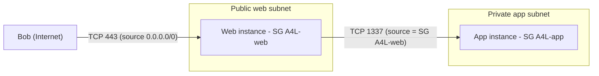

# Security Groups

> **TL;DR:** Security Group (SG) là firewall **stateful** gắn vào **network interface (ENI)**. Nó chỉ có rule allow (không có explicit deny), nhưng rule có thể trỏ tới **logical resource** như SG khác hoặc chính nó. Vì thế SG hợp với kiến trúc nhiều tầng và hệ thống auto scaling hơn [[NACL]].

## 🖼️ Sơ đồ
![[Security Groups.excalidraw]]
*Mở bằng plugin Excalidraw để chỉnh sửa · ảnh tĩnh: [[Security Groups.svg]]*

## Khái niệm cốt lõi
- **Stateful** (xem [[Stateful vs Stateless Firewalls]]): SG tự nhận ra traffic response của một request đã được cho phép. Allow request inbound thì response outbound tự đi qua, và ngược lại. Không phải mở ephemeral port (1024–65535) như với NACL.
  - Ví dụ: web server HTTPS chỉ cần **một** inbound rule `TCP 443` từ `0.0.0.0/0`, response về client tự được cho qua.
- **Không có explicit deny**. SG chỉ có:
  - allow tường minh;
  - **implicit deny**: không allow thì bị chặn.
  - Hệ quả: đã allow một dải (ví dụ `0.0.0.0/0`) thì **không thể chặn một IP con** trong dải đó, như IP của kẻ tấn công. Muốn chặn phải dùng [[NACL]].
- **Gắn vào ENI, không phải instance hay subnet.** Console cho chọn SG "cho instance", nhưng thực tế SG được gắn vào **primary ENI** của instance (xem [[EC2 Network Interfaces IPs and DNS]]). Đây là ý Adrian nhắc riêng cho kỳ thi.
- Có **inbound rules** và **outbound rules**. SG áp lên mọi traffic vào/ra ENI đó. Theo hình dung của bài giảng, SG "bao quanh" network interface.
- SG làm việc ở tầng cao hơn NACL trong [[OSI Model]] nên có nhiều tính năng hơn. Ngoài IP/CIDR, rule còn tham chiếu được **logical resource** của AWS: SG khác, hoặc chính SG đó (self-reference).

## Cách hoạt động / Kiến trúc

### 1. Rule cơ bản theo IP/CIDR
Bob truy cập web instance trong public subnet qua TCP 443. SG `A4L-web` có inbound rule: `TCP 443` từ `0.0.0.0/0`. Response từ instance về Bob tự được cho qua vì SG stateful. Nếu Bob là kẻ xấu thì SG không giúp được, vì không có cách viết rule "deny IP của Bob".

### 2. Tham chiếu SG khác (logical reference)
Kiến trúc 2 tầng: web instance (public subnet, SG `A4L-web`) cần gọi app instance (private subnet, SG `A4L-app`) qua TCP 1337.

Có ba cách mở traffic:
1. Đưa IP của web instance vào SG app. Cách này gãy ngay khi IP đổi hoặc khi scale.
2. Đưa CIDR của web subnet vào SG app. Chạy được nhưng rộng hơn cần thiết.
3. **Dùng chính SG `A4L-web` làm source** trong inbound rule của `A4L-app`. Đây là cách tốt nhất.

- Khi SG X làm source trong rule, nghĩa là **"mọi resource đang gắn SG X"**, không phải chỉ SG X với tư cách một object.
- Lợi ích:
  - Không phải quản lý IP hay CIDR.
  - **Scale tự động**: instance mới gắn `A4L-web` được phép gọi app ngay, instance mới gắn `A4L-app` được bảo vệ ngay.
  - Giảm công quản trị và lỗi cấu hình ở ứng dụng nhiều tầng.

### 3. Self-reference
Trong một private subnet, số app instance thay đổi liên tục (1, 3 hay 30 instance tùy tải, ví dụ do [[Auto Scaling Groups]] thêm hoặc bớt). SG `A4L-app` có thể có:
- Rule `All traffic` với source **chính `A4L-app`**: mọi instance gắn SG này nói chuyện tự do với nhau.
- Rule `TCP 1337` với source `A4L-web`: nhận request từ tầng web.

"Self reference" nghĩa là "bất cứ thứ gì đang gắn SG này". Rule tự áp dụng khi instance được **thêm hoặc bớt** khỏi SG và tự xử lý việc **IP thay đổi**. Use case: giao tiếp nội bộ ứng dụng như Microsoft Domain Controllers (xem [[Directory Service]]) hay cluster HA của ứng dụng.

## Bảng số liệu nhanh
| Thuộc tính | Security Group |
|---|---|
| Trạng thái | Stateful |
| Gắn vào | ENI (gián tiếp: EC2, RDS, Lambda trong VPC, ELB...) |
| Loại rule | Chỉ allow, cộng implicit deny |
| Source/Destination | IP, CIDR, SG khác, chính nó (và prefix list) |
| Thứ tự rule | Không có thứ tự, xét toàn bộ rule cùng lúc |
| Mặc định của SG mới tạo | Không có inbound rule (chặn hết inbound), outbound allow all *(bổ sung theo tài liệu AWS, bài giảng không nói)* |

> Bổ sung ngoài bài giảng: mặc định mỗi SG có tối đa 60 inbound + 60 outbound rule, và mỗi ENI gắn được tối đa 5 SG. Cả hai quota đều tăng được.

## 🎯 Mẹo thi SAA-C03
- **SG gắn vào ENI**, không gắn vào instance hay subnet. Gặp đáp án "gắn SG vào subnet" thì loại.
- **SG không có explicit deny.** Đề hỏi "chặn một IP/dải IP độc hại cụ thể" thì đáp án là **[[NACL]]** (deny rule), không phải SG.
- Mô hình chuẩn: **SG để allow** traffic tới resource, **NACL để deny** bad actor. Hai thứ dùng cùng nhau, xem [[Compare - Security Groups vs NACL]].
- SG **stateful**: không cần rule cho ephemeral port của response. Đề mô tả việc phải mở 1024–65535 outbound thì đang nói về NACL.
- Tầng app chỉ nên nhận từ tầng web: chọn **tham chiếu SG của tầng web làm source**, không hard-code IP hay CIDR. Đây là đáp án scale tốt và ít tốn công quản trị nhất.
- Các instance cùng nhóm cần nói chuyện với nhau (cluster, ASG) thì dùng **self-referencing SG**.
- [[NAT Gateway]] **không gắn được SG**. Chỉ lọc được bằng NACL trên subnet chứa nó (xem [[NAT Gateway]]).

## Liên kết
- Tiên quyết: [[Stateful vs Stateless Firewalls]], [[Layer 4 Transport]], [[VPC Subnets]], [[EC2 Network Interfaces IPs and DNS]]
- Liên quan: [[NACL]], [[Bastion Host]], [[Auto Scaling Groups]], [[NAT Gateway]], [[Elastic Load Balancer]]
- Phân biệt với: [[Compare - Security Groups vs NACL]], [[Layer 7 Firewall]], [[WAF]]
- Section: [[_MOC 06 VPC Basics]]
