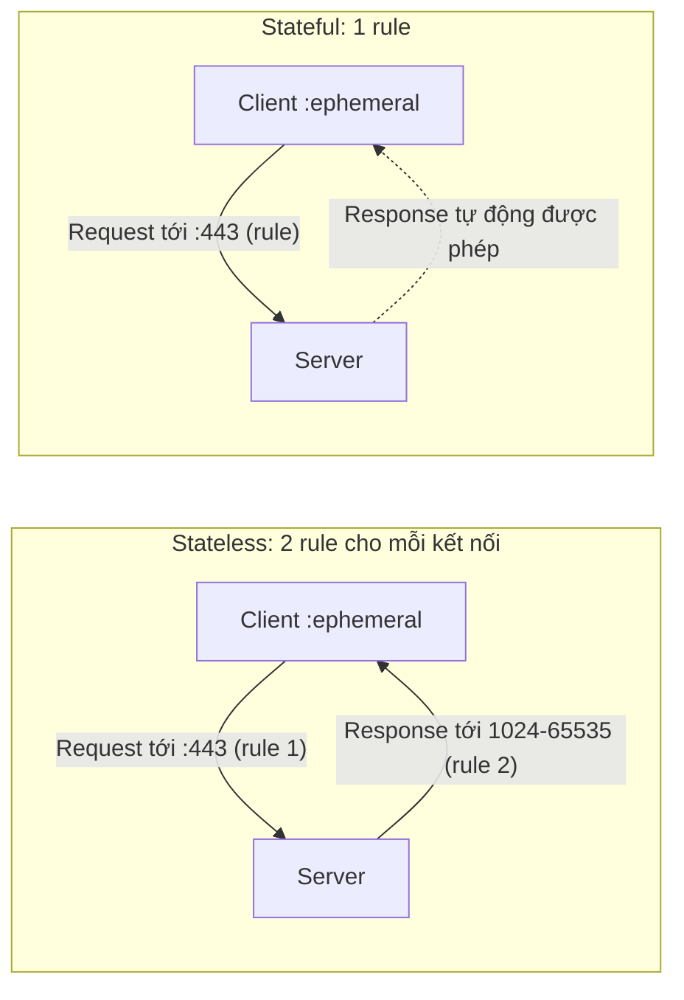

# Stateful vs Stateless Firewalls

> **TL;DR:** Mỗi kết nối TCP gồm hai phần: **request** (client → server, tới well-known port) và **response** (server → client, tới ephemeral port). Firewall **stateless** coi hai phần là độc lập nên cần **2 rule** và phải mở cả dải ephemeral port. Firewall **stateful** nhận ra response thuộc request nào nên **chỉ cần cho phép request**. Trên AWS: [[NACL]] là stateless, [[Security Groups]] là stateful.

## 🖼️ Sơ đồ
![[Stateful vs Stateless Firewalls.excalidraw]]
*Mở bằng plugin Excalidraw để chỉnh sửa · ảnh tĩnh: [[Stateful vs Stateless Firewalls.svg]]*

## Khái niệm cốt lõi
- TCP (Layer 4) chạy trên IP (Layer 3), bổ sung kiểm soát lỗi và **port**. Ví dụ HTTP = TCP/80, HTTPS = TCP/443 (xem [[Layer 4 Transport]]).
- Một "kết nối" mà con người thấy thực chất là hai luồng gói tin:
  - **Request**: client chọn một **ephemeral port** (cổng tạm, thường **1024–65535**, tùy OS) làm source port, gửi tới **well-known port** của server (ví dụ 443).
  - **Response**: server gửi ngược từ well-known port về **IP và ephemeral port** của client.
- Bộ bốn **source IP, source port, destination IP, destination port** xác định duy nhất một kết nối.

### Hướng đi phụ thuộc góc nhìn
Ví dụ Bob (119.18.36.73, port 13337) truy cập server Catagram (1.3.3.7:443):

| Phần | Gói tin | Góc nhìn client | Góc nhìn server |
|---|---|---|---|
| Request | SRC 119.18.36.73:13337 → DST 1.3.3.7:443 | **Outbound** | **Inbound** |
| Response | SRC 1.3.3.7:443 → DST 119.18.36.73:13337 | **Inbound** | **Outbound** |

- "Inbound hay outbound?" là câu hỏi bẫy: **cả hai**, tùy đứng ở đâu.
- Response luôn **ngược chiều** với request, nhưng request không phải lúc nào cũng inbound. Ví dụ web server **nhận** request từ khách (inbound) nhưng cũng **gửi** request đi khi tự cập nhật phần mềm (outbound, và response cập nhật thì inbound).
- Mẹo: luôn **xác định chiều của request trước**, response tự suy ra.

## Cách hoạt động / Kiến trúc

### Stateless firewall
- Không hiểu trạng thái kết nối ⇒ request và response là **hai luồng riêng**, cần **hai rule** (một inbound, một outbound) cho mỗi kết nối.
- Server vừa nhận kết nối (web) vừa khởi tạo kết nối (update) ⇒ cần các cặp rule **ngược nhau** cho từng loại: rule outbound có thể là response (của web) hoặc request (của update), inbound cũng vậy.
- Request luôn tới **well-known port** (dễ viết rule cụ thể). Nhưng response đi tới **ephemeral port ngẫu nhiên**; firewall không biết port nào ⇒ thường phải **mở toàn bộ dải ephemeral** (ví dụ TCP 1024–65535) tới mọi đích. Điều này làm dân bảo mật khó chịu.
- Quản trị nặng hơn, dễ sai hơn.

### Stateful firewall
- Đủ thông minh để **liên kết response với request** (cùng IP và port, chỉ đảo chiều).
- **Cho phép request (inbound hoặc outbound) ⇒ response tự động được cho phép.**
- Không cần mở cả dải ephemeral: firewall biết chính xác port nào đang dùng.
- Ít overhead quản trị, ít lỗi.

## Bảng so sánh / số liệu

| Tiêu chí | Stateless | Stateful |
|---|---|---|
| Hiểu trạng thái kết nối | Không | Có |
| Số rule cho mỗi kết nối | 2 (request + response) | 1 (chỉ request) |
| Dải ephemeral port | Thường phải mở toàn bộ | Không cần, tự cho phép đúng port |
| Overhead quản trị | Cao | Thấp |
| Ví dụ trên AWS | [[NACL]] | [[Security Groups]] |

## 🎯 Mẹo thi SAA-C03
- **NACL = stateless**, **Security Group = stateful**. Đây là điểm khác biệt số một (xem [[Compare - Security Groups vs NACL]]).
- Đề kiểu "đã cho phép inbound 443 trên NACL mà client không nhận được phản hồi" ⇒ thiếu rule **outbound cho ephemeral ports (1024–65535)** trên NACL.
- Với security group: chỉ cần rule cho request; **không** cần thêm rule outbound cho response.
- Luôn bắt đầu bằng câu hỏi "request đi theo chiều nào, tới port nào", rồi suy ra response.

## Liên kết
- Tiên quyết: [[Layer 4 Transport]], [[Layer 3 Network]], [[OSI Model]]
- Áp dụng trên AWS: [[NACL]], [[Security Groups]]
- So sánh: [[Compare - Security Groups vs NACL]]
- Liên quan: [[Layer 7 Firewall]], [[NAT Fundamentals]]
- MOC: [[_MOC 06 VPC Basics]]
