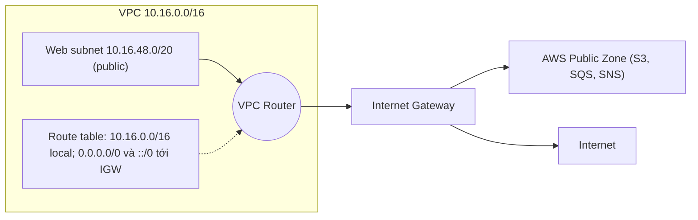
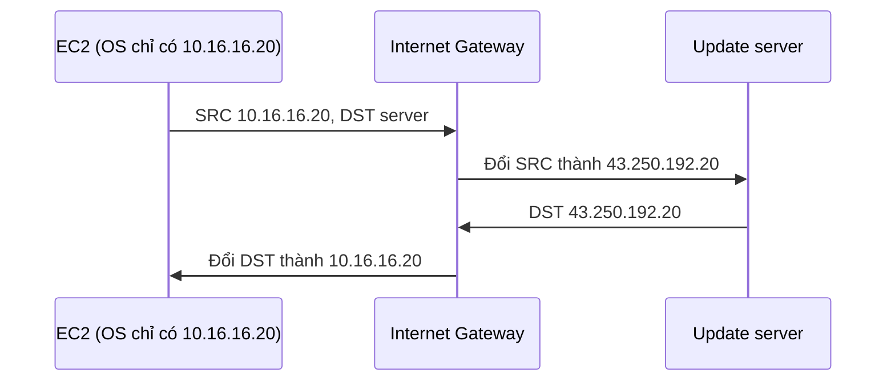

# VPC Routing and Internet Gateway

> **TL;DR:** Mỗi VPC có một **VPC Router** sẵn có, HA, điều khiển bằng **route table** gắn vào subnet. **Internet Gateway (IGW)** là cổng **regionally resilient** nối VPC với internet và AWS public zone. Subnet trở thành **public** khi có route mặc định trỏ tới IGW và tài nguyên trong đó có public IP. Public IPv4 **không bao giờ nằm trong OS** của instance: IGW làm static NAT 1:1.

## 🖼️ Sơ đồ
![[VPC Routing and Internet Gateway.excalidraw]]
*Mở bằng plugin Excalidraw để chỉnh sửa · ảnh tĩnh: [[VPC Routing and Internet Gateway.svg]]*

![[VPC Routing and Internet Gateway - static NAT.excalidraw]]
*Mở bằng plugin Excalidraw để chỉnh sửa · ảnh tĩnh: [[VPC Routing and Internet Gateway - static NAT.svg]]*

## VPC Router
- Có trong **mọi VPC** (default hay custom), **highly available**, chạy trên mọi AZ mà VPC dùng; không phải lo về availability.
- Có một interface trong **mọi subnet**, tại địa chỉ **network + 1** (xem [[VPC Subnets]]).
- Mặc định (chưa cấu hình gì) router chỉ chuyển traffic **giữa các subnet trong VPC**.
- Điều khiển bằng **route table**: route table gắn với subnet quyết định router làm gì với traffic **khi nó rời subnet đó**.

## Route Table
- Mỗi VPC có một **main route table**. Subnet không được gắn route table nào rõ ràng sẽ dùng main route table.
- Gắn một custom route table vào subnet ⇒ subnet đó **thôi dùng main route table**.
- **1 subnet ⇒ đúng 1 route table** tại một thời điểm; **1 route table ⇒ 0..nhiều subnet**.
- Route table là danh sách route, mỗi route có **Destination** và **Target**.
- Cách chọn route: router đọc **địa chỉ đích** của gói tin rời subnet, tìm mọi route có destination khớp:
  - khớp đúng một IP (**/32**), khớp cả một mạng (ví dụ /16), hoặc **default route** `0.0.0.0/0` (IPv4) / `::/0` (IPv6) khớp mọi thứ;
  - nhiều route cùng khớp ⇒ **prefix dài hơn (cụ thể hơn) thắng** (longest prefix match); /32 ưu tiên cao nhất.
- **Target**: hoặc là một AWS gateway (IGW, NAT gateway, peering, VGW...), hoặc là `local` (đích nằm trong VPC, router chuyển thẳng).
- **Local route**:
  - luôn có trong mọi route table, khớp CIDR IPv4 của VPC (và CIDR IPv6 nếu có ⇒ thêm một local route IPv6);
  - **không xóa được**, và theo khóa học là **luôn được ưu tiên**, ngoại lệ của quy tắc longest prefix.
  - (Cập nhật: từ 2021 AWS cho phép thêm route cụ thể hơn cho một subnet CIDR trong VPC, trỏ tới appliance hoặc [[Gateway Load Balancer]] endpoint, để kiểm tra traffic giữa các subnet. Đó là kịch bản nâng cao; ở mức bài này cứ nhớ local route luôn có và không xóa được.)

## Internet Gateway (IGW)
- **Region resilient**: một IGW phủ **mọi AZ** của VPC, **không cần một IGW cho mỗi AZ** (bẫy thi rất hay gặp).
- Quan hệ **1:1**: một VPC có **0 hoặc 1** IGW; một IGW gắn với **0 hoặc 1** VPC. IGW có thể tạo ra mà chưa gắn (trạng thái *detached*).
- Chạy ở **biên giữa VPC và AWS Public Zone**, chuyển traffic giữa VPC với **internet** hoặc **AWS public services** (S3, SQS, SNS...) (xem [[AWS Public vs Private Services]]).
- **Managed**: AWS lo hiệu năng và HA.

### Các bước làm subnet thành public
1. Tạo IGW.
2. Gắn (attach) IGW vào VPC.
3. Tạo custom route table.
4. Associate route table với subnet (ví dụ các subnet web).
5. Thêm default route `0.0.0.0/0` (và `::/0` cho IPv6) với target là IGW.
6. Bật cho subnet **auto-assign public IPv4** (và IPv6 nếu dùng).

## IPv4 public address hoạt động thế nào (rất hay ra thi)
- Instance có private IP (ví dụ 10.16.16.20) và được cấp public IPv4 (ví dụ 43.250.192.20).
- **OS của instance chỉ biết private IP.** Public IPv4 không bao giờ chạm tới instance. Khi cấp public IP, IGW lưu một bản ghi ánh xạ **private IP ↔ public IP** (static NAT 1:1).

- Server bên ngoài chỉ thấy địa chỉ 43.250.192.20 và không biết gì về private IP.
- **IPv6** thì khác: mọi IPv6 của AWS đều publicly routable, **OS được cấu hình chính địa chỉ IPv6 đó**, IGW chỉ chuyển gói qua lại, **không dịch địa chỉ**.
- (Cập nhật: từ 02/2024 AWS tính phí mọi public IPv4, kể cả IP tự động cấp; thêm lý do để cân nhắc IPv6.)

## Bảng so sánh / số liệu

| Thành phần | Phạm vi resilience | Quan hệ |
|---|---|---|
| VPC Router | Mọi AZ của VPC, HA | 1 per VPC, interface ở mọi subnet (network+1) |
| Route table | Gắn với subnet | 1 subnet ↔ 1 RT; 1 RT ↔ nhiều subnet |
| Internet Gateway | **Region** | 1 VPC ↔ 0/1 IGW |
| Subnet | **AZ** | 1 subnet ↔ 1 AZ |

## Demo / Lab
**Phần 1: làm tier web thành public**
- Bắt đầu từ VPC A4L với 12 subnet private (có [[CloudFormation Basics|CloudFormation]] template để dựng lại nếu cần).
- Tạo IGW `a4l-vpc1-igw` (lúc đầu ở trạng thái *detached*) → Actions → **Attach to VPC** `a4l-vpc1`. (Default VPC đã có sẵn IGW; custom VPC phải tự làm.)
- Tạo route table `a4l-vpc1-rt-web` trong VPC → **Subnet associations**: chọn sn-web-A/B/C (chúng rời main route table).
- Tab Routes: đã có 2 local route (IPv4 và IPv6 CIDR của VPC). Thêm `0.0.0.0/0` → IGW và `::/0` → IGW. Vì /16 cụ thể hơn /0, chỉ traffic **ra ngoài VPC** mới đi theo default route.
- Với từng subnet web: Edit subnet settings → **Enable auto-assign public IPv4 address**.

**Phần 2: kiểm tra bằng bastion**
- Launch EC2 `a4l-bastion` (Amazon Linux, t2/t3.micro free tier) vào **sn-web-A**, auto-assign public IP và IPv6 đều Enable; tạo SG `a4l-bastion-sg` cho SSH từ `0.0.0.0/0` và `::/0`.
- Instance có public IPv4, private IPv4, public và private DNS name (nhờ bật DNS hostnames ở [[Custom VPC]]).
- Kết nối: **EC2 Instance Connect** (web console, cần public IPv4) hoặc **SSH client** (`ssh -i a4l.pem ec2-user@<public DNS>`; trên macOS/Linux phải `chmod 400` file key nếu báo "permissions too open"). Cách thứ ba, **Session Manager**, không cần public IP và sẽ học sau. Chi tiết ở [[EC2 Instance Connect and SSH]] và [[Bastion Host]].
- Dọn dẹp: terminate instance, rồi **xóa VPC** (xóa luôn IGW, route table, subnet đi kèm). Các bài sau dựng lại bằng template.

## 🎯 Mẹo thi SAA-C03
- IGW là **regional**: đáp án "tạo một IGW cho mỗi AZ" là **sai**. Một VPC chỉ có tối đa **1 IGW**.
- Đề hỏi "subnet public cần gì" ⇒ IGW gắn VPC **+** route `0.0.0.0/0` tới IGW trong route table của subnet **+** public IP (hoặc Elastic IP). Thiếu một trong ba ⇒ không ra internet.
- **Không cấu hình public IPv4 trong OS**: đáp án bảo gán public IP vào card mạng trong hệ điều hành là sai. OS chỉ thấy private IP; IGW làm NAT.
- IPv6: không có NAT, OS có địa chỉ IPv6 thật. Muốn IPv6 **chỉ đi ra** (outbound-only) ⇒ [[Egress-Only Internet Gateway]].
- Route selection: **longest prefix match**; local route luôn có, không xóa được.
- Subnet không gắn route table rõ ràng ⇒ dùng **main route table**. Cẩn thận khi thêm route ra IGW vào main RT, vì mọi subnet "mặc định" sẽ thành public.
- Instance private cần ra internet (update) mà không nhận kết nối vào ⇒ [[NAT Gateway]], không phải IGW trực tiếp.

## Liên kết
- Tiên quyết: [[VPC Subnets]], [[Custom VPC]], [[Layer 3 Network]], [[NAT Fundamentals]]
- Dùng cùng: [[Bastion Host]], [[Security Groups]], [[NACL]]
- Tiếp theo / mở rộng: [[NAT Gateway]], [[Egress-Only Internet Gateway]], [[Gateway VPC Endpoints]], [[VPC Peering]], [[Transit Gateway]]
- Liên quan: [[AWS Public vs Private Services]], [[EC2 Network Interfaces IPs and DNS]], [[Gateway Load Balancer]]
- MOC: [[_MOC 06 VPC Basics]]
