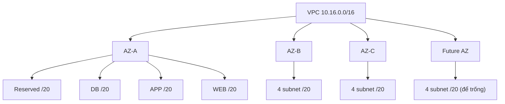

# VPC Sizing and Structure

> **TL;DR:** Trước khi tạo VPC phải có **IP plan**: chọn dải CIDR không trùng với mọi mạng mình có thể phải nói chuyện (VPC khác, cloud khác, on-prem, đối tác), đủ lớn cho tăng trưởng, rồi chia VPC theo **AZ × tier** thành các subnet. Sửa IP plan về sau rất đau, nên làm đúng từ đầu.

## 🖼️ Sơ đồ
![[VPC Sizing and Structure.excalidraw]]
*Mở bằng plugin Excalidraw để chỉnh sửa · ảnh tĩnh: [[VPC Sizing and Structure.svg]]*

![[VPC Sizing and Structure - ip-plan.excalidraw]]
*Mở bằng plugin Excalidraw để chỉnh sửa · ảnh tĩnh: [[VPC Sizing and Structure - ip-plan.svg]]*

## Khái niệm cốt lõi
- Bài này không nói về cấu hình kỹ thuật mà về **thiết kế**: một solutions architect quyết định dải IP cho cả doanh nghiệp, rồi cho từng VPC. Sai ở bước này (chồng lấn dải, VPC quá nhỏ) sẽ cản trở peering, VPN, Direct Connect, migration về sau.
- Bốn câu hỏi xuất phát:
  1. VPC cần **kích thước** bao nhiêu? Mỗi service chiếm một hoặc nhiều IP trong VPC.
  2. Có **dải nào không được dùng**? Xét VPC khác, cloud khác (Azure, GCP), mạng on-premises, partner và vendor. Không chắc thì giả định trường hợp xấu nhất.
  3. **Dự đoán tương lai**: tình hình hiện tại quan trọng, nhưng doanh nghiệp sẽ thay đổi và lớn lên.
  4. **Cấu trúc** VPC: chia theo **tier** (web, app, db...) và theo **resiliency zone** (Availability Zone).
- Giới hạn kích thước VPC (IPv4): nhỏ nhất **/28 = 16 IP**, lớn nhất **/16 = 65,536 IP**.
- Chồng lấn (overlapping) dải IP làm cho việc kết nối mạng giữa hai bên rất khó hoặc không thể (xem [[VPC Peering]], [[Site-to-Site VPN]]).

## Ví dụ Animals4life: các dải phải tránh
Bối cảnh từ [[Animals4life Scenario]]. Các mạng đã biết và không được dùng hoặc chồng lấn:

| Dải | Thuộc về | Phạm vi |
|---|---|---|
| 192.168.10.0/24 | On-prem Brisbane | 192.168.10.0 → 192.168.10.255 |
| 10.0.0.0/16 | AWS pilot cũ | 10.0.0.0 → 10.0.255.255 |
| 172.31.0.0/16 | Azure pilot | 172.31.0.0 → 172.31.255.255 |
| 192.168.15.0/24 | Văn phòng London | .15.0 → .15.255 |
| 192.168.20.0/24 | Văn phòng New York | .20.0 → .20.255 |
| 192.168.25.0/24 | Văn phòng Seattle | .25.0 → .25.255 |
| 10.128.0.0/9 | Google Cloud (dải mặc định, vendor không xác nhận được) | 10.128.0.0 → 10.255.255.255 |

- /9 là nửa của /8: nửa trên của 10.x, tức từ 10.128 đến 10.255. Tập đọc nhanh "network address + prefix ⇒ điểm cuối của dải" (xem [[Subnetting]], [[Decimal and Binary Conversion]]).
- 172.31.0.0/16 cũng chính là dải của **[[Default VPC]]** ⇒ thêm một lý do không dùng default VPC cho production.

## Cách chọn dải: quy tắc của Adrian
- Ưu tiên dải **10.x.y.z**. Với VPC tối đa /16 thì mỗi VPC "tròn" là 10.1, 10.2, ..., 10.255.
- **Tránh dải phổ biến**: 10.0 (mặc định của mọi thứ), 10.1 (người ta chọn khi muốn tránh 10.0), an toàn hơn thì tránh luôn tới 10.10. Bắt đầu từ **10.16** (số đẹp, base 2).
- Trừ thêm 10.128–10.255 vì có thể là GCP ⇒ không gian dùng được: **10.16 → 10.127**.
- Tính số dải cần: số region tối đa doanh nghiệp có thể dùng (cộng buffer) × **ít nhất 2 dải mỗi region** × số account.
  - A4L: 3 region US + 1 Europe + 1 Australia = 5 region; ×2 = 10; × 4 account (general, prod, dev + 1 dự phòng) = **40 dải** (lý tưởng).

## Phân bổ thực tế cho A4L

| Khối /16 | Dành cho |
|---|---|
| 10.0 – 10.15 | Dải phổ biến, tránh |
| 10.16 – 10.31 | US Region 1 |
| 10.32 – 10.47 | US Region 2 |
| 10.48 – 10.63 | US Region 3 |
| 10.64 – 10.79 | Europe |
| 10.80 – 10.95 | Australia |
| 10.96 – 10.127 | Chưa dùng |
| 10.128 – 10.255 | Có thể là GCP, tránh |

- Mỗi region có 16 khối /16, chia đều cho 4 account (general, prod, dev, reserved) ⇒ **mỗi account mỗi region có 4 khối /16 = 4 VPC không chồng lấn**.
  - Ví dụ US Region 1: 10.16–10.19 general (VPC1..VPC4), 10.20–10.23 prod, 10.24–10.27 dev, 10.28–10.31 reserved.
- VPC đầu tiên của account general ở US Region 1 = **10.16.0.0/16**, chính là VPC dùng trong [[Custom VPC]].

## Cấu trúc bên trong VPC: AZ × Tier
- Service không chạy "trong VPC" trực tiếp mà chạy **trong subnet**, và **mỗi subnet nằm trong đúng một AZ** (xem [[VPC Subnets]]).
- Bước 1: chọn số AZ. Mặc định **3 AZ** (gần như region nào cũng có) **+ 1 dự phòng** ⇒ 4.
- Bước 2: chọn số tier. Mặc định **web, app, db + 1 spare** ⇒ 4.
- Mỗi tier có một subnet trong mỗi AZ ⇒ **4 × 4 = 16 subnet**.
- Chia một dải thành 16 phần thì prefix tăng 4 bit: /16 → /17 (2 mạng), /18 (4), /19 (8), **/20 (16)**. Quy tắc nhớ: **prefix subnet = prefix VPC + 4**.
  - VPC /16 ⇒ subnet /20 (4,096 IP, dùng được **4,091** vì AWS giữ 5 IP mỗi subnet).
  - VPC /17 ⇒ subnet /21; VPC /18 ⇒ subnet /22...
- Khi đã cố định số subnet, chọn kích thước VPC chỉ còn là câu hỏi **cần bao nhiêu capacity**.

## Bảng so sánh / số liệu
Bảng gợi ý kích thước VPC của AWS (bài giảng nêu hai đầu micro và extra large; các hàng giữa là cùng cách tính, 8 subnet mỗi VPC):

| Size | VPC | Subnet | IP dùng được/subnet | Tổng IP dùng được |
|---|---|---|---|---|
| Micro | /24 | /27 (8 subnet) | 27 | 216 |
| Small | /21 | /24 (8 subnet) | 251 | 2,008 |
| Medium | /19 | /22 (8 subnet) | 1,019 | 8,152 |
| Large | /18 | /21 (8 subnet) | 2,043 | 16,344 |
| Extra Large | /16 | /20 (16 subnet) | 4,091 | ~65,456 |

Hai câu hỏi khi chọn: cần bao nhiêu subnet mỗi VPC, và cần bao nhiêu IP tổng cộng và mỗi subnet.

## Quy trình tổng quát
1. Thu thập nhu cầu kinh doanh: văn phòng, region, account, khả năng tăng trưởng.
2. Liệt kê và loại các dải không được dùng.
3. Chia phần còn lại theo bố cục vật lý/logic (region → account → VPC).
4. Quyết định cấu trúc VPC và subnet (AZ × tier).

Có thể đi **top-down** (từ nhu cầu doanh nghiệp xuống) hoặc **bottom-up** (từ kích thước subnet tối thiểu đi lên).

## 🎯 Mẹo thi SAA-C03
- Nhớ cứng: **VPC IPv4 tối thiểu /28 (16 IP), tối đa /16 (65,536 IP)**.
- Câu hỏi về peering/VPN/hybrid không chạy được: nghĩ ngay tới **CIDR chồng lấn**. Đề hay yêu cầu chọn dải "không overlap" với on-prem hoặc VPC khác.
- Default VPC luôn dùng **172.31.0.0/16**, dễ trùng với mạng khác; không dùng cho production.
- Thiết kế HA: subnet cho mỗi tier ở **nhiều AZ**. Câu hỏi đếm subnet: số tier × số AZ.
- Tính IP dùng được trong subnet: luôn **trừ 5** (ví dụ /20 → 4,091; /27 → 27; /28 → 11).

## Liên kết
- Tiên quyết: [[Subnetting]], [[Layer 3 Network]], [[AWS Global Infrastructure]], [[Animals4life Scenario]]
- Tiếp theo: [[Custom VPC]], [[VPC Subnets]]
- Liên quan: [[Default VPC]], [[VPC Peering]], [[Site-to-Site VPN]], [[Transit Gateway]], [[HA vs FT vs DR]]
- MOC: [[_MOC 06 VPC Basics]]
